# Pickle — мессенджер для команд и близких кругов

> **GitHub:** [код](https://github.com/fso13/AthenaeumHub) · [issues/status](https://github.com/fso13/AthenaeumHub/issues/58) · [wiki](https://github.com/fso13/AthenaeumHub/wiki) · [STATUS.md](STATUS.md)

Концепция, бизнес-требования и интерактивный HTML-прототип. Бэкенд задуман на **Java 21 / Spring Boot**, фронтенд — на **TypeScript/JavaScript**; в прототипе — чистый JS без сборки и внешних зависимостей.

> **Один продукт — два режима:** конфиденциальный (E2EE, сервер не читает сообщения) и управляемый (DLP, аудит, корпоративный поиск). Плюс роли в чатах, стикеры, файлы с понятными лимитами и плагины с моделью разрешений.

---

## 📦 Что в репозитории

| Путь | Что это |
|---|---|
| [`docs/CONCEPT.md`](docs/CONCEPT.md) | Концепция и бизнес-требования: сегменты, сценарии, FR/NFR, матрица ролей, криптографическая модель, стикеры, лимиты файлов, архитектура, монетизация, roadmap, риски |
| [`docs/PROMPT-SYSTEM-ANALYSIS.md`](docs/PROMPT-SYSTEM-ANALYSIS.md) | Готовый промт для превращения концепции в системный анализ: C4, ERD, API, sequence, состояния, права, E2EE, лимиты, трассировка |
| [`design/index.html`](design/index.html) | Интерактивный прототип мессенджера на моках: личные и групповые чаты, роли, стикеры, файлы с лимитами, плагины, безопасность, темы, адаптив |
| [`design/styles.css`](design/styles.css) | Дизайн-система и все стили прототипа |
| [`design/app.js`](design/app.js) | Моки данных и вся интерактивность |
| [`design/assets/`](design/assets/) | Иллюстрации для сообщений и онбординга (SVG) |
| [`design/screenshots/`](design/screenshots/) | Скриншоты ключевых экранов |
| [`design/dashboard/`](design/dashboard/) | Концепция «Message Dashboard»: интерактивный макет, токены, спецификация и скриншоты |

---

## 🐳 Коробочный запуск

Полный стек (PostgreSQL, Keycloak, MinIO, backend, frontend/nginx) — в [`deploy/docker-compose.yml`](deploy/docker-compose.yml):

```bash
cd deploy
cp .env.example .env     # заменить секреты и при необходимости PUBLIC_URL
docker compose --env-file .env up -d --build
# → http://localhost:8088
```

Подробности, домен/TLS, ClamAV, сброс данных и ограничения — в [`deploy/README.md`](deploy/README.md). E2EE по умолчанию выключен (`KRUG_E2EE_ENABLED=false`).

---

## 🚀 Как открыть

Прототип не требует сборки, npm и интернета — все иконки и картинки встроены.

**Вариант 1.** Откройте [`design/index.html`](design/index.html) двойным кликом в браузере.

**Вариант 2.** Локальный сервер (если браузер ограничивает `file://`):

```bash
cd design
python3 -m http.server 8080
# → http://localhost:8080
```

> Демо использует только моки и `localStorage` для темы. Никакие данные никуда не отправляются.

---

## 🆕 Концепция «Message Dashboard»

Отдельное визуальное направление по мотивам
[Dribbble Shot 17943583](https://dribbble.com/shots/17943583-Message-Dashboard): рейл пространств, плотный
сайдбар, плоские сообщения без пузырей, правая панель профиля с обложкой и сеткой вложений, две темы,
мобильный drawer и нижний sheet профиля. Логотип-огурец заменён на простой пузырь чата — про командную
переписку. Внутри — продуктовая модель Pickle: управляемый контур с DLP и E2EE-пространство с ключами,
голосовые, аудио- и видеофайлы, запись с микрофона, **треды**, **карточки песен с ID3-метаданными**,
счётчики непрочитанных на пространствах с правилом **99+**, разделы «Обзор / Файлы / Плагины / Защита /
Настройки» и окна профиля и настроек чата.

[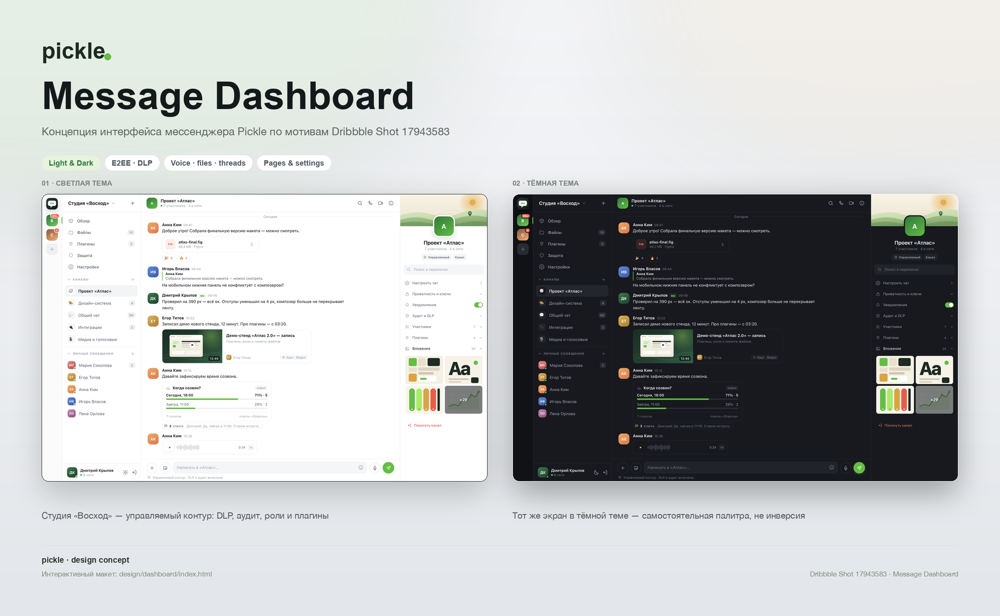](design/dashboard/index.html)

| Что | Где |
|---|---|
| Интерактивный макет | [`design/dashboard/index.html`](design/dashboard/index.html) |
| Спецификация: экраны, сетка, компоненты, внедрение | [`design/dashboard/DESIGN.md`](design/dashboard/DESIGN.md) |
| Токены (W3C Design Tokens) | [`design/dashboard/tokens.json`](design/dashboard/tokens.json) |
| Скриншоты | [светлая](design/dashboard/screenshots/desktop-light.png) · [тёмная](design/dashboard/screenshots/desktop-dark.png) · [голосовые и медиа](design/dashboard/screenshots/media-light.png) · [обзор](design/dashboard/screenshots/overview-light.png) · [файлы](design/dashboard/screenshots/files-light.png) · [настройки](design/dashboard/screenshots/settings-light.png) |
| Версия макета | **1.0.0**, заморожено 18.11.2026 · [VERSION](design/dashboard/VERSION.md) · [release zip](design/dashboard/releases/pickle-message-dashboard-v1.0.0.zip) |
| Тикет на разработку | [D1 — Message Dashboard v1.0](docs/TASKS-DASHBOARD-V1.md) |

| Голосовые, аудио и видео | Раздел «Файлы» |
|---|---|
| 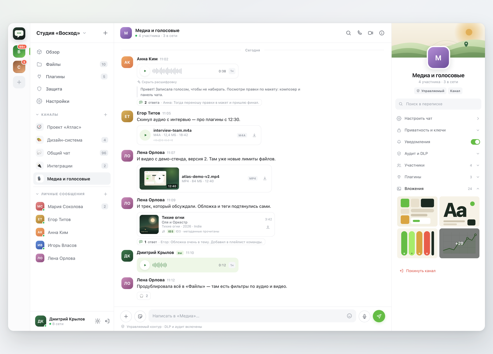 | 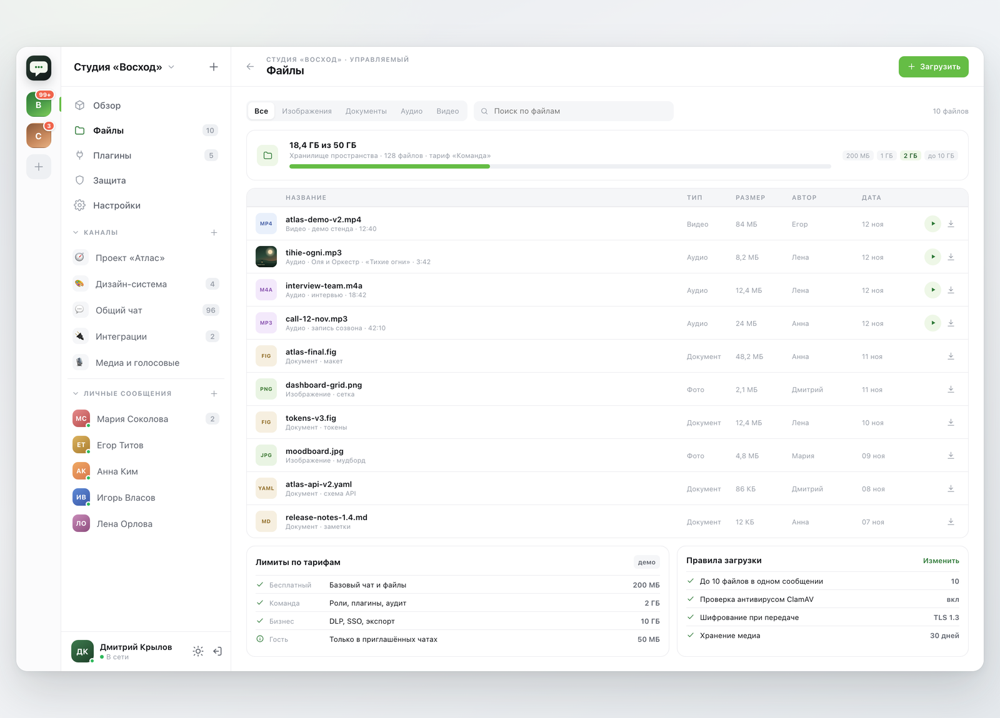 |

| Обзор пространства | Тред сообщения |
|---|---|
| 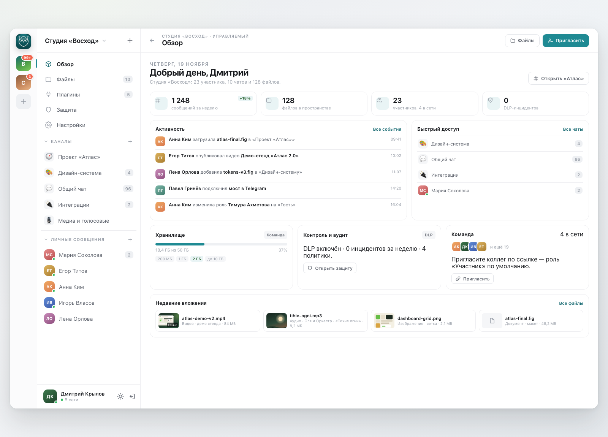 | 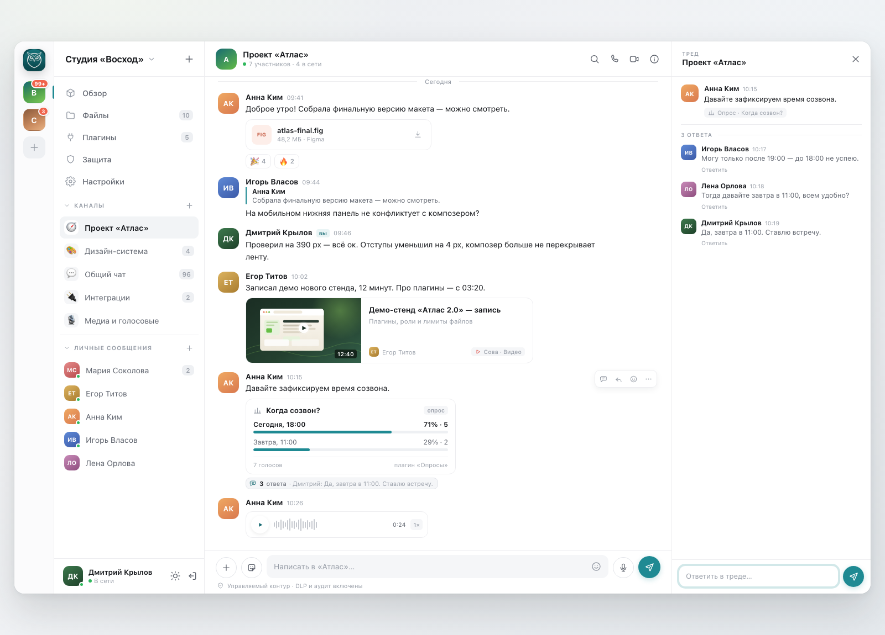 |

| Настройки чата | Профиль |
|---|---|
| 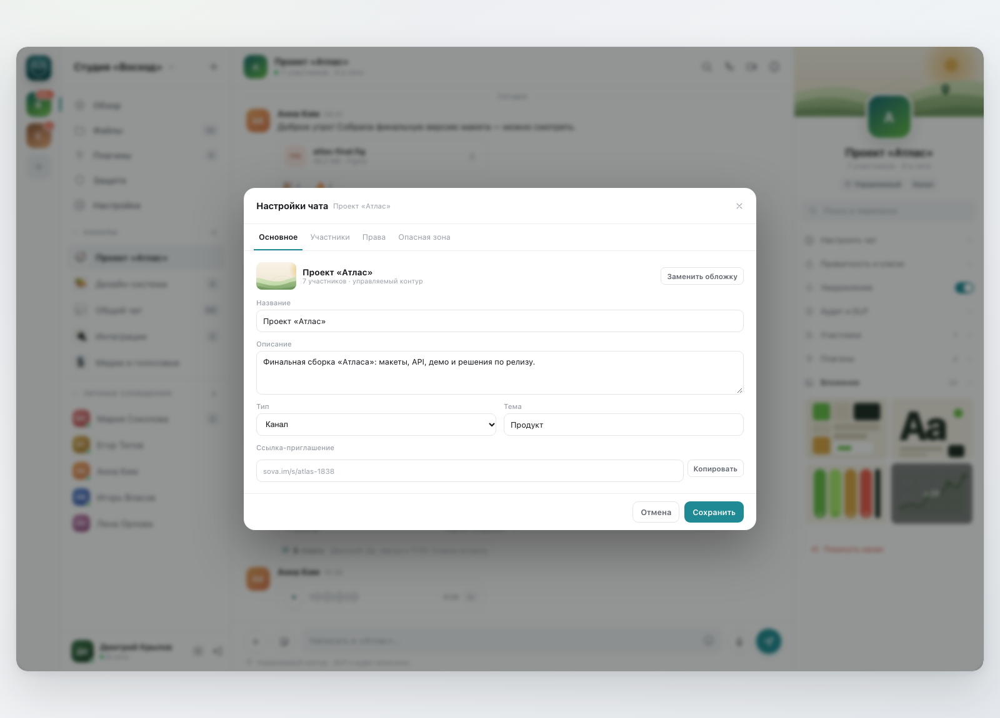 | 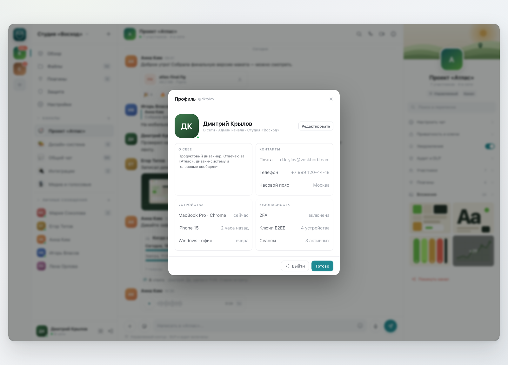 |

```bash
cd design/dashboard
python3 -m http.server 8080
# → http://localhost:8080
```

Состояния для показа: `?theme=dark`, `?chat=maria`, `?chat=media`, `?space=family&chat=family`,
`?view=overview|files|plugins|security|settings`, `?modal=profile`, `?modal=chat`, `?thread=5`,
`?recording=1`, `?details=0`, `?clean=1`. Это направление не заменяет прототип `design/index.html` — они существуют
параллельно.

---

## 🖼 Скриншоты прототипа «круг.»

| Светлая тема | Тёмная тема |
|---|---|
| 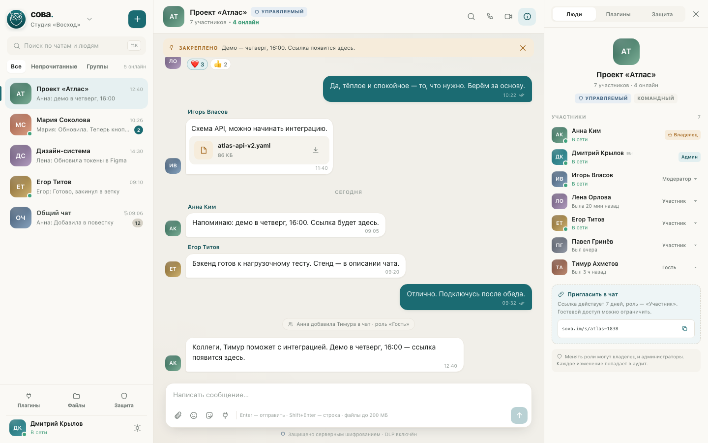 | 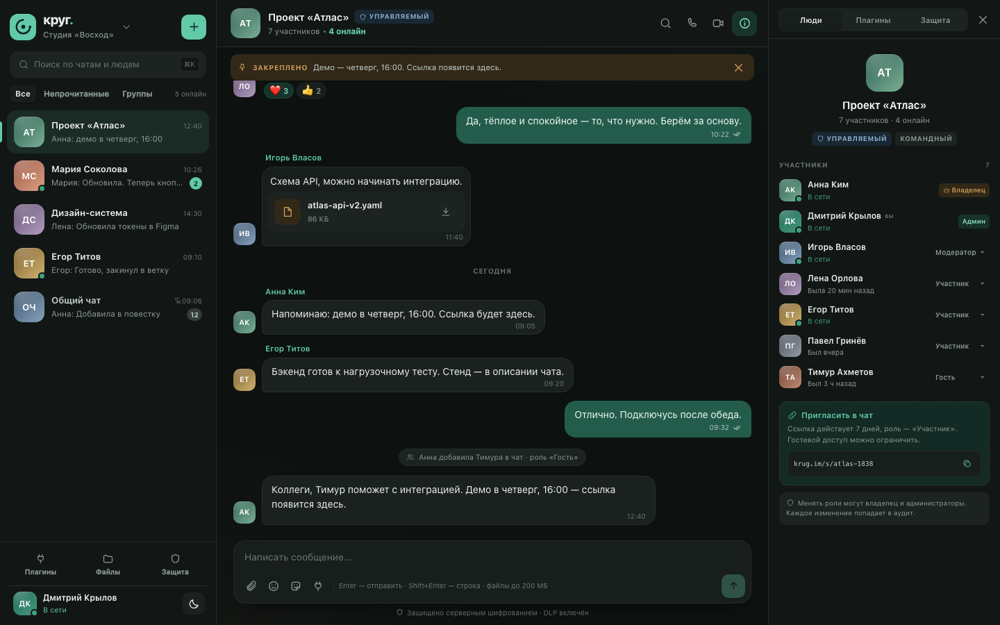 |

| Стикеры и пикер | Лимиты файлов |
|---|---|
| 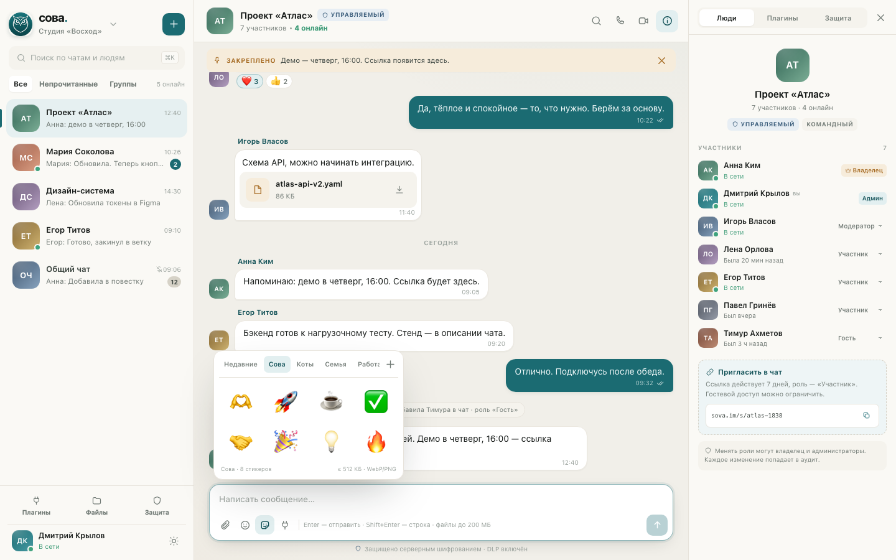 | 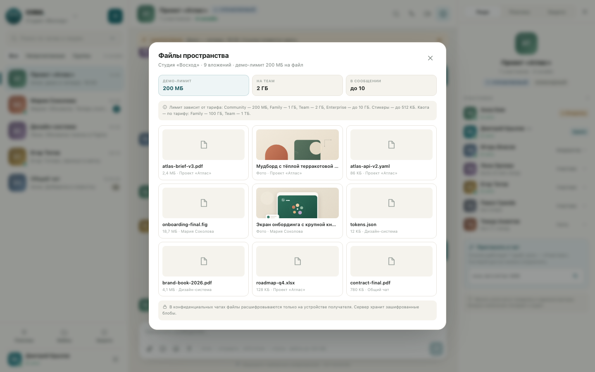 |

| Семья · E2EE и безопасность | Каталог плагинов |
|---|---|
| 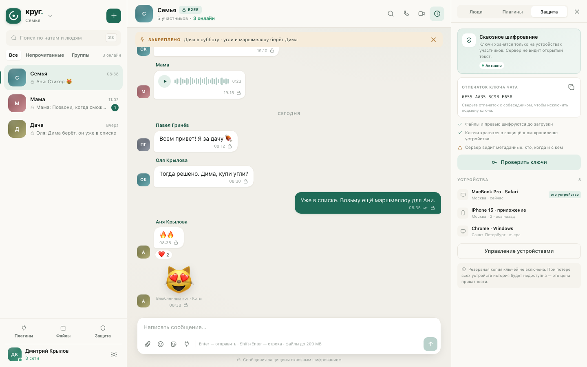 | 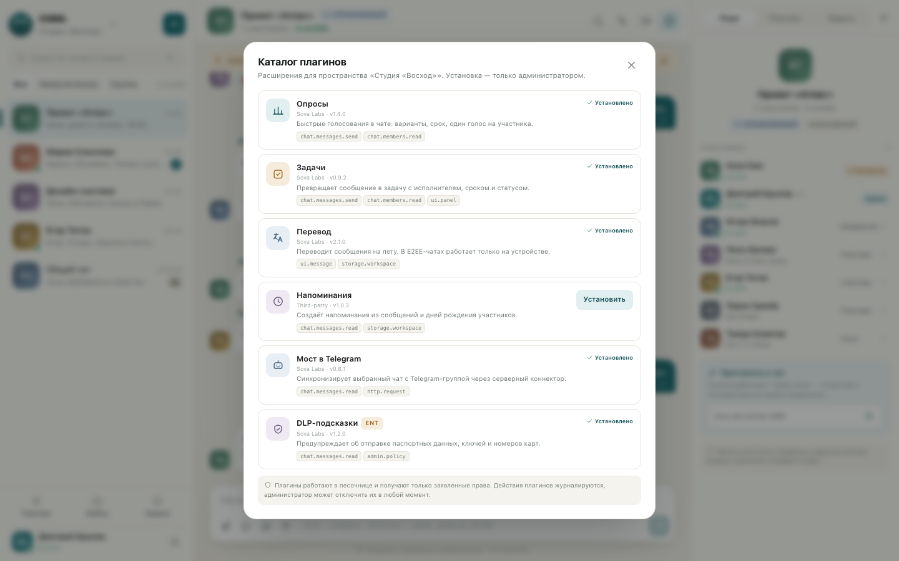 |

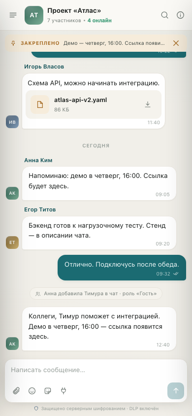

---

## 🧭 Что попробовать в прототипе

1. **Переключить пространство** — клик по логотипу «круг.» слева сверху:
   - **«Студия Восход»** — управляемый контур (серверное шифрование, DLP, аудит).
   - **«Семья»** — конфиденциальный контур (E2EE, ключи и отпечатки).
2. **Открыть групповой чат** «Проект Атлас» и панель справа:
   - вкладка **«Люди»** — роли (владелец / админ / модератор / участник / гость), смена роли, ссылка-приглашение;
   - вкладка **«Плагины»** — включение плагинов в конкретном чате, каталог, запрет серверных плагинов в E2EE;
   - вкладка **«Защита»** — режим, отпечаток ключа, проверка ключей, устройства, журнал аудита.
3. **Проверить ключи** в семейном чате: «Защита» → «Проверить ключи» → QR, safety number, кнопки сверки.
4. **Отправить сообщение** — Enter; собеседник «печатает…» и отвечает. Ответ, реакция и файл — через наведение на сообщение.
5. **Отправить стикер** — кнопка-стикер в композере: наборы «Недавние / Круг / Коты / Семья / Работа», наведение показывает подпись. В семейном чате уже есть стикер от Ани.
6. **Проверить лимиты файлов** — скрепка: в демо действует лимит **200 МБ**; файл больше отклоняется с понятным сообщением. В «Файлах» — таблица лимитов по тарифам и квота.
7. **Прикрепить обычный файл** — прогресс, «шифрование» и отправка.
8. **Создать опрос или задачу** — кнопка плагинов в композере (для чата, где они включены).
9. **Создать группу** — «+» в шапке списка чатов; выбрать участников и роли.
10. **Поиск** — по чатам в левой колонке, по сообщениям — иконка лупы в шапке чата; ⌘K/Ctrl+K фокусирует поиск.
11. **Файлы пространства** — кнопка «Файлы» внизу слева: галерея вложений и лимиты.
12. **Тема** — солнце/луна в профиле; **мобильная версия** — сузьте окно до 390 px, меню слева и панель «О чате» открываются поверх.

---

## 🗂 Демо-данные

- **Студия «Восход»** (managed): «Проект Атлас», «Дизайн-система», «Общий чат», личные чаты с Марией и Егором.
- **Семья** (E2EE): «Семья», «Дача», личный чат с мамой.
- **7 участников** в «Атласе» с разными ролями; владелец — Анна, вы — администратор.
- Плагины: «Опросы», «Задачи», «Перевод», «Мост в Telegram», «DLP-подсказки»; у каждого — permissions и ограничения по режиму.
- Стикеры: 4 набора по 8 штук; в семейном чате есть входящий стикер «Влюблённый кот».
- Файлы: демо-лимит 200 МБ; лимиты тарифов — 200 МБ / 1 ГБ / 2 ГБ / до 10 ГБ; в сообщении до 10 файлов.

---

## 🎨 Дизайн-решения

- **Тёплая нейтральная палитра** и глубокий зелёный акцент: корпоративно, но не холодно; одинаково уместно в семье и в студии.
- **Три колонки**: навигация и чаты → переписка → контекст. Правая панель складывается, на мобильных открывается поверх.
- **Безопасность видима, но не навязчива**: чип режима в шапке, статус в панели, отпечаток ключа, но без тревожных модалок.
- **Квадратные аватары-«сквирклы»** и мягкие тени — визуальный характер без потери плотности.
- **Стикеры — отдельный тип сообщения:** без пузыря, с крупным изображением, подписью и обычными реакциями/ответами.
- **Лимиты файлов видимы заранее:** в галерее, в подсказке композера и в ошибке при превышении, а не только в документации.
- **Тёмная тема** — самостоятельная палитра, а не инверсия.
- Все иллюстрации — SVG, сгенерированы для прототипа; шрифты системные.

---

## 🧱 Архитектурный замысел (кратко)

```
Web/PWA (TS) ── REST + WebSocket ── Spring Boot 3 (Java 21)
                                      ├─ Auth / сессии (Keycloak)
                                      ├─ Chat / Message / File
                                      ├─ Realtime Gateway
                                      ├─ Plugin Service + sandbox
                                      └─ Admin & Audit
PostgreSQL · Redis · S3/MinIO · Kafka/NATS · OpenSearch (managed)
```

- **Модульный монолит** на старте, выделение сервисов по нагрузке.
- **E2EE**: X25519 + Double Ratchet для 1:1, sender keys для групп; MLS — в v2.
- **Файлы и стикеры**: единый media pipeline — ключ на объект, шифрование на клиенте, сервер хранит только блобы; лимиты и квоты — в `workspace_limits`.
- **Плагины**: iframe-sandbox + RPC, capability-токены, permissions, подпись, allowlist; серверные коннекторы — только в managed-режиме.
- Детали, матрица прав, модель угроз и roadmap — в [`docs/CONCEPT.md`](docs/CONCEPT.md).

---

## ⚠️ Ограничения прототипа

Это **дизайн-прототип, а не готовый продукт**:

- нет бэкенда, авторизации и реального WebSocket;
- «шифрование» и «проверка ключей» — визуальная симуляция, криптография не реализована;
- данные живут в памяти вкладки; после перезагрузки сбрасываются (кроме темы);
- стикеры показаны эмодзи-моками; загрузка своих наборов и модерация — только в концепции;
- лимит 200 МБ действует только в демо; серверной проверки квот и докачки нет;
- звонки, SSO, админ-панель и мобильные приложения — только в концепции и roadmap;
- тексты, имена, файлы и переписка — вымышленные.

**Не используйте прототип для чувствительных данных.**

---

## 🔜 Следующие шаги

1. Согласовать сегмент и режим безопасности для пилота (студия vs IT-компания vs семья).
2. Зафиксировать MVP и криптографическую модель (ADR по E2EE и MLS).
3. Поднять каркас: Spring Boot + PostgreSQL + WebSocket + React/TS; один сквозной сценарий «чат + файл».
4. Собрать 3–5 pilot-воркспейсов и проверить метрики активации.
5. Отдельно спроектировать sandbox плагинов и журнал аудита — до открытия каталога.

---

*Рабочее название «Круг» требует проверки на товарный знак. Цены, сроки и метрики — гипотезы для валидации.*
