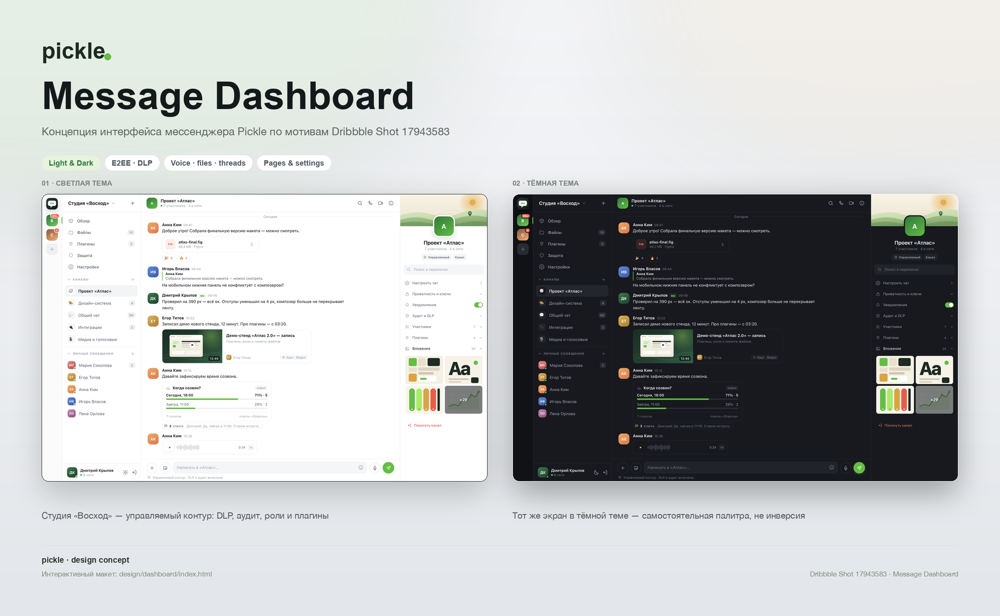
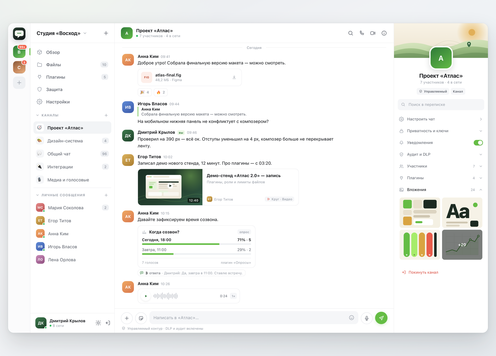
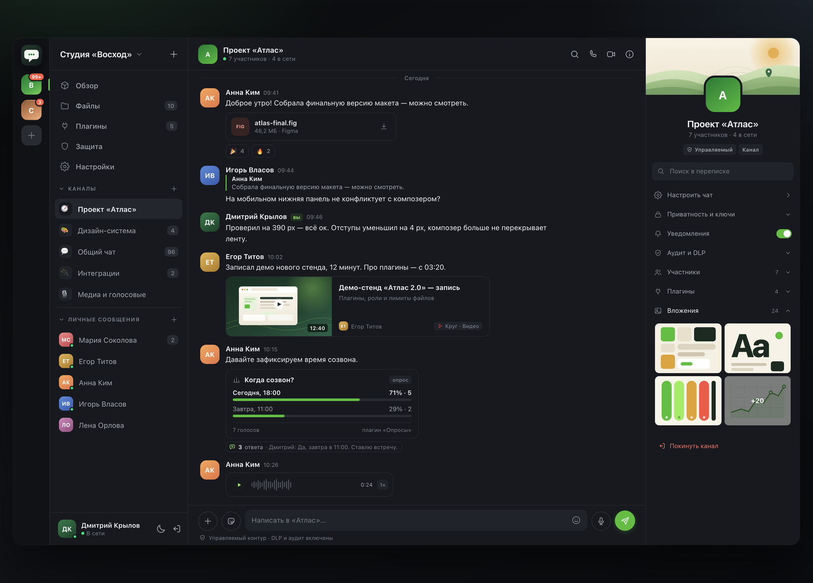

# Pickle — Message Dashboard

Концепция интерфейса мессенджера **Pickle** по мотивам
[Dribbble Shot 17943583 «Message Dashboard»](https://dribbble.com/shots/17943583-Message-Dashboard) (Nischal).

Это не редизайн существующего прототипа `design/index.html`, а **отдельное направление**: та же продуктовая
модель Pickle (управляемый контур + E2EE), но собранная в язык референса — светлые поверхности, рейл
пространств, плотный сайдбар, плоские сообщения без пузырей и правая панель профиля с обложкой.

В этом срезе добавлены **голосовые сообщения, аудио- и видеофайлы, запись с микрофона**, **счётчики
непрочитанных на иконках пространств** (с правилом `99+`), **треды** с отдельной панелью и ответами, а
также **карточки песен с метаданными из ID3** (обложка, исполнитель, альбом, год, жанр). Плюс полноценные
разделы пространства: **Обзор, Файлы, Плагины, Защита, Настройки** и окна **профиля** и **настроек чата**.
Логотип-огурец убран: в рейле теперь простой пузырь чата с тремя точками — про командную переписку.

> **Версия 1.0.0 · заморожено 18.11.2026.** Это зафиксированный макет: изменения после этой даты —
> только в новой версии (v1.1), без правок v1.0. Источник истины — этот каталог и
> [`releases/pickle-message-dashboard-v1.0.0.zip`](releases/pickle-message-dashboard-v1.0.0.zip).
> Тикет на внедрение: [D1](../../docs/TASKS-DASHBOARD-V1.md). Контрольные суммы —
> [`MANIFEST.sha256`](MANIFEST.sha256).



| Светлая тема | Тёмная тема |
|---|---|
|  |  |

---

## 1. Как открыть

Макет статический, без сборки и зависимостей — всё лежит рядом.

```bash
cd design/dashboard
python3 -m http.server 8080
# → http://localhost:8080
```

Можно открыть и двойным кликом `index.html` (`file://`): все картинки локальные SVG.

Параметры URL для демонстрации состояний:

| Параметр | Значение | Что показывает |
|---|---|---|
| `?theme=dark` | `light` / `dark` | тема, в т.ч. для скриншотов |
| `?space=family&chat=family` | id пространства и чата | E2EE-контур «Семья» |
| `?chat=media` | id чата | голосовые, аудио и видео |
| `?chat=maria` | id личного чата | профиль человека и «Секретный чат» |
| `?view=overview` | `overview` / `files` / `plugins` / `security` / `settings` | страницы пространства |
| `?filetab=audio` | `all` / `image` / `doc` / `audio` / `video` | фильтр файлов |
| `?settings=appearance` | `profile` / `appearance` / `notifications` / `workspace` / `devices` | раздел настроек |
| `?modal=profile` | | окно профиля поверх приложения |
| `?modal=chat&chat=atlas` | | окно настроек чата |
| `?thread=5` | индекс сообщения | панель треда для сообщения (например, опрос в «Атласе») |
| `?recording=1` | | состояние записи голосового |
| `?details=0` | | правая панель закрыта |
| `?clean=1` | | без всплывающих уведомлений (для съёмки) |

Что можно потрогать: пространства и чаты, темы, поиск по переписке (⌘K), аккордеоны правой панели,
«Секретный чат», отправку сообщения, вложения, стикеры, реакции, **запись голосового**, **страницы
разделов**, **фильтры файлов**, **переключатели плагинов**, **вкладки настроек**, **окна профиля и
настроек чата**, мобильный drawer и нижний sheet профиля.

---

## 2. Что взято из референса

| Элемент референса | В макете | Продуктовая фича Pickle |
|---|---|---|
| Узкий рейл с иконками приложений и активным индикатором | Рейл пространств: Pickle, «Студия «Восход»», «Семья», «+» | Переключение пространств, два контура |
| Шапка сайдбара: название воркспейса + шеврон | «Студия «Восход»» + меню пространств | Свитчер воркспейсов |
| Навигация с бейджами | Обзор, Файлы, Плагины, Защита, Настройки | Разделы продукта; бейджи — счётчики |
| Секции CHANNELS / DIRECT MESSAGES с «+» и счётчиками | «Каналы» и «Личные сообщения», unread, presence | Каналы, группы, личные чаты |
| Футер: аватар, имя, «Active now», выход | Аватар, «В сети», тема, выход | Профиль, статус, тема |
| Шапка чата: аватар, имя, Active now, звонки | Аватар, название, участники, поиск, звонок, видео, «О чате» | Участники, поиск, панель чата |
| Плоские сообщения: аватар, имя, время, дата-разделитель | То же + бейдж «вы» и плотные вложения | Отказ от пузырей, быстрый скан |
| Реакции-чипы | Эмодзи-чипы, «моя» реакция подсвечена | Реакции |
| Rich-карточка видео | Видео-превью 12:40, автор, источник | Вложения и превью |
| Правая панель: обложка, аватар, имя, био, поиск, строки, медиа | Профиль канала/человека, строки действий, сетка вложений | Роли, плагины, аудит, ключи E2EE, файлы |
| Две темы | Самостоятельные палитры | Тема как часть бренда |
| Непрочитанные на аватарах пространств | Число, при > 99 — `99+` | Уведомления пространства |
| — (расширение) | Ссылка «N ответов» и панель треда | Треды и обсуждения |
| — (расширение) | Карточка песни: обложка, исполнитель, альбом | Метаданные из ID3 |

Структурно сохранены пропорции: рейл → сайдбар → переписка → профиль, шапка 64 px, плоские сообщения с
аватаром 38 px, дата-разделитель с линиями, карточки вложений с рамкой 1 px, профиль с обложкой и
наложенным сквиркл-аватаром.

---

## 3. Что адаптировано под Pickle

- **Акцент — фирменный зелёный** (`#65BD45` / `#2F7A38`) вместо индиго. Он остаётся редким: активный
  индикатор пространства, отправка, прогресс опроса, статус E2EE.
- **Новый простой логотип**: тёмный сквиркл с белым пузырём чата и тремя точками. Огурец остался только
  в стикер-паке — как продуктовый персонаж, не как логотип.
- **Аватары-сквирклы с инициалами** вместо фотографий.
- **Два контура в одном интерфейсе.** «Студия «Восход»» — управляемый: DLP, аудит, роли, плагины.
  «Семья» — E2EE: отпечаток ключа, проверка, секретный чат, серверные плагины недоступны.
- **Голосовые сообщения как отдельный тип**: карточка с волной, длительностью, скоростью и
  расшифровкой; запись с микрофона в композере.
- **Аудио и видео — полноценные вложения**: карточка аудио с волной, видеофайл с превью, длительностью
  и размером, страница «Файлы» с фильтрами и лимитами.
- **Разделы пространства** (Обзор, Файлы, Плагины, Защита, Настройки) — это уже больше, чем референс:
  продуктовая глубина Pickle в том же визуальном языке.
- **Лимиты файлов видны в контексте**: в меню вложения, в карточке файла, в «Файлах» и тарифах.

---

## 4. Экраны

### 4.1 Чат · светлая тема
[desktop-light.png](screenshots/desktop-light.png)

Канал «Проект «Атлас»»: дата-разделитель, файл `.fig`, реакции, ответ на сообщение, видеокарточка,
опрос плагина «Опросы», голосовое от Анны. Справа — профиль канала: обложка, участники, «Приватность и
ключи», «Аудит и DLP», «Участники», «Плагины», «Вложения» и сетка медиа.

### 4.2 Чат · тёмная тема
[desktop-dark.png](screenshots/desktop-dark.png)

Отдельная палитра: поверхности `#17191E`/`#202329`, границы `#252830`, текст `#EEF0F4`, акцент
`#A6EC6A`. Обложки и медиа остаются цветными.

### 4.3 Медиа и голосовые
[media-light.png](screenshots/media-light.png)

Канал «Медиа и голосовые»: голосовое с расшифровкой, аудиофайл `interview-team.m4a` с волной,
видеофайл `atlas-demo-v2.mp4` с превью и длительностью, **карточка песни «Тихие огни»** с обложкой,
исполнителем, альбомом, годом, жанром и меткой `ID3`, голосовое «вы», реакции и ссылки на треды.

### 4.4 Запись голосового
[recording-light.png](screenshots/recording-light.png)

Состояние записи: красная точка, таймер, живая волна, удаление и отправка. Композер на время записи
уступает место полосе записи.

### 4.5 Личный чат · профиль человека
[dm-light.png](screenshots/dm-light.png)

Мария Соколова: «В сети», чипы «Личный чат» / «Секретный», отпечаток ключа, «Секретный чат: Вкл»,
общие файлы 2 × 2, звонок и блокировка. Композер меняет подпись на «Сквозное шифрование · ключи только
у участников».

### 4.6 E2EE-контур «Семья»
[family-e2ee.png](screenshots/family-e2ee.png)

Семейный чат: стикер-огурец, реакции, роли, раскрытая карточка сквозного шифрования с отпечатком
`8F2A 91C4 77D0 5B3E` и кнопками «Проверить ключи» / QR.

### 4.7 Обзор
[overview-light.png](screenshots/overview-light.png) · [мобильный](screenshots/mobile-overview.png)

Дашборд пространства: приветствие, 4 метрики (сообщения, файлы, участники, DLP/ключи), активность,
быстрый доступ к чатам, хранилище, безопасность, команда и недавние вложения с аудио/видео.

### 4.8 Файлы
[files-light.png](screenshots/files-light.png) · [мобильные файлы](screenshots/mobile-files.png)

Фильтры «Все / Изображения / Документы / Аудио / Видео», поиск, квота и тариф, таблица файлов
(MP4, M4A, MP3, FIG, PNG, YAML) с обложками песен, плеером и скачиванием, лимиты по тарифам и правила
загрузки.

### 4.9 Плагины
[plugins-light.png](screenshots/plugins-light.png)

Каталог из 6 плагинов с разрешениями и переключателями. В E2EE-пространстве серверные плагины
заблокированы и помечены «недоступно в E2EE», работает только клиентский набор стикеров.

### 4.10 Защита
[security-light.png](screenshots/security-light.png)

Управляемый контур: режим, устройства и ключи, DLP-политики, журнал аудита и сеансы. В «Семье» —
E2EE-режим, отпечаток, история ключей и проверка устройств.

### 4.11 Настройки
[settings-light.png](screenshots/settings-light.png)

Пять разделов: профиль (поля и безопасность), внешний вид (тема, плотность, превью), уведомления,
пространство (режим, приглашения, лимит файла), устройства и сеансы.

### 4.12 Окно профиля
[profile-light.png](screenshots/profile-light.png)

Модальное окно: аватар, статус, о себе, контакты, устройства, безопасность (2FA, ключи, сеансы),
«Выйти» и «Готово». Открывается из футера сайдбара и из настроек.

### 4.13 Окно настроек чата
[chat-settings-light.png](screenshots/chat-settings-light.png)

Вкладки «Основное / Участники / Права / Опасная зона»: обложка, название, описание, тип, ссылка-
приглашение; список участников с ролями; переключатели прав; архивирование, выход и удаление. Для
личного чата — «Основное / Приватность / Опасная зона».

### 4.14 Мобильная версия
[мобильный чат](screenshots/mobile-light.png) · [профиль](screenshots/mobile-profile.png) ·
[обзор](screenshots/mobile-overview.png) · [файлы](screenshots/mobile-files.png) ·
[тред](screenshots/mobile-thread.png)

390 × 844: рейл и сайдбар уезжают в drawer, страницы занимают всю ширину, таблицы схлопываются в
карточки, профиль — нижний sheet с затемнением, запись голосового сохраняется в композере.

### 4.15 Тред
[thread-light.png](screenshots/thread-light.png) · [мобильный](screenshots/mobile-thread.png)

Панель треда справа: сообщение-родитель (опрос, файл, голосовое или песня), счётчик ответов,
ответы участников и композер. Открывается ссылкой «N ответов» под сообщением или кнопкой треда в
hover-действиях; можно создать тред и у сообщения без ответов. На мобильном — overlay-панель с
затемнением.

---

## 5. Сетка и размеры

| Параметр | Значение |
|---|---|
| Окно макета | 1548 × 1000 px, радиус 18 px, тень + hairline |
| Рейл | 72 px, иконки 40 × 40 px, радиус 12 px, индикатор 3 × 24 px |
| Сайдбар | 272 px (258 px при < 1340), шапка 64 px |
| Переписка | `minmax(0, 1fr)`, шапка 64 px, композер ~56 px + подпись |
| Правая панель | 304 px (292 px при < 1340), обложка 112 px, аватар 76 px |
| Страницы | занимают переписку + правую панель (`grid-column: 3 / -1`), шапка 64 px, паддинг 24 px |
| Строка чата | 40 px, аватар 28 px, радиус 9 px |
| Строка панели | 38 px, иконка 16 px |
| Сообщение | аватар 38 px, зазор 12 px, текст 14.1/22 px, низ 12 px |
| Голосовое | карточка 330 × 46 px, волна 2 px, таймер 10.6 px |
| Аудио/видео | карточка 404–438 px, превью 128 × 72 px |
| Строка файла | 52 px, 7 колонок (36 · 1.7fr · 66 · 78 · 100 · 76 · 68) |
| Панель треда | 360 px (344 px при < 1340), header 64 px, композер 38 px |
| Карточка песни | 448 px, обложка 62 px |
| Бейдж непрочитанных | height 17 px, радиус 9 px, шрифт 9.2 px |
| Модальные окна | 540 / 720 / 820 px, радиус 18 px, header 58 px |
| Скругления | 8 / 10 / 14 / 18 px |
| Брейкпоинты | 1340 · 1180 · 920 · 760 · 420 |

Сообщения прижаты к низу, если история короче окна (`.messages::before { margin-top: auto }`), и
прокручиваются, когда не помещаются.

---

## 6. Токены

Полный набор — в [tokens.json](tokens.json). Кратко:

| Токен | Light | Dark |
|---|---|---|
| `surface` | `#FFFFFF` | `#17191E` |
| `surface-2` | `#F5F6F8` | `#202329` |
| `rail` | `#FBFBFC` | `#101216` |
| `line` | `#EDEDF0` | `#252830` |
| `text` | `#14161A` | `#EEF0F4` |
| `text-2` | `#5D626C` | `#A2A7B1` |
| `text-3` | `#979DA7` | `#787E89` |
| `accent` | `#2F7A38` | `#A6EC6A` |
| `accent-fill` | `#65BD45` | `#65BD45` |
| `accent-soft` | `#EEF7E7` | `rgba(101,189,69,.14)` |
| `online` | `#2FB85C` | `#4ADE80` |
| `danger` | `#D94A3D` | `#F07A6B` |

Типографика — системный стек (`-apple-system`, `Inter`, `Segoe UI`), без веб-шрифтов: 10.5 / 11.5 / 13 /
14.2 / 16.5 / 18 / 24 px, веса 500–700. Служебные подписи — 10.5 px uppercase с трекингом 0.09 em.

---

## 7. Компоненты

| Компонент | Где живёт | Состояния |
|---|---|---|
| `RailSpace` | рейл | default / hover / active / unread-dot |
| `NavItem` | сайдбар | default / hover / active / badge |
| `SectionHeader` / `ChatRow` | сайдбар | expanded / collapsed, unread, presence |
| `ChatHeader` | чат | группа / личный / offline, поиск открыт |
| `DateDivider`, `MessageRow` | лента | свой / чужой, hover-actions, ответ |
| `ReactionChip` | лента | чужая / моя |
| **`VoiceMessage`** | лента | чужое / своё, волна, скорость, расшифровка |
| **`AudioAttachment`** | лента | волна, длительность, скачивание |
| **`VideoAttachment`** | лента | превью, duration, play, скачивание |
| `FileCard`, `VideoCard`, `PollCard`, `StickerMessage` | лента | — |
| **`RecordingBar`** | композер | запись / отмена / отправка |
| `Composer`, `AttachMenu`, `StickerPicker` | низ чата | пустой / фокус / ввод / вложения |
| **`UnreadBadge`** | рейл пространств | 1–99 / `99+` |
| **`ThreadLink` / `ThreadPanel`** | лента / панель | N ответов, пустой тред, отправка |
| **`SongCard`** | лента / файлы | ID3 / без тегов, cover, play |
| `ProfileHeader`, `PanelSearch`, `PanelRow` | панель | expanded / switch / state |
| `MemberRow`, `MediaGrid`, `SecureCard` | панель | роли, +20, отпечаток |
| **`PageHeader`, `StatCard`, `FileTable`, `SettingsPane`** | страницы | фильтры, вкладки, переключатели |
| **`Modal`, `ProfileModal`, `ChatSettingsModal`** | поверх | вкладки, формы, опасная зона |
| `Toast` | поверх | успех / инфо |

Все состояния — на CSS-переменных; компоненты не зависят от темы.

---

## 8. Поведение (демо)

- Переключение пространств меняет сайдбар, чаты, режим, страницы и правую панель.
- Клик по чату возвращает в переписку и сбрасывает unread; на мобильном закрывает drawer.
- Поиск фильтрует сообщения по тексту, показывает количество; `⌘K` открывает, `Esc` закрывает.
- Enter отправляет сообщение, через 1.9 с приходит демо-ответ с индикатором «печатает…».
- «+» добавляет файл, фото, опрос или задачу; стикер-кнопка отправляет стикер.
- **Микрофон** включает запись: таймер, волна, отмена и отправка голосового; `Esc` отменяет.
- **Расшифровка** голосового раскрывается/сворачивается.
- **Реакции** переключаются кликом, счётчик меняется.
- **Непрочитанные**: на иконке пространства — число; больше 99 — `99+`; открытие чата уменьшает счётчик.
- **Треды**: ссылка «N ответов» открывает панель, hover-кнопка (на мобильном — иконка треда в шапке
  сообщения) создаёт тред у любого сообщения; ответы добавляются, счётчик и превью обновляются; `Esc`
  закрывает.
- **Песни**: меню вложения → «Аудио или песня» → файл; читаются ID3-теги (`TIT2`, `TPE1`, `TALB`, `TYER`,
  `TCON`, `APIC`), подтягиваются обложка, исполнитель, альбом, год, жанр и длительность. Если тегов нет —
  имя файла и дефолтная обложка. Песня появляется в ленте и в «Файлах».
- **Навигация** открывает страницы: обзор, файлы, плагины, защита, настройки; «назад» возвращает в чат.
- **Файлы** фильтруются по типу, поиск фильтрует строки, кнопки плеера — демо.
- **Плагины** переключаются; серверные в E2EE заблокированы.
- **Настройки** меняют тему, вкладки и сеансы (демо).
- **Окна** профиля и настроек чата открываются из футера, панели и страницы настроек; закрываются по
  `Esc`, крестику и фону.
- «Секретный чат» включает/выключает E2EE: меняются чипы, отпечаток и подпись композера.
- Звонки, каталог плагинов, приглашения и блокировка — заглушки с тостом.

---

## 9. Как переносить в текущий фронтенд

| Макет | React-компонент |
|---|---|
| Рейл + сайдбар | `components/Sidebar.tsx` (+ новый `SpaceRail`) |
| Шапка чата | `components/ChatHeader.tsx` |
| Лента | `components/MessageList.tsx`, `MessageRow.tsx` |
| Голосовые/аудио/видео | новые `VoiceMessage.tsx`, `AudioAttachment.tsx`, `VideoAttachment.tsx` |
| Композер и запись | `components/Composer.tsx` (+ `RecordingBar.tsx`) |
| Вложения | `components/AttachmentCard.tsx`, `MediaLightbox.tsx` |
| Правая панель | сейчас часть `ChatScreen.tsx` → `ChatDetailsPanel` |
| Треды | новый `ThreadPanel` + поле `thread` в модели сообщения |
| Песни и теги | новый `SongCard` + ID3-парсер (MP3; для остальных — fallback) |
| Страницы | новые `WorkspacePages` (Overview/Files/Plugins/Security/Settings) |
| Окна | новые `ProfileDialog`, `ChatSettingsDialog` |
| Аватары | `components/Avatar.tsx` |
| Токены | `src/styles` — переменные из `tokens.json` |

От API нужны: чаты с unread/presence, участники и роли, плагины и их состояние, отпечаток/режим E2EE,
вложения с типами и квотами, результаты поиска, аудит. Часть уже есть в `contracts/openapi.yaml`;
звонки, запись голосовых и каталог плагинов — вне текущего среза.

Это отдельное направление, а не замена текущего прототипа. Если оно выбирается основным, следующий шаг —
перенести токены в CSS-переменные фронтенда, собрать `SpaceRail`, `ChatDetailsPanel` и обновить
`MessageRow` под плоскую ленту (сейчас в приложении пузыри).

---

## 10. Доступность

- Контраст текста: основной ≥ 12:1 на светлом, ≥ 11:1 на тёмном; вторичный ≥ 5:1; служебные подписи
  ≥ 4.5:1 на поверхностях.
- Все интерактивные элементы — `<button>`/`<input>`/`<textarea>`/`<select>` с `aria-label`, у
  переключателей `role="switch"` и `aria-checked`, у модалок `role="dialog"` и `aria-modal`.
- Видимый `focus-visible` (2 px, зелёный) на всех элементах.
- `prefers-reduced-motion` отключает анимации; цвета не несут смысл в одиночку (у режимов есть подписи).
- Мобильные тач-цели ≥ 34 px; drawer и sheet закрываются тапом по фону и `Esc`.

---

## 11. Ограничения макета

- Все данные — моки в `app.js` (14 чатов, 2 пространства, 12 человек), backend не подключён.
- Аватары — инициалы на градиентах, обложки и медиа — SVG, нарисованные для концепта.
- Голосовые волны, отпечатки, журнал аудита, лимиты и плагины — демонстрационные значения.
- Метаданные песен читаются из ID3v2 (MP3/`ID3`-теги). Для M4A/MP4 и файлов без тегов показывается
  fallback: имя файла, «Неизвестный исполнитель», дефолтная обложка.
- Счётчик пространства в демо — сумма непрочитанных по чатам; «Общий чат» намеренно показывает 96,
  чтобы продемонстрировать `99+`.
- Плееры, звонки, «Создать пространство», каталог плагинов, приглашения — заглушки.
- Логотип заменён на простой пузырь чата; огурец остался в стикере.
- Шрифты системные: на macOS это SF Pro, на Windows — Segoe UI; для пиксель-в-пиксель с макетом
  подключите Inter.

---

## 12. Файлы

```
design/dashboard/
├── index.html          # интерактивный макет
├── styles.css          # дизайн-система, страницы, окна, медиа
├── app.js              # моки, рендер, логика демо
├── tokens.json         # токены (W3C Design Tokens)
├── DESIGN.md           # этот документ
├── assets/             # app-icon, обложки, album-cover, медиа, стикер
└── screenshots/        # PNG-экраны и обложка
```
