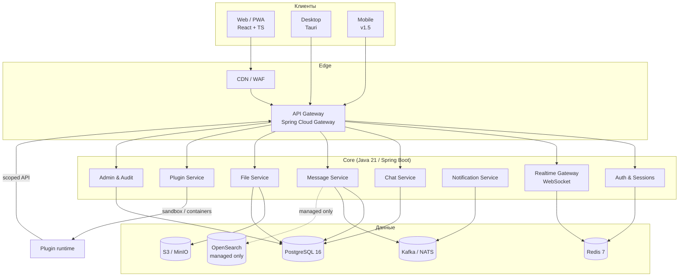

# «Сова» — концепция и бизнес-требования

**Версия:** 0.1 (черновик для обсуждения)
**Дата:** ноябрь 2026
**Название:** «Сова» (Sova)
**Формула:** приватный мессенджер для команд, семей и близких кругов — с ролями, файлами, стикерами, плагинами и сквозным шифрованием.

---

## 1. Паспорт продукта

| Параметр | Значение |
|---|---|
| Что это | Мессенджер для закрытых групп: рабочие команды, семьи, дружеские и профессиональные сообщества |
| Ключевое отличие | «Два режима безопасности» в одном продукте: конфиденциальный (E2EE) и управляемый (комплаенс, DLP, аудит) |
| Платформы | Web (PWA), Desktop (Tauri/Electron), Mobile (v1.5) |
| Бэкенд | Java 21, Spring Boot 3.x, PostgreSQL, Redis, S3/MinIO, WebSocket |
| Фронтенд | TypeScript/JavaScript, Vite, React, WebCrypto/Libsodium |
| Расширяемость | Плагины: UI-панели, действия в композере, боты и интеграции; sandbox + permissions |
| Модель распространения | SaaS, self-hosted (on-prem), private cloud |
| Монетизация | Подписка на команду, Enterprise-лицензия, семейный тариф, маркетплейс плагинов |
| Целевой рынок (первые 18 мес.) | Малые и средние команды 15–200 человек в РФ/СНГ + семьи и закрытые сообщества |

### 1.1. Elevator pitch

> «Сова» — это мессенджер, в котором команда или семья получает своё защищённое пространство: личные и групповые чаты с понятными ролями, быстрая передача файлов и стикеры, расширения под свои процессы и шифрование, которое не надо настраивать. Администратор выбирает режим: максимальная приватность (сквозное шифрование, сервер не читает сообщения) или управляемый контур (DLP, аудит, корпоративный поиск). Один продукт — два сценария.

### 1.2. Почему сейчас

- **Усталость от «универсальных» мессенджеров.** Telegram и WhatsApp удобны, но данные и права — вне контроля компании; Slack и Teams дороги, тяжелы и не подходят семьям.
- **Ужесточение требований к данным.** Компаниям нужны российское хостинг-размещение, разграничение доступа, журналы аудита и контроль утечек — без отказа от удобного чата.
- **Запрос на приватность у частных пользователей.** Мошенничество в семейных чатах, утечки переписок, нежелательные приглашения — понятная боль.
- **Плагинная экосистема как способ закрыть нишевые процессы** (опросы, задачи, дежурства, интеграции с CRM) без раздувания ядра.

---

## 2. Проблема и позиционирование

### 2.1. Проблемы сегментов

| Сегмент | Боль | Чем платим сегодня |
|---|---|---|
| Команда 15–200 чел. | Нет своего защищённого пространства; чаты смешаны с личными; нет ролей и аудита; файлы теряются | Slack/Teams — дорого и сложно; Telegram — нет контроля и комплаенса |
| Семья | Переписки и фото в чужих облаках; мошенники и фейковые приглашения; сложно объяснить настройки приватности | WhatsApp/Telegram — данные вне контроля, реклама и сбор метаданных |
| Закрытое сообщество (клуб, студия, школа) | Нужны роли, модерация, гостевой доступ и собственный брендинг | Discord — не корпоративно; чаты в соцсетях — хаос |

### 2.2. Позиционирование

```
                    высокая приватность
                            ▲
                            │   «Сова» (E2EE + роли + плагины)
                            │
     Signal ●               │
                            │        ● Slack / Teams
                            │          (комплаенс, но без E2EE)
                            │
                            │   ● Telegram
                            └──────────────────────────────▶
                                   корпоративные функции
```

«Сова» не конкурирует с Signal по уровню паранойи и не пытается заменить весь Microsoft 365. Мы выигрываем в **пересечении**: приватность + управляемость + расширяемость + цена для малой команды.

### 2.3. Ценностное предложение

1. **Своё пространство.** Отдельный воркспейс с брендом, участниками, ролями и политиками.
2. **Безопасность по умолчанию.** TLS 1.3, шифрование данных на сервере, E2EE для конфиденциальных чатов, устройства и ключи под контролем пользователя.
3. **Порядок в правах.** Владелец, администратор, модератор, участник, гость — права настраиваются на уровне чата.
4. **Файлы без трения.** До 2 ГБ на Team, докачка, превью, шифрование на клиенте и понятные лимиты по тарифу.
5. **Живые стикеры.** Встроенные наборы, быстрый пикер, недавние и избранное; свои наборы — для команды или семьи.
6. **Расширяемость.** Плагины ставятся в один клик и не ломают ядро: опросы, задачи, перевод, интеграции.
7. **Два режима под задачу.** Семья — E2EE. Компания — управляемый контур с DLP и аудитом. Можно комбинировать по воркспейсам.

---

## 3. Цели и метрики

### 3.1. Бизнес-цели (12 месяцев)

| Цель | Метрика | Целевое значение |
|---|---|---|
| Подтвердить спрос | Зарегистрированные воркспейсы | 1 500 |
| Доказать удержание | W4 retention активных воркспейсов | ≥ 40% |
| Выйти на выручку | Платящие воркспейсы | 150 |
| Проверить плагины | Воркспейсы с ≥ 1 установленным плагином | ≥ 35% |
| Не допустить инцидентов | Критические инциденты ИБ | 0 |

**North Star Metric:** количество активных диалогов в неделю (диалог = чат, где за 7 дней было ≥ 10 сообщений от ≥ 2 участников).

### 3.2. Продуктовые метрики

- Активация: воркспейс создан, приглашены ≥ 3 участника, отправлено ≥ 20 сообщений за 7 дней.
- DAU/WAU ≥ 45%.
- Время до первого сообщения нового пользователя ≤ 3 минут.
- Доля сообщений с вложениями — 8–15% (здоровый диапазон для рабочего чата).
- Установки плагинов на воркспейс — ≥ 1,2.
- NPS ≥ 50.
- Доля обращений в поддержку < 5% от активных воркспейсов в месяц.

### 3.3. Анти-метрики

- Не оптимизируем время в приложении любой ценой: цель — закрыть рабочий/личный вопрос и уйти.
- Не собираем содержимое сообщений в E2EE-режиме и не используем его для рекламы.
- Не считаем «установленные плагины» без реального использования (только активные за 30 дней).

### 3.4. Бизнес-требования (BR)

| ID | Бизнес-требование | Как проверяем |
|---|---|---|
| BR-1 | Один продукт закрывает два сценария — команду и семью — за счёт двух режимов безопасности | Пилот в обоих сегментах; переключение режима без потери базовых функций |
| BR-2 | Новый пользователь отправляет первое сообщение ≤ 3 минут без инструкции | Замер активации, юзабилити-тест на 5 респондентах |
| BR-3 | Роли и права понятны без обучения; владелец не может потерять доступ случайно | Доля обращений в поддержку по правам < 5%; сценарии AC-2, AC-6 |
| BR-4 | Файлы передаются с докачкой, понятным лимитом по тарифу и статусом | ≥ 99% успешных загрузок на пилоте; тест обрыва сети и превышения лимита |
| BR-5 | Плагины устанавливаются в один клик и не получают лишних прав | ≥ 35% воркспейсов с активным плагином; пентест sandbox |
| BR-6 | Данные остаются под контролем заказчика: E2EE, on-prem, экспорт и удаление | ИБ-ревью пилота; проверка экспорта/удаления |
| BR-7 | Цена Team ≤ 500 ₽/чел/мес, Family ≤ 200 ₽/мес — ниже порога «дорого» для сегмента | CustDev, конверсия free → paid ≥ 4% |
| BR-8 | Для компаний доступны аудит, DLP и SSO без отдельного продукта | Прохождение закупки у 2 пилотных компаний |
| BR-9 | Web/PWA и мобильный адаптив дают полноценный опыт «в дороге» | Доля мобильных сессий, WAU/DAU ≥ 45% |
| BR-10 | Маркетплейс плагинов становится отдельным каналом выручки | 100 платящих воркспейсов и ≥ 10 внешних плагинов до запуска платежей |
| BR-11 | Стикеры и лимиты файлов понятны с первого экрана и не требуют обращения в поддержку | ≥ 90% успешных первых отправок; доля ошибок загрузки < 2% |

---

## 4. Сегменты и персоны

### 4.1. Персона A — «Руководитель небольшой студии»

**Анна, 34 года, операционный директор студии дизайна (28 человек).**
Использует Telegram для работы, Slack пробовали — не прижился из-за цены и сложности. Хочет: отделить рабочее от личного, видеть, кто что решает, не потерять файлы, иметь возможность быстро подключить подрядчика и так же быстро отключить.

- JTBD: «Когда у меня 30 чатов и три подрядчика, я хочу видеть структуру команды и права доступа, чтобы не тратить время на выяснение, кто кому что отправил».
- Критерии выбора: понятные роли, поиск по файлам, интеграция с задачами, цена за человека, данные в РФ.

### 4.2. Персона B — «Хранитель семьи»

**Дмитрий, 41 год, инженер, женат, двое детей.**
Семейный чат в WhatsApp, фото в галерее, бабушка периодически пересылает подозрительные ссылки. Хочет: одно место для семьи, защиту от мошенников, простые видеозвонки, чтобы дети не видели лишнего.

- JTBD: «Когда вся семья в одном чате, я хочу быть уверен, что наши фото и разговоры не утекут и что бабушку не обманут, а настройки были понятны без инструкции».
- Критерии выбора: простота, E2EE, семейный тариф, гостевые ссылки для родственников.

### 4.3. Персона C — «Администратор контура»

**Игорь, 38 лет, IT-директор компании (120 человек).**
Нужны контроль доступа, журналы, DLP, SSO, размещение on-prem. Не готов отдавать переписку в чужое облако и не готов к «серому» мессенджеру.

- JTBD: «Когда сотрудники общаются в неучтённых мессенджерах, я хочу дать им удобный инструмент с аудитом и политиками, чтобы данные не уходили наружу».
- Критерии выбора: on-prem, OIDC/SSO, журнал аудита, API, SLA, соответствие 152-ФЗ.

### 4.4. Персона D — «Организатор сообщества»

**Мария, 29 лет, ведёт книжный клуб (300 участников).**
Нужны анонсы, роли модераторов, платные/закрытые ветки, опросы, гости. Discord слишком «геймерский», Telegram-канал — односторонний.

- JTBD: «Когда сообщество растёт, я хочу делегировать модерацию и автоматизировать рутину, чтобы не жить в телефоне».
- Критерии выбора: роли, плагины, приглашения, брендинг.

---

## 5. Сценарии использования

### 5.1. Ключевые пользовательские истории

| ID | История | Приоритет |
|---|---|---|
| US-01 | Как участник, я хочу создать личный чат с коллегой, чтобы обсудить вопрос один на один | Must |
| US-02 | Как владелец, я хочу создать группу, пригласить людей и назначить роли, чтобы управлять доступом | Must |
| US-03 | Как участник, я хочу отправить файл в пределах лимита тарифа и видеть прогресс, чтобы делиться материалами | Must |
| US-04 | Как участник, я хочу отвечать на сообщения и ставить реакции, чтобы не терять контекст | Must |
| US-05 | Как участник, я хочу видеть, что чат зашифрован и проверить ключи, чтобы доверять каналу | Must |
| US-06 | Как админ, я хочу включить плагин «Опросы» и создать опрос в чате, чтобы быстро собрать мнения | Should |
| US-07 | Как админ, я хочу пригласить гостя по ссылке с ограниченными правами, чтобы подключить подрядчика | Should |
| US-08 | Как админ, я хочу видеть журнал действий (вход, смена роли, экспорт), чтобы расследовать инцидент | Should |
| US-09 | Как участник, я хочу искать по тексту и файлам, чтобы находить нужное | Must |
| US-10 | Как владелец, я хочу удалить участника и отозвать его доступ к истории, чтобы защитить данные | Must |
| US-11 | Как участник, я хочу включить тёмную тему и уменьшить уведомления, чтобы комфортно работать | Could |
| US-12 | Как админ, я хочу подключить SSO/OIDC, чтобы не вести пароли вручную | Should |
| US-13 | Как участник, я хочу создать опрос/задачу из композера, не переключаясь в другой сервис | Should |
| US-14 | Как владелец, я хочу передать владение группой, чтобы не быть единственной точкой отказа | Should |
| US-15 | Как участник, я хочу отправить стикер в один клик, чтобы ответить живо и без текста | Must |
| US-16 | Как админ, я хочу загрузить свой набор стикеров, чтобы команда говорила «своими» образами | Should |

### 5.2. Сквозные сценарии

**Сценарий «Первый день команды»**
1. Анна создаёт воркспейс «Студия Восход», выбирает управляемый режим.
2. Приглашает 5 человек по ссылке, назначает двух администраторов.
3. Создаёт группы «Общий», «Проект Атлас», «Дизайн-система».
4. Устанавливает плагины «Опросы» и «Задачи».
5. Отправляет бриф файлом; участники получают уведомления.

**Сценарий «Семейный чат»**
1. Дмитрий создаёт воркспейс «Семья», режим — конфиденциальный (E2EE).
2. Приглашает жену, детей, бабушку; бабушка заходит по гостевой ссылке без установки приложения (PWA).
3. Отправляет фото с дачи (шифруется на устройстве).
4. Создаёт опрос «Куда на выходных?».
5. Включает «Защиту от незнакомцев»: новые участники — только с одобрения владельца.

**Сценарий «Подрядчик на неделю»**
1. Админ создаёт гостевую ссылку на конкретный чат, срок 7 дней, роль «Гость».
2. Гость видит только этот чат и последние 30 дней истории.
3. По истечении срока доступ автоматически отзывается, событие попадает в аудит.

**Сценарий «Потеря устройства»**
1. Пользователь заходит в «Безопасность → Устройства».
2. Отзывает потерянный ноутбук.
3. Все сессии устройства инвалидируются, ключи перестают использоваться.
4. Для E2EE-чатов устройство исключается из групп, sender keys ротируются.

---

## 6. Границы продукта

### 6.1. Входит в MVP (0–3 месяца)

- Web/PWA-клиент, адаптив, светлая/тёмная тема.
- Воркспейсы, приглашения по ссылке/email, роли воркспейса и чата.
- Личные и групповые чаты, треды-ответы, реакции, закрепление, упоминания.
- Текст, файлы (лимиты по тарифу: 200 МБ / 1 ГБ / 2 ГБ), изображения, превью, докачка; предварительная проверка размера и квоты.
- Стикеры: встроенные наборы, пикер, недавние и избранное, отправка стикера как сообщения.
- E2EE для личных чатов и групп (sender keys), проверка ключей, отзыв устройств.
- Управляемый режим: шифрование на сервере, журнал аудита, базовая админка.
- Поиск по чатам и сообщениям (в E2EE — локальный индекс).
- Push/email-уведомления с настройками.
- Плагинная платформа v0: каталог, установка, sandbox UI, 3 первых плагина (опросы, задачи, перевод).
- REST + WebSocket API, OpenAPI-документация.

### 6.2. Не входит в MVP

- Аудио/видеозвонки и конференции (v1.5).
- Федерация между инсталляциями (v2+).
- Полноценный мобильный клиент (v1.5, React Native).
- Пользовательские наборы стикеров и маркетплейс стикеров (v1–v2).
- Публичные каналы и монетизация контента.
- Сквозное шифрование групповых звонков.
- Собственный маркетплейс с оплатой (после 100 платящих).
- eDiscovery и юридически значимый архив (Enterprise v2).

### 6.3. Явные продуктовые принципы

1. **Приватность — не режим «для гиков», а настройка по умолчанию для личных чатов.**
2. **Корпоративные функции не ломают UX частного пользователя.**
3. **Плагин никогда не получает больше прав, чем ему явно выдано.**
4. **Никаких «тёмных паттернов»: удаление аккаунта и экспорт данных — в два клика.**
5. **Деградация изящная:** нет сети — читаем кэш, пишем в очередь, отправляем при восстановлении.

---

## 7. Функциональные требования

Приоритеты: **M** — must (MVP), **S** — should (v1), **C** — could (v2).

### 7.1. Аккаунты, воркспейсы, доступ

| ID | Требование | Приоритет |
|---|---|---|
| FR-ACC-1 | Регистрация по email + пароль, подтверждение email, восстановление пароля | M |
| FR-ACC-2 | Вход по приглашению; приглашение — ссылка с ограниченным сроком и лимитом использований | M |
| FR-ACC-3 | Воркспейс: название, логотип, домен/поддомен, режим безопасности | M |
| FR-ACC-4 | Несколько воркспейсов у одного пользователя, быстрое переключение | M |
| FR-ACC-5 | OIDC/SSO (Keycloak, Google, Яндекс 360), SCIM-провижининг | S |
| FR-ACC-6 | WebAuthn/Passkeys и TOTP 2FA | S |
| FR-ACC-7 | Управление устройствами и сессиями: список, отзыв, «выйти везде» | M |
| FR-ACC-8 | Экспорт и удаление аккаунта (GDPR/152-ФЗ) | S |
| FR-ACC-9 | Гостевые аккаунты с ограниченным сроком | S |

**Критерии приёмки (FR-ACC-2):** ссылка-приглашение живёт 7 дней, одноразовая или на N использований; после отзыва ссылка возвращает 410; событие фиксируется в аудите.

### 7.2. Чаты и сообщения

| ID | Требование | Приоритет |
|---|---|---|
| FR-CHAT-1 | Личный чат 1:1, создаётся из профиля или списка участников | M |
| FR-CHAT-2 | Групповой чат: название, аватар, описание, до 500 участников (MVP — 100) | M |
| FR-CHAT-3 | Роли в чате: владелец, администратор, модератор, участник, гость | M |
| FR-CHAT-4 | Текстовые сообщения до 8 000 символов, markdown-lite, ссылки, упоминания | M |
| FR-CHAT-5 | Ответы (reply), реакции, закреплённые сообщения, пересылка | M |
| FR-CHAT-6 | Редактирование и удаление своих сообщений; удаление любых — модератором | M |
| FR-CHAT-7 | Статусы: отправлено / доставлено / прочитано; «печатает…» | M |
| FR-CHAT-8 | Системные сообщения (добавлен участник, смена роли, закрепление) | M |
| FR-CHAT-9 | Поиск по сообщениям с фильтрами (автор, файл, дата) | M |
| FR-CHAT-10 | Архив чатов, mute, pin, папки/теги | S |
| FR-CHAT-11 | Треды (ответы в отдельной ветке) | S |
| FR-CHAT-12 | Импорт истории из Telegram/Slack (для миграции) | C |
| FR-CHAT-13 | Автоудаление сообщений по таймеру (retention policy) | S |

**Критерии приёмки (FR-CHAT-3):**
- владелец может менять роли, удалять участников, удалять чат, передавать владение;
- администратор делает всё, кроме удаления чата и передачи владения;
- модератор удаляет сообщения и закрепляет, но не меняет роли;
- гость пишет только в разрешённые чаты и не видит список участников воркспейса.

### 7.3. Матрица прав в чате

| Действие | Владелец | Админ | Модератор | Участник | Гость |
|---|:--:|:--:|:--:|:--:|:--:|
| Читать чат | ✅ | ✅ | ✅ | ✅ | ✅ |
| Отправлять сообщения | ✅ | ✅ | ✅ | ✅ | ✅* |
| Редактировать свои | ✅ | ✅ | ✅ | ✅ | ✅ |
| Удалять свои | ✅ | ✅ | ✅ | ✅ | ✅ |
| Удалять чужие | ✅ | ✅ | ✅ | — | — |
| Закреплять | ✅ | ✅ | ✅ | — | — |
| Приглашать | ✅ | ✅ | — | — | — |
| Удалять участников | ✅ | ✅ | — | — | — |
| Менять роли | ✅ | ✅ | — | — | — |
| Ставить плагины в чат | ✅ | ✅ | — | — | — |
| Использовать стикеры | ✅ | ✅ | ✅ | ✅ | ✅* |
| Включать наборы стикеров в чат | ✅ | ✅ | — | — | — |
| Менять настройки чата | ✅ | ✅ | — | — | — |
| Экспорт истории | ✅ | ✅ | — | — | — |
| Удалить чат | ✅ | — | — | — | — |
| Передать владение | ✅ | — | — | — | — |

\* Гость может быть ограничен режимом «только чтение».

### 7.4. Файлы и медиа

**Лимиты по умолчанию** (Enterprise переопределяет политикой; Web-клиент технически ограничен 2 ГБ на файл):

| Параметр | Community | Family | Team | Enterprise |
|---|---:|---:|---:|---:|
| Один файл | 200 МБ | 1 ГБ | 2 ГБ | до 10 ГБ |
| Хранилище пространства | 10 ГБ | 100 ГБ | 1 ТБ | индивидуально |
| Файлов в одном сообщении | 5 | 10 | 10 | 10 |
| Гостевой лимит на файл | 100 МБ | 500 МБ | 500 МБ | политика |
| Срок хранения по умолчанию | 12 мес. | 24 мес. | 12 мес. | политика |

| ID | Требование | Приоритет |
|---|---|---|
| FR-FILE-1 | Загрузка drag&drop и через диалог с лимитами по тарифу (200 МБ–10 ГБ); Web — до 2 ГБ, Desktop — до 10 ГБ | M |
| FR-FILE-2 | Прогресс, отмена, докачка после обрыва (chunked/resumable, чанк 4–8 МБ) | M |
| FR-FILE-3 | Превью изображений, видео, PDF, аудио; скачивание оригинала | M |
| FR-FILE-4 | Шифрование файла на клиенте в E2EE-режиме, ключ — получателям | M |
| FR-FILE-5 | Антивирусная проверка в управляемом режиме; предупреждение для исполняемых файлов | M |
| FR-FILE-6 | Галерея файлов чата, поиск по имени/типу | S |
| FR-FILE-7 | Срок хранения и автоочистка по политике воркспейса | S |
| FR-FILE-8 | Публичные ссылки с паролем и сроком (для гостей) | C |
| FR-FILE-9 | Preflight-проверка размера, числа файлов и свободной квоты до начала загрузки; понятная ошибка и предложение решения | M |
| FR-FILE-10 | Администратор задаёт лимиты и квоты в рамках тарифа; при 80/95/100% квоты — уведомления | S |
| FR-FILE-11 | Сервер — источник истины по лимитам: `413 FILE_TOO_LARGE`, `QUOTA_EXCEEDED`, `TOO_MANY_FILES`, `UNSUPPORTED_TYPE` | M |
| FR-FILE-12 | Опасные типы (exe, bat, скрипты) блокируются или требуют подтверждения по политике | M |

**Правила:**
- до 10 вложений в одном сообщении (Community — до 5); каждое вложение — отдельный объект с собственным ключом;
- квота считается по фактическому размеру зашифрованных блобов, а не по исходному файлу;
- в E2EE-режиме имя и MIME-тип шифруются, сервер видит размер, хеш, время и `attachment_id`;
- при обрыве загрузка продолжается с последнего подтверждённого чанка (идемпотентность по `upload_id` + `chunk_index`);
- удаление сообщения освобождает квоту после сборки мусора (до 24 часов), а не мгновенно.

### 7.5. Стикеры

Стикеры — часть ядра, а не плагин: они должны работать в любом чате и в обоих режимах безопасности.

**Лимиты и форматы:**

| Параметр | Community | Family | Team | Enterprise |
|---|---:|---:|---:|---:|
| Встроенные наборы | все | все | все | все |
| Своих наборов | 3 | 5 | 20 | политика |
| Объём своих наборов | 30 МБ | 50 МБ | 200 МБ | политика |
| Стикеров в наборе | 8–50 | 8–50 | 8–50 | 8–100 |

| ID | Требование | Приоритет |
|---|---|---|
| FR-STK-1 | Встроенные наборы стикеров и пикер в композере: табы наборов, поиск, недавние, избранное | M |
| FR-STK-2 | Стикер отправляется отдельным сообщением (один стикер на сообщение); к нему применимы ответ, реакция и пересылка | M |
| FR-STK-3 | Наборы устанавливаются на уровне воркспейса владельцем/админом и включаются в конкретных чатах | M |
| FR-STK-4 | Свои наборы: название, обложка, теги, 8–50 стикеров (Enterprise — до 100); создание и загрузка — владелец/админ, предпросмотр обязателен | S |
| FR-STK-5 | Форматы — PNG, WebP, APNG; **SVG запрещён**; 512×512 px, ≤512 КБ, анимация ≤3 с и ≤30 fps | M |
| FR-STK-6 | Проверка лимитов на клиенте и сервере; отклонение с понятной ошибкой и указанием параметра | M |
| FR-STK-7 | Модерация: жалоба на стикер/набор, отключение набора, карантин, история действий в аудите | S |
| FR-STK-8 | E2EE: изображение стикера шифруется как медиа; сервер видит только `sticker_id`, `pack_id`, размер и время | M |
| FR-STK-9 | Managed-режим: антивирус и DLP-проверка загружаемых стикеров, проверка прав на контент | S |
| FR-STK-10 | Локальный кэш стикеров (до 50 МБ на устройство), недавние и избранное хранятся на устройстве | S |
| FR-STK-11 | Дедупликация по `sha256`: одинаковые стикеры в наборе хранятся один раз и учитываются в квоте один раз | S |
| FR-STK-12 | Доступность: alt-подпись у стикера, навигация с клавиатуры, корректный рендер без анимации при `prefers-reduced-motion` | M |

**Правила:**
- стикер — это изображение, а не активный контент: никакого HTML/SVG/скриптов;
- свои наборы доступны на всех тарифах: 3 / 5 / 20 в зависимости от плана, встроенные — всем;
- при удалении набора из воркспейса уже отправленные стикеры остаются в истории, но новые отправить нельзя;
- в E2EE-чате клиент валидирует размер и формат до шифрования; сервер не может перекодировать изображение;
- автор набора подтверждает права на контент; при жалобе набор скрывается до разбора.

### 7.6. Плагины

| ID | Требование | Приоритет |
|---|---|---|
| FR-PLUG-1 | Каталог плагинов: карточка, версия, автор, разрешения, отзывы (v1) | M |
| FR-PLUG-2 | Установка в воркспейс администратором, включение в конкретном чате владельцем | M |
| FR-PLUG-3 | UI-плагины: панель в чате, действие в композере, рендер сообщения | M |
| FR-PLUG-4 | Манифест с permissions; запрос дополнительных прав — только с подтверждением | M |
| FR-PLUG-5 | Sandbox-изоляция (iframe + postMessage RPC, CSP, без доступа к DOM приложения) | M |
| FR-PLUG-6 | Подпись пакета, проверка при установке, allowlist для Enterprise | S |
| FR-PLUG-7 | Серверные плагины/боты: отдельный контейнер, scoped-токен, egress allowlist | S |
| FR-PLUG-8 | Журнал действий плагина, лимиты ресурсов, kill switch | S |
| FR-PLUG-9 | Приватный каталог организации | C |
| FR-PLUG-10 | Плагин не может читать E2EE-сообщения без явного согласия пользователя в каждом чате | M |

**Стартовый набор:** «Опросы», «Задачи», «Перевод», «Напоминания», «Мост в Telegram» (S), «DLP-подсказки» (Enterprise).

### 7.7. Безопасность и шифрование

| ID | Требование | Приоритет |
|---|---|---|
| FR-SEC-1 | TLS 1.3, HSTS, шифрование данных на диске (managed-режим) | M |
| FR-SEC-2 | E2EE для личных чатов: X25519 + Double Ratchet, AES-256-GCM | M |
| FR-SEC-3 | E2EE для групп: sender keys с ротацией при изменении состава | M |
| FR-SEC-4 | Проверка ключей (safety number/QR), отметка «ключ изменён» | M |
| FR-SEC-5 | Шифрование файлов, превью и стикеров на клиенте | M |
| FR-SEC-6 | Отзыв устройств, перевыпуск ключей, ограничение числа устройств | M |
| FR-SEC-7 | Журнал аудита: входы, смены ролей, экспорт, включение плагинов | M |
| FR-SEC-8 | Парольные политики, 2FA, защита от брутфорса, rate limiting | M |
| FR-SEC-9 | Резервное копирование ключей с парольной фразой (опционально) | S |
| FR-SEC-10 | MLS (RFC 9420) для больших групп | C |
| FR-SEC-11 | Sealed sender / скрытие метаданных | C |
| FR-SEC-12 | Ключи и данные в РФ, on-prem-развёртывание | S |

### 7.8. Уведомления, поиск, присутствие

| ID | Требование | Приоритет |
|---|---|---|
| FR-NOTIF-1 | Web Push, email, in-app; настройки по чату и типу | M |
| FR-NOTIF-2 | В уведомлении нет текста сообщения по умолчанию (E2EE) | M |
| FR-NOTIF-3 | Режим «не беспокоить» с расписанием | S |
| FR-SEARCH-1 | Поиск по чатам, людям, сообщениям | M |
| FR-SEARCH-2 | В E2EE — локальный зашифрованный индекс на устройстве | M |
| FR-SEARCH-3 | Глобальный поиск по файлам (managed-режим) | S |
| FR-PRES-1 | Онлайн/офлайн, «был(а) недавно», «печатает…» — с настройкой приватности | M |

### 7.9. Администрирование

| ID | Требование | Приоритет |
|---|---|---|
| FR-ADM-1 | Панель воркспейса: участники, роли, приглашения, чаты | M |
| FR-ADM-2 | Журнал аудита с фильтрами и экспортом CSV/JSON | M |
| FR-ADM-3 | Политики: срок хранения, размер файла, запрет внешних ссылок, режим безопасности | S |
| FR-ADM-4 | SSO и SCIM | S |
| FR-ADM-5 | DLP-правила и карантин (managed) | S |
| FR-ADM-6 | Брендинг (логотип, цвета, домен) | C |

---

## 8. Безопасность и шифрование (детально)

### 8.1. Два режима — сознательный компромисс

| | **Конфиденциальный (E2EE)** | **Управляемый (Compliance)** |
|---|---|---|
| Кто читает | Только участники и их устройства | Участники + уполномоченные админы (break-glass) |
| Шифрование | Сквозное, ключи только у клиентов | TLS + шифрование на сервере (envelope encryption) |
| Серверный поиск | Нет (локальный индекс) | Да (OpenSearch) |
| DLP / антивирус | Ограниченно (клиентские подсказки) | Полноценно |
| Плагины | Только клиентские, с согласием | Клиентские и серверные |
| Стикеры | Встроенные + свои наборы; изображения шифруются | Встроенные + свои наборы; серверная проверка контента |
| Аудит | Метаданные | Полный |
| Кому подходит | Семьи, приватные чаты, чувствительные обсуждения | Компании с требованиями комплаенса |

Режим задаётся на уровне воркспейса и наследуется чатами. В управляемом режиме можно создавать «приватные» E2EE-чаты, если политика разрешает; обратное — нельзя. Смена режима не перешифровывает историю задним числом.

### 8.2. Криптографическая схема

**Личные чаты (MVP):**
1. У каждого устройства — identity key (Ed25519) и набор prekeys (X25519 signed + one-time).
2. Установка сессии — X3DH-подобный handshake через сервер предключей.
3. Дальше — Double Ratchet: новая цепочка ключей на каждое сообщение, forward secrecy + post-compromise security.
4. Шифр — AES-256-GCM; вывод ключей — HKDF-SHA-256; подписи — Ed25519.

**Группы (MVP):**
1. Sender Keys: каждый участник генерирует chain key и рассылает его остальным через pairwise-сессии.
2. При удалении участника или смене состава — ротация всех sender keys.
3a. Ограничение: sender keys дают forward secrecy внутри цепочки, но не полную post-compromise security.
3b. Целевое состояние v2 — MLS (RFC 9420) для групп > 50 и для корпоративных сценариев.

**Устройства и ключи:**
- До 5 устройств на аккаунт; каждое — отдельный ключевой набор.
- Список устройств и fingerprint доступны в «Безопасности»; смена ключа собеседника подсвечивается.
- Восстановление истории на новом устройстве — только через зашифрованный бэкап с парольной фразой (Argon2id).
- Приватные ключи хранятся в OS keychain/secure enclave; в вебе — non-extractable CryptoKey + IndexedDB, защита паролем сессии.

**Чего мы НЕ обещаем:**
- Защиту от компрометации устройства с разблокированным клиентом.
- Защиту от скриншотов.
- Анонимность: метаданные (кто, когда, с кем) видны серверу.
- «Военную» стойкость против целевых атак с физическим доступом.

### 8.3. Шифрование файлов и стикеров

```
Файл → случайный file key (256 бит) → AES-256-GCM по чанкам 4 МБ
     → blob + теги → S3/MinIO
file key → обёрнут ключом чата/получателя → хранится как метаданные E2EE
миниатюра → отдельный ключ → зашифрована → хранится рядом
```

- В E2EE-режиме сервер не может расшифровать файл и не строит превью.
- Имя файла и MIME шифруются в E2EE; сервер видит только размер, хеш и дату.
- В managed-режиме — серверная проверка AV, DLP и превью; ключи — в KMS/Vault, доступ по break-glass с аудитом.
- **Стикеры** используют тот же конвейер: изображение до 512 КБ шифруется отдельным ключом, сервер видит `sticker_id`, `pack_id`, размер и хеш, но не картинку.
- SVG, HTML и исполняемые форматы не принимаются как стикеры; клиент принимает только PNG/WebP/APNG и нормализует размер до 512×512.
- В managed-режиме загружаемые наборы проходят AV/DLP-проверку и проверку прав; в E2EE — валидация на клиенте и жалобы на контент.

### 8.4. Модель угроз

| Угроза | Вектор | Контрмера |
|---|---|---|
| Перехват трафика | MITM в сети | TLS 1.3 + certificate pinning в desktop/mobile; E2EE поверх |
| Компрометация сервера | Утечка БД/бакета | E2EE: только шифротекст; managed: envelope encryption, KMS, ротация ключей |
| Злой админ | Чтение переписки | E2EE-режим; break-glass только с двумя approvals и аудитом |
| Потеря устройства | Доступ к сессии | Отзыв устройства, короткоживущие токены, biometric unlock |
| Вредоносный плагин | Кража данных | Sandbox, permissions, подпись, allowlist, аудит, kill switch |
| Вредоносный стикер/набор | SVG/HTML-инъекция, переполнение, нелицензионный контент | Whitelist PNG/WebP/APNG, лимиты размера, нормализация, AV/DLP, жалобы и takedown |
| Фишинг-приглашение | Вход в фейковый воркспейс | Верификация домена, бейдж «проверенный воркспейс», предупреждение |
| Анализ метаданных | Трафик-анализ | Минимизация метаданных, sealed sender (v2) |
| Подмена ключа | MITM на этапе обмена | Safety numbers, key transparency log (SaaS) |
| DoS / спам | Массовые сообщения | Rate limiting, репутация, капча на приглашениях |
| Откат сообщений | Rollback-атака | Монотонные счётчики, подпись цепочки |

### 8.5. Аутентификация и сессии

- Пароль ≥ 10 символов, проверка по утечкам (k-anonymity), Argon2id-хеш.
- 2FA: TOTP + WebAuthn; для админов — обязательно в Enterprise.
- Access token 15 минут, refresh token 30 дней с ротацией и привязкой к устройству.
- Сессии: список устройств, IP, последняя активность, отзыв.
- Админ-действия — step-up аутентификация (повторный WebAuthn/пароль).
- Rate limiting по IP, аккаунту и эндпоинту; блокировка после серии неудач.

### 8.6. Аудит и комплаенс

- События: вход/выход, смена пароля/2FA, создание/удаление чата, смена ролей, экспорт, установка плагина, загрузка/отключение набора стикеров, изменение лимитов и квот, break-glass доступ.
- Append-only журнал с hash chain; экспорт в SIEM (Splunk, ELK) через webhook.
- Retention: 12 месяцев по умолчанию, настраивается в Enterprise.
- 152-ФЗ: данные граждан РФ — на серверах в РФ; on-prem-вариант; согласие на обработку; DPA.
- GDPR: экспорт, удаление, минимизация, DPA, subprocessors.
- Пентесты: перед публичным запуском и ежегодно; bug bounty после 1 000 платящих.

---

## 9. Плагинная платформа

### 9.1. Типы плагинов

| Тип | Где работает | Примеры | Доступ к данным |
|---|---|---|---|
| UI-панель | iframe в правой панели чата | Опросы, задачи, файлы проекта | Только с consent, через RPC |
| Действие композера | Кнопка в композере | «Создать опрос», «Перевести» | Ввод пользователя |
| Рендерер сообщений | Кастомный тип сообщения | Poll-карточка, задача | Только своё сообщение |
| Бот/интеграция | Серверный контейнер | Мост в Telegram, CRM, CI | Scoped API-токен |
| Админ-расширение | Панель админа | DLP-правила, отчёты | Только managed-режим |

### 9.2. Манифест (пример)

```json
{
  "id": "ru.krug.polls",
  "name": "Опросы",
  "version": "1.4.0",
  "author": "Sova Labs",
  "signature": "ed25519:...",
  "entry": { "ui": "panel.html", "server": "https://polls.krug.dev" },
  "permissions": [
    "chat.messages.send",
    "chat.members.read",
    "ui.panel",
    "storage.workspace"
  ],
  "surfaces": ["panel", "composer", "message"],
  "egress": [],
  "min_app_version": "0.9.0"
}
```

### 9.3. Модель разрешений

- `chat.messages.read` — читать сообщения только тех чатов, где плагин включён; в E2EE — только после отдельного согласия пользователя.
- `chat.messages.send` — отправлять сообщения от имени плагина (с бейджем «бот»).
- `chat.members.read` — видеть состав чата.
- `files.read` / `files.write` — доступ к вложениям.
- `ui.panel` / `ui.composer` / `ui.message` — точки расширения интерфейса.
- `http.request` — исходящие запросы только к allowlist-доменам.
- `storage.workspace` — собственное хранилище плагина (изолированное).

Разрешения проверяются на сервере при каждом RPC-вызове, а не только в UI.

### 9.4. Изоляция и жизненный цикл

1. **Установка:** подпись → проверка версии и разрешений → подтверждение админа → запись в аудит.
2. **Запуск:** iframe с `sandbox="allow-scripts"`, отдельный origin, CSP без `unsafe-inline`, нет доступа к DOM и localStorage приложения.
3. **RPC:** postMessage с request-id, серверный capability-токен на 5 минут, allowlist методов.
4. **Обновление:** semver, pin версии, автообновление только patch; major — вручную.
5. **Отключение:** kill switch в админке и глобально; мгновенно отзывает токены.
6. **Удаление:** данные плагина удаляются по политике (сразу или 30 дней).

### 9.5. E2EE и плагины — честное ограничение

В конфиденциальном чате серверный плагин физически не может прочитать сообщения. Поэтому:
- UI-плагины работают **на клиенте** и получают расшифрованные данные только после явного согласия пользователя в каждом чате;
- согласие можно отозвать, оно логируется;
- серверные боты доступны только в управляемом режиме;
- в UI плагина всегда виден бейдж «имеет доступ к сообщениям».

---

## 10. Архитектура

### 10.1. Компоненты



### 10.2. Стек

| Слой | Технологии |
|---|---|
| Язык/рантайм | Java 21 (LTS), Spring Boot 3.4 |
| API | REST (OpenAPI 3.1), WebSocket (STOMP или raw + protobuf), gRPC внутри |
| БД | PostgreSQL 16, Flyway, партиционирование сообщений по месяцам |
| Кэш/сессии | Redis 7 (presence, rate limit, pub/sub для WS) |
| Очереди | Kafka или NATS JetStream (события сообщений, уведомления, аудит) |
| Файлы | S3-совместимое хранилище (MinIO on-prem), presigned URL, chunked upload |
| Поиск | OpenSearch (managed), клиентский индекс (E2EE) |
| Аутентификация | Spring Security + Keycloak (OIDC), WebAuthn |
| Наблюдаемость | OpenTelemetry, Prometheus, Grafana, Loki, Sentry |
| Плагины | iframe sandbox + RPC; серверные — контейнеры с mTLS и scoped token |
| Фронтенд | TypeScript, React 19, Vite, TanStack Query, Zustand, CSS Modules/Tailwind |
| Крипто | WebCrypto + libsodium-wrappers; на сервере — Bouncy Castle |
| Тесты | JUnit 5, Testcontainers, Playwright, k6 |
| DevOps | Docker, Kubernetes/Helm, Terraform, GitHub Actions |

### 10.3. Принцип «модульный монолит → сервисы»

На старте — **модульный монолит** (отдельные Maven-модули: `auth`, `chat`, `message`, `file`, `plugin`, `notification`, `admin`), одна БД, общие транзакции. Выделение в сервисы — по мере роста нагрузки и команд, а не заранее. Realtime-шлюз выделяется сразу: у него другой профиль масштабирования (много долгих соединений).

### 10.4. Модель данных (упрощённо)

```
users(id, email, password_hash, display_name, avatar_url, created_at)
devices(id, user_id, name, platform, public_key, last_seen_at, revoked_at)
workspaces(id, name, slug, security_mode, logo_url, created_at)
memberships(id, workspace_id, user_id, role, status, joined_at)
chats(id, workspace_id, type, name, avatar_url, security_mode, created_by, created_at)
chat_members(chat_id, user_id, role, joined_at, muted_until, last_read_message_id)
messages(id, chat_id, sender_id, type, ciphertext, content_meta, sticker_id,
         reply_to_id, created_at, edited_at, deleted_at, seq)
message_keys(message_id, device_id, wrapped_key)
attachments(id, message_id, object_key, size, mime_encrypted, sha256, status)
sticker_packs(id, workspace_id, name, cover_object_key, visibility, status,
              created_by, created_at)
stickers(id, pack_id, object_key, sha256, size_bytes, format, width, height,
         is_animated, position)
workspace_sticker_packs(workspace_id, pack_id, enabled_by, enabled_at)
chat_sticker_packs(chat_id, pack_id, enabled_by)
sticker_recent(user_id, chat_id, sticker_id, used_at)
sticker_favorites(user_id, sticker_id, created_at)
reactions(message_id, user_id, emoji)
read_receipts(chat_id, user_id, last_seq, updated_at)
plugins(id, name, version, manifest, signature, status)
plugin_installations(id, workspace_id, plugin_id, enabled_by, config, enabled_at)
audit_events(id, workspace_id, actor_id, action, target, ip, created_at, hash_prev, hash)
invites(id, workspace_id, chat_id, token_hash, role, expires_at, max_uses)
workspace_limits(workspace_id, tariff, max_file_bytes, storage_bytes,
                 max_attachments, updated_at)
```

Ключевые решения:
- `messages.seq` — монотонный счётчик в рамках чата для дельта-синхронизации и read receipts.
- Идемпотентность отправки: `client_message_id` (UUID) + уникальный индекс.
- Мягкое удаление (`deleted_at`) с очисткой контента; в E2EE контент и так недоступен серверу.
- Партиционирование `messages` по месяцу; архивирование в холодное хранилище.
- Стикеры дедуплицируются по `sha256` в рамках воркспейса; `messages.sticker_id` — nullable, тип сообщения `sticker`.
- Квоты и лимиты файлов хранятся в `workspace_limits` (tariff, max_file_bytes, storage_bytes, max_attachments) и проверяются на сервере.

### 10.5. API и реальное время

```
POST   /api/v1/auth/login
GET    /api/v1/workspaces
POST   /api/v1/workspaces/{id}/invites
GET    /api/v1/chats?cursor=...
POST   /api/v1/chats
GET    /api/v1/chats/{id}/messages?before_seq=&limit=50
POST   /api/v1/chats/{id}/messages
PATCH  /api/v1/chats/{id}/members/{userId}      # роль
POST   /api/v1/uploads/preflight                 # размер, число файлов, квота
POST   /api/v1/chats/{id}/attachments            # init upload
PUT    /api/v1/uploads/{uploadId}/{chunk}
POST   /api/v1/uploads/{uploadId}/complete
GET    /api/v1/plugins
POST   /api/v1/workspaces/{id}/plugins/{pluginId}/install
GET    /api/v1/sticker-packs
POST   /api/v1/workspaces/{id}/sticker-packs
POST   /api/v1/workspaces/{id}/sticker-packs/{packId}/stickers
POST   /api/v1/chats/{id}/sticker-packs/{packId}/enable
POST   /api/v1/chats/{id}/messages          # type=sticker, sticker_id
```

WebSocket-события: `message.new`, `message.edited`, `message.deleted`, `typing`, `presence`, `receipt.read`, `chat.member.changed`, `plugin.enabled`, `call.invite` (v1.5).

**Гарантии:**
- at-least-once доставка + дедупликация по `client_message_id`;
- порядок в чате — по `seq`, а не по времени клиента;
- offline-очередь на клиенте, синхронизация по `last_seq`;
- курсорная пагинация, никаких offset на больших объёмах.

### 10.6. Масштабирование и отказоустойчивость

- 10 000 одновременных WS-соединений на шлюз; горизонтальное масштабирование, sticky sessions не требуются при pub/sub через Redis/NATS.
- Fan-out: сообщение пишется в БД, событие — в Kafka; WS-шлюзы подписаны на топик чата.
- Rate limits: 30 сообщений/10 сек на пользователя, 100 МБ/мин на файлы.
- RPO ≤ 5 минут, RTO ≤ 30 минут; ежедневные бэкапы + PITR.
- Мультитенантность: `workspace_id` во всех запросах + row-level security в PostgreSQL.

---

## 11. UX/UI

### 11.1. Принципы

1. **Спокойный интерфейс.** Тёплая нейтральная палитра, акцент — глубокий зелёный; никакой визуальной тревоги без причины.
2. **Безопасность видима, но не навязчива.** Статус шифрования — в шапке чата и в панели, без модалок «вы в опасности».
3. **Три колонки:** навигация и чаты → переписка → контекст (участники, плагины, безопасность).
4. **Один клик до действия.** Вложение, опрос, роль, приглашение — из текущего экрана.
5. **Понятные роли.** Цветные бейджи and понятные подписи; владелец не может «выпасть» из чата случайно.
6. **Доступность.** WCAG 2.1 AA, фокус-стили, клавиатурная навигация, `prefers-reduced-motion`.

### 11.2. Карта экранов

- Вход / регистрация / приглашение.
- Основной экран: список чатов, переписка, правая панель.
- Создание чата / группы, приглашение.
- Профиль и настройки, устройства и ключи.
- Плагины: каталог, карточка, установка, настройки.
- Стикеры: пикер, наборы, недавние, избранное, загрузка своего набора (админ).
- Безопасность: режим, ключи, устройства, журнал.
- Админка воркспейса (v1).
- Файлы: галерея, превью.
- Пустые состояния, ошибки, offline-баннер.

### 11.3. Дизайн-система (черновик)

| Токен | Светлая | Тёмная |
|---|---|---|
| Фон | `#F1EFE9` | `#0D1110` |
| Панель | `#FAF9F5` | `#121716` |
| Карточка | `#FFFFFF` | `#181E1C` |
| Текст | `#171B19` | `#EDF2EF` |
| Вторичный текст | `#727B76` | `#8E9B95` |
| Акцент | `#1F6B57` | `#62C9A9` |
| Акцент-фон | `#E3EFE9` | `#17332B` |
| Границы | `#E7E3DB` | `#242C29` |
| Ошибка | `#B1433C` | `#E08A82` |

Типографика: системный гротеск (SF Pro / Segoe UI / Inter), 13–15 px в интерфейсе, 15 px в сообщениях, межстрочный 1.5. Радиусы: 8 / 14 / 20 px. Тени мягкие, без резких границ.

### 11.4. Прототип

Интерактивный HTML-прототип на моках: `design/index.html`. Без сборки и внешних зависимостей, открывается двойным кликом. Демонстрирует:

- переключение воркспейсов («Студия Восход» — managed, «Семья» — E2EE);
- личные и групповые чаты, фильтры, поиск, непрочитанные;
- сообщения: ответы, реакции, файлы, стикеры, опросы, системные события, «печатает…»;
- отправку сообщений, стикеров и загрузку файлов (симуляция), лимит 200 МБ в демо;
- правую панель: участники и роли, плагины, безопасность и ключи;
- модальные окна и поповеры: создание группы, каталог плагинов, стикер-пикер, проверка ключей, файлы;
- тёмную/светлую тему, адаптив.

---

## 12. Нефункциональные требования

| Категория | Требование |
|---|---|
| Производительность | Доставка сообщения p95 ≤ 150 мс в регионе; загрузка истории ≤ 300 мс; TTFB ≤ 200 мс |
| Масштаб | 10 000 concurrent WS на узел; 1 млн сообщений/день на инсталляцию MVP |
| Доступность | 99.9% (SaaS Team), 99.95% (Enterprise), плановые работы — окно 4 ч/мес |
| Надёжность | RPO ≤ 5 мин, RTO ≤ 30 мин; доставка at-least-once + дедупликация |
| Безопасность | OWASP ASVS L2, ежегодный пентест, шифрование в покое и при передаче |
| Приватность | Минимизация данных, отсутствие рекламного трекинга, экспорт/удаление |
| Доступность интерфейса | WCAG 2.1 AA, клавиатурная навигация, контраст ≥ 4.5:1 |
| Локализация | RU/EN на старте; готовность к расширению (i18n с первого дня) |
| Браузеры | Chrome/Edge/Safari/Firefox — последние 2 версии; PWA-установка |
| Мобильность | Адаптив от 360 px; позже — нативные клиенты |
| Лимиты загрузки | Preflight на клиенте + серверная проверка; коды `413`/`QUOTA_EXCEEDED`; p95 проверки ≤ 50 мс; квота обновляется без перезагрузки |
| Стикеры | Открытие пикера ≤ 100 мс; кэш ≤ 50 МБ на устройство; поиск по наборам ≤ 150 мс |
| Наблюдаемость | OTel-трейсы, метрики, алерты; аудит-лог; SLO-дашборды |
| Сопровождаемость | Модульный монолит, ADR, contract-тесты, покрытие критичных путей ≥ 70% |

---

## 13. Бизнес-модель

### 13.1. Тарифы (гипотеза)

| Тариф | Цена | Кому | Что входит |
|---|---|---|---|
| Community | 0 ₽ | Семьи, небольшие круги, self-host до 25 человек | Базовые чаты, файлы 200 МБ / 10 ГБ, 3 набора стикеров, E2EE, 3 плагина |
| Team | 390 ₽ / участник / мес | Команды 15–200 | Всё из Community, файлы 2 ГБ / 1 ТБ, 20 наборов стикеров, SSO, аудит, плагины, 99.9% SLA |
| Family | 199 ₽ / мес (до 8 человек) | Семьи | E2EE, файлы 1 ГБ / 100 ГБ, 5 наборов стикеров, гостевые ссылки, приоритетная поддержка |
| Enterprise | от 250 000 ₽ / год | 200+ | On-prem/private cloud, лимиты и наборы по политике, DLP, SCIM, eDiscovery, 99.95% |
| Маркетплейс | 20% с платежей | Разработчики плагинов | Публикация, биллинг, аналитика |

### 13.2. Экономика

- Целевая валовая маржа SaaS — 70–75% (инфраструктура + поддержка).
- CAC для Team — ≤ 12 000 ₽, окупаемость ≤ 6 месяцев.
- LTV/CAC ≥ 3.
- Основной канал: контент + партнёрства со студиями и IT-интеграторами; product-led через бесплатные гостевые ссылки.
- On-prem — высокая маржа лицензии, но дорогая поддержка; продаём через партнёров.

### 13.3. Риски монетизации

- Семьи плохо платят за мессенджер → ставка на Team/Enterprise, семейный тариф — воронка и удержание.
- Бесплатный self-host может каннибализировать SaaS → ограничение 25 участников и отсутствие SSO/аудита.
- Маркетплейс без критической массы бесполезен → стартовые плагины делаем сами, субсидируем первых разработчиков.

---

## 14. Дорожная карта

### 14.1. MVP (0–3 месяца) — «Можно пользоваться каждый день»

- Воркспейсы, приглашения, роли, личные и групповые чаты.
- Текст, файлы по тарифным лимитам, ответы, реакции, поиск, уведомления.
- Встроенные стикеры, пикер, недавние и избранное.
- E2EE 1:1 и группы (sender keys), устройства, проверка ключей.
- Managed-режим: шифрование на сервере, аудит, базовая админка.
- Плагины v0 + «Опросы», «Задачи».
- Web/PWA, тёмная тема, адаптив.

**Критерии выхода:** 20 пилотных воркспейсов, 500 MAU, 0 критических багов, пентест без high/critical, p95 доставки ≤ 200 мс.

### 14.2. v1 (3–6 месяцев) — «Команда может переехать»

- SSO/OIDC, SCIM, 2FA для всех.
- 2 ГБ файлы, докачка, квоты и retention-политики.
- Свои наборы стикеров (все тарифы, лимиты по плану), загрузка и модерация.
- Гостевые ссылки, передача владения, треды.
- Плагины: перевод, напоминания, мост в Telegram; приватный каталог.
- Desktop-клиент (Tauri), Web Push, офлайн-очередь.
- Админка: политики, экспорт аудита, DLP-базово.

### 14.3. v1.5 (6–9 месяцев) — «Семья и мобильность»

- Мобильные клиенты (React Native), биометрия.
- 1:1 аудио/видеозвонки (WebRTC, E2EE media).
- Семейный тариф, гостевые ссылки для родственников.
- Улучшение E2EE UX: бэкапы ключей, восстановление истории.

### 14.4. v2 (9–18 месяцев) — «Платформа»

- MLS для больших групп, sealed sender.
- Групповые звонки, screen sharing.
- Публичный маркетплейс плагинов и лицензированных наборов стикеров, приватные каталоги.
- eDiscovery, юридический архив, SIEM-интеграции.
- Федерация между инсталляциями (исследование).

---

## 15. Риски и допущения

| Риск | Вероятность | Влияние | Митигация |
|---|---|---|---|
| E2EE конфликтует с корпоративным комплаенсом | Высокая | Высокое | Два режима, прозрачные ограничения, on-prem |
| Сложность мультидевайсной синхронизации ключей | Высокая | Среднее | Начать с 1–2 устройств, бэкапы ключей, поэтапный rollout |
| Плагины становятся каналом утечек | Средняя | Высокое | Sandbox, permissions, подпись, аудит, kill switch |
| Высокая конкуренция (Telegram/Slack) | Высокая | Среднее | Ниша «приватность + роли + цена», партнёрства |
| Дорогая поддержка on-prem | Средняя | Среднее | Партнёрская сеть, стандартизированные Helm-чарты |
| Потеря ключей = потеря истории | Средняя | Высокое | Объяснять риск, бэкапы с парольной фразой, recovery-коды |
| Производительность больших групп | Средняя | Среднее | Лимит 500, sender keys, позже MLS, нагрузочные тесты |
| Регуляторные изменения | Средняя | Среднее | Локализация данных, юридическая экспертиза, on-prem |
| Нелицензионный или вредоносный контент в стикерах | Средняя | Высокое | Подтверждение прав, whitelist форматов, AV/DLP, жалобы, takedown |
| Огромные файлы и переполнение квот | Средняя | Среднее | Preflight, лимиты по тарифу, 413, уведомления 80/95/100%, архивирование |

**Допущения:**
- Команды готовы платить 300–500 ₽/чел/мес за приватный мессенджер с ролями.
- Семьи готовы платить только за удобство и безопасность, а не за функции.
- Разработчики плагинов придут за доступом к аудитории; нужен простой SDK.
- Основной трафик — текст и файлы; звонки можно отложить до v1.5.

---

## 16. Открытые вопросы

1. **Первый целевой сегмент для GTM:** студии/агентства или IT-компании? От этого зависит приоритет SSO vs плагинов.
2. **SaaS vs on-prem-first:** инвестировать ли в Kubernetes-оператор с первого дня?
3. **Звонки:** делать самим на WebRTC или интегрировать (LiveKit/Jitsi)?
4. **Плагины:** только JS/TS в sandbox или сразу WASM для серверной части?
5. **E2EE по умолчанию:** все новые воркспейсы или только личные?
6. **Монетизация маркетплейса:** с какого месяца включать платежи?
7. **Бренд:** «Сова» может конфликтовать с существующими товарными знаками — нужна проверка.
8. **Хостинг:** собственные серверы в РФ или облако (Yandex/VK/K2)?
9. **Стикеры:** только проверенный каталог или UGC с модерацией и жалобами?
10. **Файлы > 2 ГБ:** отдельный desktop-клиент или выдача ссылки на объектное хранилище?

---

## 17. Приложения

### 17.1. Критерии приёмки MVP (сценарии)

- **AC-1.** Пользователь регистрируется, создаёт воркспейс и отправляет первое сообщение менее чем за 3 минуты.
- **AC-2.** Владелец создаёт группу, приглашает 3 человек, назначает модератора; модератор может удалить чужое сообщение, но не изменить роль.
- **AC-3.** Файл 150 МБ загружается с прогрессом, переживает обрыв сети и докачивается; в E2EE-чате сервер не может открыть содержимое.
- **AC-4.** В личном E2EE-чате при смене ключа собеседника появляется предупреждение и возможность сверить safety number.
- **AC-5.** Админ устанавливает плагин «Опросы»; участник создаёт опрос, голосует, видит результаты; отключение плагина убирает действие из композера.
- **AC-6.** Отзыв устройства завершает его сессии и исключает из E2EE-групп; события видны в аудите.
- **AC-7.** Поиск находит сообщение по слову в E2EE-чате локально и не отправляет запрос на сервер.
- **AC-8.** Интерфейс проходит WCAG 2.1 AA по контрасту и клавиатуре; p95 доставки ≤ 200 мс на пилоте.
- **AC-9.** Файл сверх лимита тарифа отклоняется **до** загрузки с понятным кодом `FILE_TOO_LARGE`; при квоте 100% новые загрузки блокируются, при 80% — предупреждение.
- **AC-10.** Стикер отправляется и рендерится в E2EE-чате; сервер видит только `sticker_id`, `pack_id` и размер; недавние и избранное сохраняются на устройстве.
- **AC-11.** Админ загружает набор из 12 PNG; стикер 600 КБ отклоняется, набор 60 стикеров — тоже; после отключения набора новые стикеры не отправляются, старые остаются в истории.

### 17.2. Глоссарий

- **Воркспейс** — изолированное пространство организации/семьи.
- **E2EE** — сквозное шифрование, ключи только у клиентов.
- **Managed-режим** — шифрование на сервере + комплаенс-функции.
- **Sender Keys** — схема группового E2EE, где каждый участник рассылает свой цепной ключ.
- **MLS** — Messaging Layer Security (RFC 9420), современный протокол группового E2EE.
- **Double Ratchet** — протокол ratcheting-ключей для личных чатов.
- **Capability-токен** — ограниченный по правам и времени токен для плагина.
- **Break-glass** — экстренный доступ админа с аудитом и подтверждением.
- **Safety number** — отпечаток ключей для ручной сверки.
- **DLP** — предотвращение утечек данных.
- **Набор стикеров (sticker pack)** — подборка изображений (8–50) с обложкой и названием, установленная в воркспейс.
- **Квота** — суммарный объём файлов и стикеров, доступный пространству по тарифу.
- **Preflight** — клиентская проверка размера, количества и квоты до начала загрузки.

### 17.3. Ссылки на прототип

- `design/index.html` — интерактивный прототип (моки, без бэкенда).
- `README.md` — как открыть и что внутри.

---

*Документ — рабочая гипотеза. Требования, цены и сроки подлежат валидации на пилоте.*
