# «Круг» — системный анализ и solution design

> **Статус:** v1.0 · для архитектурного ревью, оценки и декомпозиции  
> **Дата:** 2026-11-16  
> **Вход:** `docs/CONCEPT.md` (v0.1), `README.md`, `design/index.html` (UX-референс, не источник контрактов)  
> **Стек:** Java 21 · Spring Boot 3.x · PostgreSQL 16 · Redis 7 · S3/MinIO · Kafka · WebSocket · Keycloak · React/TS  
> **Соглашения:** `[ASSUMPTION]` — допущение, `[TBD]` — нужно решение, `[DECISION]` — зафиксировано в ADR. ID сквозные: BR → FR → UC → API/EVT → ENT → NFR/SEC → TEST.

---

## 0. План работы и допущения

### 0.1. План

1. **Инвентаризация требований и конфликтов.** Свести BR/FR/NFR, проверить противоречия: E2EE ↔ DLP/поиск/плагины, лимиты ↔ web-клиент, роли ↔ владение, «сервер — источник истины» ↔ offline.
2. **Домен и данные.** Тенантность, агрегаты, `seq`/идемпотентность, квоты, ключи устройств, аудит; ERD, DDL, RLS, партиционирование, retention.
3. **Контракты.** REST/WS, права на каждом действии, ошибки, пагинация, версионирование, resume, лимиты, OpenAPI для критического пути.
4. **Поведение.** Use cases с pre/post и альтернативами; 7 sequence-диаграмм; state machines для шести сущностей.
5. **Специальные области.** Безопасность и границы доверия, файлы/стикеры end-to-end, плагины и capability-модель.
6. **Проверяемость.** NFR/SLO, трассировка BR→FR→UC→API/EVT→ENT→NFR/SEC→TEST, 15 acceptance-сценариев.
7. **Поставка.** MVP-срез, эпики, зависимости, параллельность, spikes, ADR и открытые вопросы.

### 0.2. Допущения

| ID | Допущение | Влияние | Как проверить |
|---|---|---|---|
| A-01 | Лимиты тарифов из `CONCEPT.md` §7.4–7.5 каноничны: 200 МБ / 1 ГБ / 2 ГБ / до 10 ГБ; квоты 10 ГБ / 100 ГБ / 1 ТБ / политика | Контракты preflight и `workspace_limits` | Сверка с продуктом до Sprint 0 |
| A-02 | MVP — один регион РФ, multi-AZ; on-prem поставляется Helm-чартом, но не в MVP | RPO/RTO, KMS, data residency | Q-08/Q-09 |
| A-03 | Keycloak — единственный IdP в MVP; email/password и OIDC; SCIM — v1 | Auth-модуль не хранит пароли | FR-ACC-5, ADR-17 |
| A-04 | Web/PWA — единственный клиент MVP; Desktop (Tauri) — v1, native mobile — v1.5 | 2 ГБ web-лимит, 10 ГБ — только desktop | FR-FILE-1 |
| A-05 | До 5 устройств на аккаунт; E2EE-мультидевайс тестируется на 2 устройствах в MVP, 5 — в v1 | Fan-out конвертов, стоимость ротации | FR-SEC-6, ADR-06 |
| A-06 | Группы: managed ≤100 (MVP) / ≤500 (v1); E2EE ≤50 (MVP) / ≤100 (v1); MLS — v2 | Sender keys, стоимость ротации | ADR-05, Q-02 |
| A-07 | Каталог плагинов в MVP — first-party, без платежей и публикации внешних | Plugin Service, review-процесс | FR-PLUG-1, Q-06 |
| A-08 | Kafka (не NATS) в MVP; Redis — только эфемерное состояние | Outbox, порядок, replay | ADR-02, ADR-19 |
| A-09 | OpenSearch — только managed; E2EE-поиск — локальный индекс на устройстве | Search-модуль, утечки | FR-SEARCH-2, ADR-13 |
| A-10 | Биллинг в MVP ручной: тариф и лимиты назначает платформенный админ/оператор | Нет платёжного API | Q-05 |
| A-11 | Break-glass — v1; в MVP managed-доступ только через штатные роли и аудит | KMS-гранты, approvals | ADR-14 |
| A-12 | Бэкап ключей E2EE — v1; потеря всех устройств = потеря истории | Честное UX-предупреждение | FR-SEC-9, Q-04 |
| A-13 | 10 ГБ на файл требует S3 multipart (до 10 000 частей) и desktop-клиента; web — 2 ГБ | Chunk-протокол, стоимость | ADR-11 |
| A-14 | Уведомления в MVP: in-app + email; Web Push — v1 | Notification-модуль | FR-NOTIF-1 |
| A-15 | Публичные ссылки на файлы, публичные каналы, федерация, eDiscovery — вне MVP | Границы API | §1.5 |
| A-16 | Оценки трудозатрат — order-of-magnitude (±40%), не обязательство | Планирование | §16 |

### 0.3. Что не является источником истины

- `design/index.html` и `design/app.js` — **UX-референс**: названия состояний, состав панелей, тексты ошибок. Лимиты, коды и права берутся из `CONCEPT.md` и этого документа.
- Прототип не содержит реальной криптографии, WebSocket, квот и авторизации; его моки не являются контрактами.
- Бизнес-цели, цены и сроки из концепции не пересматриваются; документ проверяет их **реализуемость**.
- Производные контракты и поля, которых нет в концепции (API-73…API-83, `crypto_scheme`, `sticker_pack_keys`, `workspace_usage` в file-модуле), — **design decisions** для реализации, а не новые бизнес-требования; они перечислены в ADR/разделах и могут быть изменены без изменения BR.

---

## 1. Резюме для архитектора

### 1.1. Что строим

Один продукт с **двумя несовместимыми контрактами доверия**:

| | **E2EE-воркспейс** | **Managed-воркспейс** |
|---|---|---|
| Кто владеет ключами контента | Клиенты участников | Сервис (KMS), клиенты — TLS |
| Что видит сервер | Метаданные, шифротекст, размеры, хеши, время | Контент после расшифровки на сервере |
| Поиск | Локальный индекс устройства | OpenSearch |
| Плагины | Только клиентские, с consent на чат | Клиентские + серверные |
| DLP/AV | Нет серверного DLP; AV — клиентский/опциональный | Полный AV/DLP |
| Break-glass | Невозможен by design | Возможен с 2 approvals и аудитом |
| Аудит | Метаданные | Полный, включая доступ к контенту |

Режим задаётся воркспейсом и наследуется чатами. В managed можно создать E2EE-чат (если политика разрешает), в E2EE — нельзя создать managed-чат. **В MVP `security_mode` воркспейса неизменяем** — смена режима означает новый воркспейс. В v1 допускается только `MANAGED → E2EE` для новых чатов, при этом старые чаты остаются managed и доступны поиску/DLP; `E2EE → MANAGED` запрещён, так как ломает обещание E2EE для уже отправленного. Это уточнение к формулировке концепции «смена режима не перешифровывает историю».

### 1.2. Границы системы

**Входит в анализ и MVP:** аутентификация и устройства, воркспейсы/участники/роли, личные и групповые чаты, сообщения (текст, ответы, реакции, закрепление, редактирование, удаление), файлы с preflight/chunk/quota/AV, встроенные стикеры, E2EE 1:1 и группы, managed-аудит и поиск, плагины first-party, уведомления, админка, realtime и sync.

**Не входит в MVP:** звонки, федерация, native mobile, публичные каналы, eDiscovery/legal hold, marketplace с платежами, MLS, sealed sender, key transparency, публичные ссылки на файлы, импорт из Telegram/Slack, кастомные наборы стикеров, гостевые ссылки, SSO/SCIM, desktop, бэкап ключей.

### 1.3. Ключевые решения

| ID | Решение | Почему | ADR |
|---|---|---|---|
| D1 | Модульный монолит `krug-core` + отдельный `realtime-gateway` + отдельный `plugin-runtime` | Одна БД и транзакции для домена; WS имеет другой профиль масштабирования; плагины — недоверенный код | ADR-01, ADR-03, ADR-12 |
| D2 | PostgreSQL — source of truth; Kafka — через transactional outbox; Redis — только эфемерное | Нет dual-write, есть replay и порядок; Redis не хранит историю | ADR-02, ADR-19 |
| D3 | Таймлайн чата — одна таблица `messages` с per-chat `seq`; системные события тоже в таймлайне | Единый порядок, resume, read receipts, меньше склейки | ADR-07 |
| D4 | E2EE 1:1 — X3DH-подобный handshake + Double Ratchet; группы — sender keys с эпохами; MLS — v2 | Проверенная схема для MVP; MLS требует зрелого клиента | ADR-04, ADR-05 |
| D5 | Managed — envelope encryption (DEK на объект, KEK в KMS); E2EE — ключ на объект/сообщение у клиента | KMS-ротация и break-glass без доступа к E2EE | ADR-14, SEC-04 |
| D6 | Авторизация — на сервере для каждого действия; RLS — defense-in-depth | UI скрывает, сервер проверяет; утечка через API исключается | ADR-10 |
| D7 | Идемпотентность: `Idempotency-Key` на мутации + `client_message_id` на сообщения; порядок — `seq` | Retry и offline не создают дублей; порядок не зависит от часов клиента | ADR-07, ADR-08 |
| D8 | Файлы: preflight → reservation → S3 multipart → complete → scan → bind | Квота не гоняется, обрыв докачивается, лимит проверяется до байтов | ADR-11 |
| D9 | Плагины: iframe sandbox, host-mediated RPC, capability-JWT ≤5 мин, allowlist методов | Плагин не видит токен и DOM приложения; отзыв мгновенный | ADR-12 |
| D10 | E2EE-поиск только локальный; серверный поиск только managed | Не обещаем невозможное; нет утечки plaintext | ADR-13 |
| D11 | Break-glass — только managed, 2 разных approver, TTL ≤60 мин, KMS-grant, аудит и уведомление | Управляемый компромисс, а не «тихий» доступ | ADR-14 |
| D12 | Уведомления по умолчанию без контента; E2EE-push не содержит текста | Push проходит через third-party | ADR-15 |

### 1.4. Главные риски

| ID | Риск | P | I | Митигация / триггер |
|---|---|---|---|---|
| R1 | MVP по концепции слишком широк для 3 месяцев: E2EE-группы + плагины + файлы + аудит | В | В | S0–S8 (18 недель), feature flags, заморозка scope; триггер — burn-down Sprint 4 |
| R2 | Ошибки E2EE-мультидевайса и ротации sender keys → потеря сообщений/компрометация | В | В | Векторы тестов, внешний crypto-review, матрица 2 устройства в MVP, запрет key backup до v1 |
| R3 | Потеря ключей = потеря истории; репутационный удар | С | В | Явное предупреждение, recovery-коды, бэкап в v1; триггер — доля тикетов |
| R4 | Побег из sandbox плагина / supply chain | С | В | Отдельный origin, CSP, подпись, review, allowlist, kill switch, пентест |
| R5 | Большие файлы (2–10 ГБ), стоимость хранения и трафика | С | С | Web-cap 2 ГБ, multipart, lifecycle, квоты, дедуп только managed |
| R6 | Realtime: 10k WS/узел, fan-out, backpressure, slow consumers | С | С | Bounded queues, drop ephemeral, close 1013, load-тест 10k |
| R7 | E2EE ↔ комплаенс: заказчик ждёт DLP в E2EE | В | В | Контракт режимов, legal review, break-glass только managed; триггер — enterprise-сделка |
| R8 | Метаданные (кто/когда/с кем) видны серверу | В | С | Минимизация, retention метаданных, sealed sender v2 |

### 1.5. MVP / не-MVP

| Область | MVP (18 недель) | v1 (19–32 недели) | v2 (9–18 месяцев) |
|---|---|---|---|
| Auth | Keycloak email/password, OIDC, 2FA TOTP (админы), устройства, сессии | WebAuthn, SSO/SCIM, 2FA для всех | — |
| Workspace | Managed и E2EE, роли, инвайты участников | Гостевые ссылки, передача владения, политики | Федерация |
| Чаты | 1:1, группы ≤100, роли, ответы, реакции, закрепление, edit/delete | Треды, архив, папки, retention, 500 участников | Публичные каналы |
| Файлы | 200 МБ–2 ГБ, preflight, chunk/resume, quota, AV managed | 2 ГБ desktop, 10 ГБ, retention, галерея, DLP | Публичные ссылки, eDiscovery |
| Стикеры | Встроенные, пикер, недавние, избранное | Свои наборы, модерация, AV/DLP, дедуп | Маркетплейс наборов |
| E2EE | 1:1 + группы ≤50, проверка ключей, отзыв устройств, до 5 устройств (тест-матрица 2) | Бэкап ключей, тест-матрица 5 устройств, группы ≤100 | MLS, sealed sender, key transparency |
| Плагины | Runtime + 2–3 first-party, managed и client-side E2EE с consent | Каталог, подпись, серверные коннекторы, kill switch | Маркетплейс, приватные каталоги |
| Поиск | Managed — OpenSearch; E2EE — локальный | Файловый поиск, фильтры | Кросс-воркспейс |
| Аудит | Метаданные + managed-события, экспорт CSV/JSON | DLP, break-glass, SIEM | eDiscovery, legal hold |
| Клиенты | Web/PWA | Desktop Tauri, Web Push | Native mobile (v1.5), звонки |

**Критерий выхода MVP:** 20 пилотных воркспейсов, 500 MAU, 0 critical, пентест без high/critical, p95 доставки ≤200 мс, p95 истории ≤300 мс, 99.9% availability за пилот.

---

## 2. Акторы, внешние системы, границы доверия

### 2.1. Акторы

| Актор | Тип | Цели | Точки входа | Ограничения |
|---|---|---|---|---|
| Гость | Человек | Читать/писать в одном чате ограниченное время | Гостевая ссылка | Не видит каталог воркспейса; история с `history_from_seq`; TTL; может быть read-only |
| Участник | Человек | Общаться, файлы, стикеры, поиск | Web/PWA, WS | Права чата; квоты |
| Модератор | Человек | Удалять чужие сообщения, закреплять | Web | Не меняет роли, не приглашает |
| Админ чата | Человек | Участники, роли, настройки, плагины чата | Web | Не удаляет чат, не передаёт владение |
| Владелец чата | Человек | Полный контроль чата, передача владения | Web | Не может удалить последнего владельца |
| Админ воркспейса | Человек | Участники, плагины, лимиты, аудит | Admin UI/API | Не меняет security_mode, не удаляет воркспейс, не передаёт владение |
| Владелец воркспейса | Человек | Политики, режим, владение, биллинг | Admin UI/API | Один/несколько; защита от потери последнего |
| Платформенный админ | Человек | Эксплуатация, глобальный kill switch, теннот-поддержка | Внутренний admin | Не читает E2EE; только метаданные и аудит; JIT-доступ |
| Сервисный аккаунт | Система | Интеграции, экспорт, SIEM | mTLS/OIDC client credentials | Scoped token, allowlist, аудит |
| Плагин | Недоверенный код | Работать в чате в рамках permissions | iframe/postMessage, RPC | Sandbox, capability-token, no E2EE server access |
| Разработчик плагина | Внешний | Публикация и обновления | Plugin registry | Подпись, review, semver, allowlist |
| Внешняя система | Система | OIDC, KMS, S3, push, email, SIEM | API/mTLS | Доверие по контракту, least privilege |

### 2.2. Внешние системы

| Система | Назначение | Данные | Граница | Отказ → поведение |
|---|---|---|---|---|
| Keycloak | OIDC, пароли, TOTP/WebAuthn, сессии | Идентификаторы, claims, MFA | Backend → OIDC | 503 `AUTH_UNAVAILABLE`; существующие access-токены живут ≤15 мин |
| KMS/Vault | KEK, DEK, break-glass grants | Ключи managed | Backend → KMS | Запись/чтение managed деградирует; E2EE не зависит |
| S3/MinIO | Блобы файлов и стикеров | Шифротекст/объекты | Backend → S3 | 503 `STORAGE_UNAVAILABLE`; upload paused, retry |
| Web Push | Push в браузер | Только event id/chat id, без контента | Notification → push | Деградация до in-app/email |
| Email | Инвайты, сброс пароля, дайджесты | Email, токен | Notification → SMTP | Retry, DLQ, статус `FAILED` |
| OpenSearch | Поиск managed | Текст managed | Search → OpenSearch | Поиск 503; сообщения не блокируются |
| SIEM | Экспорт аудита | Audit events | Audit → webhook | Буфер в outbox, retry, DLQ |
| ClamAV | AV managed | Блобы | Media worker → AV | Объект `SCAN_FAILED`, скачивание заблокировано |
| Plugin registry/CDN | Пакеты, подписи, манифесты | Пакеты плагинов | Plugin Service → registry | Установка недоступна; уже установленные работают по pinned версии |
| Billing (v1) | Тарифы, оплата | Планы, счета | Core → billing | Ручное назначение тарифа |

### 2.3. C4 Level 1 — System Context

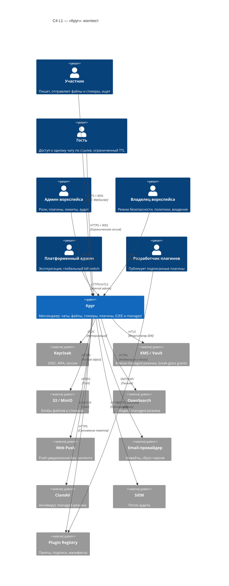

### 2.4. C4 Level 2 — Containers

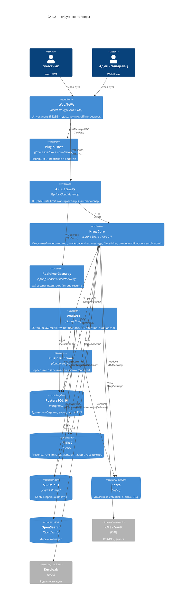

### 2.5. Границы доверия

| ID | Граница | Что доверяем | Что не доверяем | Контроль |
|---|---|---|---|---|
| TB-1 | Устройство пользователя | Хранение приватных ключей E2EE, расшифровка | Авторизацию, лимиты, валидацию, целостность `seq` | Сервер проверяет каждое действие; CSP; никаких секретов в JS |
| TB-2 | Edge (Gateway/WAF) | TLS-терминацию, rate limit | Заголовки клиента, `X-User-Id` | JWT-подпись, mTLS внутри, trust only gateway |
| TB-3 | Core | Бизнес-правила, транзакции | Контент E2EE | Нет ключей E2EE; RLS; least-privilege DB roles |
| TB-4 | Данные (PG/S3/KMS) | Шифрование в покое, backup | Прямой доступ приложения к чужим тенантам | RLS, KMS-политики, object lock, audit |
| TB-5 | Plugin sandbox | Ничего | Код плагина, его сеть, его storage | Отдельный origin, CSP, capability-JWT, allowlist, egress-proxy |
| TB-6 | Админ/break-glass | Штатные роли | «Тихий» доступ к контенту | 2 approvals, JIT, TTL, KMS-grant, аудит, уведомление |
| TB-7 | Внешние системы | Контракт (OIDC/KMS/S3) | Доступ к домену напрямую | mTLS, scoped credentials, timeout/circuit breaker |

### 2.6. Deployment-допущения

- Kubernetes, 3 AZ, 3+ узла core, 2+ узла realtime; HPA по CPU/connections.
- PostgreSQL — managed (Patroni/CloudNativePG), synchronous replica в другой AZ, PITR.
- Redis — cluster/sentinel, без persistence как source of truth.
- S3 — versioning + lifecycle; object lock для audit anchors.
- On-prem: Helm + внешние PG/S3/KMS; Keycloak в составе поставки.
- Секреты — Vault/Sealed Secrets; никаких секретов в env-файлах репозитория.

---

## 3. Домен, глоссарий, инварианты

### 3.1. Единый язык

| Термин | Определение | Владелец | Жизненный цикл | Ключевой инвариант |
|---|---|---|---|---|
| **Workspace** | Изолированный тенант: команда, семья, сообщество | workspace | `ACTIVE → SUSPENDED → DELETED` | `slug` уникален; `security_mode` неизменяем после создания без миграции |
| **Membership** | Связь пользователя и воркспейса с ролью | workspace | `INVITED → ACTIVE → SUSPENDED → REMOVED` | Нельзя удалить последнего `OWNER` |
| **Chat** | Диалог: `DIRECT` или `GROUP` | chat | `ACTIVE → ARCHIVED → DELETED` | `DIRECT` — ровно 2 участника; `security_mode` наследуется или ужесточается |
| **ChatMember** | Участие пользователя в чате с ролью | chat | `INVITED → ACTIVE → RESTRICTED → REMOVED` | Гость не видит воркспейс; `history_from_seq` ограничивает историю |
| **Message** | Элемент таймлайна: `TEXT`, `STICKER`, `SYSTEM`, `FILE` | message | `SENT → EDITED → DELETED` (tombstone) | `(chat_id, seq)` уникален; `seq` монотонен; контент E2EE серверу недоступен |
| **Timeline seq** | Монотонный номер события в чате | message | — | Выдаётся только в транзакции; пропуски допустимы, повтор — нет |
| **Envelope** | Шифротекст сообщения для устройства/группы | message | `CREATED → DELIVERED` | Для E2EE сервер не интерпретирует `ciphertext`/`header` |
| **Attachment** | Файл, привязанный к сообщению | file | `UPLOADED → SCANNING → READY → BOUND → DELETED` | Скачивание только у `READY`/`BOUND`; квота учитывает фактический размер блоба |
| **Upload** | Сессия загрузки | file | `INIT → UPLOADING → PAUSED → COMPLETING → SCANNING → READY → BOUND` | Части идемпотентны по `(upload_id, part_no)`; TTL 24 ч |
| **Quota reservation** | Резерв квоты до загрузки | file | `ACTIVE → COMMITTED / RELEASED / EXPIRED` | `used + reserved + new ≤ limit` в одной транзакции |
| **StickerPack** | Набор стикеров | sticker | `DRAFT → IN_REVIEW → ACTIVE → DISABLED → REMOVED` | Только PNG/WebP/APNG; SVG запрещён; 8–50 (Enterprise ≤100) |
| **Sticker** | Изображение в наборе | sticker | `ACTIVE → DISABLED → REMOVED` | `sha256` уникален в рамках воркспейса; 512×512, ≤512 КБ |
| **Plugin** | Опубликованный плагин (логический продукт) | plugin | `DRAFT → PUBLISHED → DEPRECATED → REMOVED` | Версия неизменяема; подпись обязательна |
| **PluginVersion** | Конкретная semver-версия | plugin | `PUBLISHED → YANKED` | Manifest и пакет иммутабельны |
| **Installation** | Установка плагина в воркспейс | plugin | `PENDING → ACTIVE → DISABLED → KILLED → UNINSTALLED` | Одна установка на `(workspace, plugin)` |
| **Enablement** | Включение плагина в чате | plugin | `ENABLED → DISABLED` | В E2EE серверные плагины запрещены |
| **Consent** | Согласие пользователя на доступ плагина к E2EE-чату | plugin | `GRANTED → REVOKED` | Без consent клиентский плагин не получает plaintext |
| **Device** | Экземпляр клиента с ключами | auth | `PENDING → ACTIVE → REVOKED` | ≤5 активных; отзыв необратим; ключи не переиспользуются |
| **Identity key** | Долговременный Ed25519-ключ устройства | auth | — | Приватный ключ не покидает устройство |
| **Prekey** | Одноразовый/подписанный X25519-ключ | auth | `AVAILABLE → CONSUMED` | Одноразовый ключ выдаётся ровно один раз |
| **Sender key** | Цепной ключ отправителя для группы | message | `EPOCH e → e+1` | Ротация при изменении состава/отзыве устройства |
| **Epoch** | Номер поколения групповых ключей | message | Монотонно растёт | Сообщение привязано к `epoch`; старые эпохи хранятся клиентом |
| **Invite** | Приглашение в воркспейс/чат | workspace | `ACTIVE → USED/REVOKED/EXPIRED` | В БД только `token_hash`; TTL; лимит использований |
| **Break-glass** | Экстренный доступ к managed-контенту | admin | `REQUESTED → APPROVED → ACTIVE → EXPIRED/REVOKED` | 2 разных approver; TTL ≤60 мин; только managed |
| **AuditEvent** | Неизменяемое событие аудита | audit | `APPENDED` | Hash chain; append-only; retention 12 мес. по умолчанию |
| **Sync cursor** | Позиция клиента в таймлайне | realtime | — | `last_seq` на чат; не глобальный курсор |
| **Security mode** | `E2EE` или `MANAGED` | workspace/chat | Наследуется | Managed может иметь E2EE-чат; E2EE не может иметь managed-чат |
| **Tariff** | Набор лимитов `COMMUNITY/FAMILY/TEAM/ENTERPRISE` | workspace | Меняется оператором | Лимиты — серверные; клиент только для UX |

### 3.2. Агрегаты и инварианты

| ID | Инвариант | Где проверяется |
|---|---|---|
| I-01 | `messages.seq` уникален в чате и строго возрастает; выдача — в транзакции с вставкой | `chat_counters` + unique per partition |
| I-02 | Повтор `client_message_id` в чате возвращает то же сообщение, а не создаёт новое | unique partial index + idempotency table |
| I-03 | `attachment` нельзя привязать к двум сообщениям | `attachments.message_id` + статус `BOUND` |
| I-04 | `used + reserved + new ≤ storage_bytes` | `workspace_usage` + reservation |
| I-05 | Нельзя удалить/понизить последнего `OWNER` чата или воркспейса | транзакционная проверка count |
| I-06 | Гость не состоит в других чатах воркспейса и не видит справочник | `chat_members` + ABAC |
| I-07 | E2EE-сообщение не имеет `body_ciphertext`, доступного серверу; только envelopes | constraint + code |
| I-08 | Сообщение E2EE-группы привязано к `epoch`; отправитель имеет sender key этой эпохи | client + envelope metadata |
| I-09 | Плагин не получает прав больше, чем в manifest и consent | capability claims = intersection |
| I-10 | Стикер — только изображение; MIME определяется по magic bytes, не по расширению | media validator |
| I-11 | Аудит нельзя обновить/удалить; hash chain проверяем | DB privileges + trigger/immutability |
| I-12 | Все тенантные запросы содержат `workspace_id`; RLS включён | RLS + integration test |
| I-13 | Удаление сообщения не освобождает квоту мгновенно; GC ≤24 ч | `deleted_at` + quota job |
| I-14 | Отозванное устройство не получает новые E2EE-конверты | fan-out filter + device status |
| I-15 | Ни один серверный компонент не логирует тело E2EE-сообщения или ключи | log scrubber + test |

### 3.3. Производные требования

Концепция задаёт бизнес- и функциональные требования, но не фиксирует часть системных контрактов. Ниже — производные FR, на которые ссылаются UC/API/тесты.

| ID | Требование | Источник |
|---|---|---|
| FR-RT-1 | WS-подключение только по одноразовому тикету (TTL 30 с), не по access-токену в query | FR-SEC-1, NFR |
| FR-RT-2 | Resume по `last_seq` на чат; при разрыве — sync + replay, без потери/дублей | CONCEPT §10.5 |
| FR-RT-3 | Порядок доставки — по `seq`; клиент игнорирует `seq ≤ last_seq` | CONCEPT §10.5 |
| FR-RT-4 | Backpressure: bounded queue, drop ephemeral, close 1013 slow consumer | NFR |
| FR-RT-5 | `typing`/`presence` — эфемерные, без гарантий и без истории | FR-PRES-1 |
| FR-DEV-1 | Регистрация устройства с публичными ключами и подписью; ≤5 активных | FR-ACC-7, FR-SEC-6 |
| FR-DEV-2 | Выдача prekeys atomically, one-time; rate limit против исчерпания | FR-SEC-2 |
| FR-DEV-3 | Отзыв устройства инвалидирует сессии, WS и исключает из E2EE | FR-SEC-6 |
| FR-IDEM-1 | `Idempotency-Key` обязателен для всех POST/PATCH/DELETE-мутаций | CONCEPT §10.5 |
| FR-IDEM-2 | `client_message_id` (UUID) уникален в чате; повтор возвращает тот же результат | CONCEPT §10.4 |
| FR-AUD-1 | Аудит append-only с hash chain и периодическим anchor | FR-SEC-7, CONCEPT §8.6 |
| FR-AUD-2 | Экспорт аудита CSV/JSON и SIEM-webhook с HMAC | FR-ADM-2 |
| FR-SYNC-1 | `GET /sync` отдаёт состояние чатов и `last_seq` для reconnect | CONCEPT §10.5 |
| FR-API-1 | Единый формат ошибок: `code`, `message`, `details`, `request_id` | NFR |
| FR-API-2 | Курсорная пагинация; `limit ≤ 100`; никаких offset на больших объёмах | CONCEPT §10.5 |

---

## 4. Use cases

Приоритет: **MVP** — пилот 18 недель; **v1** — 19–32 недели; **v2** — 9–18 месяцев.

### 4.1. Доступ и устройства

| UC | Сценарий / актор | Триггер | Pre → Post | Основной поток | Альтернативы | FR | Приоритет |
|---|---|---|---|---|---|---|---|
| **UC-01** | Регистрация, вход, регистрация устройства · новый пользователь | Переход по ссылке/регистрация | Email свободен или аккаунт существует → пользователь, membership (если инвайт), устройство `ACTIVE`, токены, аудит | 1) Открыть `/register` или инвайт; 2) Keycloak: email+пароль, verify email; 3) клиент генерирует identity key + prekeys; 4) `POST /devices`; 5) сервер проверяет подпись, лимит 5, сохраняет публичные ключи; 6) токены (access 15 мин, refresh 30 дней); 7) онбординг/воркспейс | Email занят → вход; слабый пароль → `422 WEAK_PASSWORD`; устройство сверх лимита → `409 DEVICE_LIMIT_REACHED`; инвайт истёк → `410 INVITE_EXPIRED`; email не подтверждён → `403 EMAIL_NOT_VERIFIED` | FR-ACC-1,2,7; FR-DEV-1 | MVP |
| **UC-02** | Приглашение участника · owner/admin | Кнопка «Пригласить» | Роль позволяет invite; есть свободные места → инвайт создан, ссылка отдана один раз, аудит | 1) `POST /workspaces/{id}/invites` с ролью, TTL 7 дней, `max_uses`; 2) сервер проверяет роль и seat limit; 3) хранит только `token_hash`; 4) возвращает ссылку; 5) приглашённый открывает, входит, `POST /invites/{token}/accept`; 6) membership `ACTIVE`, аудит | Истёк/использован/отозван → `410`; роль выше прав приглашающего → `403 ROLE_CEILING`; мест нет → `409 SEAT_LIMIT`; email не совпал (если email-инвайт) → `403` | FR-ACC-2; FR-CHAT-3 | MVP |
| **UC-03** | Гостевой доступ · гость | Гостевая ссылка (v1) | Ссылка активна, TTL, чат существует → гость в одном чате, история с `history_from_seq`, автоматический отзыв | 1) Админ создаёт гостевую ссылку на чат: TTL 7 дней, роль `GUEST`, окно истории 30 дней; 2) гость проходит Keycloak (email); 3) принимает инвайт; 4) сервер создаёт `GUEST` membership и `chat_member`; 5) RLS/ABAC ограничивают выдачу; 6) job истечения отзывает сессии и membership, пишет аудит | Ссылка истекла → `410`; чат удалён → `410`; гость пытается открыть другой чат → `403`; read-only → `403 CHAT_READ_ONLY`; продление — только новый инвайт | FR-ACC-9; FR-CHAT-3 | v1 |
| **UC-18** | Отзыв устройства · владелец устройства | «Потерял ноутбук» | Устройство `ACTIVE` → `REVOKED`, сессии инвалидированы, WS закрыт, E2EE-эпохи ротированы, аудит | 1) `DELETE /devices/{id}` со step-up; 2) сервер помечает `REVOKED`, инкрементирует `key_generation`; 3) отзывает refresh/access family; 4) закрывает WS; 5) публикует `EVT-22 device.revoked`; 6) клиенты в E2EE-чатах удаляют устройство из распределения и повышают epoch; 7) аудит | Последнее устройство → предупреждение, но отзыв разрешён; чужое устройство → `404` (не раскрывать); устройство уже отозвано → `204` идемпотентно | FR-ACC-7; FR-SEC-6; FR-DEV-3 | MVP |
| **UC-21** | Экспорт и удаление аккаунта · пользователь | Запрос субъекта данных | Аккаунт активен → экспорт-архив или `DELETED` с retention-окном | 1) `POST /me/export` → job; 2) асинхронная сборка метаданных и managed-контента; 3) ссылка TTL 7 дней; 4) `POST /me/delete` → soft delete, анонимизация, отзыв устройств; 5) через 30 дней — hard delete, аудит | E2EE-контент не экспортируется сервером — только клиентский экспорт; активные обязательства (billing) → `409`; повторный запрос → идемпотентно | FR-ACC-8 | v1 |

### 4.2. Чаты, сообщения, роли

| UC | Сценарий / актор | Триггер | Pre → Post | Основной поток | Альтернативы | FR | Приоритет |
|---|---|---|---|---|---|---|---|
| **UC-04** | Личный чат 1:1 · участник | Выбор пользователя → «Написать» | Оба в одном воркспейсе, DM разрешён → чат `DIRECT` с 2 участниками, режим унаследован | 1) `POST /workspaces/{id}/chats` `{type:DIRECT, peer_id}`; 2) проверка общей membership и политики DM; 3) поиск существующего `direct_key`; 4) создание чата + 2 `chat_members` + system message; 5) ответ 201 (или 200, если чат уже был) | Нет общей membership → `403`; self → `422`; гость → `403`; существующий чат → `200` с `chat_id`; blocked (v1) → `403` | FR-CHAT-1 | MVP |
| **UC-05** | Групповой чат и назначение ролей · owner/admin | «Создать группу» | Лимит участников не превышен, все приглашённые активны → группа, роли, system message, аудит | 1) `POST /workspaces/{id}/chats` `{type:GROUP, name, member_ids}`; 2) сервер проверяет лимит (100 MVP / 500 v1), активность участников; 3) создаёт чат, creator = `OWNER`; 4) добавляет участников `MEMBER`; 5) system message; 6) аудит | > лимита → `422 CHAT_MEMBER_LIMIT`; неактивный участник → `422`; попытка выдать `OWNER` → `403`; дубликат `client_request_id` → идемпотентно | FR-CHAT-2,3; FR-CHAT-8 | MVP |
| **UC-06** | Отправка сообщения (managed) · участник | Enter / «Отправить» | Активный участник, `chat.write`, чат не read-only, лимит не превышен → сообщение с `seq`, событие, доставка, receipts | 1) Клиент присваивает `client_message_id`, оптимистично рисует; 2) `POST /chats/{id}/messages` + `Idempotency-Key`; 3) authz + rate limit; 4) валидация текста ≤8000, вложений ≤10, reply в том же чате; 5) транзакция: `seq` → insert → outbox; 6) 201; 7) WS fan-out; 8) получатели шлют `delivered/read` | Повтор ключа → тот же ответ; тот же ключ, другой body → `409 IDEMPOTENCY_KEY_REUSED`; >8000 → `422 MESSAGE_TOO_LONG`; attachment не `READY` → `409 ATTACHMENT_NOT_READY`; квота → `409 QUOTA_EXCEEDED`; rate → `429`; read-only → `403 CHAT_READ_ONLY` | FR-CHAT-4,7,8; FR-IDEM-1,2 | MVP |
| **UC-07** | E2EE 1:1 · участник | Отправка в E2EE-чате | У обоих есть активные устройства и prekeys → конверт на каждое устройство, сервер не видит plaintext | 1) Клиент получает prekeys получателя `POST /keys/claim`; 2) X3DH + Double Ratchet, шифрует на каждое устройство; 3) `POST /messages` с `envelopes[]`; 4) сервер валидирует устройства/размер, выдаёт `seq`, пишет envelopes; 5) WS доставляет; 6) получатель расшифровывает, шлёт receipt | Нет prekeys → `409 NO_PREKEYS`; устройство не член → `422 UNKNOWN_DEVICE`; ключ изменился → клиент показывает предупреждение; отозванное устройство исключено | FR-SEC-2,4,5; FR-DEV-2 | MVP |
| **UC-08** | Групповой E2EE и ротация · участник | Создание/вход/удаление участника | E2EE-группа ≤50, epoch `e` → сообщение под sender key, при смене состава epoch `e+1` | 1) При создании каждый участник генерирует sender key и рассылает SKDM pairwise; 2) сообщение шифруется один раз sender key; 3) сервер fan-out всем устройствам; 4) при удалении/отзыве устройства — `epoch++`, новые SKDM, старые ключи остаются только для истории; 5) сообщения новой эпохи старым ключом не читаются | Нет SKDM → клиент запрашивает control-сообщение; несовпадение epoch → drop + запрос; офлайн-участник получает новую эпоху при подключении; >50 → `422 E2EE_GROUP_LIMIT` | FR-SEC-3; FR-CHAT-2 | MVP |
| **UC-09** | Ответ, реакция, закрепление · участник/модератор | Контекстное меню | Есть доступ к сообщению → reply/reaction/pin, системное событие | 1) Reply: `POST /messages` с `reply_to_id`; 2) реакция: `PUT /messages/{id}/reactions/{emoji}` (идемпотентно); 3) закрепление: `POST /chats/{id}/pins` — только `OWNER/ADMIN/MODERATOR`; 4) WS-событие; 5) системное сообщение для pin/unpin | Reply на удалённое → `410 MESSAGE_DELETED`; дубль реакции → `204`; лимит пинов 50 → `409 PIN_LIMIT`; нет прав → `403` | FR-CHAT-5,8 | MVP |
| **UC-10** | Редактирование и удаление · автор/модератор | Меню сообщения | Автор — edit/delete own; модератор — delete any → версия/томбстоун, GC вложений | 1) `PATCH /messages/{id}` с `version` (optimistic lock); 2) сервер проверяет авторство/роль, окно редактирования (политика, по умолчанию 48 ч); 3) `version++`, `edited_at`, WS `message.edited`; 4) `DELETE` → `deleted_at`, контент очищается, вложения в GC; 5) аудит для удаления чужого | Конфликт версий → `409 VERSION_CONFLICT`; окно истекло → `403 EDIT_WINDOW_EXPIRED`; уже удалено → `204`; E2EE edit — новый шифротекст, сервер не проверяет | FR-CHAT-6 | MVP |
| **UC-11** | Смена роли, удаление, передача владения · owner/admin | Панель «Люди» | Target — участник; роль в пределах ceiling → роль изменена, доступ пересчитан, E2EE-ротация при удалении | 1) `PATCH /chats/{id}/members/{userId}` `{role}`; 2) проверка: нельзя назначить `OWNER` (только transfer), нельзя понизить последнего owner; 3) обновление; 4) system message + аудит; 5) при удалении — `DELETE`, отзыв доступа, `epoch++`; 6) передача владения — отдельный endpoint, только `OWNER` | Последний owner → `409 LAST_OWNER`; self-demote owner → `409`; admin→owner → `403 ROLE_CEILING`; target не в чате → `404`; удаление инициирует ротацию | FR-CHAT-3; FR-SEC-3 | MVP (transfer — v1) |
| **UC-17** | Проверка ключей · участник | «Проверить ключи» | E2EE-чат, устройства известны → safety number сверен, отметка сохранена | 1) `GET /chats/{id}/keys` — устройства, identity keys, fingerprints; 2) клиент считает safety number; 3) QR/ручная сверка; 4) `PUT /chats/{id}/keys/verification` — метаданные проверки; 5) UI «проверено»; 6) при смене ключа — предупреждение и сброс отметки | Ключ изменился → `409 KEY_CHANGED` + предупреждение; устройство отозвано → `410`; нет E2EE → `409 MODE_NOT_E2EE` | FR-SEC-4 | MVP |
| **UC-23** | Reconnect и синхронизация · клиент | Потеря сети/возврат вкладки | Есть `last_seq` → состояние восстановлено без потерь и дублей | 1) `POST /realtime/ticket`; 2) WS `hello`; 3) `GET /sync` — чаты, `last_seq`, unread; 4) сравнение с локальным; 5) `subscribe` с `last_seq`; 6) сервер replay из `messages` (≤500) + live; 7) `resume.gap`, если слишком старо — REST backfill | Тикет истёк → `401` + новый; gap → REST `?after_seq=`; токен истёк → refresh; чат удалён → `410`; slow consumer → close 1013 | FR-RT-2,3; FR-SYNC-1 | MVP |

### 4.3. Файлы и стикеры

| UC | Сценарий / актор | Триггер | Pre → Post | Основной поток | Альтернативы | FR | Приоритет |
|---|---|---|---|---|---|---|---|
| **UC-12** | Загрузка файла с preflight, chunk и quota · участник | Скрепка / drag&drop | `chat.write`, квота доступна, тип разрешён → `attachment READY`, резерв закоммичен, сообщение может ссылаться | 1) Клиент вызывает `POST /uploads/preflight` (файлы, размеры, MIME, chat); 2) сервер проверяет лимит файла, число, квоту, тип, гостевой лимит; 3) создаёт reservation; 4) `POST /uploads` — init, `upload_id`, `part_size`; 5) `PUT /uploads/{id}/parts/{n}` идемпотентно; 6) `POST /complete` с sha256; 7) managed — AV/DLP `SCANNING`; 8) `READY`; 9) сообщение с `attachment_id`; 10) reservation → committed | > лимита → `413 FILE_TOO_LARGE`; квота → `409 QUOTA_EXCEEDED`; >10 файлов → `422 TOO_MANY_FILES`; SVG/HTML/exe по политике → `415 UNSUPPORTED_TYPE` / `422 DANGEROUS_TYPE_BLOCKED`; часть не совпала → `422 CHUNK_HASH_MISMATCH`; TTL → `410 UPLOAD_EXPIRED`; AV → `422 MALWARE_DETECTED` | FR-FILE-1,2,4,5,9,11,12 | MVP |
| **UC-13** | Скачивание и превью · участник | Клик по вложению | Вложение `READY/BOUND`, сообщение видимо, скан чистый → presigned URL / клиентская расшифровка | 1) `GET /attachments/{id}/download-url`; 2) authz по сообщению и чату; 3) managed: URL TTL 5 мин, `Content-Disposition`, диапазон; 4) E2EE: клиент получает зашифрованный объект и ключ из envelope, расшифровывает локально; 5) превью — серверное (managed) или клиентское (E2EE); 6) аудит скачивания — v1 | Нет доступа → `403`; удалено → `410`; карантин → `423 ATTACHMENT_QUARANTINED`; скан не завершён → `409 SCAN_PENDING`; URL истёк → новый запрос | FR-FILE-3,6 | MVP |
| **UC-14** | Отправка стикера · участник | Кнопка стикера → выбор | Набор включён в чат, стикер `ACTIVE`, `chat.write` → сообщение `type=STICKER`, один стикер | 1) `GET /chats/{id}/sticker-packs` — доступные наборы; 2) клиент показывает пикер (кэш ≤50 МБ); 3) `POST /messages` `{type:STICKER, sticker_id}`; 4) сервер проверяет enablement, статус стикера, E2EE-режим; 5) E2EE — шифрует изображение/ссылку на объект; 6) сообщение, реакции, reply | Набор отключён → `409 STICKER_PACK_DISABLED`; стикер удалён → `410`; неверный тип → `422`; >1 стикера → `422`; нет прав → `403` | FR-STK-1,2,3,8 | MVP |
| **UC-15** | Свой набор стикеров и модерация · owner/admin | «Загрузить набор» | Квота наборов есть, формат допустим → набор `ACTIVE` после review (v1), стикеры нормализованы | 1) `POST /workspaces/{id}/sticker-packs` — название, обложка; 2) `POST .../stickers` — по одному; 3) клиент/сервер проверяют PNG/WebP/APNG, 512×512, ≤512 КБ, анимация ≤3 с/≤30 fps; 4) нормализация, strip metadata; 5) managed — AV/DLP; 6) `IN_REVIEW` → `ACTIVE`; 7) аудит; 8) жалоба → `DISABLED` до разбора | 600 КБ → `413 STICKER_TOO_LARGE`; SVG → `415 UNSUPPORTED_STICKER_FORMAT`; 60 стикеров → `422 STICKER_PACK_LIMIT`; дубль `sha256` → дедуп, квота один раз; жалоба → `202`, набор скрыт | FR-STK-4,5,6,7,9,11 | v1 |

### 4.4. Платформа, поиск, аудит

| UC | Сценарий / актор | Триггер | Pre → Post | Основной поток | Альтернативы | FR | Приоритет |
|---|---|---|---|---|---|---|---|
| **UC-16** | Установка плагина, включение, RPC · admin/owner | Каталог → «Установить» | Manifest валиден, подпись проверена, права подтверждены → installation `ACTIVE`, enablement в чате, capability-токены | 1) `GET /plugins`; 2) `POST /workspaces/{id}/plugins/{pluginId}/install`; 3) сервер проверяет подпись/версию/allowlist/совместимость; 4) админ подтверждает permissions; 5) запись + аудит; 6) `POST /chats/{id}/plugins/{installationId}/enable`; 7) в E2EE — consent пользователя; 8) iframe загружается, RPC через host; 9) сервер минтит capability-JWT ≤5 мин и проверяет права на каждый вызов | Подпись неверна → `422 INVALID_SIGNATURE`; версия несовместима → `409 VERSION_INCOMPATIBLE`; прав больше, чем подтверждено → `403 CONSENT_REQUIRED`; E2EE + server plugin → `409 MODE_NOT_SUPPORTED`; kill switch → `423 PLUGIN_KILLED` | FR-PLUG-1..8,10 | MVP (runtime), v1 (каталог) |
| **UC-19** | Поиск · участник | Строка поиска / ⌘K | Доступ к чатам → результаты с учётом прав; E2EE — только локально | **Managed:** 1) `GET /workspaces/{id}/search?q=`; 2) ACL-фильтр по доступным чатам; 3) OpenSearch; 4) DLP-редакция; 5) сниппеты + переход к `seq`. **E2EE:** 1) запрос не уходит на сервер; 2) локальный зашифрованный индекс; 3) результаты только из локального кэша; 4) при отсутствии индекса — «история не проиндексирована» | Индекс отстаёт → `index_lag=true`; нет результатов; rate limit `429`; E2EE-устройство новое → истории нет; поиск по файлам managed — v1 | FR-CHAT-9; FR-SEARCH-1..3 | MVP |
| **UC-20** | Аудит, DLP, break-glass · admin | Admin UI / инцидент | Managed: роль + 2 approvals → доступ с TTL; E2EE: break-glass запрещён | **Аудит:** 1) `GET /workspaces/{id}/audit` с фильтрами; 2) hash chain verify; 3) экспорт job. **DLP:** 1) правило срабатывает на сообщение/файл; 2) warn/block/quarantine; 3) аудит. **Break-glass:** 1) `POST /break-glass` с причиной и scope; 2) второй approver; 3) KMS grant; 4) TTL 60 мин; 5) каждое чтение — аудит; 6) уведомление владельцу; 7) авто-ревок | E2EE → `409 BREAKGLASS_NOT_ALLOWED`; один approval → `403 SECOND_APPROVAL_REQUIRED`; истёк → `410`; нет роли → `403`; KMS deny → `503` | FR-SEC-7; FR-ADM-2,5 | MVP (аудит), v1 (DLP/BG) |
| **UC-22** | Retention и автоудаление · admin/система | Политика хранения | Политика задана → сообщения/файлы удаляются по TTL, квота освобождается | 1) Админ задаёт `retention_days`; 2) job выбирает партиции/записи; 3) soft delete → tombstone; 4) вложения и блобы удаляются; 5) квота пересчитывается; 6) аудит; 7) партиция detached/drop после archive | Политика меньше минимальной → `422`; legal hold (v2) блокирует; ошибка S3 → retry/DLQ | FR-CHAT-13; FR-FILE-7; FR-ADM-3 | v1 |

**Покрытие обязательных сценариев:** регистрация/инвайт/гость — UC-01..03; личный/групповой чат — UC-04..05; отправка/редактирование/удаление/ответ/реакция — UC-06..10; роли/удаление/передача — UC-11; E2EE 1:1 и группа — UC-07..08; файл — UC-12..13; стикеры — UC-14..15; плагины — UC-16; ключи/устройство — UC-17..18; аудит/DLP/break-glass — UC-20.

---

## 5. Модульная декомпозиция

### 5.1. Правила модульного монолита

1. **Один модуль — одна схема PostgreSQL** (`auth`, `workspace`, `chat`, `message`, `file`, `sticker`, `plugin`, `notification`, `search`, `audit`, `ops`). Кросс-модульные SQL-запросы запрещены; только публичные порты/read-views.
2. **Транзакция принадлежит одному модулю.** Если инвариант требует двух модулей (например, `seq` + вставка сообщения), используется in-process порт в той же транзакции; побочные эффекты — только через outbox.
3. **События — версионированные**, схема в `payload`; обратная совместимость в пределах major-версии. Потребитель идемпотентен по `event_id`.
4. **Модуль не читает чужую БД напрямую**, не импортирует чужие entities/DTO; ArchUnit-тест на зависимости.
5. **Синхронный вызов** допустим только для чтения/валидации в рамках запроса; всё, что можно отложить (уведомления, поиск, AV, аудит-экспорт), — асинхронно.
6. **Выделение в сервис** возможно по границам модуля: сначала realtime, затем file/media, затем plugin runtime; домен не меняется.

### 5.1.1. DDD-слои внутри bounded context

Каждый модуль — bounded context с четырьмя слоями; зависимости направлены внутрь. Это обязательное архитектурное требование, а не рекомендация.

| Слой | Содержит | Может зависеть от | Запрещено |
|---|---|---|---|
| `domain` | Aggregate root, entities, value objects, domain events, domain exceptions, repository interfaces | Только Java/`shared.kernel` | Spring, JPA, Jackson, DTO, HTTP, `@Transactional` |
| `application` | Command/query handlers, use cases, ports (`ChatAccessPort`, `SeqAllocator`, `IdempotencyPort`, `OutboxPort`), транзакционные границы | `domain` | `infrastructure`, `api`, JPA |
| `infrastructure` | JPA entities, Spring Data repositories, adapters, outbox/Kafka, persistence mappers | `domain`, `application` | `api` |
| `api` | Controllers, request/response DTO, validation, API mappers, `@RestControllerAdvice` | `application` | `infrastructure`, `domain`, JPA entity в ответе |

```text
ru.krug.message
├── domain/model/Message.java              // aggregate root, инварианты
├── domain/model/MessageId.java            // value object
├── domain/repository/MessageRepository.java
├── domain/event/MessageCreated.java
├── application/command/SendMessageHandler.java   // @Transactional
├── application/port/ChatAccessPort.java
├── infrastructure/persistence/MessageJpaEntity.java
├── infrastructure/persistence/JpaMessageRepository.java
├── infrastructure/persistence/MessagePersistenceMapper.java
├── api/rest/MessageController.java
├── api/dto/SendMessageRequest.java        // DTO + validation
└── api/mapper/MessageApiMapper.java       // DTO ↔ application/domain
```

Правила:
- **DTO — только `api.dto`.** Controller не принимает и не возвращает domain/JPA entity; `application` возвращает application-level result/read model, API маппит его в response DTO.
- **JPA entity — только `infrastructure.persistence`** и не является domain entity; маппинг в persistence mapper.
- **Инварианты — в domain** (`MessageText`, `Seq`, reply в том же чате), а не только в DTO-валидации.
- **Транзакция — в application handler**, не в controller и не в repository adapter.
- **Межконтекстные связи** — только IDs, ports, события; импорт domain-классов чужого контекста запрещён.
- **ArchUnit-тесты обязательны**: domain ↛ application/infrastructure/api/Spring/JPA; application ↛ infrastructure/api; api ↛ infrastructure/domain; нет кросс-контекстных domain-зависимостей.

### 5.2. Модули

| Модуль | Ответственность | Владеет данными | Входящие события | Исходящие события | Anti-scope | Зависимости |
|---|---|---|---|---|---|---|
| **auth** | Идентификация, сессии, устройства, публичные ключи, prekeys, verification-метаданные | `users`, `user_identities`, `devices`, `device_prekeys`, `key_verifications` | `EVT-22` (revoke), `EVT-30` | `EVT-22`, `EVT-23`, `EVT-29`, `EVT-30` | Не хранит роли воркспейса/чата, не проверяет права на контент, не хранит пароли (Keycloak) | Keycloak, PG, Redis |
| **workspace** | Тенант, membership, инвайты, тариф/лимиты, политики, seat limit | `workspaces`, `memberships`, `invites`, `workspace_limits` | `EVT-29`, `EVT-30` | `EVT-15`, `EVT-29` | Не владеет чатами/сообщениями, не выполняет биллинг-платежи, не модерирует контент | auth, audit, PG |
| **chat** | Жизненный цикл чата, участники, роли, `direct_key`, пины, read state, системные сообщения | `chats`, `chat_members`, `chat_counters`, `chat_pins`, `read_receipts` | `EVT-09`, `EVT-22` | `EVT-07`, `EVT-08`, `EVT-09`, `EVT-10` | Не хранит тела сообщений, не доставляет, не хранит файлы, не исполняет плагины | workspace, auth, message (port), audit |
| **message** | Таймлайн, `seq`, envelopes, реакции, edit/delete, receipts, стикер-сообщения | `messages`, `message_envelopes`, `message_payloads`, `sender_key_distributions`, `chat_key_epochs`, `message_reactions`, `message_edits` | `EVT-09`, `EVT-13`, `EVT-16`, `EVT-22` | `EVT-01`..`EVT-06`, `EVT-11`, `EVT-24` | Не шлёт push/email, не хранит блобы, не определяет права ролей, не делает fan-out | chat, workspace, file (readiness), audit, outbox |
| **realtime** | WS-тикеты, сессии, подписки, fan-out, presence/typing, resume, backpressure | Redis: `ws_session`, `presence`, `typing`; read-only PG для replay | `EVT-01`..`EVT-10`, `EVT-22` | `EVT-05`, `EVT-06`, `EVT-11`, `EVT-12` (эфемерные) | Не хранит сообщения/историю, не принимает бизнес-решения о доступе, не является SoT receipts | auth, chat, message, Redis, Kafka |
| **file** | Upload-сессии, attachments, квоты/reservations, AV-оркестрация, presigned URL, GC | `uploads`, `upload_parts`, `attachments`, `attachment_keys`, `quota_reservations`, `workspace_usage` | `EVT-14`, `EVT-15` | `EVT-13`, `EVT-14`, `EVT-15`, `EVT-24` | Не определяет тариф/лимиты (только исполняет), не отправляет сообщения, не модерирует контент | workspace (limits), S3, KMS, AV, audit |
| **sticker** | Наборы, стикеры, enablement, избранное, валидация и нормализация | `sticker_packs`, `stickers`, `workspace_sticker_packs`, `chat_sticker_packs`, `sticker_favorites` | `EVT-16`, `EVT-22` | `EVT-16`, `EVT-24` | Не рендерит HTML/SVG, не принимает финальное решение о жалобе, не отправляет сообщения | workspace, file/media, S3, AV (managed), audit |
| **plugin** | Реестр, версии, установки, enablement, consent, capability-токены, RPC-брокер, kill switch | `plugins`, `plugin_versions`, `plugin_installations`, `chat_plugin_enablements`, `plugin_consents`, `plugin_capability_grants` | `EVT-17`..`EVT-21`, `EVT-22` | `EVT-17`..`EVT-21`, `EVT-24` | Не исполняет код в core, не даёт доступ к БД, не читает E2EE, не хранит пользовательский контент | workspace, chat, auth, plugin runtime, registry, audit |
| **notification** | Настройки, fan-out, in-app/email/push, dedupe, quiet hours, retry | `notifications`, `notification_preferences` | `EVT-01`, `EVT-09`, `EVT-13`, `EVT-29` | `EVT-27` | Не хранит сообщения, не кладёт контент в E2EE-push, не подтверждает доставку сообщений | message/chat events, auth, push, email, Redis |
| **search** | Managed-индекс, ACL-фильтр, DLP-редакция, reindex; контракт локального индекса | OpenSearch (внешний), `search_documents` (logical) | `EVT-01`..`EVT-03`, `EVT-08`, `EVT-09`, `EVT-30` | `EVT-28` | Не является SoT, не индексирует E2EE на сервере, не ищет между тенантами | message/chat/workspace, OpenSearch |
| **admin/audit** | Аудит append/query/export, hash chain, anchors, break-glass, DLP-политики, жалобы, admin read models | `audit_events`, `audit_chain`, `audit_anchors`, `break_glass_*`, `content_reports`, `export_jobs`, `deletion_requests` | `EVT-24`, `EVT-25`, `EVT-26` | `EVT-25`, `EVT-26` | Не мутирует домен в обход API, не читает E2EE, не удаляет аудит | все модули (события), KMS, SIEM, PG |

**Приватность присутствия (FR-PRES-1):** `users.privacy` (v1) хранит `last_seen` (`EVERYONE|WORKSPACE|NOBODY`), `typing` и `read_receipts` (bool). Realtime фильтрует `presence`/`typing`, message не отдаёт receipts, если пользователь их отключил; настройка не влияет на доставку, только на отображение. В MVP — значения по умолчанию, UI-настройка в v1.

### 5.3. Зависимости модулей

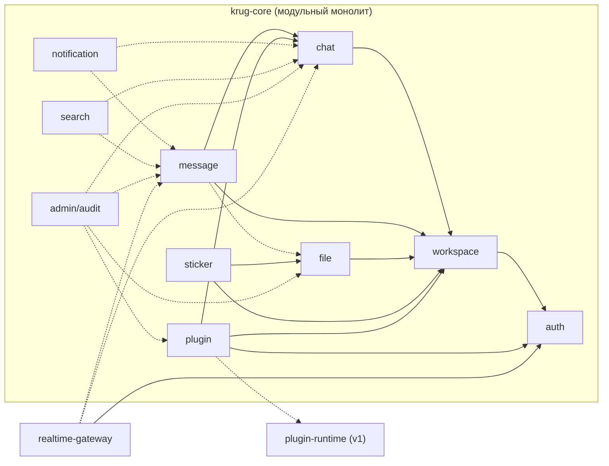

Сплошная стрелка — синхронный порт в рамках запроса; пунктир — асинхронное событие/read model.

### 5.4. Каталог событий

Все события — JSON-envelope, at-least-once, дедуп по `event_id`; порядок гарантируется в пределах `partition_key`.

```json
{
  "event_id": "0f3b6f4e-6c2a-4f6e-9c1a-2a0d9f7b1c33",
  "event_type": "message.created",
  "event_version": 1,
  "occurred_at": "2026-11-16T08:21:44.512Z",
  "workspace_id": "6b0f3a3e-...",
  "aggregate_type": "message",
  "aggregate_id": "b1e0...",
  "partition_key": "chat_id",
  "trace_id": "4bf92f3577b34da6",
  "payload": { "chat_id": "...", "seq": 18422, "sender_id": "...", "type": "TEXT", "size_bytes": 412 }
}
```

| ID | Event | Producer | Consumers | Topic | Key | Payload (без plaintext) | Семантика |
|---|---|---|---|---|---|---|---|
| EVT-01 | `message.created` | message | realtime, notification, search, audit, plugin | `krug.message.v1` | `chat_id` | message_id, chat_id, seq, sender_id, type, created_at, attachment_ids[], sticker_id, epoch | Факт в таймлайне; доставка at-least-once |
| EVT-02 | `message.edited` | message | realtime, search, audit | `krug.message.v1` | `chat_id` | message_id, seq, version, edited_at, editor_id | Новая версия; клиент применяет при `version > local` |
| EVT-03 | `message.deleted` | message | realtime, search, file, audit | `krug.message.v1` | `chat_id` | message_id, seq, deleted_by, deleted_at | Томбстоун; контент очищен |
| EVT-04 | `message.reaction.changed` | message | realtime | `krug.message.v1` | `chat_id` | message_id, user_id, emoji, action | Идемпотентно по `(message,user,emoji,action)` |
| EVT-05 | `message.delivered` | realtime | message, notification | `krug.message.v1` | `chat_id` | message_id, user_id, device_id, delivered_at | Агрегат по пользователю |
| EVT-06 | `message.read` | realtime | message, notification | `krug.message.v1` | `chat_id` | chat_id, user_id, last_read_seq | Монотонно; меньшее значение игнорируется |
| EVT-07 | `chat.created` | chat | realtime, search, audit | `krug.chat.v1` | `chat_id` | chat_id, workspace_id, type, security_mode, member_ids | — |
| EVT-08 | `chat.updated` | chat | realtime, search, audit | `krug.chat.v1` | `chat_id` | chat_id, changed_fields[], version | Оптимистичная конкуренция |
| EVT-09 | `chat.member.changed` | chat | realtime, message, notification, search, audit | `krug.chat.v1` | `chat_id` | chat_id, user_id, old_role, new_role, status, actor_id, epoch | Триггер ротации E2EE при удалении |
| EVT-10 | `chat.pin.changed` | chat | realtime | `krug.chat.v1` | `chat_id` | chat_id, message_id, action, actor_id | — |
| EVT-11 | `typing.changed` | realtime | realtime (WS) | — (Redis) | `chat_id` | chat_id, user_id, expires_at | Эфемерное, не персистится |
| EVT-12 | `presence.changed` | realtime | realtime (WS) | — (Redis) | `user_id` | user_id, status, last_seen_at | Эфемерное, TTL 60 с |
| EVT-13 | `upload.completed` | file | message, audit | `krug.media.v1` | `workspace_id` | upload_id, attachment_id, size_bytes, sha256, scan_status | Готовность вложения |
| EVT-14 | `media.scan.completed` | file worker | message, notification, audit | `krug.media.v1` | `workspace_id` | attachment_id, scan_status, engine, details | `CLEAN/INFECTED/FAILED` |
| EVT-15 | `quota.threshold.reached` | file | notification, audit | `krug.media.v1` | `workspace_id` | workspace_id, threshold (80/95/100), used, limit | Дедуп по `(workspace,threshold,period)` |
| EVT-16 | `sticker.pack.changed` | sticker | realtime, search, audit | `krug.media.v1` | `workspace_id` | pack_id, status, enabled_chat_ids[], version | — |
| EVT-17 | `plugin.installed` | plugin | audit, notification | `krug.plugin.v1` | `workspace_id` | installation_id, plugin_id, version, permissions[] | — |
| EVT-18 | `plugin.enabled` | plugin | realtime, audit | `krug.plugin.v1` | `chat_id` | chat_id, installation_id, plugin_id, enabled_by | — |
| EVT-19 | `plugin.disabled` | plugin | realtime, audit | `krug.plugin.v1` | `chat_id` | chat_id, installation_id, reason | Токены отзываются |
| EVT-20 | `plugin.killed` | plugin | realtime, audit, notification | `krug.plugin.v1` | `workspace_id` | plugin_id, installation_id, scope, reason | Немедленный отзыв |
| EVT-21 | `plugin.consent.changed` | plugin | realtime, audit | `krug.plugin.v1` | `chat_id` | chat_id, user_id, plugin_id, decision | Только E2EE |
| EVT-22 | `device.revoked` | auth | realtime, message, chat, audit, notification | `krug.identity.v1` | `user_id` | user_id, device_id, reason, key_generation | Триггер E2EE-ротации |
| EVT-23 | `device.keys.updated` | auth | message, realtime | `krug.identity.v1` | `user_id` | user_id, device_id, key_generation, prekey_count | Новые prekeys |
| EVT-24 | `audit.appended` | audit | SIEM, audit anchor | `krug.audit.v1` | `workspace_id` | audit_id, seq, action, actor_id, hash | Append-only |
| EVT-25 | `breakglass.approved` | admin | audit, notification | `krug.audit.v1` | `workspace_id` | request_id, scope, approvers[], expires_at | 2 approvals |
| EVT-26 | `breakglass.access` | admin | audit, SIEM | `krug.audit.v1` | `workspace_id` | request_id, actor_id, target, action | Каждое чтение |
| EVT-27 | `notification.requested` | notification | push/email worker | `krug.notify.v1` | `user_id` | notification_id, type, chat_id, dedupe_key | Без контента |
| EVT-28 | `search.index.requested` | message/search | search worker | `krug.search.v1` | `workspace_id` | message_id, action, version | Только managed |
| EVT-29 | `invite.accepted` | workspace | audit, notification | `krug.chat.v1` | `workspace_id` | invite_id, user_id, workspace_id, chat_id | — |
| EVT-30 | `user.deleted` | auth | workspace, message, search, audit | `krug.identity.v1` | `user_id` | user_id, deleted_at, anonymized | GDPR/152-ФЗ |

---

## 6. Модель данных

### 6.1. ERD

```mermaid
erDiagram
  USERS ||--o{ USER_IDENTITIES : "provider"
  USERS ||--o{ DEVICES : "owns"
  DEVICES ||--o{ DEVICE_PREKEYS : "has"
  USERS ||--o{ MEMBERSHIPS : "member"
  WORKSPACES ||--o{ MEMBERSHIPS : "contains"
  WORKSPACES ||--|| WORKSPACE_LIMITS : "limits"
  WORKSPACES ||--|| WORKSPACE_USAGE : "usage"
  WORKSPACES ||--o{ INVITES : "invites"
  WORKSPACES ||--o{ CHATS : "owns"
  WORKSPACES ||--o{ STICKER_PACKS : "packs"
  WORKSPACES ||--o{ PLUGIN_INSTALLATIONS : "installs"
  WORKSPACES ||--o{ AUDIT_EVENTS : "audit"
  WORKSPACES ||--o{ CONTENT_REPORTS : "reports"
  CHATS ||--|| CHAT_COUNTERS : "seq"
  CHATS ||--o{ CHAT_MEMBERS : "members"
  CHATS ||--o{ MESSAGES : "timeline"
  CHATS ||--o{ CHAT_PINS : "pins"
  CHATS ||--o{ READ_RECEIPTS : "reads"
  CHATS ||--o{ CHAT_STICKER_PACKS : "stickers"
  CHATS ||--o{ CHAT_PLUGIN_ENABLEMENTS : "plugins"
  CHATS ||--o{ CHAT_KEY_EPOCHS : "epochs"
  USERS ||--o{ CHAT_MEMBERS : "participates"
  USERS ||--o{ MESSAGES : "sends"
  USERS ||--o{ NOTIFICATIONS : "receives"
  USERS ||--o{ KEY_VERIFICATIONS : "verifies"
  MESSAGES ||--o{ MESSAGE_ENVELOPES : "device envelopes"
  MESSAGES ||--o{ MESSAGE_PAYLOADS : "group payload"
  MESSAGES ||--o{ MESSAGE_REACTIONS : "reactions"
  MESSAGES ||--o{ MESSAGE_EDITS : "versions"
  MESSAGES ||--o{ ATTACHMENTS : "attachments"
  MESSAGES ||--o{ CHAT_PINS : "pinned"
  CHAT_KEY_EPOCHS ||--o{ SENDER_KEY_DISTRIBUTIONS : "skdm"
  UPLOADS ||--o{ UPLOAD_PARTS : "parts"
  UPLOADS ||--o| ATTACHMENTS : "becomes"
  UPLOADS ||--o| QUOTA_RESERVATIONS : "reserves"
  ATTACHMENTS ||--o{ ATTACHMENT_KEYS : "keys"
  STICKER_PACKS ||--o{ STICKERS : "contains"
  STICKER_PACKS ||--o{ STICKER_PACK_KEYS : "keys"
  STICKER_PACKS ||--o{ WORKSPACE_STICKER_PACKS : "installed"
  STICKER_PACKS ||--o{ CHAT_STICKER_PACKS : "enabled"
  STICKERS ||--o{ STICKER_FAVORITES : "favorited"
  STICKERS ||--o{ MESSAGES : "sticker message"
  PLUGINS ||--o{ PLUGIN_VERSIONS : "versions"
  PLUGINS ||--o{ PLUGIN_INSTALLATIONS : "installed"
  PLUGIN_INSTALLATIONS ||--o{ CHAT_PLUGIN_ENABLEMENTS : "enabled"
  PLUGIN_INSTALLATIONS ||--o{ PLUGIN_CONSENTS : "consent"
  PLUGIN_INSTALLATIONS ||--o{ PLUGIN_CAPABILITY_GRANTS : "grants"
  BREAK_GLASS_REQUESTS ||--o{ BREAK_GLASS_APPROVALS : "approvals"
  AUDIT_EVENTS ||--|| AUDIT_CHAIN : "chain"
```

### 6.2. Каталог таблиц

#### Идентичность и тенантность

| ID | Таблица | Назначение | PK / UK | Индексы | Partition / Retention |
|---|---|---|---|---|---|
| ENT-01 | `auth.users` | Локальное зеркало пользователя; профиль | `PK(id)`; `UK(email)` | `(status)`, `(created_at)` | — / до удаления+30 дн. |
| ENT-02 | `auth.user_identities` | Связь с OIDC-subject | `PK(id)`; `UK(provider,subject)`, `UK(user_id,provider)` | `(user_id)` | — / с пользователем |
| ENT-03 | `auth.devices` | Устройства и публичные identity-ключи | `PK(id)`; `UK(user_id,identity_public_key)` | `(user_id,status)`, `(last_seen_at)` | — / 90 дн. после revoke |
| ENT-04 | `auth.device_prekeys` | Signed/one-time prekeys | `PK(device_id,key_id)` | partial `(device_id) WHERE consumed_at IS NULL` | — / 30 дн. после consume |
| ENT-05 | `workspace.workspaces` | Тенант, режим, политика | `PK(id)`; `UK(slug)` | `(security_mode)`, `(created_at)` | — / 30 дн. soft delete |
| ENT-06 | `workspace.memberships` | Роль в воркспейсе | `PK(workspace_id,user_id)` | `(user_id,status)`, partial `(workspace_id) WHERE role='OWNER'` | — / с воркспейсом |
| ENT-07 | `workspace.workspace_limits` | Тариф и серверные лимиты | `PK(workspace_id)` | — | — / версионируется |
| ENT-08 | `file.workspace_usage` | Счётчики квоты | `PK(workspace_id)` | — | — / онлайн |
| ENT-09 | `workspace.invites` | Инвайты, только hash | `PK(id)`; `UK(token_hash)` | `(workspace_id,expires_at)`, `(chat_id)` | — / 30 дн. после expire |
| ENT-10 | `chat.chats` | Чат, режим, `direct_key`, epoch | `PK(id)`; partial `UK(workspace_id,direct_key)` | `(workspace_id,last_message_at DESC)`, `(workspace_id,type)` | — / 30 дн. soft delete |
| ENT-11 | `chat.chat_members` | Участие, роль, история | `PK(chat_id,user_id)` | `(user_id,status)`, partial `(chat_id) WHERE role IN ('OWNER','ADMIN')` | — / с чатом |
| ENT-12 | `chat.chat_counters` | Аллокатор `seq` | `PK(chat_id)` | — | — / онлайн |
| ENT-13 | `message.messages` | Таймлайн | `PK(id,created_at)`; per-partition `UK(chat_id,seq)` | `(chat_id,seq DESC)`, `(chat_id,created_at DESC)`, partial `(chat_id,client_message_id)` | RANGE(created_at) месяц / 12–24 мес. |
| ENT-14 | `message.message_envelopes` | E2EE 1:1 конверты на устройство | `PK(message_id,recipient_device_id,created_at)` | `(recipient_device_id,created_at)` | RANGE(created_at) месяц / с сообщением |
| ENT-15 | `message.message_payloads` | E2EE группа: один шифротекст | `PK(message_id,scheme)` | `(chat_id,created_at)` | С сообщением |
| ENT-16 | `message.sender_key_distributions` | SKDM для sender keys | `PK(id)`; `UK(chat_id,epoch,sender_device_id,recipient_device_id)` | `(recipient_device_id,created_at)` | 30 дн. после epoch |
| ENT-17 | `message.chat_key_epochs` | Поколения групповых ключей | `PK(chat_id,epoch)` | — | С чатом |
| ENT-18 | `message.message_reactions` | Реакции | `PK(message_id,user_id,emoji)` | `(message_id)` | С сообщением |
| ENT-19 | `chat.read_receipts` | `last_read_seq`/`delivered` | `PK(chat_id,user_id)` | `(user_id,updated_at)` | С чатом |
| ENT-20 | `chat.chat_pins` | Закрепления | `PK(chat_id,message_id)` | `(chat_id,pinned_at)` | С чатом |
| ENT-21 | `message.message_edits` | История версий (v1) | `PK(message_id,version)` | — | 90 дн. / с сообщением |
| ENT-22 | `file.attachments` | Вложения | `PK(id)`; `UK(object_key)` | `(message_id)`, `(chat_id,created_at)`, `(workspace_id,status)` | 12–24 мес. / GC |
| ENT-23 | `file.attachment_keys` | Ключи вложения на устройство | `PK(attachment_id,recipient_device_id)` | `(recipient_device_id)` | С вложением |
| ENT-24 | `file.uploads` | Сессии загрузки | `PK(id)`; `UK(object_key)` | `(user_id,status)`, `(expires_at) WHERE status IN (...)` | 7 дн. после завершения |
| ENT-25 | `file.upload_parts` | Части и хеши | `PK(upload_id,part_no)` | — | С upload |
| ENT-26 | `file.quota_reservations` | Резервы квоты | `PK(id)`; `UK(upload_id)` | `(workspace_id,status)`, `(expires_at)` | 30 дн. после commit/release |
| ENT-27 | `sticker.sticker_packs` | Наборы (builtin/workspace) | `PK(id)` | `(workspace_id,status)`, `(visibility)` | — / soft delete |
| ENT-28 | `sticker.stickers` | Стикеры | `PK(id)`; `UK(pack_id,sha256)` | `(pack_id,position)` | — / с набором |
| ENT-29 | `sticker.workspace_sticker_packs` | Установка набора в воркспейс | `PK(workspace_id,pack_id)` | `(pack_id)` | — |
| ENT-30 | `sticker.chat_sticker_packs` | Включение набора в чат | `PK(chat_id,pack_id)` | `(pack_id)` | — |
| ENT-31 | `sticker.sticker_favorites` | Избранное (сервер, кросс-девайс) | `PK(user_id,sticker_id)` | `(user_id,created_at)` | С пользователем |
| ENT-32 | `plugin.plugins` | Плагин как продукт | `PK(id)`; `UK(slug)` | `(status,visibility)` | — |
| ENT-33 | `plugin.plugin_versions` | Версии, manifest, подпись | `PK(plugin_id,version)` | `(plugin_id,status)` | Иммутабельны |
| ENT-34 | `plugin.plugin_installations` | Установка в воркспейс | `PK(id)`; `UK(workspace_id,plugin_id)` | `(workspace_id,status)` | — |
| ENT-35 | `plugin.chat_plugin_enablements` | Включение в чате | `PK(chat_id,installation_id)` | `(installation_id)` | — |
| ENT-36 | `plugin.plugin_consents` | Согласие в E2EE | `PK(id)`; partial `UK(chat_id,user_id,plugin_id) WHERE revoked_at IS NULL` | `(user_id,chat_id)` | 1 год после revoke |
| ENT-37 | `plugin.plugin_capability_grants` | Выданные capability-JWT (аудит) | `PK(jti)` | `(installation_id,expires_at)`, `(revoked_at)` | 30 дн. после expiry |
| ENT-38 | `audit.audit_events` | Append-only аудит | `PK(id,created_at)`; per-partition `UK(workspace_id,seq)` | `(workspace_id,created_at DESC)`, `(workspace_id,action,created_at)` | RANGE(created_at) месяц / 12 мес. |
| ENT-39 | `audit.audit_chain` | Голова hash chain | `PK(workspace_id)` | — | — |
| ENT-40 | `audit.audit_anchors` | Суточные anchor | `PK(id)`; `UK(workspace_id,to_seq)` | `(workspace_id,created_at)` | 3 года / S3 object lock |
| ENT-41 | `audit.break_glass_requests` | Запросы break-glass | `PK(id)` | `(workspace_id,status)`, `(expires_at)` | 3 года |
| ENT-42 | `audit.break_glass_approvals` | Решения approver | `PK(request_id,approver_id)` | — | 3 года |
| ENT-43 | `notification.notifications` | Очередь/статус уведомлений | `PK(id)`; `UK(dedupe_key)` | `(user_id,created_at DESC)`, `(status,created_at)` | 90 дн. |
| ENT-44 | `notification.notification_preferences` | Настройки по чату/типу | `PK(user_id,workspace_id,scope_key,type,channel)` | `(user_id)` | С пользователем |
| ENT-45 | `ops.outbox` | Transactional outbox | `PK(id)` | partial `(id) WHERE published_at IS NULL` | 7 дн. после publish |
| ENT-46 | `ops.idempotency_keys` | Идемпотентность API | `PK(user_id,scope,key)` | `(expires_at)` | 24 ч (мутации) / 7 дн. |
| ENT-47 | `audit.content_reports` | Жалобы на контент | `PK(id)` | `(workspace_id,status)`, `(target_type,target_id)` | 3 года |
| ENT-48 | `ops.export_jobs` | Экспорт аудита/аккаунта | `PK(id)` | `(workspace_id,status)` | 7 дн. |
| ENT-49 | `ops.deletion_requests` | Удаление аккаунта | `PK(id)` | `(status,scheduled_at)` | 3 года (факт) |
| ENT-50 | `auth.key_verifications` | Метаданные сверки ключей | `PK(id)`; partial `UK(verifier_user_id,target_device_id,chat_id) WHERE revoked_at IS NULL` | `(chat_id)` | С устройством |
| ENT-51 | `ops.processed_events` | Дедуп потребителей | `PK(consumer,event_id)` | `(processed_at)` | 30 дн. |
| ENT-52 | `sticker.sticker_pack_keys` | E2EE: ключ набора на устройство, epoch | `PK(pack_id,epoch,recipient_device_id)`; `workspace_id` | `(recipient_device_id,created_at)` | С набором; старые epoch — 30 дн. |

### 6.3. Партиционирование и retention

| Данные | Стратегия | Ключ/индексы | Retention | Архив/удаление |
|---|---|---|---|---|
| `message.messages` | RANGE по `created_at`, месяц; 3 будущих партиции | per-partition `UNIQUE(chat_id,seq)`, partial `UNIQUE(chat_id,client_message_id)`, `(chat_id,seq DESC)` | 12 мес. Community/Team, 24 мес. Family, политика Enterprise | Detach → Parquet в S3 (object lock) → `DROP PARTITION`; без FK на envelopes |
| `message.message_envelopes` | Наследует retention сообщения; без партиционирования в MVP | `(recipient_device_id,created_at)` | С сообщением | Batch-delete по `message_id` при drop/GC |
| `message.sender_key_distributions` | — | `(recipient_device_id,created_at)` | 30 дн. после смены epoch | Batch-delete |
| `audit.audit_events` | RANGE по `created_at`, месяц | per-partition `UNIQUE(workspace_id,seq)`, `(workspace_id,created_at DESC)` | 12 мес. (Enterprise — политика) | Anchors в S3 object lock; drop только после anchor |
| `notification.notifications` | — | `(user_id,created_at DESC)` | 90 дн. | Delete job |
| `file.uploads`/`upload_parts` | — | `(expires_at)` partial | 7 дн. после terminal status | Delete job; S3 abort multipart |
| `ops.idempotency_keys` | — | `(expires_at)` | 24 ч (мутации), 7 дн. (долгие jobs) | Delete job |
| `ops.outbox` | — | partial `(id) WHERE published_at IS NULL` | 7 дн. после publish | Delete job |

**Правила:**
- Партиции создаёт `pg_partman`/cron за 3 месяца; алерт, если следующей партиции нет.
- `messages` не имеет FK на `chats`/`users`: партиционированная таблица не даёт глобального уникального ключа. Целостность — на уровне приложения + ежедневный orphan-check (`chat_id NOT IN chats`).
- Удаление сообщения — soft delete; физическое удаление контента и блобов — GC ≤24 ч. Квота освобождается после фактического удаления объекта, не в момент `DELETE`.
- Холодный архив не доступен через API MVP; чтение архива — отдельный внутренний job (v1).

### 6.4. DDL-фрагменты

```sql
CREATE EXTENSION IF NOT EXISTS citext;
CREATE EXTENSION IF NOT EXISTS pgcrypto;

CREATE SCHEMA IF NOT EXISTS auth;
CREATE SCHEMA IF NOT EXISTS workspace;
CREATE SCHEMA IF NOT EXISTS chat;
CREATE SCHEMA IF NOT EXISTS message;
CREATE SCHEMA IF NOT EXISTS file;
CREATE SCHEMA IF NOT EXISTS sticker;
CREATE SCHEMA IF NOT EXISTS plugin;
CREATE SCHEMA IF NOT EXISTS notification;
CREATE SCHEMA IF NOT EXISTS search;
CREATE SCHEMA IF NOT EXISTS audit;
CREATE SCHEMA IF NOT EXISTS ops;

-- Роли: миграции — krug_migrator (владелец), приложение — krug_app (RLS),
-- воркеры — krug_worker (ограниченный BYPASSRLS только для фоновых job).
```

#### Сообщения и `seq`

```sql
CREATE TABLE chat.chat_counters (
  chat_id uuid PRIMARY KEY,
  next_seq bigint NOT NULL DEFAULT 1 CHECK (next_seq > 0),
  last_message_at timestamptz,
  updated_at timestamptz NOT NULL DEFAULT now()
);

CREATE TABLE message.messages (
  id uuid NOT NULL DEFAULT gen_random_uuid(),
  workspace_id uuid NOT NULL,
  chat_id uuid NOT NULL,
  seq bigint NOT NULL CHECK (seq > 0),
  sender_id uuid,
  sender_device_id uuid,
  type text NOT NULL CHECK (type IN ('TEXT','STICKER','SYSTEM','FILE')),
  crypto_scheme text NOT NULL DEFAULT 'MANAGED'
    CHECK (crypto_scheme IN ('NONE','MANAGED','E2EE_PAIRWISE','E2EE_SENDER_KEY')),
  body_ciphertext bytea,          -- managed: server-encrypted; E2EE: NULL
  content_meta jsonb NOT NULL DEFAULT '{}'::jsonb,  -- только метаданные, без plaintext
  client_message_id uuid,
  reply_to_id uuid,
  thread_root_id uuid,
  sticker_id uuid,
  epoch integer CHECK (epoch IS NULL OR epoch >= 0),
  created_at timestamptz NOT NULL DEFAULT now(),
  edited_at timestamptz,
  deleted_at timestamptz,
  deleted_by uuid,
  version integer NOT NULL DEFAULT 1 CHECK (version > 0),
  PRIMARY KEY (id, created_at),
  CHECK (type <> 'STICKER' OR sticker_id IS NOT NULL),
  CHECK (type <> 'TEXT' OR body_ciphertext IS NOT NULL
         OR crypto_scheme IN ('E2EE_PAIRWISE','E2EE_SENDER_KEY'))
) PARTITION BY RANGE (created_at);

CREATE TABLE message.messages_2026_11 PARTITION OF message.messages
  FOR VALUES FROM ('2026-11-01') TO ('2026-12-01');

CREATE UNIQUE INDEX ux_messages_2026_11_chat_seq
  ON message.messages_2026_11 (chat_id, seq);
CREATE UNIQUE INDEX ux_messages_2026_11_client
  ON message.messages_2026_11 (chat_id, client_message_id)
  WHERE client_message_id IS NOT NULL;
CREATE INDEX ix_messages_2026_11_chat_created
  ON message.messages_2026_11 (chat_id, created_at DESC);
```

```sql
-- E2EE 1:1: конверт на каждое устройство получателя (включая другие устройства отправителя).
-- Партиционируется по created_at тем же retention, что и messages.
CREATE TABLE message.message_envelopes (
  message_id uuid NOT NULL,
  recipient_device_id uuid NOT NULL,
  workspace_id uuid NOT NULL,       -- денормализация для RLS
  chat_id uuid NOT NULL,
  scheme text NOT NULL CHECK (scheme IN ('PAIRWISE')),
  header jsonb NOT NULL,
  ciphertext bytea NOT NULL,
  created_at timestamptz NOT NULL DEFAULT now(),
  PRIMARY KEY (message_id, recipient_device_id, created_at)
) PARTITION BY RANGE (created_at);

-- Партиции message_envelopes_YYYY_MM создаются тем же job, что и messages.
CREATE INDEX ix_envelopes_recipient
  ON message.message_envelopes (recipient_device_id, created_at);

-- E2EE группа: один sender-key шифротекст на сообщение.
CREATE TABLE message.message_payloads (
  message_id uuid NOT NULL,
  scheme text NOT NULL CHECK (scheme IN ('SENDER_KEY')),
  workspace_id uuid NOT NULL,
  chat_id uuid NOT NULL,
  epoch integer NOT NULL,
  header jsonb NOT NULL,
  ciphertext bytea NOT NULL,
  created_at timestamptz NOT NULL DEFAULT now(),
  PRIMARY KEY (message_id, scheme)
);

-- SKDM: доставка sender key конкретному устройству; хранится до 30 дней.
CREATE TABLE message.sender_key_distributions (
  id uuid PRIMARY KEY,
  workspace_id uuid NOT NULL,
  chat_id uuid NOT NULL,
  epoch integer NOT NULL,
  sender_device_id uuid NOT NULL,
  recipient_device_id uuid NOT NULL,
  ciphertext bytea NOT NULL,
  created_at timestamptz NOT NULL DEFAULT now(),
  UNIQUE (chat_id, epoch, sender_device_id, recipient_device_id)
);

CREATE TABLE message.chat_key_epochs (
  chat_id uuid NOT NULL,
  epoch integer NOT NULL,
  workspace_id uuid NOT NULL,
  reason text NOT NULL,
  created_by uuid,
  created_at timestamptz NOT NULL DEFAULT now(),
  PRIMARY KEY (chat_id, epoch)
);
```

```sql
-- Аллокация seq и вставка — одна транзакция. Дырки после rollback допустимы.
WITH c AS (
  UPDATE chat.chat_counters
     SET next_seq = next_seq + 1,
         last_message_at = now(),
         updated_at = now()
   WHERE chat_id = $1
  RETURNING next_seq - 1 AS seq
)
INSERT INTO message.messages (
  workspace_id, chat_id, seq, sender_id, sender_device_id, type,
  body_ciphertext, content_meta, client_message_id, reply_to_id, sticker_id, epoch, crypto_scheme
)
SELECT $2, $1, c.seq, $3, $4, $5, $6, $7, $8, $9, $10, $11, $12
FROM c
RETURNING id, seq, created_at;
```

```sql
CREATE OR REPLACE FUNCTION ops.ensure_message_partition(p_month date)
RETURNS void LANGUAGE plpgsql AS $$
DECLARE
  start_date date := date_trunc('month', p_month)::date;
  end_date date := (start_date + interval '1 month')::date;
  part_name text := format('messages_%s', to_char(start_date, 'YYYY_MM'));
BEGIN
  EXECUTE format(
    'CREATE TABLE IF NOT EXISTS message.%I PARTITION OF message.messages FOR VALUES FROM (%L) TO (%L)',
    part_name, start_date, end_date);
  EXECUTE format(
    'CREATE UNIQUE INDEX IF NOT EXISTS %I ON message.%I (chat_id, seq)',
    'ux_' || part_name || '_chat_seq', part_name);
  EXECUTE format(
    'CREATE UNIQUE INDEX IF NOT EXISTS %I ON message.%I (chat_id, client_message_id) WHERE client_message_id IS NOT NULL',
    'ux_' || part_name || '_client', part_name);
  EXECUTE format(
    'CREATE INDEX IF NOT EXISTS %I ON message.%I (chat_id, created_at DESC)',
    'ix_' || part_name || '_chat_created', part_name);
END $$;
```

#### Квоты

```sql
CREATE TABLE workspace.workspace_limits (
  workspace_id uuid PRIMARY KEY,
  tariff text NOT NULL CHECK (tariff IN ('COMMUNITY','FAMILY','TEAM','ENTERPRISE')),
  max_file_bytes bigint NOT NULL CHECK (max_file_bytes > 0),
  storage_bytes bigint NOT NULL CHECK (storage_bytes > 0),
  max_attachments smallint NOT NULL DEFAULT 10 CHECK (max_attachments BETWEEN 1 AND 10),
  max_sticker_packs smallint NOT NULL DEFAULT 3 CHECK (max_sticker_packs >= 0),
  max_sticker_pack_bytes bigint NOT NULL DEFAULT 31457280 CHECK (max_sticker_pack_bytes > 0),
  max_stickers_per_pack smallint NOT NULL DEFAULT 50 CHECK (max_stickers_per_pack BETWEEN 8 AND 100),
  guest_file_bytes bigint NOT NULL DEFAULT 104857600 CHECK (guest_file_bytes > 0),
  guest_history_days integer NOT NULL DEFAULT 30 CHECK (guest_history_days > 0),
  retention_days integer NOT NULL DEFAULT 365 CHECK (retention_days > 0),
  allow_e2ee_chats boolean NOT NULL DEFAULT true,
  allow_external_plugins boolean NOT NULL DEFAULT false,
  version integer NOT NULL DEFAULT 1,
  updated_at timestamptz NOT NULL DEFAULT now()
);

-- Read-only проекция лимитов для file-модуля; write — только workspace.
CREATE VIEW file.v_workspace_limits WITH (security_invoker = true) AS
SELECT * FROM workspace.workspace_limits;

CREATE TABLE file.workspace_usage (
  workspace_id uuid PRIMARY KEY,
  storage_used_bytes bigint NOT NULL DEFAULT 0 CHECK (storage_used_bytes >= 0),
  storage_reserved_bytes bigint NOT NULL DEFAULT 0 CHECK (storage_reserved_bytes >= 0),
  updated_at timestamptz NOT NULL DEFAULT now()
);

-- Резерв: 0 строк => квота не позволяет; различаем QUOTA_EXCEEDED и NOT_FOUND отдельным SELECT.
UPDATE file.workspace_usage u
   SET storage_reserved_bytes = u.storage_reserved_bytes + $2,
       updated_at = now()
  FROM file.v_workspace_limits l
 WHERE u.workspace_id = $1
   AND l.workspace_id = u.workspace_id
   AND u.storage_used_bytes + u.storage_reserved_bytes + $2 <= l.storage_bytes
RETURNING u.storage_used_bytes, u.storage_reserved_bytes, l.storage_bytes;

-- Commit после complete: резерв -> использовано.
UPDATE file.workspace_usage
   SET storage_reserved_bytes = storage_reserved_bytes - $2,
       storage_used_bytes = storage_used_bytes + $2,
       updated_at = now()
 WHERE workspace_id = $1
   AND storage_reserved_bytes >= $2;

-- Release при abort/expiry.
UPDATE file.workspace_usage
   SET storage_reserved_bytes = storage_reserved_bytes - $2,
       updated_at = now()
 WHERE workspace_id = $1
   AND storage_reserved_bytes >= $2;
```

#### Загрузка и вложения

```sql
CREATE TABLE file.uploads (
  id uuid PRIMARY KEY,
  workspace_id uuid NOT NULL,
  user_id uuid NOT NULL,
  chat_id uuid,
  scope text NOT NULL DEFAULT 'CHAT' CHECK (scope IN ('CHAT','STICKER_PACK')),
  filename text,
  filename_ciphertext bytea,
  mime_type text,
  declared_size bigint NOT NULL CHECK (declared_size > 0),
  part_size integer NOT NULL CHECK (part_size BETWEEN 4194304 AND 8388608),
  total_parts integer NOT NULL CHECK (total_parts > 0),
  status text NOT NULL CHECK (status IN
    ('INIT','UPLOADING','PAUSED','COMPLETING','SCANNING','READY','BOUND','FAILED','ABORTED','EXPIRED')),
  object_key text NOT NULL UNIQUE,
  s3_upload_id text,
  sha256 bytea,
  encryption_mode text NOT NULL CHECK (encryption_mode IN ('E2EE','MANAGED')),
  expires_at timestamptz NOT NULL,
  created_at timestamptz NOT NULL DEFAULT now(),
  completed_at timestamptz,
  CHECK (scope <> 'CHAT' OR chat_id IS NOT NULL)
);

CREATE TABLE file.upload_parts (
  upload_id uuid NOT NULL REFERENCES file.uploads(id) ON DELETE CASCADE,
  part_no integer NOT NULL CHECK (part_no > 0),
  size_bytes integer NOT NULL CHECK (size_bytes > 0),
  sha256 bytea NOT NULL,
  etag text,
  created_at timestamptz NOT NULL DEFAULT now(),
  PRIMARY KEY (upload_id, part_no)
);

CREATE TABLE file.attachments (
  id uuid PRIMARY KEY,
  workspace_id uuid NOT NULL,
  chat_id uuid NOT NULL,
  message_id uuid,
  upload_id uuid NOT NULL UNIQUE REFERENCES file.uploads(id),
  object_key text NOT NULL UNIQUE,
  size_bytes bigint NOT NULL CHECK (size_bytes > 0),
  sha256 bytea NOT NULL,
  mime_type text,
  mime_type_ciphertext bytea,
  filename text,
  filename_ciphertext bytea,
  encryption_mode text NOT NULL CHECK (encryption_mode IN ('E2EE','MANAGED')),
  status text NOT NULL CHECK (status IN ('UPLOADED','SCANNING','READY','BOUND','QUARANTINED','DELETED')),
  scan_status text NOT NULL DEFAULT 'PENDING'
    CHECK (scan_status IN ('PENDING','CLEAN','INFECTED','FAILED','SKIPPED')),
  created_at timestamptz NOT NULL DEFAULT now(),
  bound_at timestamptz,
  deleted_at timestamptz
);

CREATE TABLE file.quota_reservations (
  id uuid PRIMARY KEY,
  workspace_id uuid NOT NULL,
  upload_id uuid NOT NULL UNIQUE REFERENCES file.uploads(id),
  bytes bigint NOT NULL CHECK (bytes > 0),
  status text NOT NULL CHECK (status IN ('ACTIVE','COMMITTED','RELEASED','EXPIRED')),
  expires_at timestamptz NOT NULL,
  created_at timestamptz NOT NULL DEFAULT now(),
  committed_at timestamptz
);
```

#### Устройства и prekeys

```sql
CREATE TABLE auth.devices (
  id uuid PRIMARY KEY DEFAULT gen_random_uuid(),
  user_id uuid NOT NULL,
  name text NOT NULL,
  platform text NOT NULL CHECK (platform IN ('WEB','DESKTOP','MOBILE')),
  app_version text NOT NULL,
  identity_public_key bytea NOT NULL,
  identity_key_alg text NOT NULL DEFAULT 'Ed25519',
  key_generation integer NOT NULL DEFAULT 1,
  status text NOT NULL DEFAULT 'ACTIVE' CHECK (status IN ('PENDING','ACTIVE','REVOKED')),
  created_at timestamptz NOT NULL DEFAULT now(),
  last_seen_at timestamptz,
  revoked_at timestamptz,
  revoked_reason text,
  UNIQUE (user_id, identity_public_key)
);

CREATE TABLE auth.device_prekeys (
  device_id uuid NOT NULL REFERENCES auth.devices(id) ON DELETE CASCADE,
  key_id text NOT NULL,
  kind text NOT NULL CHECK (kind IN ('SIGNED','ONE_TIME')),
  public_key bytea NOT NULL,
  signature bytea,
  created_at timestamptz NOT NULL DEFAULT now(),
  consumed_at timestamptz,
  expires_at timestamptz,
  PRIMARY KEY (device_id, key_id)
);

CREATE INDEX ix_prekeys_available
  ON auth.device_prekeys (device_id, created_at)
  WHERE consumed_at IS NULL;
```

Лимит 5 устройств нельзя выразить уникальным индексом: регистрация идёт в транзакции с `SELECT ... FOR UPDATE` по `users` (или `pg_advisory_xact_lock(hashtext(user_id))`), затем `count(*) WHERE status='ACTIVE'`.

#### Идемпотентность API

```sql
CREATE TABLE ops.idempotency_keys (
  user_id uuid NOT NULL,
  scope text NOT NULL,              -- 'POST /chats/{id}/messages'
  key text NOT NULL,                -- Idempotency-Key
  request_hash bytea NOT NULL,      -- sha256(canonical method+path+body)
  status smallint,                  -- NULL = в процессе
  response_body jsonb,
  resource_id uuid,
  created_at timestamptz NOT NULL DEFAULT now(),
  expires_at timestamptz NOT NULL,
  PRIMARY KEY (user_id, scope, key)
);

CREATE INDEX ix_idempotency_expiry ON ops.idempotency_keys (expires_at);
```

#### Аудит

```sql
CREATE TABLE audit.audit_events (
  id uuid NOT NULL,
  workspace_id uuid NOT NULL,
  seq bigint NOT NULL CHECK (seq > 0),
  actor_type text NOT NULL CHECK (actor_type IN ('USER','SYSTEM','PLUGIN','PLATFORM')),
  actor_id uuid,
  actor_ip inet,
  action text NOT NULL,
  target_type text,
  target_id uuid,
  request_id text,
  metadata jsonb NOT NULL DEFAULT '{}'::jsonb,
  created_at timestamptz NOT NULL DEFAULT now(),
  prev_hash bytea NOT NULL,
  hash bytea NOT NULL,
  PRIMARY KEY (id, created_at)
) PARTITION BY RANGE (created_at);

CREATE TABLE audit.audit_chain (
  workspace_id uuid PRIMARY KEY,
  last_seq bigint NOT NULL DEFAULT 0,
  last_hash bytea NOT NULL,
  updated_at timestamptz NOT NULL DEFAULT now()
);

-- Append в одной транзакции: serialize per workspace, вычислить hash в приложении.
SELECT last_seq, last_hash
  FROM audit.audit_chain
 WHERE workspace_id = $1
   FOR UPDATE;

INSERT INTO audit.audit_events (
  id, workspace_id, seq, actor_type, actor_id, actor_ip, action,
  target_type, target_id, request_id, metadata, prev_hash, hash
) VALUES ($1,$2,$3,$4,$5,$6,$7,$8,$9,$10,$11,$12,$13);

UPDATE audit.audit_chain
   SET last_seq = $3, last_hash = $13, updated_at = now()
 WHERE workspace_id = $2;

-- REVOKE выполняется на parent и на каждой партиции в миграции;
-- плюс trigger forbid_mutation как второй контур.
REVOKE UPDATE, DELETE ON audit.audit_events FROM krug_app;
```

#### Outbox

```sql
CREATE TABLE ops.outbox (
  id bigserial PRIMARY KEY,
  aggregate_type text NOT NULL,
  aggregate_id uuid NOT NULL,
  event_type text NOT NULL,
  event_version integer NOT NULL DEFAULT 1,
  partition_key text NOT NULL,
  payload jsonb NOT NULL,
  created_at timestamptz NOT NULL DEFAULT now(),
  published_at timestamptz,
  attempts integer NOT NULL DEFAULT 0,
  last_error text
);

CREATE INDEX ix_outbox_unpublished ON ops.outbox (id) WHERE published_at IS NULL;
```

Релиз outbox: `SELECT ... FOR UPDATE SKIP LOCKED` пачками по 500, publish в Kafka, `UPDATE published_at`; retry с экспоненциальной задержкой, после 10 попыток — DLQ-таблица и алерт.

### 6.5. RLS и мультитенантность

**Правило денормализации:** `workspace_id` есть на **каждой** тенантной таблице, включая дочерние, чтобы RLS не зависел от JOIN и не ломался при партиционировании. Для дочерних таблиц (`message_envelopes`, `message_payloads`, `sender_key_distributions`, `chat_key_epochs`, `message_reactions`, `message_edits`, `attachment_keys`, `sticker_pack_keys`, `upload_parts`, `chat_members`, `read_receipts`, `chat_pins`, `chat_sticker_packs`, `chat_plugin_enablements`, `plugin_capability_grants`, `break_glass_approvals`) `workspace_id` проставляется приложением/триггером и входит в индексы; политика — та же, что у родителя. Для `sticker_packs` с `workspace_id IS NULL` (встроенные) — отдельная политика `builtin=true` только на чтение.

Контекст транзакции выставляется приложением до запроса:

```sql
BEGIN;
SELECT set_config('app.user_id', $1, true),
       set_config('app.workspace_id', $2, true),
       set_config('app.request_id', $3, true);
-- запросы
COMMIT;
```

```sql
ALTER TABLE message.messages ENABLE ROW LEVEL SECURITY;
ALTER TABLE message.messages FORCE ROW LEVEL SECURITY;

CREATE POLICY p_messages_tenant ON message.messages
  USING (workspace_id = nullif(current_setting('app.workspace_id', true), '')::uuid)
  WITH CHECK (workspace_id = nullif(current_setting('app.workspace_id', true), '')::uuid);

CREATE POLICY p_memberships_read ON workspace.memberships
  FOR SELECT
  USING (
    user_id = nullif(current_setting('app.user_id', true), '')::uuid
    OR workspace_id = nullif(current_setting('app.workspace_id', true), '')::uuid
  );

CREATE POLICY p_devices_self ON auth.devices
  USING (user_id = nullif(current_setting('app.user_id', true), '')::uuid)
  WITH CHECK (user_id = nullif(current_setting('app.user_id', true), '')::uuid);
```

| Правило | Реализация |
|---|---|
| Все тенантные таблицы имеют `workspace_id` | `messages`, `chats`, `attachments`, `sticker_packs`, `plugin_installations`, `audit_events` и т.д. |
| `workspace_id` нельзя подменить из тела запроса | Берётся из path + membership; сравнивается с `app.workspace_id` |
| Кросс-тенантные чтения | Только `krug_worker`/`krug_migrator` с явным контекстом; в app-коде запрещены |
| Prekey claim между пользователями | `SECURITY DEFINER` функция `auth.claim_prekey(device_id)`; `EXECUTE` только `krug_app` |
| PgBouncer transaction pooling | `set_config(..., true)` — transaction-local; session-level настройки запрещены |
| Тест | Integration test под `krug_app`: запрос без GUC → 0 строк; с чужим `workspace_id` → 0 строк |

### 6.6. Порядок, `seq` и идемпотентность

| Механизм | Правило | Ошибка/поведение |
|---|---|---|
| `seq` | Выдаётся `chat_counters` в транзакции вставки; общий для `TEXT/STICKER/SYSTEM/FILE` | Пропуски допустимы; повтор невозможен |
| Порядок | Клиент сортирует по `seq`; `created_at` — метаданные | `seq <= last_seq` игнорируется |
| `client_message_id` | UUID от клиента, уникален в чате | Повтор с тем же телом → 200 + существующее сообщение; другое тело → `409 CLIENT_MESSAGE_ID_CONFLICT` |
| `Idempotency-Key` | UUID v4, TTL 24 ч, обязателен для POST/PATCH/DELETE | Тот же ключ + тот же body → исходный ответ + `Idempotent-Replay: true`; другой body → `409 IDEMPOTENCY_KEY_REUSED`; параллельный запрос → `409 IDEMPOTENCY_IN_PROGRESS` + `Retry-After: 1` |
| Исключения | `PUT .../reactions/{emoji}`, `PUT .../parts/{partNo}`, `POST /auth/*`, `POST /realtime/ticket` | Идемпотентны естественно или одноразовы; заголовок не требуется |
| Редактирование | `version` (optimistic lock) | `409 VERSION_CONFLICT`, клиент перечитывает |
| Read receipts | `last_read_seq` монотонен | Меньшее значение игнорируется; больше `next_seq` → `422 SEQ_OUT_OF_RANGE` |

### 6.7. Квоты: резерв, commit, release

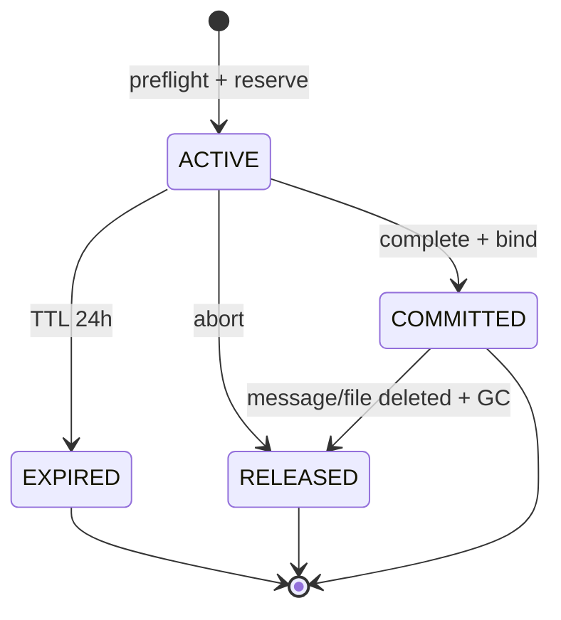

- Квота считается по **фактическому размеру зашифрованного блоба** (`attachments.size_bytes`), а не по исходному файлу.
- Стикеры учитываются в общей квоте `storage_bytes`; отдельно действуют `max_sticker_packs` и `max_sticker_pack_bytes`.
- Удаление сообщения → `attachments.deleted_at`; GC удаляет объект S3 и только затем уменьшает `storage_used_bytes`.
- Reconciliation job раз в сутки: `storage_used_bytes = SUM(size_bytes) WHERE deleted_at IS NULL`; расхождение >1% → алерт.
- Порог 80/95/100% → `EVT-15`, дедуп по `(workspace, threshold, billing_period)`; 100% блокирует новые reservation, но не чтение/скачивание.

### 6.8. Ключи и устройства

| Что | Где | Кто видит | Ротация/отзыв |
|---|---|---|---|
| Identity private key (Ed25519) | Устройство (OS keychain / non-extractable CryptoKey) | Только устройство | При revoke — уничтожается; новый device = новый ключ |
| Identity public key | `auth.devices.identity_public_key` | Сервер, участники E2EE-чата через `GET /keys` | `key_generation++` при revoke |
| Signed prekey (X25519) + подпись | `auth.device_prekeys` (`kind=SIGNED`) | Сервер, любой, кто делает claim | Плановая ротация 30 дн. |
| One-time prekeys | `auth.device_prekeys` (`kind=ONE_TIME`) | Выдаются по одному | `consumed_at`; пополнение при <20 |
| Pairwise session keys | Устройства | Только устройства | Double Ratchet на сообщение |
| Sender key (группа) | Устройства | Устройства-получатели эпохи | `epoch++` при изменении состава/revoke |
| File key (E2EE) | Обёрнут в `attachment_keys` на устройство | Только устройства-получатели | Новый ключ на объект |
| Workspace KEK/DEK (managed) | KMS + `attachments` metadata | Core/KMS; break-glass по grant | KEK-ротация 90 дн.; DEK — на объект |
| Safety number hash | `auth.key_verifications` | Сервер (метаданные) | Сбрасывается при смене ключа |

**Правила:**
- Сервер не принимает приватные ключи; `POST /devices` валидирует подпись signed prekey и формат ключей.
- `GET /keys/claim` выдаёт signed prekey всегда и one-time — если есть. Если one-time исчерпаны, возвращает `otp_exhausted: true`; сессия возможна, но FS слабее — клиент показывает предупреждение и пополняет запас.
- Конверты содержат `key_generation`; получатель отвергает конверт с меньшей генерацией.
- Новое устройство **не получает историю E2EE** без бэкапа ключей (v1). Это явное ограничение, а не баг.
- При отзыве устройства все E2EE-чаты пользователя повышают epoch; отозванное устройство не получает новые конверты и SKDM.
- **Чтение E2EE:** `GET /chats/{id}/messages` возвращает только конверт, адресованный устройству из `X-Device-Id` (приватность метаданных между устройствами одного пользователя); для группы — один `message_payloads` (sender-key). Все конверты устройствам не отдаются.
- **Payload для managed:** Kafka-событие не содержит plaintext; realtime получает текст через внутренний `MessageRenderPort` (mTLS, service token) или read-replica + KMS. Это единственная точка, где managed-plaintext покидает core, и она не логируется.

### 6.9. Аудит: целостность и экспорт

- `hash = SHA-256(prev_hash || canonical_json({event_id, workspace_id, seq, action, actor, target, metadata, created_at}))`.
- `canonical_json` — сортировка ключей, без пробелов, UTF-8; реализация в `audit`-модуле, версия алгоритма — в `metadata.hash_version`.
- Один writer на воркспейс (row lock `audit_chain`); throughput аудита ограничен 1k events/s на воркспейс — достаточно для MVP.
- Ежедневный anchor: Merkle-root дневных хешей → `audit_anchors` + S3 object lock; в v2 — внешний timestamp (RFC 3161).
- Immutability: `REVOKE UPDATE/DELETE`; trigger `forbid_mutation`; partition drop только после anchor и retention.
- Экспорт: `POST /audit/export` → job → CSV/JSON в S3, signed URL TTL 1 ч; SIEM webhook с HMAC-SHA256 и retry.
- В E2EE аудит содержит метаданные (кто, когда, чат, размер, действие), но не контент. Это фиксируется в UI и DPA.

---

## 7. API и WebSocket

### 7.1. Общие принципы

| Аспект | Правило |
|---|---|
| База | `https://api.krug.example/api/v1`; WS `wss://rt.krug.example/ws` |
| Аутентификация | `Authorization: Bearer <JWT>` (Keycloak, 15 мин); `X-Device-Id` обязателен и должен совпадать с claim `device_id` |
| Авторизация | Сервер на каждом запросе: membership + роль + ABAC + состояние ресурса; UI не является контролем |
| Tenant | `workspace_id` из path; membership проверяется до бизнес-логики; RLS — второй контур |
| Идемпотентность | `Idempotency-Key` для мутаций; `client_message_id` для сообщений; natural keys для частей/реакций |
| Пагинация | Курсор `cursor` (opaque base64url), `limit` 1..100 (messages — 1..100, audit — 1..200); `has_more` |
| Версионирование | `/v1`; breaking → `/v2`; события — `event_version`; заголовки `Deprecation`, `Sunset`; `426 CLIENT_UPGRADE_REQUIRED` при устаревшем клиенте |
| Ошибки | `{"code","message","details","request_id"}`; `details` не содержит секретов; `request_id` = trace id |
| Контент | `application/json; charset=utf-8`; файлы — `application/octet-stream`; ответы с `Cache-Control: no-store` для чувствительных |
| Таймауты | REST 10 с (upload complete — 60 с); внешние вызовы 2 с + circuit breaker |
| Трассировка | `X-Request-Id` (клиент может прислать), `traceparent` W3C; возвращается в ответе |

**Коды ошибок (сводно):**

| HTTP | `code` | Когда | Retry |
|---|---|---|---|
| 400 | `VALIDATION_FAILED` | Неверная схема/тип/формат | Нет |
| 401 | `UNAUTHENTICATED`, `TOKEN_EXPIRED`, `WS_TICKET_INVALID` | Нет/просрочен токен/тикет | Обновить токен/тикет |
| 403 | `FORBIDDEN`, `ROLE_CEILING`, `CHAT_READ_ONLY`, `CONSENT_REQUIRED`, `EMAIL_NOT_VERIFIED` | Нет прав/режим/согласие | Нет |
| 404 | `NOT_FOUND` | Объект не существует **или** нет доступа (не раскрываем) | Нет |
| 409 | `CONFLICT`, `IDEMPOTENCY_KEY_REUSED`, `IDEMPOTENCY_IN_PROGRESS`, `CLIENT_MESSAGE_ID_CONFLICT`, `QUOTA_EXCEEDED`, `ATTACHMENT_NOT_READY`, `DEVICE_LIMIT_REACHED`, `LAST_OWNER`, `VERSION_CONFLICT`, `STICKER_PACK_DISABLED`, `MODE_NOT_SUPPORTED`, `PIN_LIMIT` | Конфликт состояния | `IN_PROGRESS` — да, остальное — нет |
| 410 | `INVITE_EXPIRED`, `MESSAGE_DELETED`, `UPLOAD_EXPIRED`, `ATTACHMENT_DELETED` | Объект истёк/удалён | Нет |
| 413 | `FILE_TOO_LARGE`, `STICKER_TOO_LARGE`, `PAYLOAD_TOO_LARGE` | Лимит размера | Нет |
| 415 | `UNSUPPORTED_TYPE`, `UNSUPPORTED_STICKER_FORMAT` | MIME/формат вне allowlist | Нет |
| 422 | `MESSAGE_TOO_LONG`, `TOO_MANY_FILES`, `CHAT_MEMBER_LIMIT`, `E2EE_GROUP_LIMIT`, `STICKER_PACK_LIMIT`, `CHUNK_HASH_MISMATCH`, `MALWARE_DETECTED`, `INVALID_SIGNATURE`, `DANGEROUS_TYPE_BLOCKED`, `SEQ_OUT_OF_RANGE`, `WEAK_PASSWORD` | Семантическая ошибка | Нет |
| 423 | `ATTACHMENT_QUARANTINED`, `PLUGIN_KILLED`, `UPLOAD_LOCKED` | Объект заблокирован | После разбора |
| 429 | `RATE_LIMITED` | Лимит | Да, `Retry-After` |
| 500 | `INTERNAL` | Непредвиденное | Да с backoff |
| 503 | `DEPENDENCY_UNAVAILABLE` | KMS/S3/Keycloak/AV | Да, `Retry-After` |
| 426 | `CLIENT_UPGRADE_REQUIRED` | Версия ниже `min_app_version` | Обновить клиент |

### 7.2. Каталог endpoint’ов

Легенда прав: `Auth` — аутентифицирован; `Dev` — владелец устройства; `Mem` — активный участник чата; `Mod` — модератор+; `CA` — админ чата+; `CO` — владелец чата; `WA` — админ воркспейса+; `WO` — владелец воркспейса; `Plt` — платформенный админ.

#### Аутентификация, устройства, realtime

| API | Метод и путь | Права | Запрос → Ответ | Ошибки | Идемп. | Лимит |
|---|---|---|---|---|---|---|
| API-01 | `POST /auth/token` | — (делегируется Keycloak) | `grant_type=password / authorization_code` → `access_token`, `refresh_token`, `expires_in` | `invalid_grant`, `429` | — | 10/мин/IP, 5/мин/аккаунт |
| API-02 | `POST /auth/refresh` | refresh token | `refresh_token` → новая пара; ротация, reuse detection | `401`, `403` | — | 60/мин/устройство |
| API-03 | `POST /auth/step-up` | Auth + Dev | `{purpose}` → elevated token 5 мин | `401`, `403` | Ключ | 5/мин |
| API-04 | `POST /devices` | Auth | `{name, platform, app_version, identity_public_key, signed_prekey, prekeys[]}` → `201 {device_id, key_generation}` | `409 DEVICE_LIMIT_REACHED`, `422 INVALID_SIGNATURE` | Ключ | 10/час |
| API-05 | `GET /devices` | Auth | → `{items:[{id,name,platform,status,last_seen_at,key_generation}]}` | `401` | — | 60/мин |
| API-06 | `DELETE /devices/{deviceId}` | Dev | → `204`; инвалидация сессий, WS, E2EE-ротация; последнее устройство — предупреждение в UI, но revoke разрешён | `404` | Ключ | 10/час |
| API-07 | `POST /devices/{deviceId}/prekeys` | Dev | `{signed_prekey?, one_time_prekeys[]}` → `200 {stored}` | `422` | Ключ | 10/час |
| API-08 | `POST /keys/claim` | Auth | `{devices:[{device_id, user_id}]}` → `{bundles:[{device_id, signed_prekey, one_time_prekey?, otp_exhausted}]}`; только устройства пользователей, разделяющих воркспейс/чат | `409 NO_PREKEYS`, `422 UNKNOWN_DEVICE`, `403` | Естественная | 120/мин |
| API-09 | `POST /realtime/ticket` | Auth | → `{ticket, expires_at, ws_url}` TTL 30 с, single-use | `429` | — | 30/мин |
| API-10 | `GET /sync` | Auth | `?workspace_id=&cursor=` → `{chats:[{chat_id,last_seq,unread_count,state_version}], next_cursor, server_time}` | `403`, `410` | — | 60/мин |

#### Воркспейс, участники, инвайты

| API | Метод и путь | Права | Запрос → Ответ | Ошибки | Идемп. | Лимит |
|---|---|---|---|---|---|---|
| API-11 | `GET /workspaces` | Auth | → `{items:[{id,name,slug,security_mode,role,plan}], page}` | `401` | — | 60/мин |
| API-12 | `POST /workspaces` | Auth | `{name, slug, security_mode}` → `201 workspace` | `409 SLUG_TAKEN`, `422` | Ключ | 5/час |
| API-13 | `GET /workspaces/{workspaceId}` | Mem | → workspace + policy summary | `403`, `404` | — | 120/мин |
| API-14 | `PATCH /workspaces/{workspaceId}` | `WO` для `security_mode`; `WA` для name/logo | `{name?, logo?, security_mode?}` → `200`; MVP: mode immutable; v1: только `MANAGED→E2EE` | `403 ROLE_CEILING`, `409 MODE_CHANGE_FORBIDDEN` | Ключ | 20/час |
| API-15 | `GET /workspaces/{workspaceId}/members` | `WA` или `Mem` при `directory_visible` | `?cursor=&limit=` → `{items:[{user_id,display_name,role,status}],page}` | `403` (гость), `404` | — | 60/мин |
| API-16 | `PATCH /workspaces/{workspaceId}/members/{userId}` | `WA` | `{role}` → `200` | `403 ROLE_CEILING`, `409 LAST_OWNER` | Ключ | 30/час |
| API-17 | `DELETE /workspaces/{workspaceId}/members/{userId}` | `WA` | `?reason=` → `204` | `403`, `409 LAST_OWNER` | Ключ | 30/час |
| API-18 | `POST /workspaces/{workspaceId}/invites` | `WA` | `{role, max_uses?, expires_in?, chat_id?}` → `201 {invite_id, url, expires_at}` (URL один раз) | `403 ROLE_CEILING`, `409 SEAT_LIMIT` | Ключ | 20/час |
| API-19 | `GET /workspaces/{workspaceId}/invites` | `WA` | `?cursor=` → `{items:[{id,role,expires_at,used_count,max_uses,status}]}` | `403` | — | 60/мин |
| API-20 | `DELETE /workspaces/{workspaceId}/invites/{inviteId}` | `WA` | → `204`; ссылка → `410` | `404` | Ключ | 30/час |
| API-21 | `POST /invites/{token}/accept` | Auth | → `200 {workspace_id, chat_id?, role}` или `201 membership` | `410 INVITE_EXPIRED`, `403`, `409 ALREADY_MEMBER` | Ключ | 10/мин |
| API-22 | `GET /workspaces/{workspaceId}/limits` | Mem | → `{tariff,max_file_bytes,storage_bytes,max_attachments,...,usage:{used,reserved}}` | `403` | — | 60/мин |
| API-23 | `PATCH /workspaces/{workspaceId}/limits` | `WO`/`WA` в пределах тарифа | `{max_file_bytes?, storage_bytes?, retention_days?, ...}` → `200` | `403`, `422 LIMIT_ABOVE_PLAN` | Ключ | 10/час |

#### Чаты, участники, ключи

| API | Метод и путь | Права | Запрос → Ответ | Ошибки | Идемп. | Лимит |
|---|---|---|---|---|---|---|
| API-24 | `GET /workspaces/{workspaceId}/chats` | Mem | `?cursor=&filter=` → `{items:[{id,type,name,security_mode,last_message_at,unread}],page}` | `403` | — | 120/мин |
| API-25 | `POST /workspaces/{workspaceId}/chats` | Mem (политика) / `WA` | `{type, peer_id? , name?, member_ids?, security_mode?}` → `201 chat` | `422 CHAT_MEMBER_LIMIT`, `403 MODE_NOT_ALLOWED` | Ключ | 30/час |
| API-26 | `GET /chats/{chatId}` | Mem | → chat + `my_role` + `key_epoch` | `403`, `404` | — | 120/мин |
| API-27 | `PATCH /chats/{chatId}` | `CA` | `{name?, avatar?, notification_level?}` → `200` | `403`, `409 VERSION_CONFLICT` | Ключ | 60/час |
| API-28 | `DELETE /chats/{chatId}` | `CO` | → `204`; soft delete, E2EE-ключи уничтожаются клиентами | `403`, `409` | Ключ | 5/час |
| API-29 | `GET /chats/{chatId}/members` | Mem (гость — ограниченно) | `?cursor=` → `{items:[{user_id,display_name,role,status}]}` | `403` | — | 120/мин |
| API-30 | `PATCH /chats/{chatId}/members/{userId}` | `CA` | `{role}` → `200` | `403 ROLE_CEILING`, `409 LAST_OWNER` | Ключ | 60/час |
| API-31 | `DELETE /chats/{chatId}/members/{userId}` | `CA` | → `204`; `epoch++`, SKDM остальным | `403`, `409 LAST_OWNER` | Ключ | 60/час |
| API-32 | `POST /chats/{chatId}/leave` | Mem, кроме последнего `CO` | → `204` | `409 LAST_OWNER` | Ключ | 10/час |
| API-33 | `POST /chats/{chatId}/transfer-ownership` | `CO` | `{user_id}` → `200`; новый owner, старый `ADMIN` | `403`, `422` | Ключ | 5/час |
| API-34 | `GET /chats/{chatId}/keys` | Mem E2EE | → `{epoch, devices:[{device_id,user_id,identity_key,fingerprint,key_generation,verified}]}` | `409 MODE_NOT_E2EE` | — | 30/мин |
| API-35 | `PUT /chats/{chatId}/keys/verification` | Mem E2EE | `{device_id, method:QR/MANUAL, safety_number_hash}` → `201` | `409 KEY_CHANGED`, `410` | Ключ | 30/мин |

#### Сообщения, реакции, receipts, пины

| API | Метод и путь | Права | Запрос → Ответ | Ошибки | Идемп. | Лимит |
|---|---|---|---|---|---|---|
| API-36 | `GET /chats/{chatId}/messages` | Mem | `?after_seq=&before_seq=&limit=50` → `{items:[message],page:{next_cursor,has_more}}`; E2EE — конверт только для `X-Device-Id` | `403` (history), `422 SEQ_OUT_OF_RANGE` | — | 300/мин |
| API-37 | `POST /chats/{chatId}/messages` | Mem, `chat.write` | `{client_message_id,type,text? / sticker_id?, reply_to_id?, attachment_ids?, envelopes? / payload?, epoch?}` → `201 message` | `409`, `413`, `422`, `429` | `Idempotency-Key` + `client_message_id` | 30/10 с; 5/с на чат |
| API-38 | `PATCH /messages/{messageId}` | автор или `Mod` | `{text?, version}` → `200 message` | `403 EDIT_WINDOW_EXPIRED`, `409 VERSION_CONFLICT` | Ключ | 30/мин |
| API-39 | `DELETE /messages/{messageId}` | автор или `Mod` | `?mode=for_everyone` → `204` | `403`, `410` | Ключ | 30/мин |
| API-40 | `PUT /messages/{messageId}/reactions/{emoji}` | Mem | → `204` | `404`, `422` | Естественная | 60/мин |
| API-41 | `DELETE /messages/{messageId}/reactions/{emoji}` | Mem | → `204` | `404` | Естественная | 60/мин |
| API-42 | `POST /chats/{chatId}/read` | Mem | `{last_seq}` → `204` | `422 SEQ_OUT_OF_RANGE` | Естественная | 120/мин |
| API-43 | `POST /chats/{chatId}/pins` | `Mod` | `{message_id}` → `201`; system message | `409 PIN_LIMIT` | Ключ | 30/мин |
| API-44 | `DELETE /chats/{chatId}/pins/{messageId}` | `Mod` | → `204` | `404` | Ключ | 30/мин |

#### Файлы

| API | Метод и путь | Права | Запрос → Ответ | Ошибки | Идемп. | Лимит |
|---|---|---|---|---|---|---|
| API-45 | `POST /uploads/preflight` | Mem, `file.upload` | `{chat_id, files:[{name,size,mime,sha256?}]}` → `200 {decision, max_file_bytes, quota:{used,reserved,limit}, files:[{allowed,error?,part_size}]}` | `413`, `409 QUOTA_EXCEEDED`, `415`, `422 TOO_MANY_FILES` | Ключ | 60/мин |
| API-46 | `POST /uploads` | Mem | `{preflight_token, chat_id, filename, size, mime, encryption_mode}` → `201 {upload_id, part_size, total_parts, expires_at}` | `410 PRECHECK_EXPIRED`, `409`, `503` | Ключ | 20/мин |
| API-47 | `PUT /uploads/{uploadId}/parts/{partNo}` | владелец upload | binary body + `Content-SHA256` → `200 {etag, received}` | `409 CHUNK_CONFLICT`, `422 CHUNK_HASH_MISMATCH`, `410` | `(upload_id,partNo)` | 100 МБ/мин |
| API-48 | `GET /uploads/{uploadId}` | владелец upload | → `{status, received_parts[], missing_parts[], expires_at}` | `410` | — | 120/мин |
| API-49 | `POST /uploads/{uploadId}/complete` | владелец upload | `{sha256, parts_count}` → `202 {status:SCANNING}` или `200 {status:READY}` | `422`, `409`, `410` | Ключ | 30/мин |
| API-50 | `POST /uploads/{uploadId}/abort` | владелец upload | → `204`; release reservation | `410` | Ключ | 30/мин |
| API-51 | `GET /attachments/{attachmentId}/download-url` | Mem | → `{url, expires_at, size, sha256}`; URL TTL 5 мин | `403`, `409 SCAN_PENDING`, `410`, `423` | — | 120/мин |

#### Стикеры

| API | Метод и путь | Права | Запрос → Ответ | Ошибки | Идемп. | Лимит |
|---|---|---|---|---|---|---|
| API-52 | `GET /sticker-packs` | Mem | `?chat_id=&cursor=` → `{items:[{id,name,cover,sticker_count,enabled}],page}` | `403` | — | 120/мин |
| API-53 | `POST /workspaces/{workspaceId}/sticker-packs` | `WA` | `{name, cover_upload_id}` → `201 pack` | `409 STICKER_PACK_QUOTA`, `413` | Ключ | 5/час |
| API-54 | `POST /workspaces/{workspaceId}/sticker-packs/{packId}/stickers` | `WA` | multipart image → `201 sticker` | `413 STICKER_TOO_LARGE`, `415 UNSUPPORTED_STICKER_FORMAT`, `422` | Ключ | 60/час |
| API-55 | `PATCH /workspaces/{workspaceId}/sticker-packs/{packId}` | `WA` | `{name?, status?}` → `200` | `403`, `409` | Ключ | 30/час |
| API-56 | `POST /chats/{chatId}/sticker-packs/{packId}/enable` | `CA` | → `201` | `404`, `409 PACK_NOT_INSTALLED` | Ключ | 30/час |
| API-57 | `DELETE /chats/{chatId}/sticker-packs/{packId}` | `CA` | → `204`; новые стикеры недоступны, старые остаются | `404` | Ключ | 30/час |
| API-58 | `PUT /stickers/{stickerId}/favorite` | Auth | → `204` | `404` | Естественная | 60/мин |

#### Плагины

| API | Метод и путь | Права | Запрос → Ответ | Ошибки | Идемп. | Лимит |
|---|---|---|---|---|---|---|
| API-59 | `GET /plugins` | Auth | `?cursor=&surface=` → каталог с manifest summary | — | — | 60/мин |
| API-60 | `POST /workspaces/{workspaceId}/plugins/{pluginId}/install` | `WA` | `{version, permissions_ack[]}` → `201 installation` | `422 INVALID_SIGNATURE`, `409 VERSION_INCOMPATIBLE`, `403` | Ключ | 10/час |
| API-61 | `PATCH /workspaces/{workspaceId}/plugins/{installationId}` | `WA` | `{status, config?}` → `200` | `403`, `409` | Ключ | 30/час |
| API-62 | `POST /chats/{chatId}/plugins/{installationId}/enable` | `CA` | → `201` | `409 MODE_NOT_SUPPORTED`, `423 PLUGIN_KILLED` | Ключ | 30/час |
| API-63 | `POST /chats/{chatId}/plugins/{installationId}/consent` | Mem E2EE | `{decision:GRANT/REVOKE, scope}` → `201` | `403`, `409` | Ключ | 30/час |
| API-64 | `POST /plugin-rpc` | Auth + capability | `{capability, method, params, rpc_id}` → `200 {result}` | `403`, `423`, `429` | `rpc_id` 60 с | 60/мин/плагин |
| API-65 | `POST /workspaces/{workspaceId}/plugins/{installationId}/kill` | `WA`/`Plt` | `{reason}` → `204`; revoke tokens | `403` | Ключ | 10/час |

#### Поиск, аудит, break-glass, жалобы

| API | Метод и путь | Права | Запрос → Ответ | Ошибки | Идемп. | Лимит |
|---|---|---|---|---|---|---|
| API-66 | `GET /workspaces/{workspaceId}/search` | Mem (managed) | `?q=&chat_id=&author_id=&from=&to=&cursor=` → `{items:[{chat_id,message_id,seq,snippet,highlights}],index_lag}` | `409 MODE_NOT_SUPPORTED` (E2EE), `429` | — | 30/мин |
| API-67 | `GET /workspaces/{workspaceId}/audit` | `WA` | `?action=&actor_id=&from=&to=&cursor=` → `{items:[audit_event],page}` | `403` | — | 60/мин |
| API-68 | `POST /workspaces/{workspaceId}/audit/export` | `WA` | `{format:CSV/JSON, from, to}` → `202 {job_id}` | `403`, `422` | Ключ | 5/час |
| API-69 | `POST /workspaces/{workspaceId}/break-glass` | `WO`/`WA` | `{scope_type, scope_id, reason, ttl_minutes}` → `201 {request_id,status}` | `409 BREAKGLASS_NOT_ALLOWED` (E2EE), `422` | Ключ | 5/час |
| API-70 | `POST /workspaces/{workspaceId}/break-glass/{requestId}/approve` | второй `WO`/`WA` | `{decision:APPROVE/DENY, comment}` → `200` | `403 SECOND_APPROVAL_REQUIRED`, `409 SELF_APPROVAL` | Ключ | 10/час |
| API-71 | `DELETE /workspaces/{workspaceId}/break-glass/{requestId}` | requester/approver | → `204`; revoke KMS grant | `404` | Ключ | 10/час |
| API-72 | `POST /reports` | Mem | `{target_type,target_id,reason,comment}` → `201 report` | `409 DUPLICATE_REPORT` | Ключ | 10/час |

#### Дополнительные endpoint’ы (v1 и служебные)

| API | Метод и путь | Права | Запрос → Ответ | Ошибки | Идемп. | Лимит |
|---|---|---|---|---|---|---|
| API-73 | `POST /chats/{chatId}/key-distributions` | Mem E2EE | `{epoch, distributions:[{recipient_device_id, ciphertext}]}` → `202 {stored}`; сервер хранит SKDM и доставляет адресатам | `409 EPOCH_MISMATCH`, `422 UNKNOWN_DEVICE`, `413` | Ключ | 120/мин |
| API-74 | `GET /workspaces/{workspaceId}/break-glass/{requestId}/content` | `WO`/`WA` + активный grant | `?chat_id=&from_seq=&limit=` → `{items:[managed message], next_cursor}`; каждое чтение — аудит | `403`, `409 BREAKGLASS_NOT_ACTIVE`, `410` | — | 10/мин |
| API-75 | `POST /me/export` | Auth + step-up | `{format:JSON/ZIP}` → `202 {job_id}`; для E2EE — только метаданные, контент экспортирует клиент | `409 EXPORT_IN_PROGRESS` | Ключ | 1/сутки |
| API-76 | `POST /me/delete` | Auth + step-up | `{confirm}` → `202 {scheduled_at}`; soft delete + 30 дней | `409 ACTIVE_OBLIGATIONS` | Ключ | 1/сутки |
| API-77 | `PUT /workspaces/{workspaceId}/policies/dlp` | `WA` | `{rules:[...]}` → `200`; только managed | `409 MODE_NOT_SUPPORTED`, `422` | Ключ | 10/час |
| API-78 | `GET /workspaces/{workspaceId}/policies` | `WA` | → `{security_mode, retention, dlp, limits}` | `403` | — | 60/мин |
| API-79 | `GET /workspaces/{workspaceId}/audit/verify` | `WA` | `?from=&to=` → `{valid, checked_events, anchors[]}` | `403` | — | 10/мин |
| API-80 | `GET /chats/{chatId}/attachments` | Mem | `?cursor=&type=` → `{items:[attachment_ref],page}` (v1) | `403` | — | 60/мин |
| API-81 | `POST /workspaces/{workspaceId}/plugins/{installationId}/rollback` | `WA` | `{version}` → `200`; откат на предыдущую подписанную | `409 VERSION_ROLLBACK_FORBIDDEN` | Ключ | 10/час |
| API-82 | `POST /chats/{chatId}/sticker-packs/{packId}/keys` | Mem E2EE | `{epoch, keys:[{recipient_device_id, wrapped_key}]}` → `202`; ключ набора доставляется устройствам | `409 EPOCH_MISMATCH`, `422 UNKNOWN_DEVICE` | Ключ | 60/мин |
| API-83 | `GET /workspaces/{workspaceId}/search/files` | Mem (managed) | `?q=&chat_id=&cursor=` → `{items:[attachment_ref],page}` (v1) | `409 MODE_NOT_SUPPORTED`, `429` | — | 30/мин |

### 7.3. Пагинация, версионирование, идемпотентность

**Пагинация.**
- Курсор — `base64url({"seq":123})` для сообщений или `base64url({"created_at":"...","id":"..."})` для остальных списков. Курсор непрозрачен, подписан HMAC (`cursor_key`), TTL не истекает, но при удалении данных может стать невалидным → `400 INVALID_CURSOR`.
- Сортировка стабильная: сообщения — `seq DESC` по умолчанию (новые сверху) или `seq ASC` при `after_seq`; списки — `created_at DESC, id DESC`.
- `limit` по умолчанию 50; максимум 100 (audit — 200). `has_more` вычисляется по наличию `limit+1` строки.
- Offset запрещён на `messages`, `audit`, `search`; допускается только в админских отчётах v1 с фиксированным набором фильтров.

```json
{
  "items": [],
  "page": { "next_cursor": "eyJzZXEiOjE4NDIyfQ", "has_more": true },
  "request_id": "req_01J..."
}
```

**Версионирование.**
- URL `/api/v1`; breaking-изменения — `/api/v2` с параллельной поддержкой ≥6 месяцев.
- Новые поля — аддитивно; клиент игнорирует неизвестные поля.
- События: `event_version`; consumer поддерживает текущую и предыдущую версию.
- Плагины: `min_app_version`; при несовместимости `409 VERSION_INCOMPATIBLE`.
- Устаревший клиент: `426 CLIENT_UPGRADE_REQUIRED` + `details.min_version`.
- Заголовки `Deprecation: true`, `Sunset: <date>`, `Link: <docs>; rel="deprecation"`.

**Идемпотентность.**
- `Idempotency-Key` — UUID v4, обязателен для POST/PATCH/DELETE, кроме исключений из §6.6.
- Ключ скоупится `(user_id, method, path template)`; тело хешируется каноническим JSON.
- TTL 24 ч; ответ хранится вместе со статусом и `resource_id`.
- Параллельный дубль: первый запрос ставит `status=NULL`; второй получает `409 IDEMPOTENCY_IN_PROGRESS` с `Retry-After: 1`.
- Повтор с другим телом: `409 IDEMPOTENCY_KEY_REUSED`; в `details` — `original_request_hash` (без тела).
- Успешный replay: исходный HTTP-статус + `Idempotent-Replay: true`; для `201` также `Location`.
- Для сообщений дополнительно `client_message_id`: переживает TTL ключа и защищает offline-очередь.

**Лимиты запросов.**

| Scope | Лимит | Окно | Ответ |
|---|---|---|---|
| Логин | 10/IP, 5/аккаунт | 1 мин | `429`, lockout 15 мин после 10 неудач |
| Общие REST-вызовы | 600/пользователь | 1 мин | `429` + `X-RateLimit-*` |
| Отправка сообщений | 30/пользователь; 5/чат | 10 с / 1 с | `429` |
| Чтение истории | 300/пользователь | 1 мин | `429` |
| Preflight | 60/пользователь | 1 мин | `429` |
| Загрузка файлов | 100 МБ/пользователь; 20 init | 1 мин / 1 мин | `429` |
| Инвайты | 20/воркспейс | 1 час | `429` |
| Plugin RPC | 60/пользователь/плагин | 1 мин | `429` |
| Поиск | 30/пользователь | 1 мин | `429` |
| WS-подключения | 10/IP; 60/пользователь | 1 мин / 1 час | `429`, close 1013 |
| WS-кадры | 100/с на соединение | 1 с | close 1008 |

Заголовки: `X-RateLimit-Limit`, `X-RateLimit-Remaining`, `X-RateLimit-Reset`, `Retry-After`. Реализация — Redis token bucket (Lua), ключ `rl:{scope}:{subject}`; при недоступности Redis — fail-closed для auth/upload, fail-open для read-only с метрикой.

### 7.4. OpenAPI 3.1 — ключевые endpoint’ы

```yaml
openapi: 3.1.0
info:
  title: Krug API — key endpoints
  version: 1.0.0
  description: >
    Фрагмент контракта для архитектурного ревью. Полная спецификация генерируется
    из аннотаций и публикуется в /openapi.json; этот фрагмент фиксирует форму
    запросов, ответов и ошибок критического пути.
servers:
  - url: https://api.krug.example/api/v1
security:
  - bearerAuth: []
tags:
  - name: auth
  - name: messages
  - name: uploads
  - name: plugins
paths:
  /devices:
    post:
      tags: [auth]
      operationId: registerDevice
      summary: Зарегистрировать устройство и публичные ключи
      parameters:
        - $ref: '#/components/parameters/IdempotencyKey'
      requestBody:
        required: true
        content:
          application/json:
            schema:
              $ref: '#/components/schemas/DeviceRegistration'
      responses:
        '201':
          description: Устройство зарегистрировано
          content:
            application/json:
              schema:
                $ref: '#/components/schemas/Device'
        '409':
          $ref: '#/components/responses/Conflict'
        '422':
          $ref: '#/components/responses/Unprocessable'

  /chats/{chatId}/messages:
    parameters:
      - $ref: '#/components/parameters/ChatId'
    post:
      tags: [messages]
      operationId: sendMessage
      summary: Отправить сообщение (managed или E2EE)
      parameters:
        - $ref: '#/components/parameters/IdempotencyKey'
      requestBody:
        required: true
        content:
          application/json:
            schema:
              $ref: '#/components/schemas/MessageCreate'
      responses:
        '201':
          description: Сообщение принято; seq назначен сервером
          headers:
            Idempotent-Replay:
              schema: { type: string }
          content:
            application/json:
              schema:
                $ref: '#/components/schemas/Message'
        '403':
          $ref: '#/components/responses/Forbidden'
        '409':
          $ref: '#/components/responses/Conflict'
        '413':
          $ref: '#/components/responses/TooLarge'
        '422':
          $ref: '#/components/responses/Unprocessable'
        '429':
          $ref: '#/components/responses/TooManyRequests'
    get:
      tags: [messages]
      operationId: listMessages
      summary: История сообщений с курсором и resume по seq
      parameters:
        - name: after_seq
          in: query
          schema: { type: integer, format: int64, minimum: 0 }
        - name: before_seq
          in: query
          schema: { type: integer, format: int64, minimum: 0 }
        - $ref: '#/components/parameters/Limit'
        - $ref: '#/components/parameters/Cursor'
      responses:
        '200':
          description: Страница сообщений
          content:
            application/json:
              schema:
                $ref: '#/components/schemas/MessagePage'
        '403':
          $ref: '#/components/responses/Forbidden'

  /uploads/preflight:
    post:
      tags: [uploads]
      operationId: preflightUpload
      summary: Проверить лимиты и квоту до загрузки
      parameters:
        - $ref: '#/components/parameters/IdempotencyKey'
      requestBody:
        required: true
        content:
          application/json:
            schema:
              $ref: '#/components/schemas/PreflightRequest'
      responses:
        '200':
          description: Решение по каждому файлу
          content:
            application/json:
              schema:
                $ref: '#/components/schemas/PreflightResponse'
        '409':
          $ref: '#/components/responses/Conflict'
        '413':
          $ref: '#/components/responses/TooLarge'
        '415':
          $ref: '#/components/responses/UnsupportedMediaType'
        '422':
          $ref: '#/components/responses/Unprocessable'

  /uploads:
    post:
      tags: [uploads]
      operationId: initUpload
      summary: Создать upload-сессию и резерв квоты
      parameters:
        - $ref: '#/components/parameters/IdempotencyKey'
      requestBody:
        required: true
        content:
          application/json:
            schema:
              $ref: '#/components/schemas/UploadInit'
      responses:
        '201':
          description: Сессия создана
          content:
            application/json:
              schema:
                $ref: '#/components/schemas/UploadSession'
        '409':
          $ref: '#/components/responses/Conflict'
        '410':
          $ref: '#/components/responses/Gone'

  /uploads/{uploadId}/complete:
    parameters:
      - $ref: '#/components/parameters/UploadId'
    post:
      tags: [uploads]
      operationId: completeUpload
      summary: Завершить загрузку, проверить хеш и запустить скан
      parameters:
        - $ref: '#/components/parameters/IdempotencyKey'
      requestBody:
        required: true
        content:
          application/json:
            schema:
              $ref: '#/components/schemas/UploadComplete'
      responses:
        '200':
          description: Объект готов (E2EE или managed без скана)
          content:
            application/json:
              schema:
                $ref: '#/components/schemas/UploadSession'
        '202':
          description: Объект на сканировании (managed)
          content:
            application/json:
              schema:
                $ref: '#/components/schemas/UploadSession'
        '409':
          $ref: '#/components/responses/Conflict'
        '422':
          $ref: '#/components/responses/Unprocessable'

  /workspaces/{workspaceId}/plugins/{pluginId}/install:
    parameters:
      - $ref: '#/components/parameters/WorkspaceId'
      - $ref: '#/components/parameters/PluginId'
    post:
      tags: [plugins]
      operationId: installPlugin
      summary: Установить подписанный плагин в воркспейс
      parameters:
        - $ref: '#/components/parameters/IdempotencyKey'
      requestBody:
        required: true
        content:
          application/json:
            schema:
              $ref: '#/components/schemas/PluginInstallRequest'
      responses:
        '201':
          description: Установка создана
          content:
            application/json:
              schema:
                $ref: '#/components/schemas/PluginInstallation'
        '403':
          $ref: '#/components/responses/Forbidden'
        '409':
          $ref: '#/components/responses/Conflict'
        '422':
          $ref: '#/components/responses/Unprocessable'

components:
  securitySchemes:
    bearerAuth:
      type: http
      scheme: bearer
      bearerFormat: JWT

  parameters:
    IdempotencyKey:
      name: Idempotency-Key
      in: header
      required: true
      schema: { type: string, format: uuid }
    ChatId:
      name: chatId
      in: path
      required: true
      schema: { type: string, format: uuid }
    WorkspaceId:
      name: workspaceId
      in: path
      required: true
      schema: { type: string, format: uuid }
    PluginId:
      name: pluginId
      in: path
      required: true
      schema: { type: string }
    UploadId:
      name: uploadId
      in: path
      required: true
      schema: { type: string, format: uuid }
    Cursor:
      name: cursor
      in: query
      schema: { type: string }
    Limit:
      name: limit
      in: query
      schema: { type: integer, minimum: 1, maximum: 100, default: 50 }

  schemas:
    Error:
      type: object
      required: [code, message, request_id]
      properties:
        code: { type: string, example: QUOTA_EXCEEDED }
        message: { type: string }
        details:
          type: object
          additionalProperties: true
        request_id: { type: string }

    DeviceRegistration:
      type: object
      required: [name, platform, app_version, identity_public_key, signed_prekey]
      properties:
        name: { type: string, maxLength: 80 }
        platform: { type: string, enum: [WEB, DESKTOP, MOBILE] }
        app_version: { type: string }
        identity_public_key: { type: string, contentEncoding: base64 }
        signed_prekey:
          type: object
          required: [key_id, public_key, signature]
          properties:
            key_id: { type: string }
            public_key: { type: string, contentEncoding: base64 }
            signature: { type: string, contentEncoding: base64 }
        one_time_prekeys:
          type: array
          maxItems: 200
          items:
            type: object
            required: [key_id, public_key]
            properties:
              key_id: { type: string }
              public_key: { type: string, contentEncoding: base64 }

    Device:
      type: object
      required: [id, status, key_generation]
      properties:
        id: { type: string, format: uuid }
        status: { type: string, enum: [PENDING, ACTIVE, REVOKED] }
        key_generation: { type: integer }
        created_at: { type: string, format: date-time }

    Envelope:
      type: object
      required: [recipient_device_id, scheme, header, ciphertext]
      properties:
        recipient_device_id: { type: string, format: uuid }
        scheme: { type: string, enum: [PAIRWISE, SENDER_KEY] }
        header: { type: object, additionalProperties: true }
        ciphertext: { type: string, contentEncoding: base64 }

    MessageCreate:
      type: object
      description: >
        Managed: text (+attachments). E2EE 1:1: envelopes[]. E2EE группа:
        payload + epoch. Варианты взаимоисключающие; смешение — 422.
      required: [client_message_id, type]
      properties:
        client_message_id: { type: string, format: uuid }
        type: { type: string, enum: [TEXT, STICKER] }
        text: { type: [string, "null"], maxLength: 8000 }
        sticker_id: { type: [string, "null"], format: uuid }
        reply_to_id: { type: [string, "null"], format: uuid }
        attachment_ids:
          type: array
          maxItems: 10
          items: { type: string, format: uuid }
        envelopes:
          type: array
          description: E2EE 1:1 — по конверту на каждое активное устройство; суммарно ≤256 КБ
          items:
            $ref: '#/components/schemas/Envelope'
        payload:
          type: [object, "null"]
          description: E2EE группа — один sender-key шифротекст
        epoch: { type: [integer, "null"], minimum: 0 }

    Message:
      type: object
      required: [id, chat_id, seq, type, created_at, version]
      properties:
        id: { type: string, format: uuid }
        chat_id: { type: string, format: uuid }
        seq: { type: integer, format: int64 }
        type: { type: string, enum: [TEXT, STICKER, SYSTEM, FILE] }
        sender_id: { type: [string, "null"], format: uuid }
        text:
          type: [string, "null"]
          description: Только managed; для E2EE всегда null
        sticker_id: { type: [string, "null"], format: uuid }
        reply_to_id: { type: [string, "null"], format: uuid }
        attachments:
          type: array
          items:
            type: object
            properties:
              id: { type: string, format: uuid }
              name: { type: [string, "null"] }
              size: { type: integer, format: int64 }
              mime: { type: [string, "null"] }
              scan_status: { type: string }
        crypto:
          type: [object, "null"]
          description: >
            Только E2EE. Сервер отдаёт конверт текущего устройства (PAIRWISE)
            или общий payload группы (SENDER_KEY); plaintext отсутствует.
          properties:
            scheme: { type: string, enum: [PAIRWISE, SENDER_KEY] }
            header: { type: object, additionalProperties: true }
            ciphertext: { type: string, contentEncoding: base64 }
        created_at: { type: string, format: date-time }
        edited_at: { type: [string, "null"], format: date-time }
        deleted_at: { type: [string, "null"], format: date-time }
        version: { type: integer }

    MessagePage:
      type: object
      required: [items, page]
      properties:
        items:
          type: array
          items:
            $ref: '#/components/schemas/Message'
        page:
          type: object
          required: [has_more]
          properties:
            next_cursor: { type: [string, "null"] }
            has_more: { type: boolean }

    PreflightRequest:
      type: object
      required: [chat_id, files]
      properties:
        chat_id: { type: string, format: uuid }
        files:
          type: array
          minItems: 1
          maxItems: 10
          items:
            type: object
            required: [name, size]
            properties:
              name: { type: string, maxLength: 255 }
              size: { type: integer, format: int64, minimum: 1 }
              mime: { type: string }
              sha256: { type: string, pattern: '^[a-f0-9]{64}$' }

    PreflightResponse:
      type: object
      required: [decision, max_file_bytes, quota, files]
      properties:
        decision: { type: string, enum: [ALLOW, DENY] }
        max_file_bytes: { type: integer, format: int64 }
        max_attachments: { type: integer }
        quota:
          type: object
          properties:
            used: { type: integer, format: int64 }
            reserved: { type: integer, format: int64 }
            limit: { type: integer, format: int64 }
        files:
          type: array
          items:
            type: object
            properties:
              allowed: { type: boolean }
              error: { type: [string, "null"] }
              part_size: { type: integer }
              preflight_token: { type: [string, "null"] }

    UploadInit:
      type: object
      required: [preflight_token, chat_id, filename, size, encryption_mode]
      properties:
        preflight_token: { type: string }
        chat_id: { type: string, format: uuid }
        filename: { type: string, maxLength: 255 }
        size: { type: integer, format: int64, minimum: 1 }
        mime: { type: string }
        encryption_mode: { type: string, enum: [E2EE, MANAGED] }
        sha256: { type: string, pattern: '^[a-f0-9]{64}$' }

    UploadSession:
      type: object
      required: [upload_id, status, part_size, total_parts, expires_at]
      properties:
        upload_id: { type: string, format: uuid }
        status:
          type: string
          enum: [INIT, UPLOADING, PAUSED, COMPLETING, SCANNING, READY, FAILED, ABORTED, EXPIRED]
        part_size: { type: integer }
        total_parts: { type: integer }
        received_parts:
          type: array
          items: { type: integer }
        expires_at: { type: string, format: date-time }
        attachment_id: { type: [string, "null"], format: uuid }

    UploadComplete:
      type: object
      required: [sha256, parts_count]
      properties:
        sha256: { type: string, pattern: '^[a-f0-9]{64}$' }
        parts_count: { type: integer, minimum: 1 }

    PluginInstallRequest:
      type: object
      required: [version, permissions_ack]
      properties:
        version: { type: string, pattern: '^\d+\.\d+\.\d+$' }
        permissions_ack:
          type: array
          items: { type: string }
        config: { type: [object, "null"] }

    PluginInstallation:
      type: object
      required: [id, plugin_id, version, status]
      properties:
        id: { type: string, format: uuid }
        plugin_id: { type: string }
        version: { type: string }
        status: { type: string, enum: [PENDING, ACTIVE, DISABLED, KILLED, UNINSTALLED] }
        permissions: { type: array, items: { type: string } }

  responses:
    Conflict:
      description: Конфликт состояния или идемпотентности
      content:
        application/json:
          schema: { $ref: '#/components/schemas/Error' }
    Forbidden:
      description: Недостаточно прав
      content:
        application/json:
          schema: { $ref: '#/components/schemas/Error' }
    TooLarge:
      description: Превышен лимит размера
      content:
        application/json:
          schema: { $ref: '#/components/schemas/Error' }
    Unprocessable:
      description: Семантическая ошибка запроса
      content:
        application/json:
          schema: { $ref: '#/components/schemas/Error' }
    Gone:
      description: Объект истёк или удалён
      content:
        application/json:
          schema: { $ref: '#/components/schemas/Error' }
    UnsupportedMediaType:
      description: Формат не поддерживается
      content:
        application/json:
          schema: { $ref: '#/components/schemas/Error' }
    TooManyRequests:
      description: Превышен rate limit
      headers:
        Retry-After:
          schema: { type: integer }
      content:
        application/json:
          schema: { $ref: '#/components/schemas/Error' }
```

### 7.5. WebSocket-протокол

#### Подключение и аутентификация

1. `POST /realtime/ticket` → `{ticket, expires_at, ws_url}`; тикет — JWT TTL 30 с, `jti`, `sub`, `device_id`, `aud=realtime`.
2. `wss://rt.krug.example/ws?ticket=<jwt>`; тикет одноразовый (`SETNX ws:ticket:{jti}`), access-токен в query **не используется**.
3. Gateway проверяет подпись, `exp`, `aud`, `jti`, устройство `ACTIVE`; при ошибке — close `4401`.
4. Сервер: `hello {session_id, server_time, heartbeat_ms:25000, protocol:"krug.ws.v1"}`.
5. Клиент: `subscribe {chats:[{chat_id,last_seq}], presence:true}`.
6. Сервер проверяет membership на каждый чат, отдаёт `subscribed {chats:[{chat_id,accepted,server_last_seq}]}`; запрещённые чаты — `error {code:"FORBIDDEN", chat_id}`.

#### Кадры

```jsonl
{"v":1,"type":"hello","session_id":"ws_01J...","server_time":"2026-11-16T08:21:40Z","heartbeat_ms":25000}
{"v":1,"type":"subscribe","chats":[{"chat_id":"b1e0...","last_seq":18420}],"presence":true}
{"v":1,"type":"event","event_id":"0f3b...","event":"message.created","chat_id":"b1e0...","seq":18421,"ts":"2026-11-16T08:21:44.512Z","payload":{"message_id":"...","sender_id":"...","type":"TEXT"}}
{"v":1,"type":"ack","last_seq":18421}
{"v":1,"type":"resume.gap","chat_id":"b1e0...","from_seq":17000,"to_seq":18420,"reason":"RETENTION_WINDOW"}
{"v":1,"type":"key.skdm","chat_id":"b1e0...","epoch":7,"sender_device_id":"...","ciphertext":"base64"}
{"v":1,"type":"typing","chat_id":"b1e0...","user_id":"...","expires_at":"2026-11-16T08:21:47Z"}
{"v":1,"type":"presence","user_id":"...","status":"ONLINE","last_seen_at":"2026-11-16T08:21:40Z"}
{"v":1,"type":"error","code":"RATE_LIMITED","message":"...","request_id":"..."}
```

| Событие WS | Направление | Payload | Гарантия |
|---|---|---|---|
| `hello` | S→C | session_id, server_time, heartbeat | Один раз на соединение |
| `subscribed` | S→C | accepted/rejected chats, server_last_seq | После `subscribe` |
| `event: message.created/edited/deleted` | S→C | message_id, seq, type, sender, meta | At-least-once; дедуп по `event_id` |
| `event: message.reaction` | S→C | message_id, user_id, emoji, action | At-least-once |
| `event: message.receipt` | S→C | chat_id, user_id, last_read_seq | At-least-once, монотонно |
| `event: chat.member.changed` | S→C | user_id, role, status, epoch | At-least-once |
| `event: chat.pin.changed` | S→C | message_id, action | At-least-once |
| `event: plugin.changed` | S→C | installation_id, status | At-least-once |
| `event: sticker.pack.changed` | S→C | pack_id, status | At-least-once |
| `key.skdm` | S→C | epoch, sender_device_id, ciphertext | Доставка адресату; хранится до 30 дн. |
| `key.request` | C→S | chat_id, epoch | Эфемерное; просьба переслать SKDM |
| `typing` | C↔S | user_id, expires_at | Эфемерное, TTL 5 с, не персистится |
| `presence` | S→C | status, last_seen_at | Эфемерное, TTL 60 с |
| `ack` | C→S | last_seq | Не персистится; для backpressure |
| `resume.gap` | S→C | from_seq, to_seq, reason | Клиент идёт в REST |
| `session.revoked` | S→C | reason | Close 4403 после кадра |

#### Resume и sync

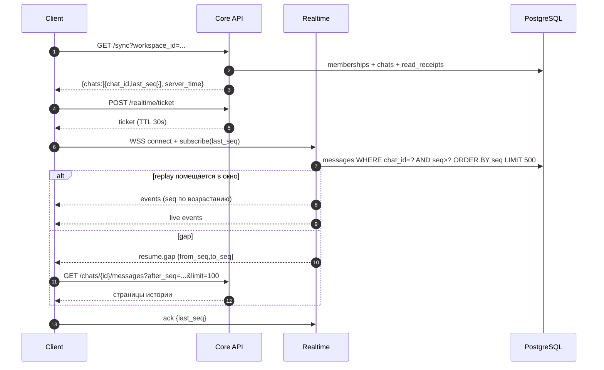

**Правила resume:**
- Клиент хранит `last_seq` на чат; после reconnect сначала `GET /sync`, затем `subscribe`.
- Replay — до 500 событий на чат; если `last_seq` старше окна (7 дней / 500 событий), сервер шлёт `resume.gap`, клиент добирает REST-страницами.
- Дубликаты отбрасываются по `event_id` и `seq <= last_seq`; порядок — по `seq`, не по `ts`.
- `read_receipts` не replay-ятся; клиент получает актуальный `last_read_seq` из `/sync`.
- При `chat.member.changed` с `status=REMOVED` gateway закрывает подписку на чат; при `device.revoked` — `session.revoked` и close 4403.
- Тикет одноразовый; reconnect — новый тикет. Backoff: 1, 2, 4, 8, 16, 30 с + jitter; не более 60 попыток/час.
- Несколько вкладок — отдельные WS-сессии; события дедуплицируются клиентом по `event_id`.

#### Fan-out и backpressure

- **Маршрутизация:** gateway при `subscribe` пишет `ws:sub:{chat_id}` (set node_id, TTL) и `ws:node:{node_id}:chats`. Fan-out worker читает `EVT-01`, находит узлы-подписчики и публикует в `ws:node:{id}` (Redis Pub/Sub). Gateway доставляет локальным соединениям.
- **Почему не Kafka на каждый gateway:** при 3+ узлах каждый читал бы весь поток; Redis-маршрутизация дешевле. Kafka остаётся durable-шиной для replay/аналитики.
- **Очередь на соединение:** 256 кадров. При переполнении сначала дропаются `typing`/`presence`, затем — close `1013 SLOW_CONSUMER` с `last_delivered_seq`; клиент переподключается и делает resume.
- **Heartbeat:** ping 25 с, timeout 60 с; мёртвые сессии чистятся по TTL.
- **Ограничение подписок:** ≤200 чатов на соединение; больше — `error SUBSCRIPTION_LIMIT` (клиент подписывается на видимые чаты).
- **Метрики:** `ws_connections`, `ws_subscriptions`, `ws_outbound_queue_depth`, `ws_slow_consumer_total`, `ws_resume_gap_total`.

---

## 8. Сценарии взаимодействия

### 8.1. Вход, выпуск токенов, регистрация устройства

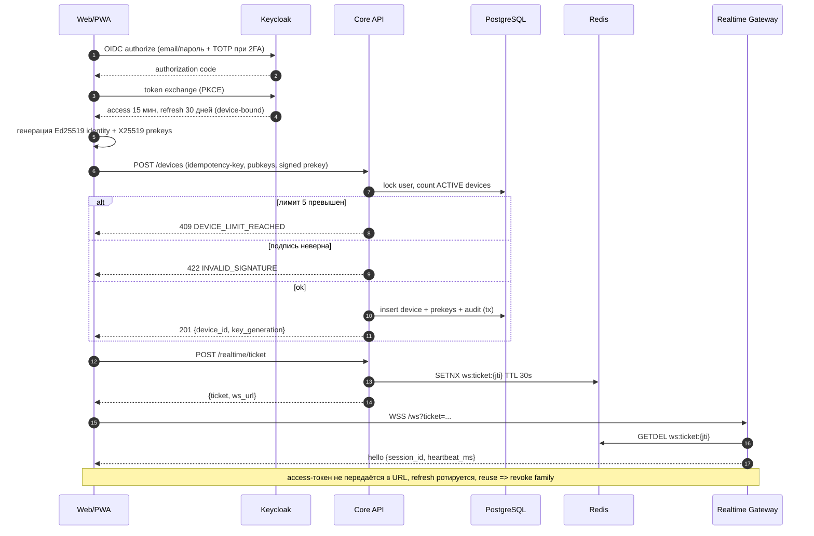

**Сбои и компенсации:**
- Keycloak недоступен → `503 AUTH_UNAVAILABLE`; уже выданный access живёт ≤15 мин, refresh не продлевается до восстановления.
- Подпись signed prekey невалидна → устройство не создаётся, клиент генерирует новый ключ; повторов с тем же `Idempotency-Key` не будет.
- Тикет истёк/использован → `401 WS_TICKET_INVALID`; клиент берёт новый тикет, backoff.
- Потеря ответа `POST /devices` → повтор с тем же `Idempotency-Key` возвращает тот же `device_id`, дубль устройства не создаётся.

### 8.2. E2EE 1:1: prekeys → сессия → доставка → receipt

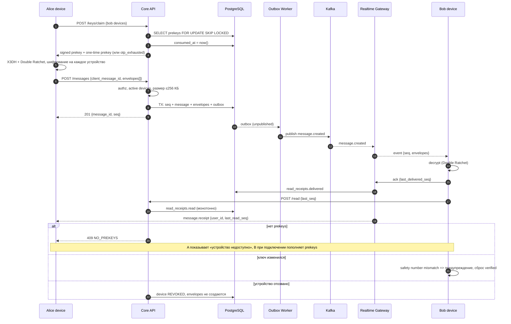

**Сбои и компенсации:**
- `POST /messages` упал после коммита, клиент повторяет: `client_message_id` + `Idempotency-Key` возвращают тот же `seq`.
- Получатель офлайн: конверты лежат в БД; при подключении `subscribe` с `last_seq` replay доставит сообщение.
- Потерян one-time prekey (редко): сессия строится на signed prekey, `otp_exhausted=true`; клиент предупреждает о меньшей FS.
- Устройство отозвано между claim и отправкой: сервер отвергает конверт для `REVOKED` (`422 UNKNOWN_DEVICE`), клиент пересобирает набор.

### 8.3. Групповой E2EE и ротация sender keys

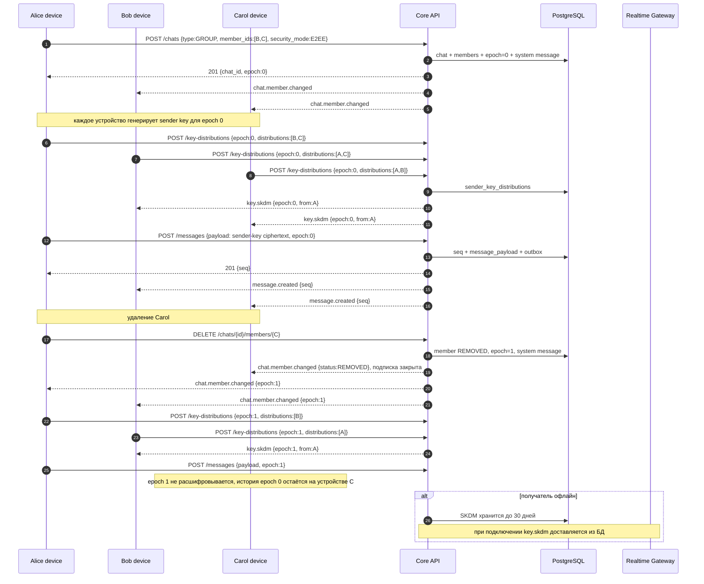

**Сбои и компенсации:**
- Пропущен SKDM → получатель шлёт `key.request`; отправитель повторяет `POST /key-distributions`.
- Новая эпоха, а старые сообщения ещё в пути → клиент хранит ключи прошлых эпох; сообщение содержит `epoch`.
- Удалённый участник успел получить epoch 1 до удаления → это окно ограничено транзакцией; при следующей ротации он исключается. Честно фиксируем: мгновенный отзыв уже доставленных ключей невозможен.
- Устройство отозвано → `EVT-22`, epoch++, SKDM только активным устройствам.

### 8.4. Загрузка файла: preflight → chunk → S3 → скан → сообщение

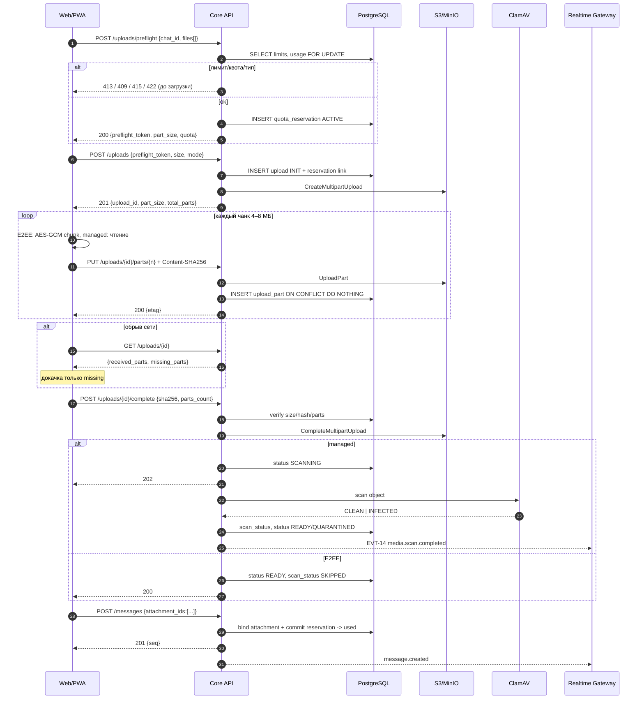

**Сбои и компенсации:**
- Обрыв на чанке: часть не записана/не совпал хеш → `422 CHUNK_HASH_MISMATCH`; повтор с тем же `part_no` идемпотентен.
- TTL 24 ч → `410 UPLOAD_EXPIRED`; reservation `EXPIRED`, квота возвращается.
- AV `INFECTED` → `QUARANTINED`, скачивание `423`, сообщение не отправляется; аудит.
- Пользователь отменил → `POST /abort`, reservation `RELEASED`, S3 `AbortMultipartUpload`.
- Приложение упало после complete, но до сообщения → GC освобождает объект через 24 ч; повторная отправка с тем же `attachment_id` невозможна после unbind.

### 8.5. Стикеры: отправка и загрузка своего набора

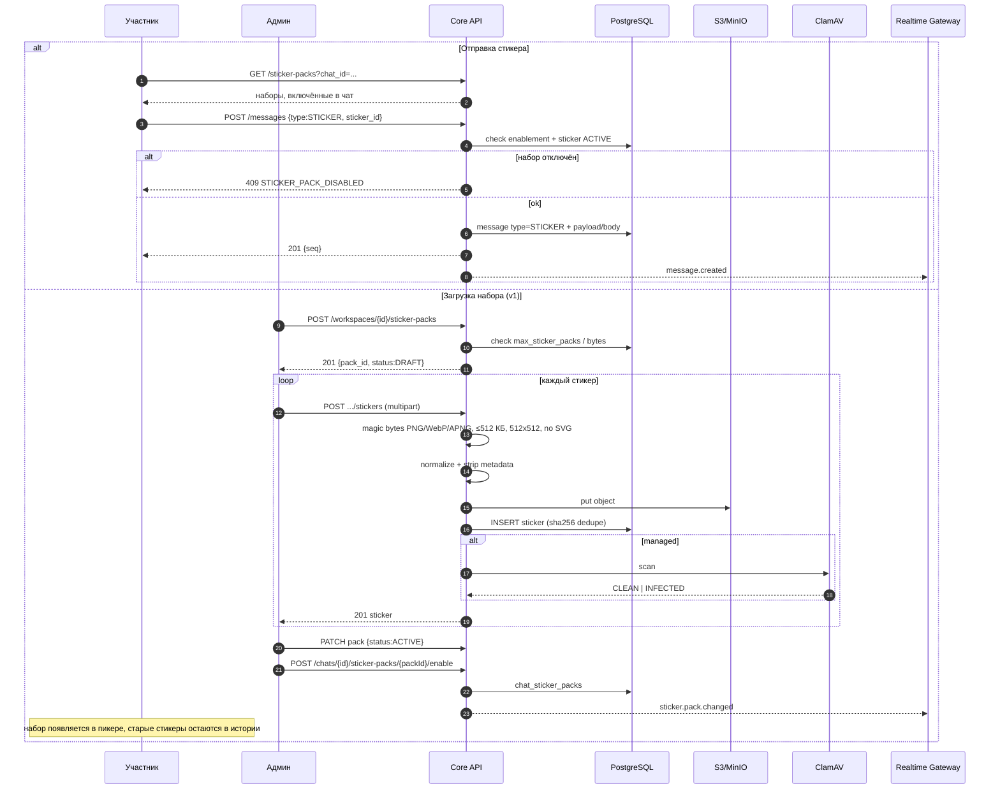

**Сбои и компенсации:**
- 600 КБ → `413 STICKER_TOO_LARGE`; SVG → `415 UNSUPPORTED_STICKER_FORMAT`; 60 стикеров → `422 STICKER_PACK_LIMIT`; всё до записи в S3.
- Дубликат `sha256` → существующий стикер переиспользуется, квота учитывается один раз.
- Жалоба → набор `DISABLED` до разбора; уже отправленные стикеры рендерятся из кэша, новые отправить нельзя.
- E2EE: сервер не перекодирует и не сканирует изображение; валидация на клиенте + жалобы, метаданные (`sticker_id`, `pack_id`, размер) видны.
- E2EE свои наборы: `K_pack`/epoch оборачивается на устройства через API-82; при изменении состава чата — новый epoch, старые скачанные стикеры остаются, новые недоступны удалённому.

### 8.6. Установка плагина и RPC

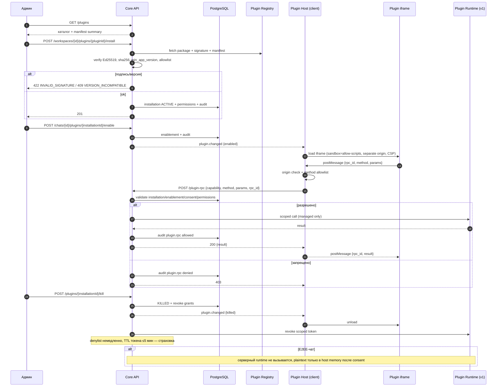

**Сбои и компенсации:**
- Registry недоступен → установка `503`; уже установленный pinned-плагин работает.
- Плагин пытается вызвать метод вне allowlist → `403 METHOD_NOT_ALLOWED`, аудит, счётчик инцидентов.
- Токен истёк во время сессии → host минтит новый; RPC повторяется с тем же `rpc_id` (дедуп 60 с).
- Kill switch → новые RPC `423`, iframe выгружается, токены в denylist; SLA ≤60 с.
- E2EE + серверный плагин → `409 MODE_NOT_SUPPORTED`; UI не показывает установку.

### 8.7. Break-glass в managed-режиме

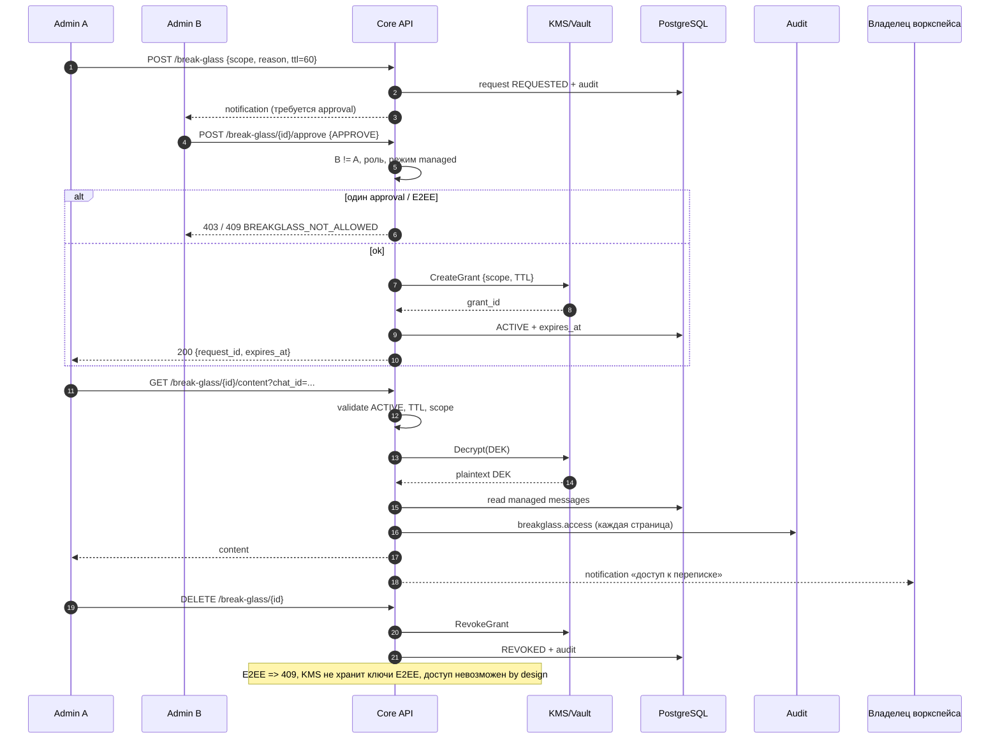

**Сбои и компенсации:**
- Второй approver недоступен → запрос истекает `EXPIRED`; доступ не выдаётся.
- KMS недоступен → `503`, grant не создаётся; повтор с тем же `Idempotency-Key`.
- Approver ушёл из воркспейса → grant отзывается job’ом; проверка роли на каждом чтении.
- Каждое чтение — отдельная аудит-запись с `request_id`; пропуск записи блокирует выдачу (fail-closed).
- E2EE-воркспейс → `409 BREAKGLASS_NOT_ALLOWED`; UI не показывает кнопку.

---

## 9. State machines

### 9.1. Сообщение

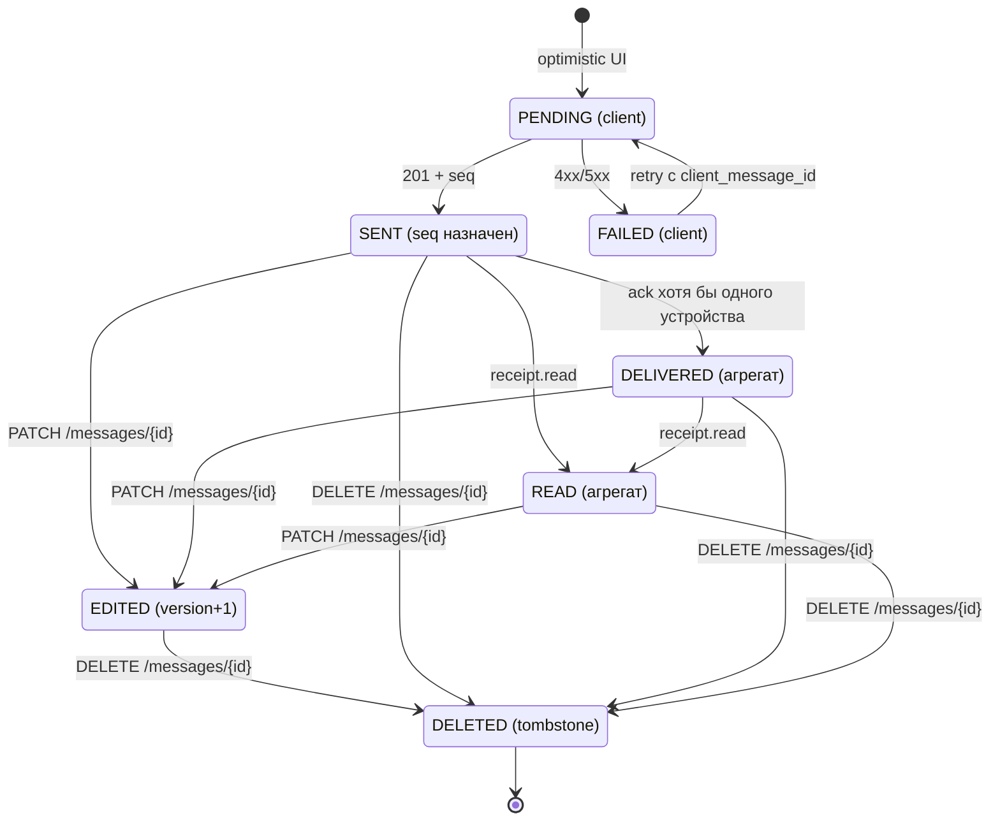

**Инварианты:**
- `SENT` — единственное серверное состояние создания; `DELIVERED/READ` — агрегаты по пользователю, не отдельные строки.
- `seq` не меняется при edit/delete; меняется `version`/`deleted_at`.
- Переход в `DELETED` очищает контент (`body_ciphertext`, envelopes, `content_meta`), оставляя tombstone для порядка.
- Повторный `DELETE` идемпотентен (`204`), повторный `PATCH` с той же версией — `409 VERSION_CONFLICT`.
- В E2EE сервер не валидирует текст; проверяются только размер, тип, устройства и права.

### 9.2. Загрузка

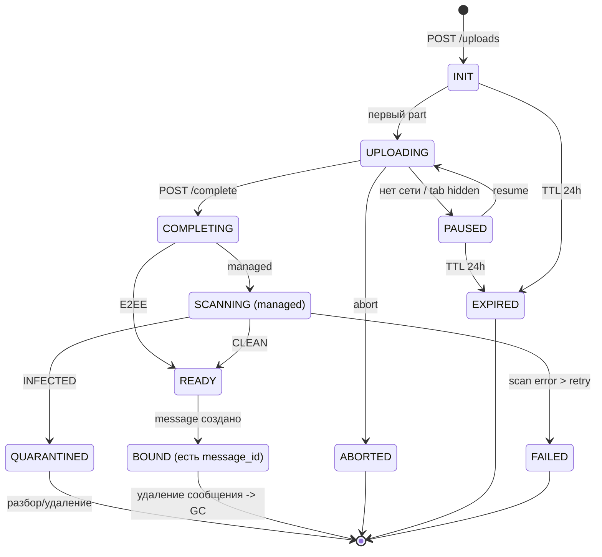

**Инварианты:** `COMPLETING` не принимает новые части; `BOUND` — терминальное для upload; `QUARANTINED` не скачивается; любая terminal-стадия освобождает reservation (кроме BOUND, где reservation → committed).

### 9.3. Участник чата

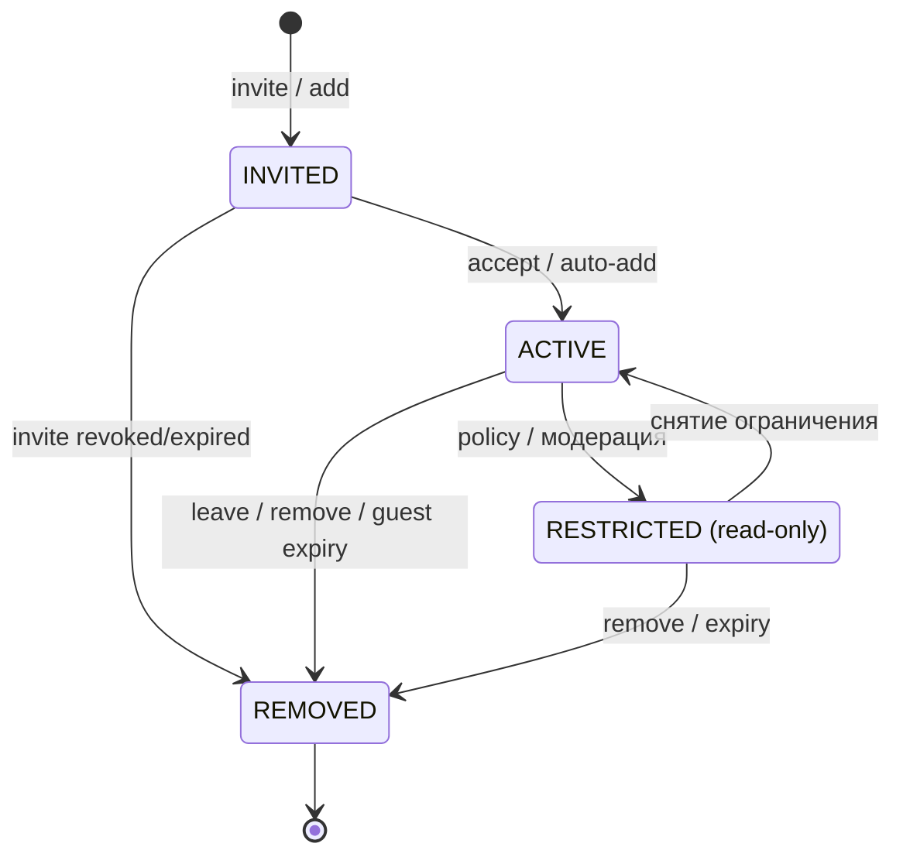

**Инварианты:** последний `OWNER` не может быть `REMOVED`/понижен; `REMOVED` немедленно теряет `chat.read`; для E2EE удаление инициирует `epoch++`; гость с истёкшим TTL автоматически `REMOVED` и теряет сессии.

### 9.4. Плагин: установка и версия

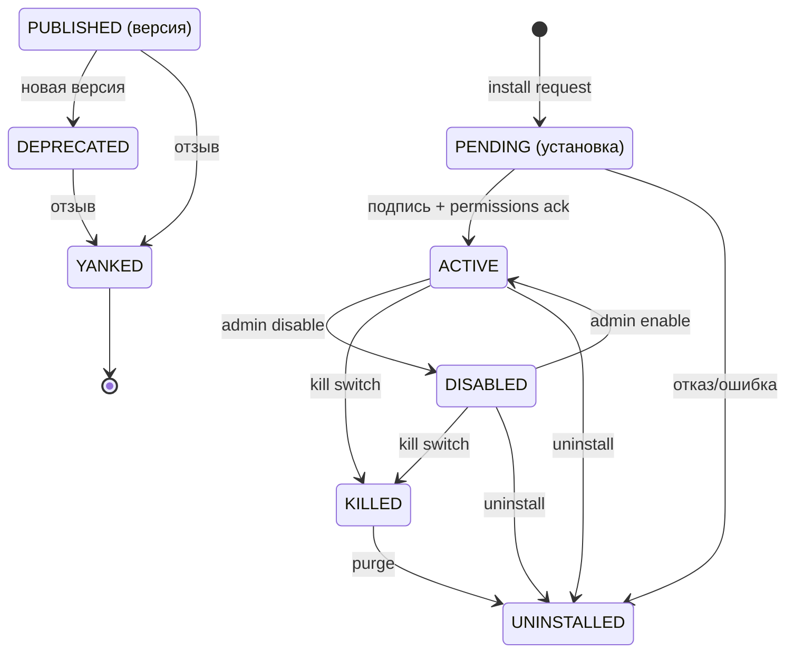

**Инварианты:** `KILLED` отзывает все capability-grants и запрещает enablement; версия иммутабельна; `YANKED` не устанавливается, но уже установленная pinned-версия работает до kill switch; auto-update только patch, major — вручную.

### 9.5. Набор стикеров

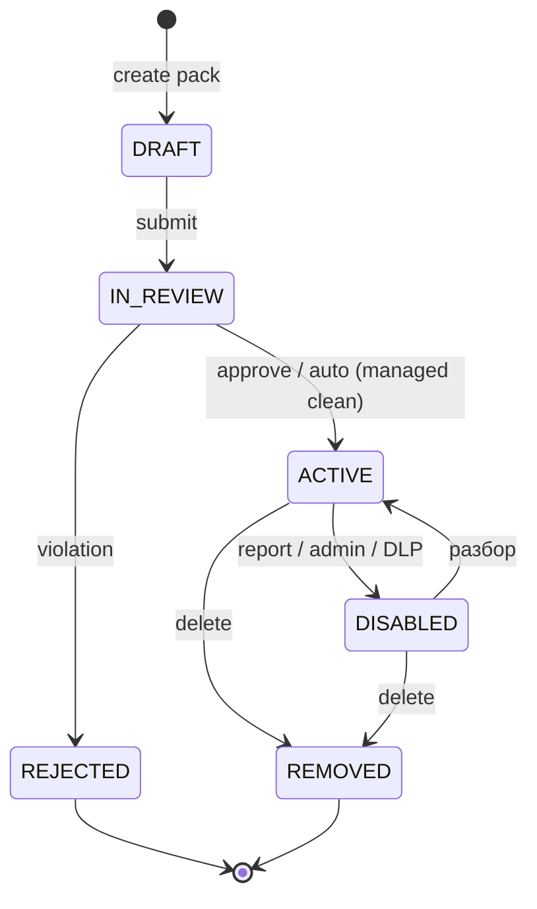

**Инварианты:** `ACTIVE` требует 8–50 валидных стикеров (Enterprise ≤100) и обложку; `DISABLED` запрещает новые отправки, но не рендер истории; `REMOVED` удаляет объекты и квоту, но `sticker_id` в старых сообщениях остаётся tombstone.

### 9.6. Устройство и ключи

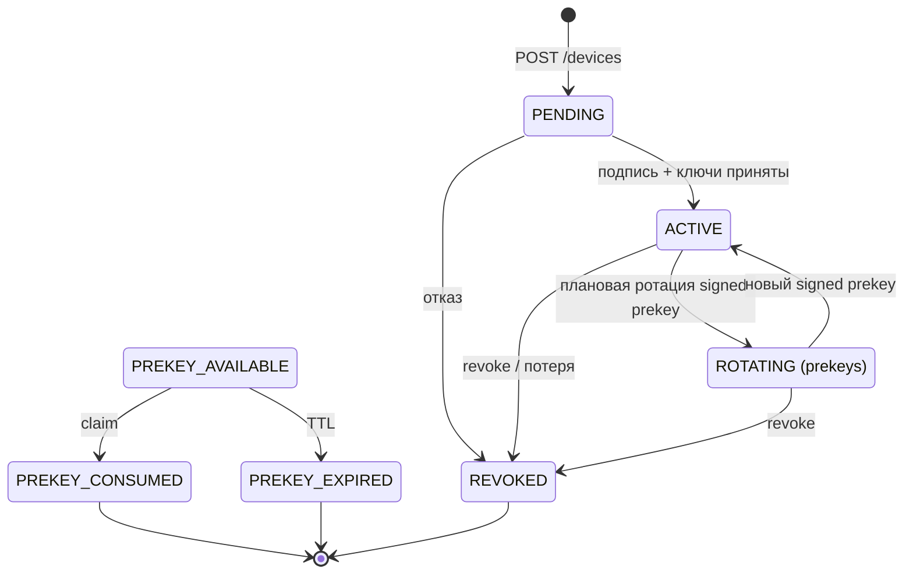

**Инварианты:** `REVOKED` терминален, `key_generation++`; prekey нельзя потребить дважды (`FOR UPDATE SKIP LOCKED`); при <20 one-time prekeys клиент пополняет; отозванное устройство не получает новые конверты и SKDM.

---

## 10. Роли, права, ABAC

### 10.1. Модель

- **Workspace role:** `OWNER`, `ADMIN`, `MEMBER`, `GUEST` (v1).
- **Chat role:** `OWNER`, `ADMIN`, `MODERATOR`, `MEMBER`, `GUEST`.
- **Effective permission** = RBAC по роли **∩** ABAC-ограничения **∩** состояние ресурса. По умолчанию — deny.
- **Workspace ADMIN не получает чтение контента автоматически.** Он управляет участниками, плагинами, лимитами и аудитом, но `chat.read`/`message.read` требует членства в чате или break-glass (managed). Для E2EE — только членство, ключей у админа нет.
- **UI скрывает — сервер проверяет:** каждая кнопка соответствует permission; отсутствие permission в UI не является контролем.

### 10.2. Матрица воркспейса

| Действие | OWNER | ADMIN | MEMBER | GUEST |
|---|:--:|:--:|:--:|:--:|
| `workspace.read` | ✓ | ✓ | ✓ | ✓ |
| `workspace.update` (name/logo) | ✓ | ✓ | — | — |
| `workspace.security_mode.change` | ✓ | — | — | — |
| `workspace.delete` | ✓ | — | — | — |
| `workspace.transfer_ownership` | ✓ | — | — | — |
| `billing.manage` | ✓ | ◐¹ | — | — |
| `member.invite` | ✓ | ✓ | — | — |
| `member.remove` | ✓ | ✓ | — | — |
| `member.role.change` | ✓ | ✓ | — | — |
| `directory.read` | ✓ | ✓ | ✓ | — |
| `chat.create.group` | ✓ | ✓ | ◐² | — |
| `chat.create.direct` | ✓ | ✓ | ✓ | — |
| `audit.read` | ✓ | ✓ | — | — |
| `audit.export` | ✓ | ✓ | — | — |
| `limits.manage` | ✓ | ◐³ | — | — |
| `plugin.install` | ✓ | ✓ | — | — |
| `plugin.kill` | ✓ | ✓ | — | — |
| `sticker_pack.install` | ✓ | ✓ | — | — |
| `breakglass.request` | ✓ | ✓ | — | — |
| `breakglass.approve` | ◐⁴ | ◐⁴ | — | — |
| `data.export` | ✓ | ✓ | — | — |
| `retention.manage` | ✓ | ◐³ | — | — |

¹ только если включена роль `BILLING` (v1); иначе владелец.  
² если политика `members_can_create_groups=true`; иначе только ADMIN+.  
³ в пределах тарифа; повышение тарифа — платформенный админ.  
⁴ только второй approver, не равный requester; для E2EE запрещено.

### 10.3. Матрица чата

| Действие | OWNER | ADMIN | MODERATOR | MEMBER | GUEST |
|---|:--:|:--:|:--:|:--:|:--:|
| `chat.read` | ✓ | ✓ | ✓ | ✓ | ◐¹ |
| `chat.write` | ✓ | ✓ | ✓ | ✓ | ◐¹ |
| `message.reply` / `message.react` | ✓ | ✓ | ✓ | ✓ | ✓ |
| `message.edit.own` | ✓ | ✓ | ✓ | ✓ | ✓ |
| `message.delete.own` | ✓ | ✓ | ✓ | ✓ | ✓ |
| `message.delete.any` | ✓ | ✓ | ✓ | — | — |
| `message.pin` | ✓ | ✓ | ✓ | — | — |
| `chat.members.read` | ✓ | ✓ | ✓ | ✓ | ◐² |
| `chat.members.add` | ✓ | ✓ | — | — | — |
| `chat.members.remove` | ✓ | ✓ | — | — | — |
| `chat.role.change` | ✓ | ✓ | — | — | — |
| `chat.settings.update` | ✓ | ✓ | — | — | — |
| `chat.delete` | ✓ | — | — | — | — |
| `chat.transfer` | ✓ | — | — | — | — |
| `chat.export` | ✓ | ✓ | — | — | — |
| `sticker.use` | ✓ | ✓ | ✓ | ✓ | ◐¹ |
| `sticker_pack.enable` | ✓ | ✓ | — | — | — |
| `plugin.enable` | ✓ | ✓ | — | — | — |
| `file.upload` | ✓ | ✓ | ✓ | ✓ | ◐³ |
| `file.download` | ✓ | ✓ | ✓ | ✓ | ◐³ |
| `history.read` | ✓ | ✓ | ✓ | ✓ | ◐⁴ |

¹ если гость не в read-only и не истёк TTL.  
² гость видит только участников своего чата; справочник воркспейса недоступен.  
³ гостевой лимит файла (100/500 МБ) и запрет на отдельные типы по политике.  
⁴ `history_from_seq`: гость видит только окно, разрешённое приглашением (по умолчанию 30 дней).

### 10.4. Управленческие действия workspace ADMIN без членства в чате

| Действие | Разрешено | Ограничение |
|---|---|---|
| Добавить/удалить участника | ✓ | Нельзя удалить последнего `OWNER`; нельзя повысить выше своей роли |
| Сменить роль | ✓ | Нельзя назначить `OWNER`; только transfer |
| Изменить настройки чата | ✓ | Нельзя сменить `security_mode` E2EE→managed |
| Включить плагин/набор стикеров | ✓ | Только если плагин установлен и разрешён политикой |
| Читать сообщения | — | Нужно членство или break-glass (managed) |
| Удалить чат / передать владение | — | Только `chat.OWNER` |
| Экспортировать историю | — | Только `chat.OWNER/ADMIN` или break-glass |

### 10.5. Алгоритм проверки прав

```text
authorize(actor, action, resource):
  1. device = load_device(actor.device_id); if device.status != ACTIVE: DENY(DEVICE_REVOKED)
  2. ws = load_workspace(resource.workspace_id)
     if ws.status == SUSPENDED and action.is_write: DENY(WORKSPACE_SUSPENDED)
  3. m = membership(actor.user_id, ws.id)
     if m.status != ACTIVE: DENY(NOT_A_MEMBER)
  4. if action.scope == WORKSPACE:
       return check_rbac(m.role, action) and check_abac(actor, action, resource)
  5. cm = chat_member(resource.chat_id, actor.user_id)
     if cm is None:
        if action in ADMIN_MANAGE_ACTIONS and m.role in {OWNER, ADMIN}: allow_without_read()
        else DENY(NOT_A_CHAT_MEMBER)
     if cm.status in {REMOVED, INVITED}: DENY(NOT_ACTIVE_MEMBER)
  6. base = cm.role
     if m.role in {OWNER, ADMIN} and action in ADMIN_MANAGE_ACTIONS: base = max(base, CHAT_ADMIN)
     if not check_rbac(base, action): DENY(FORBIDDEN)
  7. if not check_abac(actor, action, resource): DENY(ABAC_DENIED)
  8. ALLOW
```

`ADMIN_MANAGE_ACTIONS` = `{chat.members.add, chat.members.remove, chat.role.change, chat.settings.update, plugin.enable, sticker_pack.enable}`. В него **не входят** `chat.read`, `message.*`, `chat.delete`, `chat.transfer`.

### 10.6. ABAC-правила

| ID | Условие | Эффект | Код ошибки | Тест |
|---|---|---|---|---|
| ABAC-01 | `workspace.security_mode=E2EE` и action ∈ `breakglass.*` | deny | `409 BREAKGLASS_NOT_ALLOWED` | T-SEC-01 |
| ABAC-02 | `chat.security_mode=E2EE` и actor=`PLUGIN_SERVER` | deny | `409 MODE_NOT_SUPPORTED` | T-PLG-02 |
| ABAC-03 | `chat_member.status != ACTIVE` | deny all chat actions | `403`/`404` | T-ROLE-03 |
| ABAC-04 | guest и `message.seq < history_from_seq` | deny read | `403 HISTORY_RESTRICTED` | T-ROLE-05 |
| ABAC-05 | `attachment.scan_status != CLEAN` и action=`file.download` | deny (кроме владельца в карантине по политике) | `423` | T-FILE-06 |
| ABAC-06 | `message.sender_id != actor` и role < MODERATOR и action=`message.delete.any` | deny | `403` | T-ROLE-02 |
| ABAC-07 | action ∈ `{role.demote, member.remove}` и target — последний `OWNER` | deny | `409 LAST_OWNER` | T-ROLE-04 |
| ABAC-08 | action=`plugin.rpc` и consent отсутствует в E2EE | deny | `403 CONSENT_REQUIRED` | T-PLG-03 |
| ABAC-09 | `device.status=REVOKED` | deny all | `401`/`403` | T-DEV-01 |
| ABAC-10 | `chat.read_only=true` и action=`chat.write`/`file.upload` | deny | `403 CHAT_READ_ONLY` | T-ROLE-06 |
| ABAC-11 | action=`message.edit` и `now - created_at > edit_window` | deny | `403 EDIT_WINDOW_EXPIRED` | T-MSG-04 |
| ABAC-12 | action=`file.upload` и `used + reserved + size > storage_bytes` | deny | `409 QUOTA_EXCEEDED` | T-FILE-03 |
| ABAC-13 | action=`breakglass.content.read` и grant не ACTIVE/scope не совпадает | deny | `403`/`409` | T-BG-02 |
| ABAC-14 | action=`chat.read` и workspace ADMIN без членства и без break-glass | deny | `403` | T-ROLE-07 |
| ABAC-15 | `chat.key_epoch != envelope.epoch` | deny decrypt (клиент) | — | T-E2EE-03 |

### 10.7. Кто чем управляет

| Объект | Управление | Кто | Ограничение |
|---|---|---|---|
| Роли воркспейса | Назначение/снятие | `OWNER`, `ADMIN` | Нельзя снять последнего `OWNER`; нельзя назначить выше себя |
| Роли чата | Назначение/снятие | `chat.OWNER`, `chat.ADMIN`; workspace `ADMIN` — manage-actions | `OWNER` только через transfer |
| Лимиты и квоты | Значения в рамках тарифа | `OWNER`, `ADMIN` | Тариф меняет платформенный админ |
| Стикеры | Встроенные | Платформа | — |
| Свои наборы | Создание/загрузка/статус | `OWNER`, `ADMIN` | Квоты набора; review; нельзя SVG |
| Включение набора | В чате | `chat.OWNER`, `chat.ADMIN` | Набор должен быть установлен в воркспейс |
| Плагины | Установка/disable/kill | `OWNER`, `ADMIN` | Подпись, allowlist, managed-only для server |
| Плагин в чате | Enable/disable | `chat.OWNER`, `chat.ADMIN` | E2EE — только client-side + consent |
| Аудит | Чтение/экспорт | `OWNER`, `ADMIN` | Append-only; нельзя удалить |
| Break-glass | Request/approve/revoke | `OWNER`, `ADMIN` (2 разных) | Только managed; TTL ≤60 мин; KMS |
| Жалобы на контент | Рассмотрение | Платформенный админ | Набор/стикер → `DISABLED`; аудит |

### 10.8. «UI скрывает — сервер проверяет»

| UI-элемент | Что скрывает | Серверная проверка | Тест |
|---|---|---|---|
| Кнопка «Удалить» у чужого сообщения | Нет `message.delete.any` | RBAC + ABAC-06 | `DELETE` → `403`, сообщение не меняется |
| Дропдаун роли | Нет `member.role.change` | `ROLE_CEILING` + `LAST_OWNER` | Попытка назначить `OWNER` → `403` |
| Скрепка при 100% квоты | Нет места | Preflight + reservation | `413`/`409` до загрузки |
| Установка плагина | Нет `plugin.install` / E2EE + server | Подпись + режим + роль | `403`/`409` |
| Поиск в E2EE | Серверного поиска нет | Endpoint отсутствует/`409` | Сетевой тест: нет запроса |
| Break-glass | Нет 2 approvals | Approver ≠ requester + KMS | `403 SECOND_APPROVAL_REQUIRED` |
| Справочник воркспейса для гостя | Нет `directory.read` | ABAC гость | `403` |
| «Выйти» у последнего owner | Нельзя | `LAST_OWNER` | `409` |

---

## 11. Безопасность

### 11.1. Что видит сервер

| Данные | E2EE | Managed | Комментарий |
|---|---|---|---|
| Текст сообщения | Шифротекст (конверты/ payload) | Шифротекст в БД, plaintext в памяти core | В E2EE сервер не имеет ключа |
| Имя файла, MIME | Шифротекст | Plaintext/метаданные | В E2EE — только размер, sha256, время |
| Содержимое файла | Шифротекст | Шифротекст в S3 + DEK в KMS | Managed может построить превью |
| Стикер | Шифротекст изображения | Изображение + AV/DLP | `sticker_id`, `pack_id`, размер видны в обоих |
| Участники, роли, время | Метаданные | Метаданные | — |
| Реакции | Метаданные (эмодзи могут быть чувствительны) | Метаданные | Эмодзи не шифруются в MVP — [TBD] Q-11 |
| Поисковый индекс | Только на устройстве | OpenSearch | — |
| IP, user-agent, device_id | Да | Да | Минимизация, retention 90 дн. |
| Ключи | Публичные ключи, prekeys | Публичные ключи + KEK/DEK в KMS | Приватные ключи E2EE не покидают устройство |

### 11.2. Ключевая иерархия

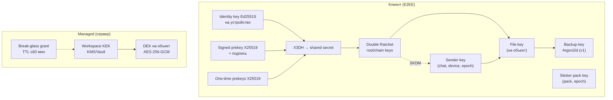

- **1:1:** identity Ed25519 + signed/one-time X25519 prekeys → X3DH-подобный handshake → Double Ratchet; AES-256-GCM; HKDF-SHA-256; заголовок ратчета в конверте.
- **Группа:** каждый sender device генерирует sender key (chain key + signing key) на эпоху; SKDM рассылается pairwise; сообщение шифруется один раз; ротация при изменении состава/отзыве устройства.
- **Файл:** случайный `K_file` 32 байта; AES-256-GCM по чанкам; `K_file` оборачивается ключом pairwise-сессии или sender key и хранится в `attachment_keys` на устройство.
- **Стикер (свой набор, E2EE):** `K_pack` на epoch; изображения шифруются `K_pack`, ключ оборачивается на устройства участников и хранится в `sticker_pack_keys`; при смене состава — новый epoch.
- **Managed:** DEK на объект, KEK в KMS; ротация KEK 90 дней; break-glass выдаёт KMS-grant, а не копию KEK.
- **Backup (v1):** ключевой bundle шифруется ключом из Argon2id-парольной фразы; сервер хранит непрозрачный blob; без фразы восстановление невозможно.

### 11.3. E2EE: честные границы

| Функция | E2EE | Managed | Почему |
|---|---|---|---|
| Серверный поиск | ✗ | ✓ | Нет ключа у сервера |
| Локальный поиск | ✓ | ✓ (клиентский кэш) | Индекс на устройстве |
| DLP на сервере | ✗ | ✓ | Сервер не читает контент |
| AV файлов на сервере | ✗ (клиентская проверка/предупреждение) | ✓ | Сервер не может расшифровать |
| Серверные плагины/боты | ✗ | ✓ | Нет plaintext |
| Клиентские плагины | ✓ только с consent на чат | ✓ | Plaintext в памяти хоста |
| Break-glass | ✗ | ✓ | Нет ключей |
| Аудит контента | ✗ (метаданные) | ✓ | — |
| Пуш с текстом | ✗ (по умолчанию) | ◐ (политика) | Push идёт через third-party |
| Восстановление истории | Только бэкап ключей (v1) | ✓ | Сервер не расшифрует |
| Мультидевайс | ✓ до 5, каждое устройство отдельно | ✓ | Fan-out конвертов |
| Компрометация сервера | Контент защищён | Контент + KMS-доступ | Модель доверия разная |

**Что не обещаем:**
- защиту от компрометации разблокированного устройства, кейлоггера, вредоносного ПО;
- защиту от скриншотов и пересылки получателем;
- анонимность: сервер видит участников, время, размеры, IP, device_id;
- «военную» стойкость против целевых атак с физическим доступом;
- ретроактивный отзыв уже доставленных сообщений/ключей;
- защиту от принудительного раскрытия ключей на устройстве (legal coercion);
- квантовую стойкость (X25519/Ed25519 — не post-quantum; PQ — v2+);
- серверный DLP/поиск/плагины в E2EE — это не «недоделка», а свойство режима.

### 11.4. Угрозы и контрмеры

| ID | Угроза | Вектор | Контрмеры | Остаточный риск | Тест |
|---|---|---|---|---|---|
| THR-01 | Кража/потеря устройства | Доступ к сессии/ключам | Короткие токены, revoke, keychain, biometric (v1), шифрование бэкапа | До первого revoke | T-DEV-01 |
| THR-02 | Злой админ | Чтение managed-контента | Break-glass 2 approvals, TTL, KMS, аудит, уведомление; E2EE невозможен | Коллюзия двух админов | T-BG-01 |
| THR-03 | Компрометация сервера | Утечка БД/бакета | E2EE; managed — envelope encryption + KMS; least privilege; RLS | Метаданные; managed при компрометации KMS | T-SEC-03 |
| THR-04 | MITM | Сеть | TLS 1.3, HSTS, pinning (desktop/mobile), E2EE поверх | Компрометация CA | T-SEC-02 |
| THR-05 | Вредоносный плагин | Кража данных/побег | Sandbox, CSP, capability, consent, allowlist, kill switch, review | Zero-day браузера | T-PLG-01 |
| THR-06 | Стикер как активный контент | SVG/HTML/XSS | Whitelist PNG/WebP/APNG, magic bytes, нормализация, CSP, `img` без HTML | Ошибка декодера | T-STK-01 |
| THR-07 | Фишинг-приглашение | Фейковый воркспейс | Верификация домена/бренда (v1), предупреждение, TTL, аудит | Социальная инженерия | T-INV-02 |
| THR-08 | DoS/спам | Массовые сообщения/регистрации | Rate limit, капча на инвайтах, репутация, backpressure | Распределённый ботнет | T-NFR-02 |
| THR-09 | Откат/повтор сообщений | Replay | Монотонный `seq`, `client_message_id`, `version`, подпись цепочки (v2) | Ошибка клиента | T-MSG-03 |
| THR-10 | Анализ метаданных | Трафик | Минимизация, retention, sealed sender (v2) | Метаданные видны | T-PRIV-01 |
| THR-11 | Подмена ключа | MITM при обмене | Safety numbers, key change warning, key transparency (v2) | Пользователь игнорирует warning | T-E2EE-04 |
| THR-12 | Supply chain | Зависимости/плагины | SBOM, lockfile, SCA, подпись, reproducible build (v1), allowlist | Вредоносное обновление | T-PLG-05 |
| THR-13 | Утечка через логи | Тело/ключи в логах | Log scrubber, запрет plaintext, structured logging, аудит доступа к логам | Ошибка разработчика | T-SEC-05 |
| THR-14 | SSRF через плагин | `http.request` | Egress proxy, allowlist, DNS rebinding protection, нет доступа к metadata | Ошибка allowlist | T-PLG-04 |

| ID | Контроль | Где реализован | Как проверяем |
|---|---|---|---|
| SEC-01 | TLS 1.3, HSTS, mTLS внутри | Gateway, service mesh | SSL-скан, конфиг-тест |
| SEC-02 | AuthN Keycloak, access 15 мин, refresh-ротация, device binding | auth, Keycloak | T-AUTH-01..03 |
| SEC-03 | Step-up для админ-действий | auth, gateway | T-AUTH-03, T-BG-01 |
| SEC-04 | E2EE 1:1: X3DH + Double Ratchet | client, message | T-E2EE-01, векторы |
| SEC-05 | Sender keys + epoch-ротация | client, message | T-E2EE-02/03 |
| SEC-06 | Safety number / key verification | client, auth | T-E2EE-04 |
| SEC-07 | Отзыв устройства, `key_generation` | auth, realtime | T-DEV-01 |
| SEC-08 | Envelope encryption, KMS, ротация KEK | file, plugin, KMS | T-SEC-03 |
| SEC-09 | Break-glass: 2 approvals, TTL, grant | admin/audit, KMS | T-BG-01..03 |
| SEC-10 | Plugin sandbox, CSP, отдельный origin | plugin host | T-PLG-01/02 |
| SEC-11 | E2EE consent на чат | plugin | T-PLG-03 |
| SEC-12 | Изоляция поиска: local vs OpenSearch | search | T-SEARCH-01 |
| SEC-13 | Шифрование файлов/стикеров, ключ на объект | file, sticker | T-FILE-05, T-STK-05 |
| SEC-14 | AV/DLP только managed | file, admin | T-FILE-06, T-BG-02 |
| SEC-15 | Audit hash chain + anchors | audit | T-AUD-01 |
| SEC-16 | Rate limit, lockout, anti-abuse | gateway, Redis | T-NFR-02 |
| SEC-17 | RLS, least-privilege DB-роли | все модули | RLS integration |
| SEC-18 | Секреты в Vault, ротация ≤90 дн. | ops | Secrets scan |
| SEC-19 | Логи без plaintext/PII | все | Log assertion |
| SEC-20 | Шифрование backup, KMS-ключи | ops | Restore drill |
| SEC-21 | CSP, SRI, non-extractable keys, XSS-защита | web | ZAP + review |
| SEC-22 | Минимизация метаданных, retention | все | Privacy review |

### 11.5. Аутентификация и сессии

| Механизм | Решение |
|---|---|
| Пароль | ≥10 символов, Argon2id в Keycloak, проверка утечек (k-anonymity) |
| 2FA | TOTP для админов в MVP; WebAuthn — v1; для всех — v1 |
| Access token | JWT 15 мин; claims `sub`, `sid`, `device_id`, `auth_time`, `acr`; роли **не** в токене |
| Refresh | 30 дней, ротация, device-bound, reuse detection → revoke family |
| Web-хранение | Access — в памяти; refresh — HttpOnly Secure SameSite=Strict cookie; CSRF-заголовок на refresh |
| Desktop/mobile | OS keychain/secure storage; biometric unlock (v1) |
| Step-up | Админ-действия и break-glass: `POST /auth/step-up`, elevated 5 мин, `acr` |
| Сессии | Список устройств, IP, last_seen; «выйти везде»; revoke устройства |
| Brute force | Lockout 15 мин после 10 неудач, progressive delay, rate limit |
| Сервисные аккаунты | OIDC client credentials, scoped roles, mTLS, ротация секретов |

### 11.6. Клиентская защита

- CSP `default-src 'self'; script-src 'self'; object-src 'none'; frame-ancestors 'none'; base-uri 'none'`; никакого `unsafe-eval`.
- Markdown-lite рендерится в текстовые узлы; ссылки — `rel="noopener noreferrer"`, `target="_blank"`; HTML запрещён.
- Файлы/превью — только `img`/`video`/`object` с sandbox для PDF (v1); SVG не рендерится из пользовательских файлов.
- Ключи E2EE — non-extractable `CryptoKey` + IndexedDB; пароль сессии для разблокировки.
- SRI для внешних скриптов (если появятся), lockfile, SBOM.
- Никаких токенов/ключей в `localStorage` в открытом виде; refresh — cookie, access — память.
- Очистка кэша при logout; `Clear-Site-Data` где возможно.

### 11.7. Логи, метаданные, retention

- Запрещено логировать: текст сообщений, имена файлов, ciphertext, ключи, prekeys, токены, email в открытом виде.
- Разрешено: `request_id`, `workspace_id`, `chat_id`, `message_id`, `actor_id`, `action`, latency, status, размер.
- Логи — 30 дней; аудит — 12 месяцев; метаданные соединений — 90 дней.
- PII-скраббер на ingress; тест на отсутствие plaintext в логах.
- DLP-события и break-glass — отдельный защищённый индекс с доступом только security-роли.

### 11.8. Managed: KMS, ротация, break-glass

- KEK на воркспейс, DEK на объект; AES-256-GCM; AAD = `workspace_id || object_id || version`.
- KMS-политика: core-роль `wrap/unwrap`, break-glass — отдельный grant с TTL; ключи не экспортируются.
- Ротация KEK 90 дней (re-wrap DEK), DEK — при перезаписи; старые версии доступны для чтения.
- Break-glass: причина, scope (чат/период), TTL ≤60 мин, 2 разных approver, step-up, KMS grant, аудит каждого чтения, уведомление владельца, авто-revoke.
- При отзыве approver’а/уходе из воркспейса — grant revoke job.
- E2EE: KMS не содержит ключей контента; break-glass API возвращает `409` до любых операций.

### 11.9. Аудит и мониторинг ИБ

- Аудит-события: login/logout, MFA, смена пароля, создание/удаление чата, роли, инвайты, экспорт, плагины, стикеры, лимиты, break-glass, revoke устройства.
- Hash chain + daily anchor; экспорт в SIEM; алерты на: break-glass, массовый экспорт, серию 403, аномальный объём загрузок, plugin kill, ошибки KMS.
- Security-метрики: `auth_failures`, `breakglass_active`, `plugin_denied_rpc`, `av_infected`, `dlp_blocks`, `revoked_devices`.
- Пентест перед публичным запуском и ежегодно; bug bounty после 1000 платящих.
- Incident response: kill switch плагина, revoke устройств, ротация KEK, публичный статус; runbook в ops.

---

## 12. Файлы и стикеры end-to-end

### 12.1. Лимиты по тарифам

| Параметр | Community | Family | Team | Enterprise |
|---|---:|---:|---:|---:|
| Один файл | 200 МБ | 1 ГБ | 2 ГБ | до 10 ГБ |
| Хранилище воркспейса | 10 ГБ | 100 ГБ | 1 ТБ | политика |
| Файлов в сообщении | 5 | 10 | 10 | 10 |
| Гостевой лимит на файл | 100 МБ | 500 МБ | 500 МБ | политика |
| Retention по умолчанию | 12 мес. | 24 мес. | 12 мес. | политика |
| Своих наборов стикеров | 3 | 5 | 20 | политика |
| Объём своих наборов | 30 МБ | 50 МБ | 200 МБ | политика |
| Стикеров в наборе | 8–50 | 8–50 | 8–50 | 8–100 |
| Один стикер | 512 КБ | 512 КБ | 512 КБ | 512 КБ |

**Клиентские ограничения (UX, не замена серверу):** web — 2 ГБ на файл (браузер/память), desktop — до 10 ГБ; мобильный — 200 МБ в MVP. Сервер всегда проверяет лимит по тарифу, даже если клиент показывает меньше.

### 12.2. Коды ошибок файлов и стикеров

| HTTP | `code` | Когда | `details` | Что делать пользователю |
|---|---|---|---|---|
| 413 | `FILE_TOO_LARGE` | Размер > `max_file_bytes` | `{limit, actual, tariff}` | Уменьшить файл или сменить тариф |
| 409 | `QUOTA_EXCEEDED` | `used+reserved+size > storage_bytes` | `{used,reserved,limit,required}` | Освободить место/повысить тариф |
| 422 | `TOO_MANY_FILES` | > `max_attachments` | `{limit, actual}` | Отправить частями |
| 415 | `UNSUPPORTED_TYPE` | MIME вне allowlist | `{mime, allowed[]}` | Выбрать другой формат |
| 422 | `DANGEROUS_TYPE_BLOCKED` | exe/bat/script по политике | `{mime, policy}` | Упаковать/согласовать политику |
| 410 | `UPLOAD_EXPIRED` | TTL истёк | `{expired_at}` | Начать заново |
| 410 | `PRECHECK_EXPIRED` | Preflight token >10 мин | `{expired_at}` | Повторить preflight |
| 409 | `CHUNK_CONFLICT` | Часть уже с другим хешем | `{part_no}` | Перезалить часть |
| 422 | `CHUNK_HASH_MISMATCH` | Хеш части не совпал | `{part_no, expected, actual}` | Повторить часть |
| 423 | `UPLOAD_LOCKED` | Идёт complete/scan | `{retry_after}` | Подождать |
| 422 | `MALWARE_DETECTED` | AV `INFECTED` | `{engine}` | Файл заблокирован |
| 409 | `SCAN_PENDING` | Скачивание до `CLEAN` | `{status}` | Подождать |
| 423 | `ATTACHMENT_QUARANTINED` | Карантин | `{reason}` | Обратиться к админу |
| 413 | `STICKER_TOO_LARGE` | >512 КБ | `{limit, actual}` | Сжать/нормализовать |
| 415 | `UNSUPPORTED_STICKER_FORMAT` | SVG/HTML/GIF и т.п. | `{mime, allowed[]}` | PNG/WebP/APNG |
| 422 | `STICKER_PACK_LIMIT` | >50 (или >100 Enterprise) | `{limit, actual}` | Разбить набор |
| 409 | `STICKER_PACK_QUOTA` | Превышено число наборов/объём набора по тарифу | `{limit, actual, tariff}` | Удалить набор/сменить тариф |
| 409 | `STICKER_PACK_DISABLED` | Набор отключён | `{pack_id, status}` | Выбрать другой |
| 409 | `PACK_NOT_INSTALLED` | Набор не установлен в воркспейс | `{pack_id}` | Установить набор |

### 12.3. Preflight: контракт и решение

```json
{
  "chat_id": "b1e0...",
  "files": [
    {"name": "atlas-brief-v3.pdf", "size": 2483027, "mime": "application/pdf", "sha256": "..."},
    {"name": "render.zip", "size": 2684354560, "mime": "application/zip"}
  ]
}
```

```json
{
  "decision": "DENY",
  "max_file_bytes": 2147483648,
  "max_attachments": 10,
  "quota": {"used": 734003200000, "reserved": 0, "limit": 1099511627776},
  "files": [
    {"allowed": true, "part_size": 8388608, "preflight_token": "pf_..."},
    {"allowed": false, "error": "FILE_TOO_LARGE", "details": {"limit": 2147483648, "actual": 2684354560}}
  ]
}
```

**Правила:**
- Preflight не резервирует квоту; резерв делает `POST /uploads` в той же транзакции, что и проверка `used+reserved`.
- `preflight_token` — подписанный JWT TTL 10 мин, содержит `chat_id`, `user_id`, `size`, `mime_hash`, `decision`; защищает от подмены размера между preflight и init.
- Один preflight — до 10 файлов; частичные отказы допустимы, клиент показывает по каждому.
- При 80/95/100% квоты preflight возвращает `quota.warning` и событие `EVT-15`; 100% — `QUOTA_EXCEEDED`.

### 12.4. Chunk/resume

| Параметр | Значение |
|---|---|
| Размер части | 8 МБ по умолчанию; 4 МБ для мобильных/слабых сетей; последняя — меньше |
| Число частей | `ceil(size / part_size)`, ≤10 000 (S3 multipart limit) |
| Идемпотентность | `(upload_id, part_no)`; повтор с тем же sha256 → `200`; другой sha256 → `409 CHUNK_CONFLICT` |
| Хеш | `Content-SHA256` — SHA-256 зашифрованной части (E2EE) или исходной (managed) |
| Возобновление | `GET /uploads/{id}` → `received_parts`/`missing_parts`; клиент докачивает только missing |
| Таймаут части | 60 с; при 3 неудачах — пауза, экспоненциальный backoff |
| Завершение | `POST /complete` проверяет число частей, суммарный размер, финальный sha256 |
| TTL | 24 ч; продление — не более 72 ч; после — `EXPIRED` |
| Параллелизм | 3 части на устройство; глобально 100 МБ/мин на пользователя |

**S3 multipart:** `CreateMultipartUpload` → `UploadPart` (part_no 1..10000) → `CompleteMultipartUpload`; при abort — `AbortMultipartUpload`. В MVP части идут через API (проще authz/quota); в v1 — presigned URL на часть с TTL 5 мин, сервер валидирует `part_no`/размер после загрузки. [ASSUMPTION] A-13.

### 12.5. E2EE-формат файла

```text
object = MAGIC("KRF1") || version || nonce_prefix(8) ||
         chunk_0 || tag_0 || chunk_1 || tag_1 || ... || chunk_n || tag_n

chunk_i = AES-256-GCM(K_file, nonce = nonce_prefix || uint32(i),
                      aad = file_id || uint32(i) || plaintext_size_i)
K_file  = random 32 bytes (CSPRNG)
K_manifest = HKDF-SHA-256(K_file, "krug-file-manifest", 32)
manifest = AES-256-GCM(K_manifest, {name, mime, size, sha256, chunks[]})
K_file/K_manifest обёрнуты на каждое устройство получателя:
  attachment_keys(attachment_id, recipient_device_id, wrapped_key)
```

- Сервер видит только `object_key`, размер, `sha256` зашифрованного объекта, дату; имя/MIME — шифротекст.
- Клиент проверяет `sha256` расшифрованного файла и размер; при несовпадении — не сохраняет.
- Превью: клиент генерирует и шифрует отдельным ключом (v1); сервер не строит превью.
- Ключи файла не попадают в поисковый индекс/логи; удаляются при удалении сообщения на клиенте.

### 12.6. Managed AV/DLP pipeline

```mermaid
flowchart LR
  U["Upload complete"] --> V["Verify size/hash"]
  V --> Q["Status SCANNING"]
  Q --> AV["ClamAV"]
  Q --> DLP["DLP rules (async)"]
  AV -->|CLEAN| R["READY"]
  AV -->|INFECTED| X["QUARANTINED"]
  AV -->|ERROR| F["FAILED / retry"]
  DLP -->|BLOCK| X
  DLP -->|WARN| R
  R --> M["Bind to message"]
  X --> A["Audit + notify admin"]
```

- AV — inline до `READY` (p95 ≤5 с для ≤50 МБ; для больших — async с `SCAN_PENDING`).
- DLP — async, но `BLOCK` переводит в `QUARANTINED` до скачивания; `WARN` — флаг в UI и аудит.
- Парольные архивы — `DANGEROUS_TYPE_BLOCKED` или `QUARANTINED` по политике.
- E2EE: AV/DLP сервера нет; клиент может предупредить об exe/скрипте, но не блокирует криптографически.

### 12.7. Стикеры: валидация и нормализация

| Проверка | Клиент | Сервер | Ошибка |
|---|---|---|---|
| Формат по magic bytes | PNG/WebP/APNG только | Повторно, не по расширению | `415 UNSUPPORTED_STICKER_FORMAT` |
| SVG/HTML/script | Запрет | Запрет; декодер не SVG | `415` |
| Размер | ≤512 КБ | ≤512 КБ | `413 STICKER_TOO_LARGE` |
| Размеры | 512×512 (contain, прозрачный фон) | Ровно 512×512 | `422 INVALID_STICKER_DIMENSIONS` |
| Анимация | ≤3 с, ≤30 fps, ≤100 кадров | Проверка метаданных | `422 STICKER_ANIMATION_LIMIT` |
| Метаданные | EXIF/XMP удаляются | Повторная нормализация | — |
| Дубликат | — | `sha256` в рамках воркспейса | дедуп, квота один раз |
| Кол-во в наборе | 8–50 | 8–50 (Enterprise ≤100) | `422 STICKER_PACK_LIMIT` |
| Объём набора | по тарифу | по тарифу | `409 STICKER_PACK_QUOTA` |
| Права на контент | Чекбокс автора | Attestation в аудите | — |
| Managed AV/DLP | — | Скан изображения | `422 MALWARE_DETECTED` / карантин |

**Пайплайн:** загрузка → magic bytes → decode header → normalize 512×512 → strip metadata → encode WebP/PNG (или APNG) → размер ≤512 КБ → S3 immutable → `sha256` dedupe → AV/DLP (managed) → `ACTIVE`.
**E2EE:** клиент делает всё до шифрования; сервер проверяет только `sticker_id`, `pack_id`, размер, `sha256`; перекодирование запрещено. Для своих наборов используется `K_pack` (epoch): изображения шифруются им, `K_pack` оборачивается на устройства участников, у которых набор включён (`sticker_pack_keys`, API-82). При изменении состава чата — новый epoch; уже скачанные стикеры старого epoch остаются у участника, новые — нет. Встроенные наборы — публичные локальные ассеты и не требуют ключа.

### 12.8. Стикеры: модель и модерация

- Встроенные наборы — подписаны платформой, доступны всем, не занимают квоту воркспейса; в E2EE — локальные ассеты.
- Свои наборы — `DRAFT → IN_REVIEW → ACTIVE`; установка в воркспейс (`workspace_sticker_packs`), включение в чат (`chat_sticker_packs`); в E2EE — `K_pack`/epoch и `sticker_pack_keys`, ротация при смене состава.
- Отключение набора в чате: новые стикеры недоступны, старые рендерятся; `sticker_id` остаётся.
- Жалоба: `content_reports` → `DISABLED` до разбора; аудит; автор может оспорить (v1).
- Дедупликация `sha256` в рамках воркспейса; один объект, одна запись квоты.
- Кэш на устройстве ≤50 МБ; недавние — локально (IndexedDB), избранное — сервер + локальный кэш.
- Alt-подпись обязательна; `prefers-reduced-motion` отключает анимацию.

### 12.9. Скачивание, превью, галерея

- Managed: `GET /attachments/{id}/download-url` → presigned URL TTL 5 мин, `Content-Disposition: attachment; filename*=UTF-8''...`, поддержка `Range` для видео/PDF.
- E2EE: сервер отдаёт зашифрованный объект (presigned) + клиент получает `wrapped_key` из envelope; расшифровка в Web Worker; превью — локально.
- Галерея чата — `GET /chats/{id}/attachments?cursor=` (v1); поиск по имени — managed, локальный — E2EE.
- Удаление сообщения → attachment `DELETED`, S3 object delete, квота освобождается после GC ≤24 ч.
- Retention: job удаляет объекты старше политики; аудит; для managed — DLP-проверка перед удалением не требуется.

---

## 13. Плагины

### 13.1. Типы и scope

| Тип | Где работает | MVP | v1 | v2 | Доступ к E2EE |
|---|---|---|---|---|---|
| UI-панель | iframe в правой панели | ✓ | ✓ | ✓ | Только client-side + consent |
| Действие композера | iframe/кнопка | ✓ | ✓ | ✓ | Только client-side + consent |
| Рендерер сообщения | host-rendered компонент | ✓ | ✓ | ✓ | Только client-side + consent |
| Бот/интеграция | server runtime | — | ✓ | ✓ | ✗ |
| Админ-расширение | admin UI | — | ✓ | ✓ | ✗ |
| WASM-рантайм | sandbox | — | — | ✓ | TBD |

### 13.2. Манифест

```json
{
  "schema_version": "1.0",
  "id": "ru.krug.polls",
  "name": "Опросы",
  "version": "1.4.0",
  "publisher": { "id": "krug-labs", "key_id": "ed25519:9f2c..." },
  "entry": { "ui": "panel.html", "worker": "worker.js" },
  "surfaces": ["panel", "composer", "message"],
  "permissions": [
    "chat.messages.read",
    "chat.messages.send",
    "chat.members.read",
    "ui.panel",
    "ui.composer",
    "storage.workspace"
  ],
  "egress": [],
  "min_app_version": "1.0.0",
  "resource_limits": { "memory_mb": 128, "cpu_ms_per_call": 200, "rpc_per_min": 60 },
  "content_hash": "sha256:..."
}
```

- Подпись **detached** (Ed25519) хранится рядом с пакетом; внутри манифеста её нет, иначе получается циклическая зависимость. Это исправление к примеру из концепции.
- `id` — reverse-DNS, immutable; `version` — semver; `content_hash` — sha256 пакета; `min_app_version` — совместимость.
- `permissions` не могут расширяться без нового manifest + повторного consent; `egress` — allowlist доменов.
- Схема манифеста версионируется (`schema_version`); неизвестные поля игнорируются, неизвестные permissions → отказ установки.

### 13.3. Разрешения

| Permission | Что даёт | Риск | E2EE | Consent |
|---|---|---|---|---|
| `chat.messages.read` | Читать сообщения включённых чатов | Высокий | Только client-side | На каждый чат |
| `chat.messages.send` | Отправлять от имени плагина (бейдж «бот») | Средний | Да, с consent | На каждый чат |
| `chat.members.read` | Состав чата | Высокий | Да, с consent | На каждый чат |
| `files.read` | Читать вложения | Высокий | Только client-side | На каждый чат |
| `files.write` | Прикреплять файлы | Средний | Да, с consent | На каждый чат |
| `ui.panel` | Панель | Низкий | Да | Нет |
| `ui.composer` | Кнопка в композере | Низкий | Да | Нет |
| `ui.message` | Рендер своего сообщения | Низкий | Да | Нет |
| `http.request` | Исходящие запросы к allowlist | Высокий | ✗ | Да, при установке |
| `storage.workspace` | Изолированное хранилище | Средний | Да | Нет |
| `notifications.send` | Свои уведомления | Низкий | Да | Нет |
| `bot.commands` | Slash-команды | Средний | Да, с consent | На каждый чат |

**Правило:** эффективные права = `manifest.permissions ∩ workspace_policy ∩ chat_enablement ∩ user_consent (для E2EE)`. Сервер проверяет на каждом RPC, не только при установке.

### 13.4. Sandbox

```html
<iframe
  sandbox="allow-scripts"
  src="https://p-7f3c.plugins.krug.example/panel.html"
  referrerpolicy="no-referrer"
  allow="clipboard-write"
  title="Опросы">
</iframe>
```

| Контроль | Реализация |
|---|---|
| Изоляция origin | Отдельный домен `*.plugins.krug.example`, без `allow-same-origin` |
| DOM приложения | Недоступен: cross-origin + sandbox |
| Storage | Нет `localStorage`/`IndexedDB` приложения; только plugin storage через host RPC |
| Сеть | `connect-src 'none'`; только `postMessage`; egress — через host/egress proxy |
| CSP | `default-src 'none'; script-src 'self'; style-src 'self'; img-src 'self' data: blob:; connect-src 'none'; frame-ancestors https://app.krug.example; base-uri 'none'; form-action 'none'` |
| Navigation | `allow-top-navigation` отсутствует; ссылки — через host |
| Permissions | `Permissions-Policy: camera=(), microphone=(), geolocation=()` |
| RPC | Только allowlist методов, размер ≤64 КБ, timeout 5 с, rate limit |
| Ресурсы | Server runtime: cgroup CPU 0.25/ mem 256 МБ / pids 64; UI: лимиты RPC, watchdog |
| Краш | iframe перезагружается, host не падает; circuit breaker после 5 ошибок |

### 13.5. Capability-токены

```json
{
  "iss": "krug",
  "aud": "plugin-rpc",
  "sub": "installation:3f1c...",
  "chat_id": "b1e0...",
  "user_id": "9a2d...",
  "device_id": "c7e1...",
  "plugin_id": "ru.krug.polls",
  "permissions": ["chat.messages.read", "chat.members.read"],
  "scope": ["chat.messages.list", "chat.members.list"],
  "jti": "0b6f...",
  "iat": 1763271700,
  "exp": 1763272000,
  "ver": 1
}
```

- TTL 300 с; подпись Ed25519; хранится `plugin_capability_grants` для аудита/отзыва.
- **Токен не передаётся в iframe.** Host получает его от API и держит в памяти; iframe видит только `rpc_id`/результат.
- Проверка: подпись, `exp`, `aud`, `jti` не в denylist, `installation.status=ACTIVE`, `chat_enablement`, `consent` (E2EE), permission для метода, rate limit.
- Отзыв: kill switch/disable → `revoked_at`, Redis denylist `plugin:deny:{jti}`; in-flight RPC проверяет denylist.
- Токен привязан к чату/пользователю/устройству: переиспользование в другом чате → `403`.

### 13.6. RPC

```json
{"jsonrpc":"2.0","id":"rpc_01J...","method":"chat.messages.list","params":{"chat_id":"b1e0...","limit":50}}
```

| Аспект | Правило |
|---|---|
| Транспорт | `postMessage` между iframe и host; host → `POST /plugin-rpc` |
| Валидация origin | `event.origin === pluginOrigin` и `event.source === iframe.contentWindow` |
| Методы | Allowlist по permissions; неизвестный → `-32601` |
| Параметры | JSON Schema метода; размер ≤64 КБ; лимит глубины |
| Таймаут | 5 с; отмена по `rpc_id` |
| Идемпотентность | `rpc_id` дедуп 60 с; mutating-методы требуют `idempotency_key` |
| Ошибки | `-32601 METHOD_NOT_FOUND`, `-32602 INVALID_PARAMS`, `-32003 FORBIDDEN`, `-32023 PLUGIN_KILLED`, `-32029 RATE_LIMITED` |
| Аудит | Каждый RPC: allowed/denied, method, installation, chat, user; без params с контентом |

### 13.7. Lifecycle и аудит

1. **Publish:** разработчик подписывает пакет, загружает manifest + SBOM; registry проверяет подпись/хеш/совместимость.
2. **Review:** статический анализ, permissions diff, ручное ревью (v1), allowlist.
3. **Install:** админ воркспейса, подтверждение permissions, запись `plugin.installed`.
4. **Enable:** владелец/админ чата, проверка режима; в E2EE — consent каждого пользователя.
5. **Update:** patch — авто (если разрешено), minor/major — вручную; pinned версия; rollback на предыдущую.
6. **Disable/Kill:** админ/платформа; отзыв токенов, выгрузка iframe, аудит.
7. **Uninstall:** данные плагина удаляются сразу или через 30 дней (политика); аудит.

**События аудита:** install, permission_ack, enable, disable, kill, consent_granted/revoked, rpc_denied, egress_blocked, update, uninstall.

### 13.7.1. Требования PLG

| ID | Требование | Проверка |
|---|---|---|
| PLG-01 | Manifest иммутабелен; semver; `content_hash`; `min_app_version` | Contract-тест registry |
| PLG-02 | Least-privilege permissions; эффективные права — пересечение с политикой/consent | T-PLG-01, permission-diff review |
| PLG-03 | Установка только с валидной detached-подписью и allowlist | T-PLG-01, negative |
| PLG-04 | iframe `allow-scripts` без `allow-same-origin`, отдельный origin, CSP | T-PLG-02, sandbox escape test |
| PLG-05 | RPC только через host, не напрямую в API/сеть | T-PLG-02, network assertion |
| PLG-06 | Capability-JWT ≤5 мин, привязан к installation/chat/user/device, не в iframe | T-PLG-03, token replay test |
| PLG-07 | В E2EE — consent на каждый чат; отзыв логируется | T-PLG-03 |
| PLG-08 | Серверные плагины в E2EE запрещены | T-PLG-02, API 409 |
| PLG-09 | Kill switch ≤60 с, отзыв токенов, выгрузка iframe | T-PLG-04 |
| PLG-10 | Аудит install/enable/disable/kill/consent/RPC denied | T-PLG-05 |
| PLG-11 | Лимиты CPU/память/RPC/размер params | Load/abuse test |
| PLG-12 | Изолированное storage, квота, удаление при uninstall | T-PLG-06 |
| PLG-13 | Auto-update только patch; major вручную; rollback | Registry-тест |
| PLG-14 | Review, подпись, takedown, приватный каталог (v2) | Процессный аудит |
| PLG-15 | Server runtime: egress allowlist, mTLS, нет БД | T-PLG-04, SSRF test |
| PLG-16 | Нет доступа к DOM/localStorage приложения | T-PLG-02 |
| PLG-17 | Расширение permissions — только новый manifest + повторный consent | T-PLG-01 |
| PLG-18 | Данные плагина удаляются при uninstall (сразу/30 дней) | T-PLG-06 |

### 13.8. Kill switch

| Уровень | Кто | Что делает | SLA |
|---|---|---|---|
| Глобальный плагин | Платформа | Все установки `KILLED`, токены отозваны | ≤60 с |
| Версия | Платформа | `YANKED`, авто-обновление запрещено | ≤60 с |
| Воркспейс | Админ воркспейса | Установка `KILLED`, чаты отключены | ≤60 с |
| Чат | Владелец/админ чата | Enablement `DISABLED` | ≤30 с |

Механизм: API обновляет статус → Redis denylist + WS `plugin.changed` → host выгружает iframe; in-flight RPC → `423`. Аудит и уведомление владельца.

### 13.9. E2EE: что именно разрешено

- Серверный плагин в E2EE **не запускается** (`409 MODE_NOT_SUPPORTED`).
- Клиентский плагин получает plaintext только после **явного consent на чат**; consent можно отозвать, он логируется.
- Host расшифровывает сообщение в памяти и передаёт плагину только разрешённые поля; без `chat.messages.read` — ничего.
- Плагин не может сохранить plaintext в `storage.workspace` без `files.write`/`storage` permission; host аудирует запись.
- В UI плагина — бейдж «имеет доступ к сообщениям»; при отзыве consent iframe выгружается.
- Экспорт/egress в E2EE по умолчанию запрещён; `http.request` требует отдельного consent и allowlist, но не отменяет риск утечки — предупреждение.

### 13.10. Серверные плагины (managed, v1)

- Отдельный namespace/контейнер, non-root, read-only FS, seccomp, network policy.
- Scoped token (audience `plugin-runtime`), TTL ≤5 мин, только разрешённые API.
- Egress только через proxy с allowlist; DNS rebinding protection; запрет metadata-эндпоинтов.
- Нет прямого доступа к БД; только scoped API.
- Лимиты CPU/память/время; circuit breaker; kill switch.
- Аудит каждого вызова и egress; DLP на выходе (v1).

### 13.11. Supply chain и review

- Подпись Ed25519; ключи publisher в registry; rotation/revocation.
- SBOM (CycloneDX), SCA, lockfile, reproducible build (v1).
- Статический анализ JS/WASM; запрет `eval`/`new Function`; CSP.
- Manual review для permissions `chat.messages.read`, `files.read`, `http.request`.
- Allowlist publisher/plugin для Enterprise; приватный каталог (v2).
- Auto-update только patch; major — вручную; rollback.
- Инцидент: yank версии, kill, уведомление, постмортем.

### 13.12. Anti-scope

- Плагин не исполняется в процессе core, не имеет JDBC/доступа к S3.
- Плагин не может читать E2EE без consent; серверный плагин — никогда.
- Плагин не может менять роли/права/лимиты.
- Плагин не может отправлять сообщения без `chat.messages.send` и бейджа.
- Плагин не является источником истины для сообщений/файлов; его данные — вторичны.
- Плагин не получает capability-токен в iframe и не может его подделать.

---

## 14. NFR, SLO, ёмкость, деградация

### 14.1. NFR

| ID | Категория | Требование | Как измеряем | Зависимость |
|---|---|---|---|---|
| NFR-01 | Latency | p95 `POST /messages` ≤150 мс, p99 ≤400 мс (без клиентского крипто) | Server histogram, OTel | БД, seq-lock |
| NFR-02 | Latency | p95 доставки по WS ≤150 мс в регионе, p99 ≤500 мс | `ws_delivery_latency` | Kafka/Redis, gateway |
| NFR-03 | Latency | p95 истории ≤300 мс, p99 ≤600 мс на 50 сообщений | API histogram | Партиции, индексы |
| NFR-04 | Latency | p95 preflight ≤50 мс | API histogram | `workspace_usage` |
| NFR-05 | Latency | Пикер стикеров ≤100 мс (кэш), поиск по наборам ≤150 мс | RUM + API | CDN, IndexedDB |
| NFR-06 | Latency | p95 `complete` ≤2 с (без скана); скан ≤5 с для ≤50 МБ | Job metrics | S3, AV |
| NFR-07 | Scale | 10 000 concurrent WS на узел; 3 узла = 30 000 | Load test | Redis, OS limits |
| NFR-08 | Scale | 1 млн сообщений/день на инсталляцию; пик 10× (≈116/с), design headroom 500/с | k6 + production | PG, Kafka |
| NFR-09 | Scale | 50 000 concurrent users на инсталляцию | Load test | Gateway, Redis |
| NFR-10 | Availability | 99.9% SaaS Team (≤43 мин 12 с/30 дн.) | SLO dashboard | Multi-AZ |
| NFR-11 | Availability | 99.95% Enterprise (≤21 мин 36 с/30 дн.) | SLO dashboard | Multi-AZ, KMS |
| NFR-12 | Reliability | RPO ≤5 мин | WAL/PITR | PG replica |
| NFR-13 | Reliability | RTO ≤30 мин | Restore drill | Runbook |
| NFR-14 | Reliability | At-least-once доставка + дедуп; потеря подтверждённого сообщения = 0 | Chaos + checksum | Outbox |
| NFR-15 | Reliability | Ежедневный backup + PITR 7 дней; restore drill ежеквартально | Drill report | S3, PG |
| NFR-16 | Security | OWASP ASVS L2; TLS 1.3; HSTS; пентест без high/critical | ASVS checklist, pentest | SEC-01..22 |
| NFR-17 | A11y | WCAG 2.1 AA: контраст ≥4.5:1, клавиатура, фокус, reduced motion | axe + ручной аудит | UI |
| NFR-18 | i18n | RU/EN с первого дня; строки вне кода; плюрализация; RTL — v2 | CI lint + review | UI |
| NFR-19 | Compatibility | Chrome/Edge/Safari/Firefox — последние 2 версии; PWA install | Browser matrix | Web |
| NFR-20 | Mobile | Адаптив от 360 px; панели поверх; touch-target ≥44 px | Playwright + RUM | UI |
| NFR-21 | Observability | OTel traces, RED/USE metrics, structured logs, SLO dashboards | Dashboards | OTel collector |
| NFR-22 | Logging | Логи 30 дн., аудит 12 мес., метаданные соединений 90 дн.; без plaintext | Retention job | Loki/S3 |
| NFR-23 | Limits | Rate limits из §7.3; 429 с `Retry-After` | Redis metrics | Redis |
| NFR-24 | Backpressure | Bounded queues, drop ephemeral, close 1013; outbox lag ≤60 с | Metrics + chaos | Realtime |
| NFR-25 | Delivery | Zero-downtime deploy; canary 5%→25%→100%; rollback ≤10 мин | Deploy pipeline | K8s |
| NFR-26 | Quality | Покрытие критичных путей ≥70%; contract tests OpenAPI/WS; mutation — v1 | CI reports | Test suite |
| NFR-27 | Secrets | Ротация ≤90 дн.; никаких секретов в репозитории; Vault/Sealed Secrets | Secrets scan | Vault |
| NFR-28 | Residency | Данные граждан РФ — в РФ; on-prem — по запросу | Infra audit | Хостинг |
| NFR-29 | Storage | Lifecycle: hot 90 дн., warm 12 мес., archive; dedupe только managed | S3 lifecycle | S3 |
| NFR-30 | Cost | Инфраструктура ≤25% выручки на 1k MAU (гипотеза) | FinOps dashboard | [TBD] Q-12 |

### 14.2. SLO и error budget

| SLO | SLI | Target | Window | Error budget | Alert |
|---|---|---|---|---|---|
| SLO-01 | API availability (non-5xx) | 99.9% | 30 дн. | 43 мин 12 с | burn 2%/1 ч, 5%/6 ч |
| SLO-02 | `POST /messages` p95 | ≤150 мс | 30 дн. | 10% запросов >цели | p95 >150 мс 10 мин |
| SLO-03 | WS delivery p95 | ≤200 мс | 30 дн. | 10% | p95 >200 мс 10 мин |
| SLO-04 | History p95 | ≤300 мс | 30 дн. | 10% | p95 >300 мс 10 мин |
| SLO-05 | 5xx rate | <0.5% | 30 дн. | 0.5% | >1% 5 мин |
| SLO-06 | Upload success (без cancel) | ≥99% | 30 дн. | 1% | <98% 30 мин |
| SLO-07 | Auth p95 | ≤300 мс | 30 дн. | 10% | p95 >300 мс 10 мин |
| SLO-08 | Audit append success | 99.99% | 30 дн. | 0.01% | любой разрыв chain |
| SLO-09 | Search p95 (managed) | ≤300 мс | 30 дн. | 10% | p95 >300 мс 15 мин |
| SLO-10 | WS connect success | ≥99.5% | 30 дн. | 0.5% | <99% 15 мин |

**Политика error budget:** burn >2× за 1 ч — заморозка релизов, разбор; >5% за 6 ч — incident Sev-2; полное исчерпание — только bugfix/security до восстановления.

### 14.3. Ёмкость

| Параметр | Расчёт | Вывод |
|---|---|---|
| Сообщения | 1 000 000/день ≈ 11.6/с; пик 10× ≈ 116/с | Design 500/с: 4× headroom |
| WS | 10 000/узел; 50 000 CCU | 5 узлов + 1 резерв; sticky не нужен |
| Fan-out | 100 участников × 1 payload (sender key) = 100 доставок; 116/с × 100 = 11.6k доставок/с | Redis Pub/Sub + локальные очереди |
| Envelopes 1:1 | до 5 устройств × ~1 КБ = 5 КБ/сообщение | 1M/день × 5 КБ = 5 ГБ/день worst case |
| Метаданные сообщений | ~1 КБ/строка + индексы ~30% | ~1.3 ГБ/день, ~475 ГБ/год |
| Файлы | 5% сообщений × 1 МБ = 50 ГБ/день; 10% × 2 МБ = 200 ГБ/день | Квоты и lifecycle обязательны |
| PG connections | 200 на core-инстанс, 2 000 через PgBouncer | Transaction pooling |
| Kafka | 12 партиций на topic, key=`chat_id`/`workspace_id` | Порядок в чате, параллелизм по чатам |
| Redis | 10k сессий × ~2 КБ ≈ 20 МБ + подписки | 2 ГБ на узел с запасом |
| Партиции | 12/год × retention 2 года = 24 + 3 будущих | pg_partman |

**Допущения нагрузки:** средний текст 200–800 символов; 5–10% сообщений с вложениями; средний файл 1–2 МБ; пик — рабочий день 10:00–19:00 МСК; 1M/день — на инсталляцию, не на воркспейс.

### 14.4. Деградация при отказах

| Отказ | Влияние | Поведение | Восстановление |
|---|---|---|---|
| Keycloak | Новые логины/refresh | `503 AUTH_UNAVAILABLE`; access живёт ≤15 мин | Retry, circuit breaker |
| KMS | Managed-запись/чтение | `503`; E2EE работает | Очередь? Нет: fail-closed, retry |
| S3 | Файлы/стикеры | Upload/download `503`; текст работает | Multipart resume |
| Redis | Rate limit, presence, WS-маршрутизация | Auth/upload fail-closed; REST работает; новые WS — `503` | Sentinel failover |
| Kafka | Fan-out/уведомления/поиск | Outbox копится; сообщения сохраняются; доставка задерживается | Relay догоняет, алерт lag >60 с |
| OpenSearch | Поиск | `503`; сообщения не блокируются | Reindex |
| ClamAV | Managed upload | `SCAN_PENDING`; скачивание заблокировано | Retry, очередь |
| Plugin registry | Новые установки | `503`; установленные работают | Pinned-версия |
| SIEM | Экспорт аудита | Буфер в outbox, retry, DLQ | Догоняет |

**Принцип:** деградация не должна терять подтверждённые сообщения; лучше задержать доставку, чем подтвердить и потерять. Для read-only деградация мягче (fail-open с метрикой), для auth/upload/quota — fail-closed.

### 14.5. Наблюдаемость

- **Метрики:** `http_server_requests_seconds`, `ws_connections`, `ws_subscriptions`, `ws_delivery_latency`, `ws_outbound_queue_depth`, `ws_slow_consumer_total`, `outbox_lag_seconds`, `kafka_consumer_lag`, `message_seq_gap_total`, `quota_used_ratio`, `upload_bytes_total`, `av_scan_seconds`, `plugin_rpc_denied_total`, `breakglass_active`, `audit_chain_verify_failures`, `kms_errors_total`.
- **Трейсы:** W3C `traceparent` от gateway до БД/S3/KMS; span’ы без контента; sampling 10% (ошибки — 100%).
- **Логи:** JSON, `request_id`, `workspace_id`, `chat_id`, `actor_id`, `action`, `latency_ms`, `status`; PII-скраббер; запрет plaintext.
- **Дашборды:** SLO, realtime, media, plugins, security, DB partitions, Kafka lag, Redis memory.
- **Алерты:** burn rate, 5xx, p95, outbox lag, WS queue >200, KMS errors, audit chain mismatch, break-glass, AV infected rate, quota >95%.
- **Синтетика:** login → send → receive раз в минуту в каждом регионе; проверка E2EE-коннекта на тестовом воркспейсе.

### 14.6. Backup, DR, on-prem

- PostgreSQL: synchronous replica в другой AZ, WAL archive в S3, PITR 7 дней; ежедневный logical dump для кросс-версий.
- S3: versioning + lifecycle; object lock для audit anchors; cross-region replication — Enterprise v1.
- Redis: не source of truth; при потере — сессии/лимиты восстанавливаются, WS переподключаются.
- KMS: backup ключей по политике провайдера; on-prem — Vault raft snapshot + unseal keys offline.
- Restore drill: ежеквартально, в изолированном окружении, проверка hash chain и выборочная расшифровка managed.
- On-prem: Helm chart, внешние PG/S3/KMS, backup hooks; RPO/RTO — по соглашению с заказчиком.

### 14.7. Quality gates

| Gate | Инструмент | Блокирует merge/release |
|---|---|---|
| Unit + integration | JUnit 5, Testcontainers | Coverage критичных путей ≥70% |
| Contract | OpenAPI validator, WS schema | Breaking без версии |
| E2E | Playwright (Chromium/WebKit/Firefox) | Критические UC |
| Load | k6: 10k WS, 500 msg/s, 1 ч | p95/SLO, error rate |
| Security | SAST, SCA, secrets, ZAP, Trivy | High/critical |
| A11y | axe-core + ручной | WCAG AA blockers |
| Chaos | kill Redis/Kafka/S3 в staging | Нет потери подтверждённых сообщений |

---

## 15. Трассировка и acceptance

### 15.1. BR → FR → UC → API/EVT → ENT → NFR/SEC → TEST

| BR | FR (ключевые) | UC | API/EVT | ENT | NFR/SEC | TEST |
|---|---|---|---|---|---|---|
| BR-1 Два режима | FR-ACC-3, FR-CHAT-1..3, FR-SEC-2..3, FR-STK-3, FR-PLUG-2 | UC-04,05,07,08,14,16 | API-25,34,37,56,60; EVT-01,09 | ENT-05,10,11,13,14,17,27..35 | SEC-04,05; NFR-01 | T-E2EE-01, T-ROLE-01 |
| BR-2 Первое сообщение ≤3 мин | FR-ACC-1, FR-CHAT-4, FR-NOTIF-1 | UC-01,06 | API-01,04,37 | ENT-01,03,13 | NFR-01,05 | T-AUTH-01, T-MSG-01 |
| BR-3 Роли и права | FR-CHAT-3, FR-ACC-7, FR-ADM-1 | UC-05,11,18 | API-06,16,30,31,33 | ENT-03,06,11 | SEC-02,07; NFR-16 | T-ROLE-01..07 |
| BR-4 Файлы с докачкой | FR-FILE-1..12 | UC-12,13,22 | API-45..51,80; EVT-13,14 | ENT-22..26 | NFR-03,04; SEC-13,14 | T-FILE-01..07 |
| BR-5 Плагины без лишних прав | FR-PLUG-1..10 | UC-16 | API-59..65,81; EVT-17..21 | ENT-32..37 | SEC-10,11; PLG-01..18 | T-PLG-01..06 |
| BR-6 Контроль данных | FR-SEC-1..12, FR-ACC-8 | UC-17,18,20,21 | API-06,34,35,67..71,75,76 | ENT-03,38..42 | SEC-08,09,15 | T-SEC-01..05, T-BG-01 |
| BR-7 Цена/лимиты | FR-ACC-3, FR-FILE-10 | UC-20 | API-22,23 | ENT-07,08 | NFR-24,29 | T-FILE-05 |
| BR-8 Аудит/DLP/SSO | FR-ACC-5, FR-ADM-2,4,5 | UC-20,21 | API-67..70,77,78,79 | ENT-38..42,47 | SEC-02,15 | T-AUD-01, T-BG-02 |
| BR-9 Мобильный опыт | FR-PRES-1, FR-NOTIF-1 | UC-06,23 | API-10,42; WS | ENT-43,44 | NFR-17,19,20 | T-A11Y-01, T-NFR-03 |
| BR-10 Маркетплейс | FR-PLUG-1,9 | UC-16 | API-59,60 | ENT-32,33 | PLG-14 | v2 |
| BR-11 Стикеры/лимиты понятны | FR-STK-1..12, FR-FILE-9,11 | UC-12,14,15 | API-45,52..57 | ENT-27..31 | NFR-05 | T-STK-01..05 |

### 15.2. Покрытие FR

| FR | UC | API/EVT | ENT | NFR/SEC/PLG | TEST | Приоритет |
|---|---|---|---|---|---|---|
| FR-ACC-1, FR-ACC-2 | UC-01,02 | API-01,04,18,21; EVT-29 | ENT-01,03,09 | SEC-02 | T-AUTH-01, T-INV-01 | MVP |
| FR-ACC-3, FR-ACC-4 | UC-01,04 | API-11,12,25 | ENT-05,06,10 | NFR-28 | T-AUTH-02 | MVP |
| FR-ACC-5, FR-ACC-6 | v1 | API-01,03 | ENT-02,03 | SEC-02,03 | T-AUTH-03 | v1 |
| FR-ACC-7 | UC-18 | API-05,06,07 | ENT-03,04 | SEC-07 | T-DEV-01 | MVP |
| FR-ACC-8, FR-ACC-9 | UC-21,03 | API-75,76,18,21 | ENT-06,09,49 | SEC-15 | T-SEC-05 | v1 |
| FR-CHAT-1, FR-CHAT-2 | UC-04,05 | API-25,30 | ENT-10,11 | NFR-08 | T-ROLE-01 | MVP |
| FR-CHAT-3 | UC-05,11 | API-16,30,31,33 | ENT-06,11 | SEC-17 | T-ROLE-02..04 | MVP |
| FR-CHAT-4, FR-CHAT-7 | UC-06,09 | API-37,42; EVT-01,05,06 | ENT-13,19 | NFR-01,02 | T-MSG-01, T-MSG-03 | MVP |
| FR-CHAT-5, FR-CHAT-8 | UC-09 | API-37,40,43; EVT-04,10 | ENT-18,20 | NFR-02 | T-MSG-02 | MVP |
| FR-CHAT-6 | UC-10 | API-38,39; EVT-02,03 | ENT-13,21 | SEC-15 | T-MSG-04 | MVP |
| FR-CHAT-9 | UC-19 | API-66 | ENT-13, OS | SEC-12 | T-SEARCH-01 | MVP |
| FR-CHAT-10, FR-CHAT-11, FR-CHAT-13 | UC-22 | API-22,23,27,28,78 | ENT-10,20,07 | NFR-29 | T-FILE-07 | v1 |
| FR-CHAT-12 | — | — | — | — | — | v2 |
| FR-FILE-1, FR-FILE-2, FR-FILE-9, FR-FILE-11 | UC-12 | API-45,46,47,49; EVT-13,15 | ENT-22..26 | NFR-04; SEC-13 | T-FILE-01..03 | MVP |
| FR-FILE-3, FR-FILE-6 | UC-13 | API-51,80 | ENT-22 | NFR-03 | T-FILE-04 | MVP/v1 |
| FR-FILE-4, FR-FILE-5, FR-FILE-12 | UC-12 | API-46,49; EVT-14 | ENT-22,23 | SEC-13,14 | T-FILE-05, T-FILE-06 | MVP |
| FR-FILE-7, FR-FILE-10 | UC-22,20 | API-22,23,78 | ENT-07,08,22 | NFR-29 | T-FILE-07 | v1 |
| FR-FILE-8 | v2 | — | — | — | — | v2 |
| FR-STK-1, FR-STK-2, FR-STK-3 | UC-14 | API-52,56,57,37; EVT-16 | ENT-27..30 | NFR-05 | T-STK-01 | MVP |
| FR-STK-4, FR-STK-5, FR-STK-6 | UC-15 | API-53,54,55 | ENT-27,28 | SEC-13 | T-STK-02, T-STK-03 | v1 |
| FR-STK-7, FR-STK-9 | UC-15 | API-55,72 | ENT-47 | SEC-14 | T-STK-04 | v1 |
| FR-STK-8 | UC-14,15 | API-37,54; EVT-16 | ENT-13,28 | SEC-13 | T-STK-05 | MVP |
| FR-STK-10, FR-STK-11, FR-STK-12 | UC-14 | API-52,54,58 | ENT-28,31 | NFR-05,17 | T-STK-01, T-A11Y-01 | MVP/v1 |
| FR-PLUG-1, FR-PLUG-2 | UC-16 | API-59,60,61; EVT-17 | ENT-32..34 | PLG-01,02 | T-PLG-01 | MVP |
| FR-PLUG-3, FR-PLUG-4, FR-PLUG-5 | UC-16 | API-62,64; EVT-18 | ENT-35,36,37 | SEC-10; PLG-03..06 | T-PLG-02 | MVP |
| FR-PLUG-6, FR-PLUG-7, FR-PLUG-8, FR-PLUG-9 | UC-16,20 | API-60,65,81; EVT-19,20 | ENT-32..37 | PLG-08..16 | T-PLG-05 | v1 |
| FR-PLUG-10 | UC-16 | API-63,64; EVT-21 | ENT-36 | SEC-11 | T-PLG-03 | MVP |
| FR-SEC-1, FR-SEC-2, FR-SEC-3 | UC-07,08 | API-04,08,73; EVT-22 | ENT-03,04,14..17 | SEC-01,04,05 | T-E2EE-01..03 | MVP |
| FR-SEC-4, FR-SEC-5 | UC-17 | API-34,35,37,46 | ENT-14,15,22,23,50 | SEC-06,13 | T-E2EE-04 | MVP |
| FR-SEC-6 | UC-18 | API-06,07; EVT-22 | ENT-03,04 | SEC-07 | T-DEV-01 | MVP |
| FR-SEC-7 | UC-20 | API-67,79; EVT-24 | ENT-38,39,40 | SEC-15 | T-AUD-01 | MVP |
| FR-SEC-8 | UC-01 | API-01,03 | ENT-01,03 | SEC-02,16 | T-AUTH-03 | MVP |
| FR-SEC-9 | v1 | — | ENT-50 | SEC-20 | T-SEC-04 | v1 |
| FR-SEC-10, FR-SEC-11 | v2 | — | — | — | — | v2 |
| FR-SEC-12 | v1 | — | — | NFR-28 | T-SEC-01 | v1 |
| FR-NOTIF-1, FR-NOTIF-2, FR-NOTIF-3 | UC-06,08 | EVT-27 | ENT-43,44 | NFR-22 | T-MSG-01 | MVP/v1 |
| FR-SEARCH-1, FR-SEARCH-2, FR-SEARCH-3 | UC-19 | API-66, API-83 | ENT-13, ENT-22, OS | SEC-12 | T-SEARCH-01 | MVP/v1 |
| FR-PRES-1 | UC-23 | WS `presence`, `typing` | Redis | NFR-02,24 | T-NFR-03 | MVP |
| FR-ADM-1, FR-ADM-2, FR-ADM-3 | UC-20,22 | API-22,23,67,68,78,79 | ENT-07,38..42 | SEC-15 | T-AUD-01 | MVP/v1 |
| FR-ADM-4, FR-ADM-5, FR-ADM-6 | UC-20 | API-77,78 | ENT-38..42,47 | SEC-02,14 | T-BG-02 | v1/v2 |

**Не покрыто намеренно:** FR-CHAT-12 (импорт) — v2; FR-FILE-8 (публичные ссылки) — v2; FR-SEC-10/11 (MLS, sealed sender) — v2; FR-ADM-6 (брендинг) — v2. Для них нет API в MVP, чтобы не создавать ложных контрактов.

### 15.3. Acceptance-сценарии

**AC-01. Онбординг и первое сообщение ≤3 минут** · FR-ACC-1, FR-CHAT-4 · UC-01,06 · API-01,04,37
- **Given** новый пользователь с валидным инвайтом и пустым воркспейсом.
- **When** регистрируется, подтверждает email, регистрирует устройство, открывает чат и отправляет «Привет».
- **Then** сообщение получает `seq`, отображается оптимистично и подтверждается; медиана пути ≤3 мин; в логах нет текста; аудит содержит `user.registered`, `device.registered`, `message.created`.
- **Тесты:** T-AUTH-01 (E2E), T-MSG-01 (integration), RUM-перцентиль.

**AC-02. Инвайт: TTL, лимит использований, отзыв** · FR-ACC-2 · UC-02 · API-18,21
- **Given** админ создал инвайт `max_uses=2`, TTL 7 дней.
- **When** два пользователя принимают, третий пытается, затем админ отзывает ссылку.
- **Then** первые два получают membership; третий — `410 INVITE_EXPIRED`; после отзыва — `410`; в аудите `invite.created`, `invite.accepted` ×2, `invite.revoked`; в БД только `token_hash`.
- **Тесты:** T-INV-01 (integration), T-INV-02 (security: перебор токена).

**AC-03. Роли: модератор удаляет чужое, но не меняет роль** · FR-CHAT-3 · UC-11 · API-30,39
- **Given** чат с owner, admin, moderator, member.
- **When** moderator удаляет сообщение member и пытается сменить роль member на admin.
- **Then** удаление `204`, сообщение tombstone; смена роли `403 ROLE_CEILING`; попытка назначить `OWNER` — `403`; последний owner не понижается `409 LAST_OWNER`; аудит.
- **Тесты:** T-ROLE-02, T-ROLE-04 (integration + API).

**AC-04. Идемпотентность и порядок при offline-очереди** · FR-IDEM-1,2; FR-RT-2,3 · UC-06,23 · API-37,36,42
- **Given** клиент офлайн, 3 сообщения в очереди; сеть пропала после отправки, ответ не получен.
- **When** клиент повторяет с теми же `client_message_id` и reconnect.
- **Then** в чате ровно 3 сообщения с монотонными `seq`; повтор не создаёт дублей; `GET /messages?after_seq=` не отдаёт дублей; `resume` не теряет события; при gap — `resume.gap` и REST-добор.
- **Тесты:** T-MSG-03 (integration + chaos), T-NFR-03 (load).

**AC-05. Редактирование, удаление, реакции, пины** · FR-CHAT-5,6,8 · UC-09,10 · API-38..43
- **Given** сообщение и два участника.
- **When** автор редактирует (v1), второй ставит реакцию дважды, модератор закрепляет, автор удаляет.
- **Then** edit `version=2`, повтор с v1 → `409 VERSION_CONFLICT`; реакция идемпотентна; pin создаёт system message; delete — tombstone, контент очищен; лимит пинов 50 → `409`.
- **Тесты:** T-MSG-02, T-MSG-04 (integration).

**AC-06. E2EE 1:1: сервер не видит plaintext** · FR-SEC-2,4,5 · UC-07 · API-08,37,34
- **Given** два устройства с prekeys; E2EE-чат.
- **When** A отправляет сообщение, B расшифровывает; затем A смотрит БД/логи.
- **Then** в `messages.body_ciphertext` NULL, в `message_envelopes` — по конверту на устройство; сервер не может расшифровать; при отсутствии prekeys — `409 NO_PREKEYS`; при смене ключа B видит предупреждение; safety number совпадает.
- **Тесты:** T-E2EE-01, T-E2EE-04 (integration + DB assertion + network).

**AC-07. Групповой E2EE: ротация при удалении** · FR-SEC-3 · UC-08 · API-31,73
- **Given** E2EE-группа A, B, C, epoch 0, все получили SKDM.
- **When** A удаляет C; A и B отправляют сообщения.
- **Then** epoch=1; C не получает новые конверты/SKDM и не расшифровывает новые сообщения; история epoch 0 остаётся у C; A/B расшифровывают; `POST /key-distributions` с epoch 0 → `409 EPOCH_MISMATCH`.
- **Тесты:** T-E2EE-02, T-E2EE-03 (E2E + crypto vectors).

**AC-08. Файл 150 МБ: обрыв, докачка, квота** · FR-FILE-1,2,9 · UC-12 · API-45..49
- **Given** квота 10 ГБ, использовано 5 ГБ; файл 150 МБ.
- **When** загрузка обрывается на 60%, клиент повторяет `GET /uploads/{id}` и докачивает; complete.
- **Then** один объект, sha256 совпадает, reservation → committed, `storage_used += size`, в чате одно сообщение; повторный complete идемпотентен; AV `CLEAN` (managed).
- **Тесты:** T-FILE-01, T-FILE-02 (E2E + chaos network).

**AC-09. Лимиты и квота до загрузки** · FR-FILE-9,11 · UC-12 · API-45
- **Given** Team 2 ГБ; квота 100% и 80%.
- **When** preflight 2.1 ГБ, 11 файлов, файл при 100%, затем 80%.
- **Then** `413 FILE_TOO_LARGE`, `422 TOO_MANY_FILES`, `409 QUOTA_EXCEEDED` — все до байтов; при 80% — warning + `EVT-15`; клиентская проверка не заменяет серверную (запрос в обход UI тоже отклонён).
- **Тесты:** T-FILE-03 (API + negative), T-FILE-05 (limits).

**AC-10. Стикеры: отправка, валидация, отключение набора** · FR-STK-1,2,5,6,8 · UC-14,15 · API-37,54,57
- **Given** включённый набор, E2EE-чат.
- **When** отправляется стикер; загружается 600 КБ, SVG, 60 стикеров; набор отключается.
- **Then** стикер `201`, сервер видит `sticker_id`/`pack_id`/размер, не изображение; 600 КБ → `413`; SVG → `415`; 60 → `422`; после отключения новый стикер `409`, старый рендерится.
- **Тесты:** T-STK-01, T-STK-02, T-STK-05 (E2E + media validation).

**AC-11. Плагин: установка, consent, kill switch** · FR-PLUG-2,4,5,10 · UC-16 · API-60,62,63,64,65
- **Given** подписанный first-party плагин; managed и E2EE чаты.
- **When** админ ставит и включает; пользователь даёт consent; плагин вызывает RPC; админ делает kill.
- **Then** установка `201`; без consent RPC `403 CONSENT_REQUIRED`; с consent — `200` и аудит; E2EE + server runtime `409`; kill → `423` ≤60 с, iframe выгружен, токены отозваны; аудит всех шагов.
- **Тесты:** T-PLG-01..04 (E2E + security).

**AC-12. Отзыв устройства** · FR-ACC-7, FR-SEC-6 · UC-18 · API-06
- **Given** два устройства в E2EE-чате.
- **When** пользователь отзывает одно.
- **Then** refresh/access инвалидированы, WS закрыт `4403`, устройство `REVOKED`, `key_generation++`, новые конверты не создаются, остальные устройства повышают epoch, аудит; повторный revoke идемпотентен.
- **Тесты:** T-DEV-01 (E2E + integration).

**AC-13. Поиск: E2EE локально, managed на сервере** · FR-CHAT-9, FR-SEARCH-1,2 · UC-19 · API-66
- **Given** E2EE-чат и managed-чат с одинаковым текстом.
- **When** поиск в обоих.
- **Then** E2EE: ни одного запроса к `/search`, результат из локального индекса; managed: результат с ACL-фильтром, DLP-редакцией, `index_lag`; чужой чат не попадает; p95 ≤300 мс.
- **Тесты:** T-SEARCH-01 (E2E + network assertion + perf).

**AC-14. Аудит, DLP, break-glass** · FR-SEC-7, FR-ADM-2,5 · UC-20 · API-67..71,77,79
- **Given** managed-воркспейс, два админа; E2EE-воркспейс.
- **When** A запрашивает break-glass, B одобряет, A читает; затем E2EE-запрос; DLP-правило блокирует файл.
- **Then** без второго approval — `403`; с ним — grant TTL, каждое чтение в аудите, владелец уведомлён; E2EE — `409`; DLP — `QUARANTINED`; `audit/verify` — `valid=true`; hash chain не рвётся.
- **Тесты:** T-BG-01..03, T-AUD-01 (security + integration).

**AC-15. Нагрузка и SLO** · NFR-01..03,07..10 · все UC
- **Given** staging 3 узла, 10k WS/узел, 500 msg/s, 1M сообщений/день.
- **When** 1-часовой soak + 10× пик 10 минут.
- **Then** p95 send ≤150 мс, delivery ≤200 мс, history ≤300 мс; 5xx <0.5%; outbox lag ≤60 с; нет потери подтверждённых сообщений; память/CPU в лимитах; error budget не исчерпан.
- **Тесты:** T-NFR-01..03 (k6 + chaos).

### 15.4. Тестовая стратегия

| Уровень | Инструменты | Что покрывает | Gate |
|---|---|---|---|
| Unit | JUnit 5, Mockito, property-based для seq/quota | Политики, крипто-векторы, парсеры | ≥70% критичных путей |
| Integration | Testcontainers (PG, Redis, Kafka, MinIO), WireMock | RLS, транзакции, outbox, preflight, AV | Все миграции + RLS-тесты |
| Contract | OpenAPI validator, JSON Schema WS, Pact (v1) | Совместимость клиент/сервер/плагин | Breaking без версии |
| E2E | Playwright, два браузерных контекста | AC-01..AC-14 | Все critical |
| Security | OWASP ZAP, Semgrep, Trivy, custom authz fuzzer | IDOR, XSS, SSRF, sandbox | High/critical = 0 |
| Load | k6, Grafana | AC-15, SLO | p95 + error rate |
| A11y | axe-core, ручной screen reader | WCAG AA | Blockers = 0 |
| Chaos | Toxiproxy, kill Redis/Kafka/S3 | Деградация, resume | Нет потери |

### 15.5. Пробелы трассировки

- FR-CHAT-12 (импорт), FR-FILE-8 (публичные ссылки), FR-SEC-10/11 (MLS/sealed sender), FR-ADM-6 (брендинг) — v2, API намеренно нет.
- DLP-правила (FR-ADM-5) описаны на уровне контракта `PUT /policies/dlp`; конкретный DSL правил — v1, отдельный ADR.
- Key transparency и eDiscovery — v2, вне текущей модели данных.
- Метрики стоимости (NFR-30) требуют FinOps-данных; цель [TBD] Q-12.

---

## 16. MVP-срез, эпики, зависимости

### 16.1. Принципы среза

- **Вертикальные срезы:** каждый эпик заканчивается работающим пользовательским сценарием, а не «слоем».
- **Feature flags:** E2EE-группы, плагины, managed-поиск, кастомные стикеры — за флагами; пилот включает поэтапно.
- **Контракт раньше кода:** OpenAPI/WS/event-схемы фиксируются в Sprint 0–1; frontend работает на моках, но по контракту.
- **Безопасность не откладывается:** authz, RLS, идемпотентность, `seq`, серверные лимиты — в первых эпиках, не в «hardening».
- **Один режим — один контракт:** E2EE и managed не смешиваются в одном чате; переключение — только managed → E2EE-чат.

### 16.2. Эпики

Оценка — person-weeks (pw), order-of-magnitude; команда 10–11 FTE: 4 backend, 3 frontend, 1.5 QA, 1 DevOps/SRE, 0.5 security/crypto, 0.5–1 PM/BA.

| Эпик | Результат | Модули | Зависимости | Оценка | Трек | Спринт |
|---|---|---|---|---|---|---|
| **E0. Foundation** | DDD-каркас bounded contexts + ArchUnit, CI/CD, окружения, Keycloak, RLS-каркас, outbox, OTel, feature flags | auth, ops | — | 8–10 pw | A | S0–S1 |
| **E1. Workspace & access** | Воркспейс, membership, роли, инвайты, лимиты, аудит-каркас | workspace, auth, audit | E0 | 5–7 pw | A | S1–S2 |
| **E2. Chat & message core** | Чаты 1:1/группа, роли, таймлайн, `seq`, ответы, реакции, пины, edit/delete, receipts | chat, message | E0, E1 | 12–15 pw | B | S2–S5 |
| **E3. Realtime & sync** | Тикеты, WS, подписки, fan-out, resume, presence/typing, backpressure | realtime | E2 | 9–12 pw | B | S3–S6 |
| **E4. Files pipeline** | Preflight, reservation, chunk/resume, S3, quota, AV, download | file | E0, E2 | 12–15 pw | C | S3–S7 |
| **E5. Built-in stickers** | Наборы, пикер, отправка, кэш, избранное | sticker, file | E2, E4 | 5–6 pw | C | S4–S6 |
| **E6. E2EE 1:1 & devices** | Устройства, prekeys, X3DH/DR, конверты, проверка ключей, revoke | auth, message | E0, E2; S1 | 14–18 pw | D | S2–S7 |
| **E7. E2EE groups** | Sender keys, SKDM, epoch, ротация, лимит 50 | message, chat | E6; S1 | 8–10 pw | D | S5–S8 |
| **E8. Managed compliance** | Аудит hash chain, серверный поиск, AV, admin read models | audit, search, file | E0, E2, E4 | 8–10 pw | E | S4–S7 |
| **E9. Plugin platform** | Manifest, install/enable, sandbox host, RPC, capability, 2–3 плагина | plugin | E0, E2; S4 | 12–15 pw | E | S4–S8 |
| **E10. Admin console** | Участники, роли, лимиты, аудит, стикеры, плагины | admin, workspace | E1, E8 | 6–8 pw | B/E | S6–S8 |
| **E11. Notifications** | In-app, email, prefs, quiet hours, без контента | notification | E2, E3 | 4–5 pw | B | S5–S7 |
| **E12. Hardening & pilot** | Load/chaos, pentest, a11y, docs, runbooks, пилот | все | E2–E11 | 8–10 pw | All | S7–S8 |

**Итого:** 111–141 pw. При 10–11 FTE × 18 недель = 180–198 pw — есть запас на интеграцию; при 8 FTE (144 pw) 18 недель — tight, без запаса. 14 недель достижимы только при сокращении E7/E9. Это главный риск R1. Оценки включают DDD-маппинг и ArchUnit (ADR-24); если команда незнакома с DDD, добавить 10–15% на E0/E2.

### 16.3. Зависимости и критический путь

```mermaid
flowchart LR
  E0["E0 Foundation"] --> E1["E1 Workspace"]
  E1 --> E2["E2 Chat/Message"]
  E2 --> E3["E3 Realtime"]
  E2 --> E4["E4 Files"]
  E4 --> E5["E5 Stickers"]
  E2 --> E6["E6 E2EE 1:1"]
  E6 --> E7["E7 E2EE Groups"]
  E2 --> E9["E9 Plugins"]
  E4 --> E8["E8 Managed Compliance"]
  E2 --> E8
  E1 --> E10["E10 Admin"]
  E8 --> E10
  E2 --> E11["E11 Notifications"]
  E3 --> E11
  E5 --> E12["E12 Hardening"]
  E7 --> E12
  E9 --> E12
  E10 --> E12
  E11 --> E12
```

**Критический путь:** E0 → E1 → E2 → E6 → E7 → E12. E3/E4/E9 могут идти параллельно после E2, но E12 зависит от всех.

### 16.4. План спринтов (2 недели)

| Спринт | Фокус | Выход |
|---|---|---|
| S0 | E0, spikes S-01…S-06, контракты, RLS/outbox skeleton | Env + CI + OpenAPI v0 + crypto decision |
| S1 | E0/E1: auth, workspace, invites; UI-каркас | Вход, создание воркспейса, инвайт |
| S2 | E2: чаты, сообщения, `seq`; E6: устройства/prekeys; E4 preflight | Первое сообщение managed; устройство E2EE |
| S3 | E2: реакции/пины/edit; E3: WS ticket/fan-out; E4 chunks; E6: 1:1 | Realtime + E2EE 1:1 демо |
| S4 | E4 quota/AV; E5 стикеры; E7 группы; E8 аудит/поиск; E9 sandbox | Файлы, стикеры, группа E2EE |
| S5 | E7 ротация; E9 RPC/плагины; E10 админка; E11 уведомления | Плагины + админка |
| S6 | E8 managed compliance; E9 finish; E10/E11; начало E12 | Managed-поиск/аудит, плагины v0 |
| S7 | E7 стабилизация; E12: load/chaos, a11y, feature flags | SLO/нагрузка, RC-кандидат |
| S8 | E12: pentest, пилот, runbooks, документация | Release candidate / пилот |

### 16.5. Spikes (S0–S1, 2–3 дня каждая)

| ID | Spike | Вопрос | Go/No-Go |
|---|---|---|---|
| S-01 | E2EE multi-device + sender key 50×5 | Успевает ли распределение/ротация по latency? | p95 SKDM <2 с, нет потери |
| S-02 | 2 ГБ upload в браузере | Streams/Worker/память; resume после reload | Успех на Chrome/Safari, RAM <300 МБ |
| S-03 | 10k WS/узел + Redis fan-out | Лимиты ОС, память, slow consumer | 10k стабильно 1 ч, p95 <200 мс |
| S-04 | iframe sandbox + RPC + CSP | Побег, origin, postMessage, Safari | Нет доступа к DOM/сети, RPC работает |
| S-05 | OpenSearch ACL + DLP | Фильтр по чатам, задержка индексации, redaction | p95 <300 мс, нет утечки |
| S-06 | KMS envelope + grant | Wrap/unwrap, TTL, revoke, стоимость | Break-glass ≤5 с, отзыв ≤60 с |

**No-Go:** если S-01 не проходит — E7 переносится в v1, E2EE-группы feature-flag off; если S-02 — web-лимит 1 ГБ, 2 ГБ только desktop (v1).

### 16.6. Параллельность

| Трек | Люди | Эпики | Что может идти независимо |
|---|---|---|---|
| A Platform | 2 BE + DevOps | E0, E1 | Инфраструктура, auth, RLS, CI |
| B Messaging | 2 BE + 2 FE | E2, E3, E11 | UI чата, WS, уведомления |
| C Media | 1 BE + 1 FE | E4, E5 | Preflight, chunk, стикеры |
| D Crypto | 1 BE + 1 FE + security | E6, E7 | Протокол, устройства, группы |
| E Plugins/Compliance | 1 BE + 1 FE | E8, E9, E10 | Sandbox, RPC, аудит, поиск |

Frontend может начинать UI по контракту с моками уже в S1; QA — contract-тесты с S1, E2E — с S3.

### 16.7. Что отложено и почему

| Отложено | Куда | Почему | Влияние |
|---|---|---|---|
| Гостевые ссылки | v1 | Требует TTL/истории/отзыва и отдельного UX | Продажи сообществ |
| Свои наборы стикеров | v1 | Модерация, AV/DLP, нормализация | Кастомизация |
| SSO/SCIM, WebAuthn | v1 | Корпоративные продажи | Enterprise |
| Desktop, 10 ГБ | v1 | Tauri, память, multipart | Крупные файлы |
| Бэкап ключей | v1 | UX восстановления, Argon2id | Потеря истории |
| Break-glass, DLP | v1 | KMS-гранты, approvals, DSL | Комплаенс |
| MLS, sealed sender | v2 | Зрелость клиента, RFC 9420 | Большие группы, метаданные |
| Звонки, федерация, eDiscovery | v2 | Не влияют на MVP-ценность | Roadmap |

**Не откладывать:** server-side authz, RLS, `seq`/идемпотентность, quota reservation, E2EE-тест-векторы, hash chain аудита, rate limits. Это дешевле сделать сразу, чем чинить.

### 16.8. Definition of Ready / Done

| DoR (задача готова к разработке) | DoD (задача завершена) |
|---|---|
| FR/UC/API/ENT/NFR/TEST связаны | Код + unit/integration/contract-тесты |
| Права и ошибки описаны | Authz-тест на 403/404 |
| Лимиты и идемпотентность | Нагрузочный/негативный тест |
| Данные/миграции/RLS | Миграция + rollback |
| Метрики/логи/алерты | Дашборд/алерт |
| Feature flag/rollback | Документация + runbook |

---

## 17. ADR, открытые вопросы, что дальше

### 17.1. ADR

| ID | Решение | Альтернативы | Последствия | Статус |
|---|---|---|---|---|
| ADR-01 | Модульный монолит `krug-core` + отдельный `realtime-gateway` + `plugin-runtime` | Микросервисы сразу; монолит с WS внутри | Один деплой домена, границы модулей, WS масштабируется отдельно; позже extraction | Принято |
| ADR-02 | PostgreSQL — source of truth; Kafka через transactional outbox | Dual-write; NATS JetStream | Нет потери событий, replay; эксплуатация Kafka, lag | Принято |
| ADR-03 | REST на Spring MVC + virtual threads; WS на WebFlux/Reactor Netty | Всё на WebFlux; всё на MVC | Два стека, но оптимальные профили; команда должна знать оба | Принято |
| ADR-04 | E2EE 1:1: X3DH-подобный handshake + Double Ratchet, AES-256-GCM | Готовый libsignal; только prekeys без ratchet | Контроль и переносимость; цена — crypto-review и тест-векторы | Принято |
| ADR-05 | Группы: sender keys с эпохами, лимит 50 MVP/100 v1; MLS — v2 | MLS сразу; серверный fan-out ключей | Проще MVP, нет PCS; ротация дороже; MLS позже | Принято с оговоркой |
| ADR-06 | До 5 устройств, конверт на каждое устройство | 1 устройство; общий ключ пользователя | Fan-out и storage растут; UX лучше | Принято |
| ADR-07 | `seq` на чат через `chat_counters` в транзакции | Глобальный sequence; timestamp | Порядок и resume; hot-chat lock, gaps | Принято |
| ADR-08 | `Idempotency-Key` + `client_message_id` | Дедуп по хешу контента | Надёжные retry; TTL/таблица, 409-сценарии | Принято |
| ADR-09 | Партиционирование `messages` по месяцу; per-partition unique | HASH по `chat_id`; без партиций | Retention через drop; нет глобального FK, per-partition индексы | Принято |
| ADR-10 | RLS по `workspace_id` + GUC; отдельные DB-роли | Только app-level фильтр | Defense-in-depth; PgBouncer/SECURITY DEFINER нюансы | Принято |
| ADR-11 | Файлы: preflight → reservation → S3 multipart → scan → bind; MVP через API, v1 presigned | Прямая загрузка без reservation; один PUT | Контроль квоты/AV; больше кода, S3 abort | Принято |
| ADR-12 | Плагины: iframe sandbox + host-mediated RPC + capability-JWT | Прямой доступ к API из iframe; server-side JS | Безопасность; host сложнее, токен не в iframe | Принято |
| ADR-13 | E2EE-поиск локальный; managed — OpenSearch | Серверный индекс шифротекста; клиентский поиск для всех | Честная граница; E2EE-поиск не кросс-девайс | Принято |
| ADR-14 | Break-glass: 2 разных approver, TTL ≤60 мин, KMS grant, аудит | Один админ; постоянный доступ | Комплаенс; ops-трение, legal review | Принято |
| ADR-15 | Уведомления без контента по умолчанию | Контент в push | Приватность; меньше информативности | Принято |
| ADR-16 | Стикеры: только PNG/WebP/APNG, 512×512, ≤512 КБ, без SVG | SVG/HTML; произвольный размер | Безопасность; нормализация и потери качества | Принято |
| ADR-17 | Keycloak OIDC; access 15 мин, refresh 30 дней device-bound | Собственный auth; только OIDC без пароля | Зрелость; зависимость, SCIM позже | Принято |
| ADR-18 | Soft delete + GC + detach/drop партиций | Жёсткое удаление сразу | Восстановление/аудит; место, GC-сложность | Принято |
| ADR-19 | Redis — только эфемерное (presence, лимиты, WS-маршрутизация) | Redis как очередь/SoT | Нет потери истории; fail-closed для auth/upload | Принято |
| ADR-20 | Аудит: hash chain + daily anchor в S3 object lock | Только таблица аудита; внешний timestamp сразу | Доказуемость; сериализация writer, ops | Принято |
| ADR-21 | Авторизация: код + ABAC-атрибуты, без OPA в MVP | OPA/Cedar; только RBAC | Быстрые изменения, тесты; политика в коде | Предложено |
| ADR-22 | Подпись плагина — detached Ed25519; manifest без подписи | Подпись внутри manifest | Нет циклической зависимости; registry формат | Принято |
| ADR-23 | `security_mode` воркспейса неизменяем в MVP; v1 — только managed→E2EE для новых сообщений | Смена режима с перешифровкой; смена on-the-fly | Честная граница E2EE; смена режима = новый воркспейс | Принято |
| ADR-24 | DDD + 4 слоя в каждом bounded context: domain → application → infrastructure/api; DTO только в api; JPA entity только infrastructure | Анемичный CRUD; общие entity на все слои | Изоляция инвариантов, тестируемость, явные границы; больше кода/маппинга | Принято |

### 17.2. Открытые вопросы

| ID | Вопрос | Почему важно | Кто решает | Срок |
|---|---|---|---|---|
| Q-01 | Первый сегмент GTM: студии/агентства или IT-компании? | Приоритет SSO vs плагинов, on-prem | Продукт | До Sprint 0 |
| Q-02 | E2EE-группы: 50 или 100 в MVP? Когда MLS? | Сложность ротации, UX | Архитектор + crypto | До S1 |
| Q-03 | E2EE по умолчанию для новых воркспейсов? | Позиционирование, комплаенс | Продукт + юристы | До S1 |
| Q-04 | Бэкап ключей: обязательный или opt-in? Recovery-коды? | Потеря истории, поддержка | Продукт + security | До v1 |
| Q-05 | Биллинг: провайдер, автоматизация, триалы | Монетизация | Продукт + финансы | До v1 |
| Q-06 | Маркетплейс: платежи, review, revenue share | Плагинная экосистема | Продукт | До v2 |
| Q-07 | 10 ГБ: desktop-only или ссылка на S3? | UX и стоимость | Архитектор + продукт | До v1 |
| Q-08 | Хостинг: свои серверы в РФ или облако? | 152-ФЗ, RPO/RTO | CTO | До S1 |
| Q-09 | On-prem: KMS/Vault, Keycloak, Helm — кто поддерживает? | Enterprise-продажи | CTO + support | До v1 |
| Q-10 | DLP: DSL правил, категории, владелец | Комплаенс | Security + продукт | До v1 |
| Q-11 | Шифровать ли реакции/эмодзи в E2EE? | Метаданные vs UX | Security + продукт | До S4 |
| Q-12 | Unit-экономика: cost per 1k MAU, лимиты хранения | Цена/маржа | Финансы + DevOps | До пилота |
| Q-13 | Гость: окно истории 30 дней? read-only по умолчанию? | UX и безопасность | Продукт | До v1 |
| Q-14 | Key transparency: нужен ли в v2, какой лог? | Защита от подмены ключа | Security | До v2 |
| Q-15 | Звонки: WebRTC сами или LiveKit/Jitsi? E2EE media? | Roadmap v1.5 | Архитектор | До v1.5 |
| Q-16 | Мобильные: React Native или native; push-провайдер? | Roadmap v1.5 | CTO | До v1.5 |

### 17.3. Что дальше

1. **Architecture review (1–2 дня).** Пройти ADR-01..24, зафиксировать Accepted/Proposed; отдельно — ADR-05 (sender keys vs MLS), ADR-14 (break-glass), ADR-23 (неизменяемость режима) и ADR-24 (DDD-слои) с командой.
2. **Contract-first (Sprint 0).** Довести OpenAPI до полного, JSON Schema событий и WS, сгенерировать клиенты; включить contract-тесты в CI.
3. **Crypto review и threat model (S0–S1).** S-01 spike, внешний ревьюер, тест-векторы X3DH/DR/sender keys; зафиксировать «что не обещаем» в DPA/UI.
4. **Декомпозиция (S0).** Разбить E0–E12 на задачи с DoR: FR/UC/API/ENT/NFR/TEST, права, ошибки, лимиты; завести трассировку в трекере.
5. **Sprint 0 infra.** Окружения, CI/CD, Keycloak, RLS-каркас, outbox, OTel, feature flags, синтетика.
6. **Пилот.** 20 воркспейсов, 500 MAU, метрики активации, support-runbook, incident-процесс; по результатам — v1 scope.

### 17.4. Как проверить, что документ «достаточен»

- Любая задача backend/frontend/QA имеет FR/UC/API/ENT и тест — без домысливания.
- Для каждого endpoint есть права, ошибки, лимит и идемпотентность.
- E2EE-граница не содержит серверного поиска/DLP/плагинов; UI это честно показывает.
- Файлы и стикеры проходят путь preflight → upload → scan → message → download, включая ошибки и квоты.
- Роли проверяются сервером; есть негативные тесты на 403/404.
- MVP отделён от v1/v2; отложенное не «спрятано» в MVP.
- C4, ERD, 7 sequence, 6 state machines и 15 AC готовы к ревью.

---

*Документ — рабочий артефакт для архитектурного ревью. Оценки и лимиты подлежат валидации на пилоте; изменения фиксируются через ADR.*


---

## 17. Дополнительные требования Pickle v1.1 (R-01…R-04)

> Добавлено после приёмки Auth BFF, media previews и Pickle-брендинга. Требования обязательны для managed-режима; E2EE-чат создаётся по тем же правилам, но не в этом срезе.

### 17.1 Создание чатов пользователем (R-01)

| ID | Требование |
|---|---|
| FR-CHAT-14 | Пользователь с ролью `OWNER`/`ADMIN` воркспейса может создать `GROUP`-чат; `DIRECT` доступен любому активному участнику, если политика DM разрешена. |
| FR-CHAT-15 | Количество чатов ограничивается настройками установки: `max_chats_per_user` (по умолчанию 100) и `max_chats_per_workspace` (по умолчанию 1000). Лимит проверяется в одной транзакции с созданием. |
| FR-CHAT-16 | При превышении — `409 CHAT_LIMIT_REACHED` с `details.limit`, `details.used`, `details.scope`; UI показывает понятное сообщение и не создаёт optimistic-чат. |
| FR-CHAT-17 | Создание идемпотентно по `Idempotency-Key`; повтор возвращает тот же чат. GROUP требует имя 1..120 и активных участников; creator — `OWNER`. |
| UC-23 | Создание чата: кнопка «+» → тип, имя, участники → проверка роли/лимита/участников → чат + system message + аудит → открыть чат. |
| AC-R01 | UI показывает счётчик `used/limit`; при лимите кнопка заблокирована; серверный лимит нельзя обойти прямым API. |

### 17.2 Выбор воркспейса (R-02)

| ID | Требование |
|---|---|
| FR-WS-1 | Пользователь видит все активные воркспейсы из `GET /me` и может переключиться без повторного логина. |
| FR-WS-2 | Выбор сохраняется per-device (`workspace_id`), но сервер всегда проверяет membership; чужой воркспейс → `403/404`. |
| FR-WS-3 | Переключение сбрасывает чаты/сообщения/уведомления предыдущего воркспейса; E2EE-сессии не смешиваются. |
| AC-R02 | Switcher виден при ≥2 воркспейсах; после reload открывается последний выбранный; deep-link на чужой воркспейс не раскрывает данные. |

### 17.3 Первичная настройка администратором (R-03)

| ID | Требование |
|---|---|
| FR-ADM-1 | Первый зарегистрированный пользователь становится `platform_admin`; флаг хранится в `auth.users.is_platform_admin`, не в клиенте. |
| FR-ADM-2 | Пока `setup_completed=false`, приложение после входа администратора ведёт на `/setup`; обычные пользователи видят «Установка не завершена». |
| FR-ADM-3 | Setup wizard: SMTP host/port/user/password/from/starttls + тест письма; бизнес-параметры `max_chats_per_user`, `max_chats_per_workspace`, `max_workspace_members`, `registration_open`. |
| FR-ADM-4 | Завершение setup атомарно сохраняет `ops.system_settings`, шифрует SMTP-пароль, пишет аудит, ставит `setup_completed_at`; повторный setup → `409 SETUP_ALREADY_COMPLETED`. |
| FR-ADM-5 | SMTP можно изменить позже через админку; пароль никогда не возвращается в API, только `smtp_configured=true/false`. |
| UC-24 | First login admin → `/setup` → SMTP test → business params → «Завершить» → `/admin`; без setup чаты/регистрация ограничены. |
| AC-R03 | Свежая установка: `/setup` обязателен; после завершения — доступ в приложение; не-админ не может вызвать setup/settings; SMTP-пароль не в логах/ответах. |

### 17.4 Веб-админка (R-04)

| ID | Требование |
|---|---|
| FR-ADM-6 | `/admin` — отдельный защищённый раздел для `platform_admin`: обзор (users/workspaces/chats), системные параметры, SMTP, лимиты, статус setup. |
| FR-ADM-7 | Админка работает только в managed-контуре: не показывает содержимое E2EE, не даёт break-glass; действия аудируются. |
| FR-ADM-8 | Non-admin → `403`; admin API защищён серверной ролью, UI-guard — только UX. |
| FR-ADM-9 | Изменение бизнес-параметров применяется к новым операциям; существующие чаты не удаляются. |
| AC-R04 | Admin видит overview/settings, сохраняет SMTP/лимиты, тестирует письмо; обычный пользователь не открывает `/admin` и не вызывает `/admin/*`. |

### 17.5 Модель/API (сводно)

- `auth.users.is_platform_admin boolean not null default false`; первый пользователь — true (атомарно).
- `ops.system_settings` (singleton): `setup_completed_at`, SMTP host/port/username/password_ciphertext/from/starttls, business params, `updated_at`, `updated_by`.
- `GET /setup/status` (public, без секретов) → `{setup_required, registration_open}`.
- `GET/PATCH /admin/settings`, `POST /admin/settings/test-email`, `GET /admin/overview` (platform admin).
- `POST /workspaces/{id}/chats` — лимиты из `system_settings`; `409 CHAT_LIMIT_REACHED`.
- `GET /workspaces/{id}/members` — активные участники для DIRECT-чата: `user_id`, `display_name`, `role`, `joined_at`; cursor/search; только членам воркспейса.
- `GET /me` → `is_platform_admin`; `GET /workspaces/{id}/limits` → `max_chats_per_user`, `chats_used`.

### 17.6 Вне scope v1.1

- Биллинг/тарифы, SSO/SCIM, несколько платформенных админов, кастомные роли, E2EE-админка, аудит-экспорт.

---

## 18. Требования Pickle v1.2: админка, UI/UX, LDAP (R-05…R-07)

### 18.1 Полноценная админка (R-05)

| ID | Требование |
|---|---|
| FR-ADM-10 | Platform admin видит список пользователей: email, display name, статус, `is_platform_admin`, число воркспейсов/чатов, использованное место, дата регистрации; поиск по email/имени и cursor-пагинация. |
| FR-ADM-11 | Platform admin видит список чатов across workspaces: workspace, тип, режим, участники, сообщения, последняя активность; фильтры по воркспейсу/типу/поиску. |
| FR-ADM-12 | Storage dashboard: `used_bytes`, `reserved_bytes`, `objects`, `attachments`, разбивка по воркспейсам и top users; данные только агрегаты, без содержимого файлов. |
| FR-ADM-13 | Все admin-чтения — только `platform_admin`, cursor-пагинация, лимиты, аудит доступа к персональным метаданным; без E2EE-контента и без plaintext сообщений. |
| FR-ADM-14 | Admin UI: отдельные разделы Overview / Users / Chats / Storage / Settings; поиск, фильтры, пустые/ошибочные состояния, responsive, keyboard/axe. |
| AC-R05 | Admin находит пользователя по email, видит его чаты/место, фильтрует чаты по воркспейсу, видит storage by workspace; non-admin получает 403. |

### 18.2 Современный UI/UX (R-06)

| ID | Требование |
|---|---|
| FR-UX-1 | Единая дизайн-система Pickle: токены цвета/типографики/радиусов/теней/отступов; светлая/тёмная тема; без случайных hex в компонентах. |
| FR-UX-2 | Адаптивность: 390 / 768 / 1440 px; sidebar/панели не ломают composer и таблицы; touch-targets ≥44 px. |
| FR-UX-3 | WCAG 2.1 AA: контраст 4.5:1 для текста, 3:1 для крупных/границ; focus-visible, aria, клавиатурная навигация, reduced-motion. |
| FR-UX-4 | Состояния: skeleton/empty/error/retry, optimistic с откатом, понятные ошибки; без layout shift; диалоги с focus trap/return. |
| FR-UX-5 | Визуальный язык Pickle: огуречный зелёный, графит/cream, крупные радиусы, спокойные тени; не перегружать декором. |
| AC-R06 | axe без violations на ключевых экранах; keyboard-only сценарий login → chat → file → admin; 390 px без горизонтального скролла. |

### 18.3 LDAP / AD / FreeIPA через Keycloak (R-07)

| ID | Требование |
|---|---|
| FR-IDP-1 | Подключение LDAP/AD/FreeIPA через Keycloak User Federation; пользователи аутентифицируются корпоративным паролем, Pickle пароль не хранит. |
| FR-IDP-2 | Маппинг username/email/displayName/групп; LDAP user получает `emailVerified=true` при импорте/первом входе (или подтверждает email по политике). |
| FR-IDP-3 | Группы LDAP/AD могут маппиться в роли/воркспейсы (v1 — группы в токен/атрибут; авто-роли — v2). |
| FR-IDP-4 | Регистрация через Pickle для федеративных доменов отключается/ограничивается; вход — через `/auth/login` BFF. |
| FR-IDP-5 | Документация: Keycloak Admin Console/kcadm, bind DN, user/group mapper, TLS, тестовый вход, troubleshooting, AD/FreeIPA отличия. |
| AC-R07 | LDAP-пользователь входит через форму Pickle; неверный пароль → 401; email/displayName корректны; LDAP-пароль не сохраняется в БД Pickle; инструкция воспроизводима. |

### 18.4 Вне scope v1.2

SCIM, автоматическое создание воркспейсов из AD-групп, LDAP groups→роли без ручного маппинга, несколько platform admin, биллинг.

### 18.5 Admin actions и аудит (R-08)

| ID | Требование |
|---|---|
| FR-ADM-15 | Platform admin может приостановить (`suspend`) и реактивировать пользователя; Keycloak user disabled/enabled, активные сессии отзываются, действие аудируется. |
| FR-ADM-16 | Platform admin может soft-delete чат; чат исчезает из списков, сообщения не удаляются физически, действие аудируется. |
| FR-ADM-17 | Audit log view: cursor-пагинация, фильтр по action, actor/target/time; только метаданные, без тел сообщений/файлов/секретов. |
| FR-ADM-18 | Все действия подтверждаются в UI (dialog), non-admin → 403; повторное действие идемпотентно/409 по смыслу. |
| AC-R08 | Admin suspend → пользователь не может войти; activate → может; delete chat → исчезает у участников; audit показывает действия; non-admin 403. |

### 18.6 Управление участниками воркспейса (R-09)

| ID | Требование |
|---|---|
| FR-WS-4 | OWNER/ADMIN видят список участников и могут добавить существующего пользователя по email с ролью ADMIN/MEMBER/GUEST. |
| FR-WS-5 | `max_workspace_members` проверяется в одной транзакции; превышение → `409 WORKSPACE_MEMBER_LIMIT_REACHED`; дубль → `409 MEMBER_ALREADY_EXISTS`; неизвестный email → `404 USER_NOT_FOUND`. |
| FR-WS-6 | OWNER может менять роли ADMIN/MEMBER/GUEST и удалять участников; ADMIN не может менять OWNER/назначать OWNER; нельзя удалить последнего OWNER/себя. |
| FR-WS-7 | Все изменения аудируются; участник получает доступ к воркспейсу и его чатам при следующем запросе; удалённый теряет доступ. |
| UC-25 | Владелец открывает «Участники» → email + роль → добавить → список обновляется; смена роли/удаление с подтверждением. |
| AC-R09 | Добавление второго пользователя в воркспейс, лимит, дубль, роли, удаление, аудит, non-admin 403. |

Приглашения на незарегистрированный email и SCIM — v1.1.
